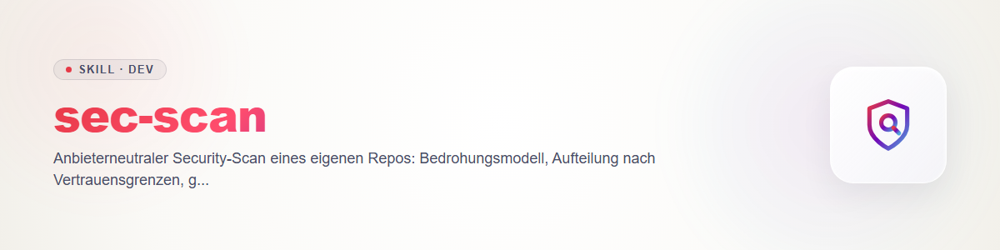

# sec-scan

Ядро семейства навыков безопасности ellmos. Общий контракт (фазы, файлы, жизненный цикл, серьёзность, правила, адаптеры) находится в `references/contract.md`, схемы - в `schemas/`, валидатор - в `scripts/secfind.py` + `scripts/seclib.py` (только стандартная библиотека). Этот навык ссылается на контракт и не повторяет его. Соседи: `sec-threat-model`, `sec-diff-scan`, `sec-validate`, `sec-triage`, `sec-report`.

## Режимы

- **standard:** один проход, одна модель, одна сессия.
- **deep:** несколько независимых проходов (иной порядок пакетов, иное разделение или иная модель), объединяются по `id`. Только после предупреждения о стоимости и подтверждения пользователя (контракт 6.5).

## Процедура

1. **Цель и область:** репозиторий, ref (SHA коммита или `working-tree`), исключённые пути. Присвоить `scanId`. Каталог сканирования называется `sec-scan-<scanId>/` (контракт 1), располагается в базовой папке **вне репозитория** и создаётся только после preflight.
2. **Preflight:**
   - Свой или разрешённый код? Иначе прервать (контракт 6.1).
   - Проверка блокировки для репозитория и базовой папки каталога сканирования: `python <lock_scan.py> --check-dir '<path>' --json`, код возврата сохранить сразу. 0 = свободно, 1 = заблокировано, всё остальное (сбой, нечитаемый вывод) = неизвестно = остановиться (контракт 6.2). Интерпретатор вызывать явно, скрипт никогда не «открывать». Если `lock_scan.py` на этом хосте отсутствует (нет системы блокировок ellmos), вместо этого искать `LOCK*.txt` в репозитории и его родительских папках: нет = свободно (отметить в отчёте), один или несколько = остановиться.
   - **Указать egress:** уходит ли код к провайдеру (размещённый слой ревью, сторонняя модель)? Приватные репозитории остаются в локальной сессии (контракт 6.6). **Указать стоимость**, а для `deep` дождаться подтверждения (6.5).
3. **Модель угроз:** есть ли актуальный `threatmodel.md`? Если нет, выполнить `sec-threat-model`.
4. **Сформировать пакеты:** разделить репозиторий по границам доверия и точкам входа из модели; для каждого пакета - файлы и исследовательские вопросы. Очень большие пакеты делить, а не читать поверхностно.
5. **Проверить каждый пакет** (source-to-sink: source -> преобразование -> sink, читая также защитные меры на пути):
   injection (SQL, shell, шаблоны, LDAP/NoSQL), authn/authz и разделение tenant'ов, секреты в коде, криптография (алгоритмы, случайность, обращение с ключами), небезопасная десериализация, доступ к путям/файлам (traversal, upload, symlinks), SSRF и open redirect, небезопасная конфигурация (debug, CORS, значения по умолчанию, права), использование заведомо уязвимых зависимостей (шаблоны в коде; сопоставление с advisory - задача `security-tech-stack-check`). Не фиксировать находки, которые путь не подтверждает; подозрение без доказательств относится в `coverage.limits`, а не в `findings`.
6. **Записать кандидата:** `rule` через точки в нижнем регистре (`py.sql-injection`), `cwe` там, где применимо, `severity` и `confidence` по контракту 3, `status: candidate`, `location`, `evidence` как цитата кода/трассы. **Маскировать секретные значения** (контракт 4). `id` всегда получать через `python scripts/secfind.py id RULE PATH -` (фрагмент через stdin), никогда не вручную.
7. **Сохранять честное покрытие:** `scanned` с глубиной `read` / `skimmed` / `pattern-only`, `notScanned` с причиной (сгенерировано, vendored, слишком велико, бинарное, недостижимо), `limits` для ограничений метода. `complete: true` только если `notScanned` пуст (контракт 5). `unknown` не означает «безопасно».
8. **Валидировать:** `python scripts/secfind.py validate findings.json coverage.json`, показать код возврата (0/1) и вывод. При ошибках исправить и повторить.
9. **Завершение:** число кандидатов по серьёзности, состояние покрытия, следующие шаги (`sec-validate`, затем `sec-triage`, `sec-report`). Частичное сканирование сообщается как частичное (контракт 6.9).

## deep

Не менее двух проходов с разным разделением, у каждого свой список кандидатов. Объединение по `id`: одинаковые `id` соединяются (добавить доказательства; при различии серьёзности взять более высокую и указать различие в `description`), новые `id` добавляются. Покрытие = объединение прочитанных путей; `provider.model` перечисляет все задействованные модели.

## Adapter

Готовый сканер провайдера может взять на себя часть сканирования (контракт 7): **Claude** `/claude-security`, **Codex** `codex-security`. У Gemini и Kimi его нет, они следуют процедуре выше.

1. Запустить сканер после preflight (шаг 2); прочитать его выходные файлы и сопоставить их поле за полем с `findings.json` / `coverage.json`. Файлы и поля сканера здесь не предполагаются; сопоставление строится при чтении реального вывода и отмечается в `coverage.limits`.
2. **Все находки начинаются как `candidate`**, даже если сканер сообщает их как подтверждённые. Адаптер никогда не пропускает валидацию.
3. `provider.name` / `provider.model` - после сканирования, `provider.engine` = имя сканера.
4. Покрытие брать из отчёта сканирования. Если его там нет, установить `complete: false` и добавить в `notScanned` запись «покрытие сканера неизвестно» (валидатор отклоняет `complete: false` без записи в `notScanned`; одного `limits` недостаточно).
5. Пересоздать `id` через `secfind.py id`, чтобы находки совпадали с находками других запусков. Затем шаг 8.

## Ограничения

Без патчей, без коммитов, без сетевых сканирований (контракт 6.1, 6.3). Без эксплойтов времени выполнения; воспроизведение - это `sec-validate`.

## Changelog

### 0.1.0 (2026-10-31)

- Первая версия: режимы standard/deep, preflight, пакеты, адаптер.
