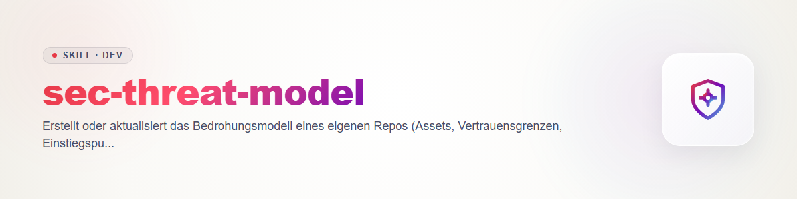

> **English** — Official English version of `sec-threat-model`.

# sec-threat-model

Phase 1 of the ellmos security family (`sec-threat-model`, `sec-scan`, `sec-diff-scan`, `sec-validate`, `sec-triage`, `sec-report`). Shared contract: `sec-scan/references/contract.md` (section 1 scan directory, section 6 rules). Not repeated here.

## Rules

- Own or explicitly authorised code only (contract 6.1). No network access to third-party systems, no port scans.
- The model is built from **source code that was read**, not from README claims. Whatever is only claimed there or cannot be evidenced goes in as `open`, never as fact.
- Write only into the scan directory (`<tmp>/ellmos-security/<repo>/sec-scan-<scanId>/`), never into the source tree. Check the lock before writing as described in `sec-scan` > Preflight.

## Procedure

1. **Clarify scope:** repo, ref (commit SHA or `working-tree`), excluded paths. Read an existing `threatmodel.md`; if there is one, switch to update mode: only carry changes forward and note state and ref.
2. **Read the structure:** manifests, build/deploy files, configuration, directory tree. Derive languages and frameworks from the code.
3. **Find entry points:** HTTP routes, CLI arguments, queue/webhook consumers, file and format parsers, IPC/sockets, scheduled jobs, environment variables, plugin/script loading points. For each: file:line and caller population (anonymous, authenticated, internal).
4. **Name assets:** secrets and tokens, personal data, user files, databases, compute, execution privileges, reputation/supply chain. Give the location in code, never the value.
5. **Draw trust boundaries:** where data moves from less to more trusted (network -> process, user -> admin, tenant -> tenant, process -> OS/shell/DB, third-party package -> own code). Where enforcement (authn/authz, validation, sandbox) sits in the code, or that it is missing.
6. **Sketch data flows:** source -> transformation -> sink for the most critical assets and entry points (text or Mermaid, short). Sinks: shell, SQL, filesystem, deserialisation, template, HTTP client, logs.
7. **Derive attacker goals:** per boundary, what an attacker wants (code execution, data exfiltration, privilege escalation, tampering, outage). STRIDE only as a thinking aid, not as a mandatory grid.
8. **Prioritise investigation questions:** concrete, checkable questions ("Does `user_id` from route X reach the query in `db.py` unchecked?"), ordered by impact times reachability. `sec-scan` turns them into investigation packages.

## Output: `threatmodel.md`

Sections in this order: **State** (repo, ref, date, paths read) · **Assets** · **Trust boundaries** · **Entry points** (table: path, type, caller, auth) · **Data flows** · **Attacker goals** · **Investigation questions** (numbered, prioritised) · **Open** (assumptions, unread areas, contradictions between docs and code). No secret values, no exploit instructions.

## Scope limits

Finds no vulnerabilities and assigns no severity. A model with many `open` entries is more honest than a smooth one.

## Changelog

### 0.1.0 (2026-10-31)

- First version as phase 1 of the security family.
