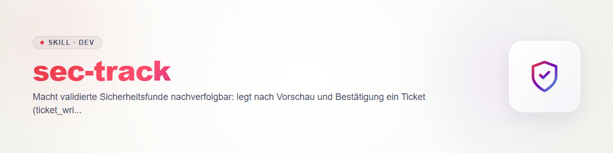

# sec-track - 所見を追跡可能にする

「track」フェーズ。コントラクト：`sec-scan/references/contract.md`（ルール 4 シークレット、ルール 8 チケットは §6。フィールド `ticket` は `schemas/finding.schema.json`）。status が `validated` 以降の所見のみが対象で、`candidate` は追跡しない。

## 宛先を選ぶ

| 宛先 | いつ | ツール |
|---|---|---|
| ユーザーのチケットシステムのチケット | 既定。非公開で、外部への影響なし | ticket-master の `ticket_writer.py` |
| GitHub issue | **プライベート**リポジトリ、またはエクスプロイト経路のない純粋な堅牢化上のギャップに限る | `gh issue create` |
| セキュリティアドバイザリのドラフト | **公開**リポジトリの脆弱性 | `gh api`（リポジトリのセキュリティアドバイザリ、ドラフト） |

**公開リポジトリ + 悪用可能な所見：公開 issue は決して作らない。** それは開示にあたる（外部送信、ルール 6）。その場合はアドバイザリのドラフトか非公開のチケットを使う。Linear も Jira も使わない。

## 手順

1. **選ぶ：** どの所見を、どの宛先に。1 件ずつ行い、一括チケットにはしない。そうすれば各 id が自分の参照を持つ。
2. **所見 id（`SEC-<12 hex>`）で重複を確認する：** `finding.ticket` はすでに設定されているか。チケットのディレクトリで id を検索する。GitHub では `gh issue list --state all --search "<id>"`。ヒットした場合は既存の参照を使い、新規には作らない。
3. **本文を起草する：** id、タイトル、rule/CWE、重大度、位置（`path:line`）、短い影響の説明、推奨対応、パッチファイルがあればそこへの案内。**シークレットの値は決して書かない**（ルール 4）：位置のみ。必要以上のエクスプロイトの詳細は書かない。
4. **プレビューを示し、確認を待つ。** それから初めて作成する。チケット、issue、アドバイザリは外部に影響するか、取り消せないため。
5. **作成する：**
   - チケット（ID は決して手で選ばない、ルール 8）：`python <ticket-master>/lib/ticket_writer.py --title "<SEC-id> <title>" --body "<text>" --project <project> --priority <level>`。この CLI は作成されたチケットファイルのパスを出力する。モジュールのドキュメントでは `--urgency` と書かれていることがあるが、CLI 自体が受け付けるのは `--priority`。使う前に `--help` を読む。
   - Issue：`gh issue create --repo <owner/repo> --title ... --body-file <file>`。
   - アドバイザリ：リポジトリのセキュリティアドバイザリ用の GitHub REST インターフェース（`gh api`）でドラフトを作る。使う前に正確なフィールドを GitHub のドキュメントで確認する（未解決。ここでは確定させない）。ドラフトのままにし、公開しない。
6. **参照を書き戻す：** `finding.ticket` = チケットのパス／id、`owner/repo#nr`、またはアドバイザリのリンク。その後 `python scripts/secfind.py validate findings.json coverage.json` を実行する（スクリプトは `sec-scan` にある）。

## 変更履歴

### 0.1.0 (2026-10-31)
- 初版。
