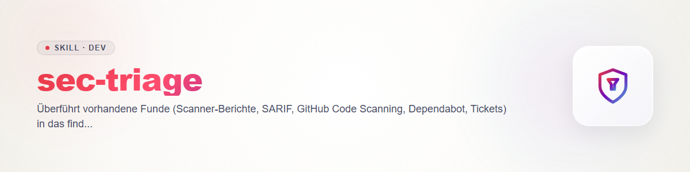

# sec-triage

Фаза 4 семейства навыков безопасности ellmos. Контракт: `sec-scan/references/contract.md` (файлы 1, жизненный цикл 2, серьёзность 3, id 4, правила 6). Валидатор: `sec-scan/scripts/secfind.py`. **Только статические доказательства:** без нового поиска (`sec-scan`), без валидации во время выполнения (`sec-validate`).

## Вход

Существующие находки: файлы SARIF или отчёты сканеров, GitHub code scanning и Dependabot (экспорт через `gh` или из веб-интерфейса; учитывать egress), тикеты, списки аудита. Если `findings.json` уже существует, он продолжается, иначе создаётся (каталог сканирования по контракту 1). Preflight как шаг 2 `sec-scan` (принадлежность, проверка блокировки fail-closed).

## Процедура

1. **Сопоставить:** одна запись на каждую исходную находку. Нормализовать `rule` к виду через точки в нижнем регистре (`py.sql-injection`; исходный идентификатор правила и источник указать в `description`), `cwe` - из тегов источника, `location` - из оповещения, `severity` сначала так, как её указывает источник, `status: candidate`.
2. **Закрепить доказательства:** фрагмент кода из оповещения, иначе прочитать место в указанном файле и процитировать. Если доказательства получить нельзя (файл отсутствует, строка сместилась, оповещение без кода), **не** импортировать находку с выдуманными доказательствами; перечислить её в `coverage.limits` как не импортированную, с причиной. Маскировать секретные значения (контракт 4). Для оповещений о зависимостях: `rule`, например, `dep.vulnerable-dependency`, `location` = строка манифеста/lockfile, `evidence` = эта строка; id advisory и затронутая версия - в `description`.
3. **Устранить дубликаты:** построить `id` через `python sec-scan/scripts/secfind.py id RULE PATH -`. Одинаковые `id` (в том числе из нескольких источников) объединяются в одну находку, источники перечисляются в `description`; при различии серьёзности взять более высокую и отметить это.
4. **Прочитать политику:** `SECURITY.md` (определения серьёзности, сроки, поддерживаемые версии, канал сообщений) и возможные решения проекта. Если её нет, действует контракт 3, и результат это указывает.
5. **Задать серьёзность и приоритет:** сверить серьёзность с политикой и скорректировать с указанием причины; приоритет вывести из серьёзности, экспозиции и сроков и записать в `priority` (`P0`-`P4`, P0 - самый срочный; уровни политики сопоставить с ним), причину указать в `description`.
6. **Статус:** по валидатору `triaged` требует `validatedBy.verdict == confirmed`. Уже валидированные находки (`validated`) становятся `triaged`. Импортированные, ещё не валидированные находки остаются `candidate` с заданными серьёзностью/приоритетом и передаются в `sec-validate`. Исключать только если политика это прямо предусматривает (например, неподдерживаемая версия): `rejected` с `rejectedReason`.
7. **Тикеты:** только если этого требуют пользователь или политика: `ticket_writer.py` (id никогда не выбирать вручную) или GitHub issue/черновик advisory; уязвимости в публичных репозиториях - как **приватный** черновик advisory, не как публичный issue. Записать ссылку в `ticket`. Без секретных значений в тикетах (контракт 6.4).
8. **Покрытие:** чистый импорт ничего не сканирует. `scanned: []`, `notScanned` с записью «import without own scan, repo not read» (то есть `complete: false`), `limits` с источниками, состоянием импорта и не импортированными находками. `provider.name` = источник (например, `github-code-scanning`), `model` = `n/a`, `engine` = инструмент-источник.
9. **Проверить:** `python sec-scan/scripts/secfind.py validate findings.json coverage.json`, показать код возврата. Затем `sec-validate` для кандидатов, `sec-report` для отчёта.

## Changelog

### 0.1.0 (2026-10-31)

- Первая версия: импорт, устранение дубликатов по id, триаж по политике.
