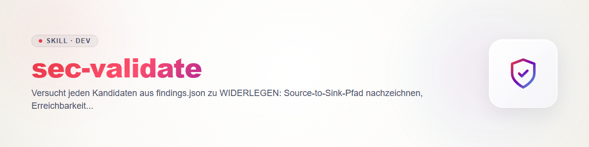

# sec-validate

Phase 3 der ellmos-Security-Familie. Vertrag: `sec-scan/references/contract.md` (Lebenszyklus 2, Severity 3, Regeln 6). Validator: `sec-scan/scripts/secfind.py`. Haltung: **Widerlegen, nicht Bestätigen.** Ein Kandidat gilt erst als `validated`, wenn der Widerlegungsversuch scheitert.

## Eingang und Unabhängigkeit

- Eingang: `findings.json` + `coverage.json` eines Scans, Kandidaten mit `status: candidate` (oder eine vom Nutzer genannte `id`-Auswahl).
- **Unabhängiger Prüfer (Vertrag 6.7):** bevorzugt anderer Anbieter als `provider.name` des Scans (Claude <-> Codex). Ohne einen: unabhängiger Subagent der höchsten Modellklasse, **ohne** die Begründung des Finders vorab zu lesen; im Ergebnis vermerken. Mehrere Anbieter oder Fan-out: erst Kosten schätzen und Nutzer warnen (6.5). Geht Code an einen Fremdanbieter, Egress ansagen (6.6).
- Preflight wie `sec-scan` Schritt 2 (Eigentum, Lock-Prüfung, fail-closed).

## Je Kandidat

1. **Neu lesen:** den Code an `location` selbst lesen, die `evidence` des Finders nur als Hinweis nutzen.
2. **Pfad nachzeichnen:** Quelle -> Transformationen -> Senke, jede Stufe mit Datei:Zeile. Bricht die Kette, ist das ein Widerlegungsgrund.
3. **Erreichbarkeit:** Welche Route, welcher Aufrufer, welche Authentifizierung führt dorthin? Totcode, Testcode, nur-Admin-Pfade und interne Aufrufer senken Schweregrad oder widerlegen.
4. **Gegenmaßnahmen suchen:** Validierung, Escaping, parametrisierte Abfragen, Framework-Schutz, Konfiguration, vorgeschaltete Prüfungen, Berechtigungen. Auch an anderer Stelle (Middleware, Wrapper).
5. **Voraussetzungen des Angreifers** benennen (anonym, Konto, lokaler Zugriff, bestimmte Konfiguration).
6. **Nachstellen, wenn gefahrlos möglich:** nur in einer lokalen Kopie oder Testumgebung, mit synthetischen Daten und Stub-Diensten; z. B. ein gezielter Unit-Test oder Aufruf der Funktion mit Angriffseingabe. **Nie** gegen fremde oder produktive Systeme, kein Netzzugriff nach außen, keine echten Geheimnisse, keine Zerstörung. Lässt sich nicht gefahrlos nachstellen: statische Argumentation genügt, Verdict `uncertain` ist dann erlaubt.
7. **Schweregrad kalibrieren** nach Vertrag 3 (Erreichbarkeit mal Auswirkung); `confidence` neu setzen. Änderung als "Severity alt -> neu: Grund" in `description`.
8. **Urteil schreiben:**

| Verdict | Folge in `findings.json` |
|---|---|
| `confirmed` | `status: validated`, `validatedBy: {provider, model, verdict: confirmed}`; Pfad und etwaiges Repro in `description`; `impact` und `recommendation` ergänzen |
| `refuted` | `status: rejected`, `rejectedReason` mit der konkreten Gegenmaßnahme bzw. dem Bruch in der Kette, `validatedBy.verdict: refuted` |
| `uncertain` | `status` bleibt `candidate`, `validatedBy.verdict: uncertain`, in `description` steht, was fehlt, um zu entscheiden |

`validatedBy.provider` / `.model` sind der **Prüfer**, nicht der Finder. Gleicher Anbieter wie der Finder erzeugt die Validator-Warnung "validated by the same provider"; sie bleibt sichtbar und wird nicht unterdrückt.

## Abschluss

`python sec-scan/scripts/secfind.py validate findings.json coverage.json`, Exitcode zeigen. Zusammenfassung: Zahl je Verdict, Severity-Änderungen, offene `uncertain`. Weiter mit `sec-triage` (validierte Funde) und `sec-report`. Keine Geheimniswerte in `description` oder Repro-Ausgabe (Vertrag 6.4). Kein Patchen, kein Commit.

## Changelog

### 0.1.0 (2026-10-31)

- Erstfassung: Widerlegungsverfahren, Verdict-Abbildung, Unabhängigkeit.
