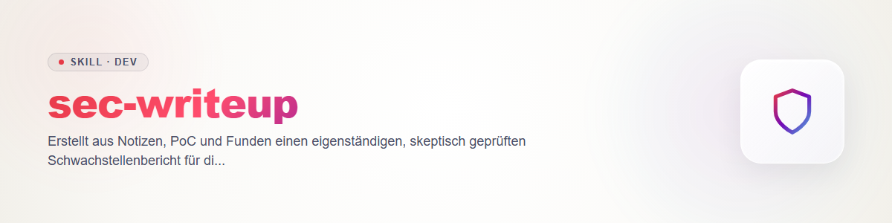

# sec-writeup - Schwachstellenbericht zur Offenlegung

Ein Bericht, der ohne Vorwissen lesbar ist und von jemandem nachvollzogen werden kann, der die Lücke nicht kennt. Vertrag: `sec-scan/references/contract.md` (Regel 1 eigener Code, Regel 4 Geheimnisse, Regel 6 Egress, Regel 9 ehrlich berichten).

## Ablauf

1. **Rohmaterial sammeln:** Fund (`findings.json`), Notizen, PoC, Patch. Nur Schwachstellen in eigenem oder ausdrücklich autorisiertem Code (Regel 1).
2. **Skeptisch prüfen, bevor geschrieben wird:** jede Kernbehauptung ("ohne Authentifizierung erreichbar", "Remote Code Execution", "betrifft alle Versionen") selbst zu widerlegen versuchen. Danach je Behauptung: **belegt** (mit Evidenz: Codestelle, Testausgabe, Commit) oder **ungeprüft** (so im Text markiert). Severity nur nach der Skala des Vertrags (§3); eine CVSS-Zahl oder CVE-Kennung nur, wenn der Nutzer sie vorgibt - keine erfinden.
3. **Betroffene Versionen aus der Historie ermitteln** (Einführung per `git log -S`/`git blame`, Behebung per Commit/Tag), nicht schätzen; unsichere Grenze als offen angeben.
4. **Bericht gliedern:** Zusammenfassung (2-3 Sätze) · Betroffene Komponente und Versionen · Voraussetzungen des Angreifers · Reproduktionsschritte · Auswirkung (konkret, ohne Übertreibung) · Fix/Workaround · Zeitleiste · Danksagung/Kontakt.
5. **PoC minimal:** nur so viel, dass der Maintainer die Lücke reproduzieren kann (Eingabe + erwartetes Fehlverhalten). Kein einsatzfähiger Exploit, keine Zielsysteme, keine Persistenz. Im Zweifel beschreiben statt Code beilegen.
6. **Schwärzen:** Geheimnisse, Hostnamen, interne Pfade und Personendaten entfernen; Funde zeigen nur den Ort, nie den Wert (Regel 4). Ein offengelegtes Geheimnis wird beim Anbieter rotiert.
7. **Zeitleiste nur mit echten Daten** (Entdeckung, Meldung, Bestätigung, Fix). Offenlegungsfrist vom Nutzer bzw. der `SECURITY.md` (`sec-policy`), nicht vom Skill.
8. **Zustellung:** Entwurf liegt beim Nutzer. Der Versand (E-Mail, Advisory, Plattform) ist Außenwirkung und braucht dessen ausdrückliche Freigabe (Regel 6); bei öffentlichen Repos bevorzugt Draft-Advisory/privater Meldeweg.

## Changelog

### 0.1.0 (2026-10-31)
- Erstfassung.
