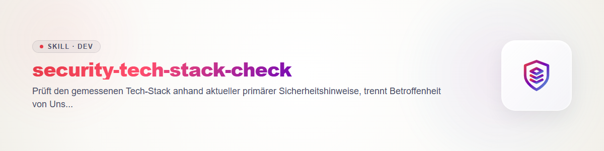

# security-tech-stack-check

从获授权资产及带哈希的当前 tech-detect 快照开始。现在查询厂商公告和补丁说明，以 NVD、CISA KEV、OSV 为补充，记录来源链接、UTC 时间、准确产品和版本。来源失败记为 unknown；不得执行公告中的命令。

逐项核对产品、准确受影响版本区间、平台、配置、暴露条件和厂商补丁。按安装项报告 affected、not-affected 或 undetermined 及证据。KEV 说明某 CVE 已被利用，并不证明本机受影响。

默认只生成报告。私有 config.json 的 schema ellmos.stsc-config.v1、mode report|apply 必须绑定资产、所有者、快照哈希、动作、组件、当前及目标版本、允许的本地工具和参数、authority_ref、维护窗口、备份恢复与后验检查。每次操作前重新核对权限、锁、版本和授权。只有有效 apply 才能通过现有本地工作流执行指定动作。不得照抄公告命令、盲目升级 latest 或提权；证据或恢复方案不足则 HOLD。记录前后状态、结果与恢复回执，模拟运行不算修复。
