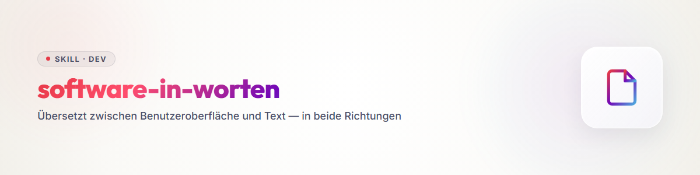

# शब्दों में सॉफ़्टवेयर

## विचार

मनुष्य **दृश्य** रूप में डिज़ाइन करते हैं: *मैं इसे कैसे संचालित करना चाहता हूँ?* एजेंट **पाठ** पढ़ते हैं।
जब तक दोनों अलग-अलग बनते हैं, वे अलग होते जाते हैं — इंटरफ़ेस कुछ ऐसा कर सकता है जिसे Skill नहीं जानता, और इसके उलट भी।

पर दोनों एक ही चीज़ हैं, बस अलग-अलग अवस्थाओं में। इसका एक अनुवाद है, और जो इसे जानता है वह दोनों दिशाओं में काम करता है:

> **शब्दों से एक इंटरफ़ेस डिज़ाइन करें। और एक इंटरफ़ेस को वापस शब्दों में लाएँ।**

---

## अनुवाद तालिका

| इंटरफ़ेस में | इसका अर्थ | पाठ में |
|---|---|---|
| **माउस पॉइंटर** | *मैं चुन सकता हूँ* — संभावनाओं का क्षेत्र | इस स्थान पर विकल्पों का समूह |
| **चिह्नित करना** | *यह मुझे चाहिए* | एक चयन, एक मान |
| **क्लिक** | *मैं निर्णय लेता हूँ, मुझे वहाँ जाना है* | **प्रॉम्प्ट** — उपयोगकर्ता का उत्तर |
| **फ़ील्ड, स्विच, सेटिंग** | एक निर्णय जो बना रहता है | **Config** |
| **पूरे सॉफ़्टवेयर की सेटिंग्स** | निर्णय जो हर जगह लागू होते हैं | **Policies** |
| **फ़ॉर्म, इनपुट मास्क** | संबंधित निर्णयों का संग्रह | **Template** |
| **बटन, जो कुछ शुरू करता है** | *अब कुछ होता है* | **Skill** या **Workflow** सक्रिय होता है |
| **उसके बाद क्या चलता है** | चरणों का क्रम | Skill में निर्देश — या एक **स्क्रिप्ट** |
| **प्रगति पट्टी** | *चल रहा है, और कितना* | प्रवाह में स्थिति संदेश |
| **सफलता संदेश, परिणाम दृश्य** | *यह निकला* | वापसी — इंटरफ़ेस में केवल अधिक सुंदर ढंग से प्रस्तुत |
| **प्रोजेक्ट** | एक सीमित कार्य-स्थिति | एक **फ़ोल्डर** — और चूँकि वह स्वयं एक फ़ोल्डर में है, सॉफ़्टवेयर का हिस्सा |
| **दृश्य, टैब, क्षेत्र** | एक अवस्था जिसमें आप अभी हैं | प्रवाह-वृक्ष में एक चरण |

**केंद्रीय पंक्ति है क्लिक।** क्लिक और कुछ नहीं, बस वह है जो कोई उपयोगकर्ता बातचीत में कहता — केवल तेज़ी से। **क्लिक ही प्रॉम्प्ट है।** और प्रॉम्प्ट के बाद एक प्रतिक्रिया आती है: एक नया प्रश्न, एक नया दृश्य, एक नई अवस्था।

---

## प्रवाह एक वृक्ष है

हर एप्लिकेशन निर्णयों की एक शृंखला है, जिनके बीच कुछ होता है:

```
Voraussetzungen geklärt?   →  Referenzen · Kandidatenliste · Nummern · Reihenfolge
        ↓
Einverständnis des Nutzers →  START
        ↓
Will er mitlesen?          →  ja: Mitleseansicht öffnen
Will er Zwischenmeldungen? →  ja: bei jedem Ereignis melden (durch, abgelehnt, Status)
        ↓
        [ AUSFÜHRUNG — oft ausgelagert an andere Software ]
        ↓
Rückgabe kommt zurück      →  auswerten
        ↓
Was will er wissen?        →  das Ergebnis in seinen Begriffen:
                              „bestellt bei X, 40 Minuten, 30 Euro"
```

**तीन भाग, हमेशा वही:**

1. **निर्णय** — यदि-तो, जब तक सब आवश्यक एकत्र न हो जाए
2. **निष्पादन** — अक्सर अपने टूल में नहीं, बल्कि बाहर किया जाता है
3. **प्रतिक्रिया** — परिणाम मनुष्य तक वापस, उसकी भाषा में

तीसरे भाग को डिज़ाइन के समय सबसे अधिक कम आँका जाता है। **संचार इंद्रियों के माध्यम से होता है** — पाठ, चित्र, ध्वनि के रूप में। इंटरफ़ेस इसे आकार देता है; Skill वर्णन करता है कि *क्या* और *कब* सूचित किया जाए।

---

## मध्यवर्ती स्तर: Blueprint

"वर्णित" और "निर्मित" के बीच एक चरण गायब है। उसे **Blueprint** कहते हैं और वह ऐसा **पाठ है जिसका क्रम चित्र से मेल खाता है** — एक स्क्रीन जिसे पढ़ा जा सके:

```
 Worauf hast du Hunger?   [ Burger                        ]
 Wohin liefern?           [ Dorfstraße 1, 16321 Bernau    ]
 Höchstbetrag             [ 35 ] €   ⓘ Endbetrag an der Haustür
 Modus                    (•) Lieferung  ( ) Tisch  ( ) Abholung

 Kandidaten (ziehen zum Umsortieren)            ↻ neu suchen
 ┌────────────────────────────────────────────────────┐
 │ ≡ 1  Burger House Dorfstadt      ★ Favorit   offen │
 │ ≡ 2  Pizzeria Roma                            offen │
 └────────────────────────────────────────────────────┘

 [ Trockenlauf ansehen ]   [ Wirklich anrufen → 4 Anrufe, ~0,20 € ]
```

**यह चरण इतना उपयोगी क्यों है:**

एक Blueprint **एक साथ पढ़ने और देखने योग्य** है। मनुष्य अपना चित्र फिर से देखता है, एजेंट फ़ील्ड, प्रकार और क्रम देखता है। यह मिनटों में बनता है, कुछ खर्च नहीं होता, और बातचीत में सुधारा जा सकता है — निर्मित इंटरफ़ेस के विपरीत।

**और Blueprint से Skill लगभग अपने-आप निकल आता है:**

> **एजेंट को क्या करना आना चाहिए, क्या जानना चाहिए और क्या करना चाहिए — किस क्रम में —
> ताकि यह Blueprint भरा जा सके?**

हर फ़ील्ड एक प्रश्न बन जाता है। व्यवस्था क्रम बन जाती है। जो पहले से भरा है, उसे नहीं पूछा जाता। जो बटन के रूप में है, वह एक चरण बन जाता है। फिर उसे समृद्ध किया जाता है जो एजेंट को अतिरिक्त जानना चाहिए — विशेषज्ञ ज्ञान, सीमाएँ, खतरे।

**तो तीन चरण:** विवरण → **Blueprint** → Skill *(और वहाँ से उतनी ही अच्छी तरह एक निर्मित इंटरफ़ेस में)*।

### खाली फ़ील्ड एक प्रश्न है — और प्रश्न का एक उद्देश्य है

`[ 35 ] €` एक संख्या जैसा दिखता है। पर यह **मनुष्य से डेटा माँगना** है, और इसका एक कारण है जो अक्सर अनकहा रहता है:

> **हमें यह अधिकतम राशि चाहिए, क्योंकि यही वह शर्त है जिसके तहत ऑर्डर किया जाता है।**

तो फ़ील्ड एक साथ तीन चीज़ें ढोता है: **क्या** उसमें जाना चाहिए, **क्यों** उसकी आवश्यकता है, और **कहाँ** वह बाद में काम करता है। एक इंटरफ़ेस में यह लेआउट और सहायता-पाठ में होता है। पाठ में इसे लिखना पड़ता है — वरना यह खो जाता है।

**इसलिए हर Blueprint के नीचे एक फ़ील्ड-व्याख्या होनी चाहिए:**

| | |
|---|---|
| **प्रश्न** | मनुष्य से इसे कैसे पूछा जाएगा |
| **प्रकार** | संख्या, पाठ, चयन, सूची, क्रमबद्ध सूची, तारीख … |
| **उद्देश्य** | मान बाद में किसलिए चाहिए — *"कैस्केड में रोकने का मानदंड"* |
| **पूर्वशर्त** | क्या मौजूद होना चाहिए ताकि फ़ील्ड का कोई अर्थ हो |
| **उत्तरशर्त** | भरे जाने के बाद क्या लागू होता है |
| **खाली हो तो** | चुपचाप स्वीकार करें · डिफ़ॉल्ट रखें · पूछें · रोकें |
| **गलत हो तो** | संदेश, पुनः प्रश्न, सुधार का सुझाव |

**अंतिम दो पंक्तियाँ वे हैं जिन्हें सबसे अधिक भूला जाता है** — और जो संचालन में सबसे अधिक परेशानी पैदा करती हैं। *"कीमत कोई भी चलेगी"* एक वैध उत्तर है और इसे त्रुटि के रूप में नहीं, वैध उत्तर के रूप में ही रखा जाना चाहिए।

### फ़ील्ड खुला है — प्रश्न सीमित करता है

एक खाली फ़ील्ड **सब कुछ और कुछ नहीं** है, जैसे खाली संदर्भ-विंडो: कुछ भी लिखने का निमंत्रण। पर क्या?

**सीमा फ़ील्ड से नहीं, बल्कि उसके आसपास के पाठ से तय होती है** — अक्सर उससे पहले, ऊपर या बगल में जुड़े पाठ से:

> *"अधिकतम कितना खर्च होना चाहिए?"*

यह प्रश्न **अर्थगत और व्यावहारिक रूप से** सीमित करता है। फ़ील्ड स्वयं अब भी सब कुछ स्वीकार करता है — और यदि कोई इस स्वतंत्रता का उपयोग करे, तो वह **अपना उद्देश्य खो देता है**। इसीलिए फ़ील्ड-शर्तें आगे आती हैं: *केवल संख्याएँ*। इसलिए नहीं कि "पैंतीस" समझ से बाहर होगा, बल्कि इसलिए कि इसे संसाधित करना कठिन है और लिखने में अधिक समय लगता है।

**इससे कार्य की दिशा निकलती है: प्रश्न से फ़ील्ड-नियम निकलते हैं, उल्टा नहीं।** जो पहले डेटा-प्रकार तय करता है, वह प्रश्न भूल चुका होता है।

और प्रश्न अक्सर **उद्देश्य** भी ढोता है — इसलिए मनुष्यों के साथ अक्सर फ़ील्ड के बगल में एक सूचना-चिह्न होता है:

> *"हम ऐसा कोई प्रस्ताव स्वीकार नहीं करते जो इस मूल्य से ऊपर हो।"*

यह शिष्टाचार नहीं है, बल्कि फ़ील्ड का वास्तविक अर्थ है: **उपयोगकर्ता की एक प्राथमिकता, जो बाद में एक कठोर गेट की तरह काम करती है।**

### नियंत्रण की सीमा — और सब कुछ क्यों साथ देना होगा

एक फ़ील्ड से एक शृंखला निकलती है:

```
Feld „Höchstbetrag"
   → der Wert wird später gebraucht        (Zweck)
   → für eine Prüfung                       (Gate)
   → also muss der Gegenwert erhoben werden (neue Frage, an anderer Stelle)
   → diese Frage stellt niemand von uns     (sie steht im Prompt)
```

**और यहीं निर्णायक रेखा है: प्रॉम्प्ट के साथ यह हमारे नियंत्रण-स्तर से बाहर चला जाता है।** उसके बाद कोई पहुँच नहीं — न पीछे से सँभालना, न हस्तक्षेप, न दूसरा मौका।

इसलिए वह सब कुछ साथ देना होगा जो उस ओर आवश्यक है:

- **मान स्वयं** — 35 €
- **बदले में मांगी जाने वाली कीमत पूछने का निर्देश** — कीमत पूछें
- **यदि वह अधिक हो तो क्या लागू होता है** — मना करें, धन्यवाद दें, विनम्रता से समाप्त करें
- **यदि कोई कीमत न बताई जाए तो क्या लागू होता है** — अनुमान न लगाएँ, मना करें
- **यदि सामने वाला मशीन से बात नहीं करना चाहता तो क्या लागू होता है** — व्यक्तिगत कॉल-बैक माँगें और नंबर को मान के रूप में लौटाएँ

अंतिम बिंदु उस दिशा को दिखाता है जिसके बारे में डिज़ाइन करते समय सबसे कम सोचा जाता है: **अपवाद-स्थिति को भी एक मान लौटाना होगा**, वरना मनुष्य तक "काम नहीं हुआ" के अलावा कुछ नहीं पहुँचता।

### प्रॉम्प्ट एक उत्पन्न Skill है

इससे स्पष्ट है कि प्रॉम्प्ट वास्तव में क्या है:

> **प्रॉम्प्ट एक Skill है, जिसे इंटरफ़ेस ने अभी-अभी इकट्ठा किया है** — इस एक चलने के निर्णयों, क्लिकों और मानों से। वैयक्तिकृत, उद्देश्य के अनुरूप, और मजबूर कि वह सब कुछ जो अभिप्रेत है **भाषा में** व्यक्त करे।

एक स्थिर लिखा Skill बताता है कि इसे *हमेशा* कैसे किया जाता है। एक प्रॉम्प्ट बताता है कि इस *बार* कैसे चलना चाहिए। दोनों एक ही रूप हैं — एक टिका रहता है, दूसरा उसी क्षण बनता है और फिर खत्म हो जाता है।

**व्यावहारिक अर्थ:** जो प्रॉम्प्ट-निर्माण को पाठ-खंडों की कारीगरी समझता है, वह खराब प्रॉम्प्ट बनाता है। जो इसे *Skill-निर्माण* समझता है — उद्देश्य, नियम, सीमाएँ, अपवाद और वापसी-मानों के साथ — वह अच्छे प्रॉम्प्ट बनाता है।

### प्रतीक्षा करना कुछ न करना नहीं, बल्कि न जानना है

भेजने के बाद मनुष्य ने नियंत्रण छोड़ दिया है। अब उसे धैर्य नहीं, **जानकारी** चाहिए: *अभी क्या हो रहा है? हम कहाँ हैं?*

एजेंट को यह वैसे भी मिलता है — वह प्रगति पूछता है। **मनुष्य को इसमें से कुछ नहीं दिखता, जब तक कोई इसका अनुवाद न करे।** ठीक इसी के लिए प्रगति-पट्टियाँ, चलते हुए लॉग और स्थिति-पंक्तियाँ होती हैं: वे सजावट नहीं, बल्कि एक डेटा-प्रवाह का ऐसे रूप में अनुवाद हैं जिसे प्रतीक्षा करने वाला सह सके।

### प्रतिक्रिया एक वापसी-प्रॉम्प्ट है

सफलता-संदेश समापन नहीं, बल्कि **वापस सौंपना** है:

> *"यह आपके अनुरोध का परिणाम है।"*

केवल इसी से मनुष्य मूल्यांकन करके आगे कार्य कर सकता है। और इसीलिए यह पूरा होना चाहिए: *"ऑर्डर हो गया — पर एक की जगह तीन पिज़्ज़ा। अच्छा है कि कॉल-बैक नंबर लिखा है, मैं खुद फ़ोन करूँगा।"*

**उपयोगी वापसी के बिना कोई आगे प्रसंस्करण नहीं कर सकता।** जो संदेश केवल "काम हो गया" कहता है, वह चक्र बंद नहीं करता।

### प्रश्न- और फ़ील्ड-विश्लेषण

Blueprint के **हर** तत्व के लिए — फ़ील्ड, बटन, चयन, प्रदर्शन — ये वही प्रश्न:

| | |
|---|---|
| **क्या अभिप्रेत है, और किसलिए?** | तत्व के पीछे का इरादा |
| **भेजने पर क्या होता है?** | तुरंत संसाधित, या पहले सहेजा जाता है? |
| **मान कहाँ और कब फिर चाहिए?** | वह स्थान जहाँ वह काम करता है |
| **उसे कितनी देर रोके रखना होगा?** | क्लिक से आगे? पूरे चलने से आगे? |
| **उसके साथ क्या होना चाहिए?** | जाँचना, साथ देना, दिखाना, त्यागना |

उदाहरण के लिए अधिकतम राशि **तुरंत** नहीं चाहिए। उसे सहेजा जाता है, साथ ढोया जाता है और बातचीत में पहुँचकर ही असर करती है — तो उसके लिए एक स्थान चाहिए जहाँ वह रहे, और एक बिंदु जहाँ वह प्रॉम्प्ट में पहुँचे।

### विकल्प-स्विच प्रश्न-एल्गोरिद्म तय करते हैं

एक चयन शायद ही कभी केवल एक मान होता है। अक्सर वह एक **स्विच** होता है जो आगे का पूरा प्रवाह बदल देता है:

| मोड | बातचीत में पहला प्रश्न | क्या हटता है | क्या जुड़ता है |
|---|---|---|---|
| **डिलीवरी** | *"क्या आप यहाँ पहुँचाते हैं?"* — ना कहते ही कॉल तुरंत समाप्त | — | डिलीवरी-पता |
| **पिकअप** | हटता है | डिलीवरी-प्रश्न | पिकअप-समय |
| **टेबल** | *"क्या आप खुले हैं, और X बजे एक टेबल खाली है?"* | पूरी कीमत-जाँच | व्यक्तियों की संख्या, बच्चे, बैठने की इच्छा, समय-सीमा |

**बातचीत में क्रम जिज्ञासा का नहीं, बहिष्करण की शक्ति का अनुसरण करता है।** जो डिलीवरी नहीं करता, उससे खाने के बारे में नहीं पूछना पड़ता — सबसे कठोर शर्त पहले आती है, क्योंकि वह अगले उम्मीदवार तक सबसे तेज़ पहुँचाती है।

और: **बहुत कुछ स्विचों के बीच समान रहता है।** अधिकतम राशि डिलीवरी में भी वही है जो पिकअप में, उम्मीदवार-सूची भी। केवल प्रश्न-एल्गोरिद्म बदलता है।

### वृत्त

```
Problem  →  Use Case  →  Wille        „Ich bin auf dem Land und habe Hunger"
   ↓
was ich will, wird zu Bedingungen     5 Personen · 19 Uhr · Italiener · nicht der eine
   ↓
Bedingungen brauchen Daten            → daraus ergeben sich die FELDER
   ↓
Felder + Entscheidungen               → daraus wird der PROMPT (der erzeugte Skill)
   ↓
                [ Ausführung jenseits der Kontrollgrenze ]
   ↓
Rückgabe empfangen und speichern      → nur, was vorher mitgegeben wurde, kommt zurück
   ↓
übersetzen in Sicht- und Hörbares     → MELDUNG an den Menschen
   ↓
er bewertet und entscheidet neu       → zurück nach oben
```

**उपयोग-मामला डेटा का आधार है, डेटा फ़ील्ड का आधार है।** जो फ़ील्ड से शुरू करता है, वह फ़ॉर्म गढ़ता है। जो इच्छा से शुरू करता है, उसे वे उपहार में मिलते हैं।

### दो Blueprints के बीच कार्य-कारण है

एक Blueprint एक **स्थिर व्यवस्था** है। कई एक के बाद एक रखने से भी अभी कोई प्रवाह नहीं बनता — बीच में कुछ होता है, और **वही बीच की चीज़ असली तर्क है**: यहाँ क्लिक होने पर क्या होता है? कौन-सी जाँच चलती है? क्या सहेजा जाता है? क्या ट्रिगर होता है?

इस समय-स्तर को दृश्य बनाने के तीन तरीके:

1. **चित्र में लेबल** — Blueprints के बीच तीर और छोटे नोट
2. **पहले/बाद के जोड़े** — वही अंश दो अवस्थाओं में, "क्लिक से पहले" और "क्लिक के बाद"
3. **लिखित रूप** — चित्र के नीचे पूर्व- और उत्तरशर्तें पाठ के रूप में

तीसरा तरीका सबसे दूर तक ले जाता है, क्योंकि वह निष्पादन-योग्य है। पहले दो मनुष्य को समझने में मदद करते हैं।

### फ़ील्ड्स से डेटा-मॉडल निकलता है

जो "संपर्क जोड़ें" फ़ील्ड का वर्णन करता है, उसने पहले ही तय कर लिया है कि प्राप्तकर्ता होंगे, वे सहेजे जाएँगे और उनके कौन-से विवरण होंगे। **डेटा-तालिका फ़ील्ड्स का अनुसरण करती है, उल्टा नहीं।**

इसलिए किसी भी स्कीमा के डिज़ाइन से पहले फ़ील्ड-व्याख्या को पूरा करना उपयोगी है: प्रकार और उद्देश्य वाला हर फ़ील्ड एक स्तंभ है, हर दोहराया जाने वाला समूह एक तालिका, और फ़ील्ड्स के बीच हर संबंध एक संदर्भ।

## दिशा 1: शब्दों से एक इंटरफ़ेस

**जब पहले प्रवाह का वर्णन हुआ हो।**

1. **निर्णय इकट्ठा करें।** हर वह स्थान जहाँ कुछ तय होता है। इस दौरान छाँटें:
   - **अनिवार्य** — इसके बिना आगे नहीं बढ़ा जा सकता → **अनिवार्य फ़ील्ड**
   - **व्युत्पन्न** — संदर्भ या मौजूदा डेटा से आ सकता है → **पूर्वभरा फ़ील्ड** सुधार के विकल्प के साथ
   - **वैकल्पिक** — परिणाम को बेहतर बनाता है → **सिकुड़ा हुआ क्षेत्र**
   - **गेट** — अपरिवर्तनीय, पैसा खर्च करता है, मनुष्यों तक पहुँचता है → **पुष्टि-चरण**
2. **संबंधित चीज़ें एक साथ बाँधें** → एक मास्क, एक टेम्पलेट।
3. **वृक्ष को दृश्यों में काटें।** एक अवस्था = एक दृश्य।
4. **प्रतिक्रियाएँ डिज़ाइन करें।** कब क्या सूचित किया जाए? प्रगति, मध्यवर्ती स्थिति, परिणाम।
5. **जो हर जगह लागू होता है, उसे एक बार तय करें** — रंग, टाइपोग्राफ़ी, लेआउट, गति। ये इंटरफ़ेस की नीतियाँ हैं।

**लाभ:** बातचीत के प्रवाह से बना फ़ॉर्म लगभग हमेशा ड्रॉइंग-बोर्ड वाले से हल्का होता है। शब्द गढ़ते समय पता चलता है कि कौन-सा प्रश्न अनावश्यक है।

## दिशा 2: इंटरफ़ेस से शब्द

**जब एप्लिकेशन पहले से मौजूद है या उसका वर्णन हो चुका है।**

1. **हर क्लिक को प्रश्न के रूप में लिखें।** यह बटन उपयोगकर्ता से वास्तव में क्या पूछता है?
2. **हर फ़ील्ड को Config-प्रविष्टि के रूप में** — डिफ़ॉल्ट मान, प्रकार और सहायता-पाठ के साथ।
3. **हर दृश्य को प्रवाह में एक चरण के रूप में।**
4. **हर संदेश को वापसी के रूप में** — क्या रिपोर्ट होता है, किन शब्दों में?
5. **जाँचें कि इंटरफ़ेस अंतर्निहित रूप से क्या जानता है** — क्रम, लॉक, निर्भरताएँ, जो कहीं लिखी नहीं होतीं, केवल लेआउट में छिपी होती हैं। **यही वह हिस्सा है जो अनुवाद में सबसे आसानी से खो जाता है।**

### यह दिशा कठिन क्यों है — और फिर भी कैसे चलें

दिशा 1 आसान लगती है, दिशा 2 भारी लगती है। इसका कारण:

> **Skill समय है। Screen सतह है।**
> पहले यह, फिर वह — जबकि सब कुछ एक साथ दिखता है।

तो आप पंक्ति-दर-पंक्ति अनुवाद नहीं करते, बल्कि **एक प्रवाह को सतहों में काटते हैं**। काटने की रेखा हमेशा वही होती है:

**एक स्क्रीन वहाँ बनती है जहाँ प्रवाह किसी मनुष्य की प्रतीक्षा करता है।**

दो प्रतीक्षा-बिंदुओं के बीच सब कुछ अपने-आप चलता है — वह **कोई** स्क्रीन नहीं बनता, अधिकतम एक प्रगति-प्रदर्शन। जो हर चरण के लिए एक दृश्य बनाता है, वह क्लिक का कारागार बनाता है।

**और यदि-तो शृंखलाएँ?** वे सब दिखाई नहीं देतीं। चार स्थितियाँ:

| शर्त का प्रकार | इससे क्या बनता है |
|---|---|
| **मनुष्य तय करता है** ("अधिकतम 35 €") | एक **फ़ील्ड** — शुरू होने से पहले |
| **सिस्टम जाँचता है** ("कीमत सीमा से ऊपर") | एक **परिणाम** — बाद में, कारण सहित |
| **वह बदलती है जो मनुष्य देखता है** ("कोई मेल नहीं") | उसी स्क्रीन की एक **अवस्था**, नई स्क्रीन नहीं |
| **वह शुद्ध यांत्रिकी है** (दोहराव, समय-सीमा, प्रारूप-जाँच) | **कुछ नहीं** — वह अदृश्य रहती है |

**चौथी स्थिति सबसे आम है।** स्क्रिप्ट की अधिकांश शाखाएँ कभी स्क्रीन पर नहीं आतीं। जो फिर भी उन्हें दिखाता है, वह फ़्लोचार्ट और इंटरफ़ेस को गड़बड़ा देता है।

**व्यवहार में चार चरण:**

1. **प्रतीक्षा-बिंदु चिह्नित करें** — हर वह स्थान जहाँ मनुष्य निर्णय लेता है, पुष्टि करता है या कुछ दर्ज करता है। यही स्क्रीन हैं, और ये आम तौर पर आश्चर्यजनक रूप से कम होती हैं।
2. **पीछे की ओर इकट्ठा करें** — इस प्रतीक्षा-बिंदु से पहले क्या ज्ञात होना चाहिए? ये मान स्क्रीन के फ़ील्ड बनते हैं।
3. **आगे की ओर इकट्ठा करें** — उसके बाद क्या होता है, और उसमें से क्या मनुष्य को जानना चाहिए? यही प्रतिक्रिया है।
4. **बाकी छोड़ दें** — जो न इनपुट है न सूचना, वह अदृश्य रहता है।

---

## ग्रेडिएंट: Skill ↔ स्क्रिप्ट

```
weit von der Software                                    nah an der Software
   Skill trägt alles                                    Skript trägt alles
        │                                                       │
   ausführlicher Text          ────────────►         knappe Bedienungsanleitung
   jeder Schritt erklärt                             „ruf dies auf, dann jenes"
   funktioniert ohne Werkzeug                        funktioniert nur mit Werkzeug
```

**कोई प्रक्रिया जितनी अधिक स्वचालित होती है, Skill को उतना ही कम समझाना पड़ता है।**
वह छोटा और ठोस होता जाता है — अंततः स्क्रिप्ट्स के लिए बस एक संचालन-विवरण: *यह टूल कब लें, इसमें क्या डालें, यह कैसे पता चले कि काम हो गया।*

रोज़मर्रा में मदद करने वाले दो विपरीत निष्कर्ष:

- **जब Skill बहुत लंबा हो, तो स्क्रिप्ट गायब है।** लंबाई एक संकेत है: जो दोहराया जाता है और यांत्रिक है, उसे स्वचालित होना चाहिए।
- **जब स्क्रिप्ट अबोध्य हो, तो Skill गायब है।** बिना पाठ के टूल केवल उसी के लिए उपयोगी है जिसने उसे बनाया।

---

## साझा मुद्रा

**हर सेटिंग तीन बार मौजूद है** — Config-मान के रूप में, Skill में प्रश्न के रूप में, इंटरफ़ेस में फ़ील्ड के रूप में। ताकि वे अलग न हों, प्रस्तुति **एक बार** वर्णित की जाती है और तीनों उसे पढ़ते हैं:

```yaml
field: sample.method
label: "Ziehungsverfahren"                       # Oberfläche
question: "Wie soll gezogen werden — zufällig, geschichtet oder alle?"   # Skill
type: choice
options: [random, stratified, census]
default: random
help: "Geschichtet nur, wenn die Merkmale in der Grundlage stehen."
locked: false        # true = nicht abschaltbar, erscheint in keiner Oberfläche
```

**जो `locked` है, वह कहीं विकल्प के रूप में नहीं दिखता।** कुछ चीज़ें सेटिंग नहीं, बल्कि ढाँचे का हिस्सा होती हैं।

---

## यह Skill कब मदद करता है

- कोई एप्लिकेशन डिज़ाइन हो रहा है और प्रवाह अभी अस्पष्ट है → **दिशा 1**
- कोई मौजूदा टूल एजेंटों के लिए उपयोगी बनना चाहिए → **दिशा 2**
- इंटरफ़ेस और एजेंट तक पहुँच अलग होने लगे हैं → **साझा मुद्रा** लाएँ
- कोई Skill बहुत लंबा हो गया है और किसी को पता नहीं क्यों → **ग्रेडिएंट** जाँचें
- कोई डिज़ाइन-बातचीत खो जाने से पहले दर्ज करनी है → तालिका + वृक्ष

## संबंधित

`condition` शर्तों, समय-बिंदुओं और क्रमों को जाँचे जा सकने वाले गेट्स में अनुवाद करता है
(`/if`, `/when`, `/after`, `/and`, `/or`) — प्रवाह-नियंत्रण के विशेष मामले के लिए वही गति।
`skill-extractor` बातचीत के क्रम से Skills प्राप्त करता है। `plugin-system` अपनी स्क्रिप्ट्स को खोजने योग्य बनाता है।
