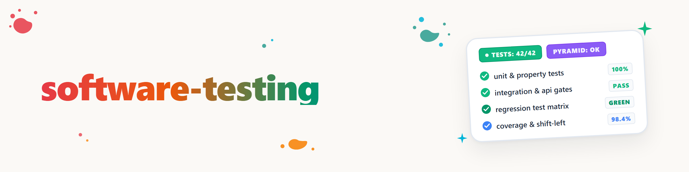

# Teste de Software: Estratégia de Testes & Seleção de Testes

Esta skill responde à pergunta **"De quais testes eu preciso aqui, agora, e para quê?"** —
de forma sistemática, e não por intuição. Ela fornece a lógica de decisão; o catálogo
completo de todos os tipos de teste, técnicas e definições está em
`testarten-katalog.md` na mesma pasta (para perguntas de detalhe, consulte-o).

---

## 1. Quadro de referência: pensar em três dimensões

Antes de planejar ou escrever testes, posicione a tarefa em três eixos (ISTQB).
Quem mantém apenas "uma lista de testes" mistura os eixos e planeja com lacunas:

| Eixo | Pergunta | Formas |
|---|---|---|
| **Nível de teste** | Em que nível? | Unitário → Integração → Sistema → Aceitação |
| **Tipo de teste** | Qual propriedade? | funcional / não funcional / estrutural / relacionado a mudanças |
| **Técnica de teste** | Como surgem os casos de teste? | Caixa-preta / Caixa-branca / baseada em experiência |

Transversalmente: **estático** (revisões, análise estática — sem execução, detecção de
falhas mais cedo e mais barata) vs. **dinâmico** (o código é executado).

---

## 2. Roteador de situações: o que está em jogo?

Escolha o ponto de partida conforme a situação concreta:

| Situação | Procedimento |
|---|---|
| **Construir nova funcionalidade** | Esclarecer os critérios de aceitação ANTES do código (mentalidade ATDD/BDD). Testes unitários em paralelo à implementação (classes de equivalência + valores-limite). Teste de integração para novas interfaces. Um caminho feliz E2E, não mais. |
| **Corrigir bug** | Primeiro um teste que reproduz o bug (vermelho), depois a correção (verde) = **reteste**. Depois a **regressão** do ambiente. Diagnóstico em si → `bugfix-protocol`. |
| **Refatoração** | NENHUM novo teste de funcionalidade — a suíte existente é a rede de segurança. Antes, verificar se a suíte realmente cobre o comportamento (se necessário, adicionar testes de caracterização). Cobertura/mutação como indicador de lacunas. |
| **Código legado sem testes** | Não começar com testes unitários de cada função. Primeiro criar testes de caracterização no nível de sistema/API em torno do comportamento atual, depois acrescentar testes unitários ao tocar partes individuais. |
| **API / Microsserviços** | Testes de API no nível do serviço como foco (nível médio da pirâmide). Com equipes/implantações separadas: **Contract Testing** (p. ex. Pact) em vez de testes de integração compartilhados em staging. |
| **Preparar release** | Ordem: Smoke (build estável?) → regressão completa → testes não funcionais (carga, segurança) → UAT/aceitação → smoke no candidato a release. |
| **Preocupação com desempenho** | Definir primeiro uma meta mensurável (p. ex. "P95 < 300 ms com 1.000 usuários"), senão nenhum teste é avaliável. Teste de carga = carga normal; teste de estresse = ponto de ruptura + recuperação. Ambiente próximo ao de produção é obrigatório. |
| **Configurar pipeline de testes** | Implementar os gates de CI/CD da seção 4; começar com unitário + lint a cada commit e ampliar gradualmente. |
| **Escrever estratégia/conceito de testes** | Estrutura ao longo das 3 dimensões + mapeamento por fases (seção 4) + priorização baseada em risco (seção 6, ponto 10). |

---

## 3. Níveis de teste: objeto, objetivo, momento

| Nível | Verifica | Quando | Regra prática |
|---|---|---|---|
| **Unitário/Componente** | Função/classe individual isolada (mocks/stubs) | Durante a implementação, cada commit | Base larga da pirâmide; rápido (< segundos), determinístico |
| **Integração** | Interação, interfaces, conexão com BD | Após testes unitários, a cada merge | Integrar incrementalmente (top-down/bottom-up), nunca big bang em sistemas grandes |
| **Sistema** | Sistema completo contra requisitos técnicos | Assim que existir um build integrado | Funcional E não funcional; testadores independentes são valiosos |
| **Aceitação** | Expectativa de negócio, uso real | Última etapa antes do go-live | UAT pela área de negócio; não esquecer o operacional (backup/deploy/monitoramento); se necessário, Alpha/Beta |

**Pirâmide de testes** como proporção: muitos testes unitários, testes de integração/API
direcionados, poucos E2E (regra prática ~70/20/10 como ponto de partida — ajustar conforme
a origem real das falhas). Pirâmide invertida (muitos testes de UI) = lenta + instável → evitar.

---

## 4. Mapeamento por fases: quando testar o quê?

### Gates de CI/CD (mapeamento padrão moderno)

| Etapa do pipeline | Gate |
|---|---|
| Cada commit | Testes unitários, linters, análise estática (segundos–minutos) |
| Pull Request | Revisão de código, SAST/SCA, testes de componente direcionados |
| Merge | Testes de integração/API/contrato, smoke no ambiente de teste |
| Noturno / Pré-release | Regressão completa, E2E, testes de desempenho/carga, DAST |
| Candidato a release | Smoke em staging, UAT, aceitação |
| Produção (Shift-Right) | Monitoramento/observabilidade, Canary/Blue-Green, feature flags, eventualmente experimentos de caos |

**Orçamentos de tempo e regras de bloqueio (valores de referência da prática):**

- **Commit até o feedback < 10 minutos** para o caminho rápido (lint + unitário + testes
  de integração críticos); pipeline completo até staging **< 30–45 minutos**; regressão
  completa à noite ou antes do release. Um ciclo de feedback mais lento é contornado.
- **Bloqueante vs. apenas informativo:** gates unitário, de integração e smoke SEMPRE
  bloqueiam (com vermelho não há merge/deploy). Etapas noturnas (regressão, carga, DAST)
  reportam via ticket/correção, mas não bloqueiam todo commit. Após o deploy em produção:
  smoke + monitoramento — com vermelho, rollback + incidente.
- **Ponto de transferência:** o commit (git push) separa o Inner Loop (local: TDD,
  unitário, iteração rápida) do Outer Loop (pipeline compartilhado com gates). O que pode
  ser deslocado para o Inner Loop é detectado ali com o menor custo (Shift-Left).

### Clássico (modelo V): projetar testes ao especificar

Requisitos↔teste de aceitação · projeto de sistema↔teste de sistema · arquitetura↔teste
de integração · código↔teste unitário. Ideia central: os testes de um nível são projetados
**ao criar a especificação correspondente** — não só no final. Revisões de requisitos/
projetos (teste estático) são a detecção de falhas mais precoce de todas.

### Quadrantes de Teste Ágil (grade de planejamento para sprints)

Q1 Unitário/TDD + Q2 testes de histórias/BDD rodam continuamente e **previnem** falhas;
Q3 exploratório/usabilidade/UAT + Q4 desempenho/segurança **avaliam** o produto, assim que
houver produto suficiente. Detalhes no catálogo.

---

## 5. Escolher a técnica de projeto de teste

| Se a base de teste … | … então técnica |
|---|---|
| tem faixas de entrada/conjuntos de valores | **Classes de equivalência** (um representante por classe) + **análise de valores-limite** (em e logo além de cada limite: para 5–50 teste 4, 5, 50, 51) — o equipamento básico para quase todo teste unitário |
| tem regras de negócio complexas/combinações de condições | **Teste de tabela de decisão** |
| descreve estados e transições (fluxo, sessão, dispositivo) | **Teste de transição de estados** (testar também transições proibidas) |
| descreve fluxos de usuário | **Teste de caso de uso/cenário** incluindo caminhos de erro e exceção |
| é código e a cobertura deve ser medida | **Cobertura de instruções/ramos** — como indicador de lacunas, não como meta (100% de cobertura ≠ correto) |
| é pouco claro/lacunar ou o tempo é escasso | **Teste exploratório** (sessões com tempo limitado e charter) + **Error Guessing** (nulo, string vazia, caracteres especiais, fusos horários, condições de corrida) |

Técnicas sistemáticas primeiro, técnicas baseadas em experiência como complemento
consciente — elas encontram o que os scripts deixam passar.

---

## 6. Boas práticas (checklist ao planejar/revisar testes)

1. **Shift-Left:** revisões + análise estática desde a fase de requisitos — quanto mais
   tarde uma falha é encontrada, mais cara ela é (regra prática difundida segundo Boehm;
   a direção é incontestada, os fatores exatos são discutidos).
2. **Respeitar a pirâmide de testes** — testes E2E com moderação, base unitária larga.
3. **Automatizar o que se repete** (smoke, regressão, API, unitário) e ancorá-lo nos gates
   de CI/CD; reservar capacidade manual para exploratório + usabilidade.
4. **Projetar casos de teste sistematicamente** (seção 5), não de forma ad hoc.
5. **Tornar os requisitos não funcionais mensuráveis** — sem valor-alvo numérico não há
   teste de desempenho/carga avaliável.
6. **Reteste ≠ regressão:** primeiro confirmar a correção, depois os efeitos colaterais.
   Ordem: Smoke → Sanity/reteste → Regressão.
7. **Tratar testes instáveis (flaky) imediatamente** — colocar em quarentena, corrigir a
   causa ou excluir; suítes instáveis destroem a confiança no pipeline.
8. **Gerenciar dados e ambientes de teste:** reproduzíveis (contêineres/IaC), próximos da
   produção, dados anonimizados ou sintéticos.
9. **Medir a qualidade dos próprios testes:** cobertura como indicador de lacunas; **teste
   de mutação** onde os números de cobertura possam enganar.
10. **Priorizar com base em risco:** profundidade do teste conforme impacto da falha ×
    probabilidade de falha — não distribuída igualmente.
11. **Qualidade é tarefa da equipe** (abordagem whole-team): envolver os testadores cedo nos
    requisitos; BDD/ATDD como veículo comum com a área de negócio.
12. **Não esquecer o Shift-Right:** monitoramento, canary, feature flags; engenharia do caos
    apenas com observabilidade madura.

---

## 7. Técnicas modernas — quando usar adicionalmente

| Técnica | Usar quando … |
|---|---|
| **Contract Testing** (Pact) | Microsserviços com implantações/equipes separadas |
| **Mutation Testing** (Stryker, PIT, mutmut) | Deve-se avaliar a qualidade de uma suíte de testes existente |
| **Property-Based Testing** (Hypothesis, fast-check) | Existem invariantes ("ordenar é idempotente") e casos-limite são temidos |
| **Fuzzing** | Parsers, desserialização, entradas críticas para segurança |
| **Chaos Engineering** | Sistemas distribuídos + observabilidade madura + rollbacks bem feitos |

---

## Skills vizinhas (não duplicar)

- **`superpowers:test-driven-development`** — o ciclo concreto red-green-refactor
  ao escrever código.
- **`bugfix-protocol`** — diagnóstico de 6 fases de um bug concreto.
- **`bugsweep`** — varredura sistemática de bugs em uma base de código.
- **`dev-cycle`** — ciclo completo de 8 fases (a partir da v1.2.0: testes são
  projetados nas fases 1/3/5, escritos na fase 6 e executados na fase 7; esta skill
  preenche QUAIS testes devem rodar onde).

## Referência

Catálogo completo (todos os níveis de teste, tipos de teste incluindo a tabela detalhada
de não funcionais, todas as técnicas de projeto, Quadrantes Ágeis, estático/dinâmico,
modelo V, fontes):
→ `testarten-katalog.md` (na mesma pasta)

Mapa visual geral — fases, ciclos de feedback, papéis e gates de teste como
"esquema elétrico do desenvolvimento de software" (folha BL-5 = integração dos testes,
BL-2 = cadências dos ciclos de feedback):
→ `../dev-cycle/SCHALTPLAN-SOFTWAREENTWICKLUNG.html` (abrir no navegador)

---

## Registro de alterações

### 1.0.1 (2026-08-22)
- Orçamentos de tempo e regras de bloqueio para gates de CI/CD adicionados (< 10 min
  caminho rápido, < 30–45 min pipeline; bloqueante vs. informativo; rollback após vermelho
  em produção) bem como o commit como ponto de transferência Inner/Outer Loop
- Referência à folha esquemática no skill dev-cycle; delimitação do dev-cycle ajustada à
  sua v1.2.0 (Shift-Left: projetar 1/3/5, escrever 6, executar 7)

### 1.0.0 (2026-08-22)
- Versão inicial a partir de pesquisa online (sistemática ISTQB, pirâmide de testes,
  Quadrantes de Teste Ágil, gates de CI/CD, técnicas modernas)
