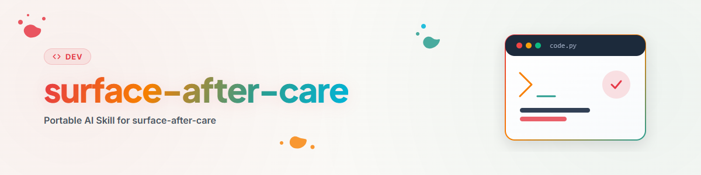

# Surface After Care — একটি প্রকাশিত রিপোর নিয়মিত রক্ষণাবেক্ষণ চক্র

## কখন এই Skill প্রযোজ্য

এটি এমন একটি রিপোজিটরির জন্য ব্যবহার করুন যা **ইতিমধ্যে সর্বজনীন** এবং যা পর্যায়ক্রমে পর্যালোচনা করা হবে। এটি সহজ স্তর: রিপোজিটরি নিজেই যা সিদ্ধান্ত নিতে পারে, তা বহিরাগত রিপোজিটরি তালিকাভুক্ত না করে বা আইনি মতামতের জন্য না গিয়ে সম্পন্ন করে।

প্রতিবেশী Skill-গুলোর সাথে পার্থক্য:

| পরিস্থিতি | Skill |
|---|---|
| রিপোজিটরি প্রথমবার প্রকাশিত হচ্ছে | `github-repo-care` |
| রিপো public, নিয়মিত রক্ষণাবেক্ষণ চক্র | **এই Skill** |
| অতিরিক্তভাবে আইনি যাচাই + সব সংগঠনজুড়ে ক্রস-রেফারেন্স + App-i18n | `full-after-care` (উপনাম `deep-after-care`) |
| শুধু আইনি/Privacy/লাইসেন্স যাচাই, সর্বজনীন করার আগে | `repo-publish-check` |
| ভাষা-সংস্করণগুলো বিষয়বস্তুতে সমন্বিত রাখা | `bilingual-doc-sync` |
| অনেক রিপোজিটরিজুড়ে এই চক্রের ন্যায্য ঘূর্ণন | `rotation-check` |

## মূল ধারণা

একটি প্রকাশিত রিপো দুই দিকে বিচ্যুত হয়: **ডকুমেন্টেশন রিপোতে থাকা সফটওয়্যারের চেয়ে পুরোনো সংস্করণ বর্ণনা করে**, এবং **এমন ফাইল জমে যায় যা কখনো বহিরাগতদের জন্য ছিল না**। দুটোই সাধারণত নাটকীয় নয়, কিন্তু দুটোই ঠিক সেই ব্যবহারকারীদের ক্ষতি করে যাদের আপনি জিততে চান — একজন চলে যায় কারণ ইনস্টলেশন নির্দেশনা আর মেলে না, অন্যজন মূল ডিরেক্টরিতে `AUFGABEN.txt` ও `Plan.txt` দেখে ভাবে এখানে কেউ শুধু নিজের জন্য কাজ করছে।

এই চক্র উভয়টিই পরিষ্কার করে। এটি ইচ্ছাকৃতভাবে পুনরাবৃত্তিযোগ্য: বছরে চারবার আধা ঘণ্টা একটি বড় একবারের পরিষ্কারের চেয়ে ভালো।

## ধাপসমূহ

ক্রম যাদৃচ্ছিক নয়। ধাপ ০ শুরুতে, কারণ এটি পরবর্তী সব ধাপের পরিধি নির্ধারণ করে। ধাপ ২ পরিবর্তন-পুশ করা সব কিছুর আগে চলে — নইলে আগে পরিষ্কার করা দরকার এমন অবস্থার ওপর উন্নতি স্তূপ হয়। ধাপ ১ সম্পূর্ণ সার্ভার-সাইড এবং এতে বাধা দেয় না।

### ০. বিতরণ পৃষ্ঠগুলো তালিকাভুক্ত করা

**কিছু পরিবর্তনের আগে: এই প্রকল্পটি কোথায় কোথায় আছে তা স্পষ্ট করুন।** GitHub রিপো প্রায়ই একমাত্র পৃষ্ঠ নয়। সংশোধিত README-এর কোনো মূল্য নেই যদি npm-প্যাকেজ পৃষ্ঠা এখনো পুরোনো সংস্করণ দেখায় যার ভুল ইনস্টলেশন নির্দেশনা আছে — আর ঠিক সেখানেই বেশিরভাগ ব্যবহারকারী পৌঁছায়, কারণ প্যাকেজ রেজিস্ট্রি সার্চ ইঞ্জিনে প্রায়ই GitHub রিপোর চেয়ে ভালো র‌্যাংক করে।

```bash
# Manifeste verraten die Kanäle
cat package.json pyproject.toml setup.py Cargo.toml 2>/dev/null | rg -n "name|version|keywords|repository|homepage"
rg -n "npmjs.com|pypi.org|marketplace|registry|crates.io|hub.docker|zenodo|doi" README* docs/ .github/ 2>/dev/null

# Veröffentlichten Stand der Kanäle abfragen (nur was zutrifft)
npm view <paket> version description keywords 2>/dev/null
pip index versions <paket> 2>/dev/null
gh release list --repo ORG/REPO --limit 5
```

সাধারণ পৃষ্ঠ: npm, PyPI, Crates, Docker Hub, MCP-Registry, Plugin-/Skill-ডিরেক্টরি, VS-Code- বা Browser-Marketplaces, App-Stores, Zenodo/DOI, প্রকল্পের ওয়েবসাইট, সংগঠনের প্রোফাইল, `llms.txt`, অন্য হোস্টে মিরর-রিপো।

খুঁজে পাওয়া তালিকা রান-লগে লিখে রাখুন। এটি এখন থেকে **লক্ষ্য-সেট**: পরবর্তী ধাপের প্রতিটি পরিবর্তন শেষে এই তালিকার বিপরীতে প্রতিফলিত হবে (দেখুন „সব পৃষ্ঠজুড়ে সমতা")। এমন পৃষ্ঠ পেলে যা আর কেউ রক্ষণাবেক্ষণ করে না এবং একটি মৃত অবস্থার দিকে নির্দেশ করে, সেটি একটি আলাদা ফলাফল — হয় হালনাগাদ করুন, নয়তো ইচ্ছাকৃতভাবে প্রত্যাহার করুন, কিন্তু ফেলে রাখবেন না।

### ১. Topics সেট করা

Topics GitHub-এর ভেতরে সবচেয়ে গুরুত্বপূর্ণ অনুসন্ধান-পৃষ্ঠ এবং প্রায় কোনো খরচ ছাড়াই পাওয়া যায়।

```bash
gh repo view ORG/REPO --json nameWithOwner,description,repositoryTopics,homepageUrl,visibility
gh repo edit ORG/REPO --add-topic <topic> --add-topic <topic>
```

লক্ষ্য হলো তিন দিক থেকে প্রায় ৫–১২টি Topics: **এটি কী** (`cli`, `mcp-server`, `python-library`), **এটি কী নিয়ে** (`file-management`, `tax`, `note-taking`) এবং **এটি কীভাবে কাজ করে** (`local-first`, `offline`, `privacy`)। তুলনীয় প্রকল্পে আসলে ব্যবহৃত Topics-এর দিকে তাকান — বানানো Topics কোনো ব্যবহারকারী খুঁজে পায় না। Description ও Homepage একই দৃশ্যে থাকায় সেগুলোও সঙ্গে সঙ্গে যাচাই করুন।

ধাপ ০-এর অন্য পৃষ্ঠগুলোতে Topics-এর প্রতিরূপ আছে: `keywords`-এ `package.json`, `keywords`/`classifiers`-এ `pyproject.toml`, Marketplace ও Store-এ বিভাগ ও Tags। বিষয়বস্তুতে এগুলো একই রাখুন — এগুলো একই সিদ্ধান্ত, শুধু একাধিক জায়গায়।

### ২ক. Privacy-Gate — সবসময় চলে

এই ধাপ কখনো বাদ যায় না, এমনকি আপাতদৃষ্টিতে নিরীহ চক্রেও না। অনুসন্ধান হয় **ট্র্যাক করা** সেটে, দৃশ্যমান ওয়ার্কিং ট্রিতে নয়, কারণ ঠিক এখানেই „পরিষ্কার দেখায়" এবং „আসলেই পরিষ্কার"-এর পার্থক্য।

```bash
git ls-files
rg -n "C:\\\\Us[e]rs\\\\|/home/[a-z]|s[k]-[A-Za-z0-9]{16}|gh[p]_|gh[o]_|AKIA[0-9A-Z]{16}|API[_-]?KEY|TO[K]EN|PASS[W]ORD|SEC[R]ET|BEGIN [A-Z ]*PRIVATE KEY" $(git ls-files)
rg -n "\x{C3}\x{83}|\x{C2}\x{A0}|\x{FFFD}" $(git ls-files -- '*.md' '*.txt' '*.json')
```

প্যাটার্নটিতে আপনার নিজের অভ্যন্তরীণ ফোল্ডারের নামও যোগ করুন — পাইপলাইন-ফোল্ডার, বিষয়ভিত্তিক ডিরেক্টরি, ব্যক্তিগত কাজের স্থান:

```bash
rg -n "\.SOFTWARE|\.RESEARCH|_control-center|<weitere eigene Ordnernamen>" $(git ls-files)
```

এ ধরনের উল্লেখ Secret নয় এবং অ্যালার্ট তোলে না, তাই এগুলো ফাঁকি দিয়ে যায় — কিন্তু এগুলো পাঠকদের জন্য **অসমাধানযোগ্য** („.SOFTWARE-Pipeline থেকে ফেরত আনা" অপরিচিতদের কিছু বলে না) এবং নিজের কাঠামো প্রকাশ করে। এগুলো সহ্য করা নয়, প্রতিস্থাপন বা মুছে ফেলা হয়। শুধু `C:\Users\…` ও Token-প্যাটার্ন খুঁজলে এগুলো নিশ্চিতভাবে পাওয়া যাবে না।

কিছু পেলেন? তাহলে পাওয়া জিনিসের **ধরন** নির্ধারণ করে কী করতে হবে — দেখুন „Force-Push-নিয়ম" অংশ। যে Secret কখনো কমিট হয়েছে তা পুড়ে গেছে বলে ধরে নিতে হবে: `HEAD` থেকে সরালেই যথেষ্ট নয়, এটি বদলাতে (Rotate) হবে।

### ২খ. নথিগুলোর প্রকাশের উদ্দেশ্য যাচাই

এই চক্রের আসল কেন্দ্র। ট্র্যাক করা `.md`, `.txt` ও `.json` দেখুন এবং প্রতিটি ফাইলের জন্য প্রশ্ন করুন: **এটি কি কখনো বহিরাগতদের জন্য ছিল?**

```bash
git ls-files -- '*.md' '*.txt' '*.json' | sort
```

শুধু ফাইলের নাম দেখে অনুমান করবেন না — ভেতরে একবার তাকান। একটি `PLAN.md` একটি প্রকাশ্য রোডম্যাপ হতে পারে, আর একটি নিরীহ নামের `notes.md` অভ্যন্তরীণ মূল্য-কৌশল হতে পারে। তিনটি শ্রেণি:

**রিপোতে থাকা উচিত** — README, LICENSE, CHANGELOG, SECURITY, CONTRIBUTING, `docs/`, API-রেফারেন্স, উদাহরণ-Config, প্রকৃত রোডম্যাপ, Manifest (`package.json`, `pyproject.toml`), Lockfiles, CI-কনফিগারেশন।

**রিপোতে থাকা উচিত নয়, কিন্তু ঝুঁকিহীন** — এই চক্রের স্বাভাবিক ক্ষেত্র। কাজ ও পরিকল্পনা-ফাইল (`AUFGABEN.txt`, `Plan.txt`, `TODO-intern.md`), সেশন-নোট ও হস্তান্তর (`HANDOFF`, `BRIEFING`, `_handoff/`), নিজস্ব পাইপলাইনের স্ট্যাটাস-ফাইল, উন্নয়ন-ডায়েরি, `_archive/`, স্থানীয় পাথ সহ Registry- ও Index-JSON, মধ্যবর্তী অবস্থা ও তৈরি করা Artefacts, এজেন্টের কাজের ফাইল। এই ফাইলগুলো বিপজ্জনক নয়, কিন্তু অগোছালো করে এবং একটি বাইরের নির্মাণস্থলের ছাপ দেয়। আচরণ: `.gitignore` যোগ করুন, `git rm --cached <datei>` করুন এবং **স্বাভাবিকভাবে পুশ করুন**।

**রিপোতে থাকা উচিত নয় এবং স্পর্শকাতর** — Credentials, ব্যক্তিগত তথ্য, গ্রাহক-ডেটা, অভ্যন্তরীণ হিসাব, মূল্য ও আলোচনা-কৌশল, অপ্রকাশিত ব্যবসায়িক পরিকল্পনা, চুক্তির খসড়া, প্রতিযোগিতামূলক মূল্য আছে এমন সবকিছু। এখানে সাধারণ কমিট যথেষ্ট নয়, Force-Push-নিয়ম দেখুন।

`.json`-এ দ্বিতীয়বার দেখার মতো: Manifest ও Lockfiles থাকে, কিন্তু স্থানীয় Config, Task-/Registry-ফাইল, Export-ডাম্প এবং সম্পূর্ণ পাথ বা Hostname-সম্বলিত সবকিছু সাধারণ ফাঁকি দেওয়া উপাদান।

যদি এমন ফাইল সরান যা কেউ খুঁজতে পারে (যেমন একটি রোডম্যাপ), কমিট বা README-তে সংক্ষেপে লিখুন তথ্যটি এখন কোথায় আছে — নইলে এটি পিছু হটার মতো দেখায়।

### ৩. ব্যানার

ব্যানার নির্ধারণ করে কেউ আদৌ পড়া শুরু করবে কিনা। যাচাই করুন একটি আছে কিনা এবং README-তে প্রথম উপাদান হিসেবে যুক্ত কিনা।

না থাকলে তিনটি পথ আছে — এই ক্রমে যুক্তিসংগত:

1. **এজেন্টের ইমেজ-জেনারেটর** (যেমন agy; সেখানে „generiere" শব্দটি আসল PNG তৈরির ট্রিগার), যদি একটি ছবির মোটিফ টাইপোগ্রাফির চেয়ে ভালো মানায়।
2. **Codex**, যদি ব্যানারটি কোড থেকে তৈরি হওয়ার কথা হয় এবং অনুসরণ করার মতো একটি স্টাইল-নমুনা থাকে।
3. **নিজে SVG দিয়ে**, যদি ব্যানার মূলত শব্দ-চিহ্ন ও আকৃতির ভাষা হয় — এটি প্রায়ই দ্রুততম এবং সবচেয়ে নিয়ন্ত্রণযোগ্য বিকল্প, আর SVG পরে বদলানো যায়।

প্রকল্পটি একটি গোষ্ঠীর অংশ হলে পরিবার বজায় রাখুন: একই মূল রং, একই নন্দনতত্ত্ব, একই শব্দ-চিহ্ন-প্রক্রিয়া। যে ব্যানার দলছুট, সেটি কোনো ব্যানার না থাকার চেয়েও খারাপ দেখায়। সাধারণ আকার 1200x300; PNG রিপোতে, পাশে SVG উৎস হিসেবে।

### ৪. বক্তব্যগুলো প্রকৃত অবস্থার সাথে মেলানো

এখানেই সবচেয়ে বেশি মূল্য তৈরি হয়। README কিছু দাবি করে — বিশ্বাস না করে যাচাই করুন:

- **Version** README/Badge-এ, `pyproject.toml`/`package.json`/`__version__`-এর বিপরীতে এবং সর্বশেষ Release-Tag-এর বিপরীতে। একাধিক Version-বাহক থাকলে সবগুলো যাচাই করুন, শুধু একটি নয়।
- **ইনস্টলেশন-পথ** সত্যিই অনুসরণ করে দেখুন, অন্তত পড়ে: প্যাকেজটি উল্লেখিত নামে আছে কিনা? কমান্ড ও Flags মেলে কিনা?
- **Feature-তালিকা** কোডের বিপরীতে: উল্লেখিত সবকিছু আছে কিনা, এবং তালিকায় নতুন কিছু বাদ পড়েছে কিনা?
- **সংখ্যা** (Tool-সংখ্যা, সমর্থিত ফরম্যাট, টেস্ট-কভারেজ) উৎসে গুনুন, অনুমান করে লিখবেন না। README-র সংখ্যা নীরবে পুরোনো হয়।
- **Screenshots** বর্তমান ইন্টারফেসের বিপরীতে।
- **Requirements** (Python-/Node-সংস্করণ, Dependencies) Manifest-এর বিপরীতে।
- **Links** প্রতিবেশী প্রকল্প, ডকুমেন্টেশন ও Registries-এ: এখনো কাজ করে কিনা?

**একটি সংশোধন সব পৃষ্ঠের জন্য প্রযোজ্য, শুধু যেখানে ধরা পড়েছে সেখানে নয়।** যদি একটি বিষয়গত বক্তব্য ভুল প্রমাণিত হয় — বিশেষ করে যখন নিয়োগকর্তা সেটি শুধরে দেন —, তাহলে একই বক্তব্য বেশিরভাগ ক্ষেত্রে অন্য কোথাও আছে: সংগঠনের প্রোফাইলে, `llms.txt`-এ, দ্বিতীয় ভাষা-সংস্করণে, প্রতিবেশী প্রকল্পের README-তে। পয়েন্টটি টিক দেওয়ার আগে সেটি লক্ষ্য করে খুঁজুন:

```bash
gh search code "<prägnante Formulierung>" --owner ORG
```

নইলে একটি জায়গা শুধরাবেন এবং তিনটি রেখে দেবেন — আর অসঙ্গতিটি তখনই চোখে পড়বে যখন পরের রিপো পালা আসবে। এটি শুধু সময়ই নষ্ট করে না, ডকুমেন্টেশনের প্রতি আস্থাও ক্ষুণ্ণ করে: একই বিষয়ের দুটি বর্ণনা পেলে কেউ আর কোনোটিকেই বিশ্বাস করে না।

এরপর **উপস্থাপনা** উন্নত করুন যেখানে দুর্বল: বিকল্পের দীর্ঘ তালিকা টেবিল হলে সহজে পড়া যায়; Codeblock-এ ভাষা-Tags লাগে; একটি কাঠামো বা প্রবাহ-সারাংশ Mermaid-চিত্র বা ASCII-Tree হিসেবে গদ্যের চেয়ে দ্রুত বোঝা যায়; প্রথম পর্দার উচ্চতায় উদ্দেশ্য, ইনস্টলেশন ও একটি ব্যবহারের উদাহরণ থাকা উচিত, Badges বা ইতিহাস নয়। README যদি ~৪০০ লাইন ছাড়িয়ে যায়, বিস্তারিত `docs/`-এ সরিয়ে লিংক করুন।

**README-এর ভাষানীতি:** মানদণ্ড হলো একটি **ইংরেজি `README.md`** এবং একটি **জার্মান দ্বিতীয় সংস্করণ**। ব্যতিক্রম: অ্যাপ্লিকেশনের বিষয়বস্তু নিজেই জার্মান (জার্মান আইন, জার্মান কর- বা অনুদান-ব্যবস্থা, জার্মানভাষী শ্রোতা) বা এখন পর্যন্ত শুধু একটি জার্মান সংস্করণ আছে — তখন জার্মান মূল ভাষা থাকবে। প্রকল্প ইতিমধ্যে যেসব ভাষায় কথা বলে, তাদের প্রতিটির জন্য আলাদা README-সংস্করণ থাকা উচিত। রিপোতে ইতিমধ্যে ব্যবহৃত নামকরণ-নিয়ম মেনে চলুন (`README_de.md`, `README.de.md`, `docs/README.de.md`) এবং পাশে দ্বিতীয় একটি উদ্ভাবন করবেন না। সংস্করণগুলো শিরোনাম-অংশে পরস্পরের সাথে লিংক করুন।

### ৬. ঘাটতি থাকা মানক ভাষাগুলো যোগ করা

যে README-গুলোতে **মানক ভাষাগুলো** নেই সেগুলো যোগ করুন: জার্মান, ইংরেজি, স্প্যানিশ, সরলীকৃত চীনা, জাপানি, রুশ। উদ্দেশ্য পৌঁছানো, তাই এটি মূলত ব্যবহারকারী-মুখী প্রকল্পের জন্য — একটি ডেভেলপার-কেন্দ্রিক লাইব্রেরি যার শ্রোতা শুধু ইংরেজিভাষী, সেখানে রুশ README লাভ নয়, শুধু বাড়তি রক্ষণাবেক্ষণের বোঝা। সচেতনভাবে সিদ্ধান্ত নিন এবং রান-লগে লিখুন, যাতে পরের চক্র এটি আবার নতুন করে আলোচনা না করে।

নতুন সংস্করণগুলো **পূরণ করা হয়, খালি রেখে তৈরি করা হয় না** — „TODO: translate"-সম্বলিত Stub একটি খালি ফাইলের চেয়েও খারাপ, কারণ এটি সম্পূর্ণতার ভান করে। বিষয়গত সমান্তরালতা ও পিছনের দিকে সমন্বয় `bilingual-doc-sync` নির্ধারণ করে; দুইয়ের বেশি সংস্করণ থাকলে মিল যাচাই করতে এই Skill-কে ডাকা সার্থক।

### ৭. দৃশ্যমানতা ও প্রচার

ভাবুন কোন ব্যবস্থাগুলো **এই** প্রকল্পের জন্য সত্যিই ব্যবহারকারী আনে, এবং সেগুলো বাস্তবায়ন করুন:

- **Registries**, যেখানে প্রকল্পটি প্রযুক্তিগতভাবে স্থান পায়: প্যাকেজ-রেজিস্ট্রি (npm, PyPI), MCP-Registry, Plugin-/Skill-ডিরেক্টরি, Marketplaces।
- **কিউরেটেড তালিকা** (`awesome-*` ও বিষয়ভিত্তিক সংগ্রহ), যদি গ্রহণের মানদণ্ড সত্যিই পূরণ হয়। এমন একটি তালিকায় PR, যার মানদণ্ড প্রকল্পটি পূরণ করে না, সুনাম ক্ষতি করে।
- **নিজস্ব পৃষ্ঠ**: সংগঠনের প্রোফাইল, `llms.txt`, প্রকল্পের ওয়েবসাইট, Oekosystem-এর README, সম্পর্কিত নিজস্ব রিপো থেকে লিংক।
- **Release-Notes** সুযোগ হিসেবে: বর্ণনা করা নতুনত্ব ছাড়া একটি Release লক্ষ্য হয় না।

**অনুমোদন-গেট:** বাইরে যাওয়া সবকিছু — বহিরাগত রিপোতে PR, বহিরাগত তালিকায় এন্ট্রি, পোস্ট, জমাদান — **প্রস্তাব করা হয় এবং এই চ্যানেলের জন্য স্থায়ী অনুমোদন না থাকলে সুস্পষ্ট অনুমোদনের পরেই চালানো হয়**। নিজস্ব পৃষ্ঠের পরিবর্তনে এই গেট লাগে না। কারণ সহজ: বহিরাগত রিপোতে প্রত্যাহার করা একটি PR জনসমক্ষে দৃশ্যমান থাকে এবং প্রকল্পের ওপর প্রভাব ফেলে।

### ৮. সংগঠন-পৃষ্ঠায় এন্ট্রি

প্রথমে নিজের সংগঠন: রিপোটি কি প্রোফাইল-README (`ORG/.github` → `profile/README.md`)-এ আদৌ তালিকাভুক্ত, সঠিক বিভাগে, হালনাগাদ বর্ণনাসহ?

```bash
gh api user/orgs --jq '.[].login'
```

তারপর **সব** সংগঠনের মধ্য দিয়ে যান এবং প্রতিটির জন্য একটি প্রশ্নের উত্তর দিন: এই সংগঠনের পৃষ্ঠার একজন দর্শক কি এই রিপো থেকে উপকৃত হবেন? বেশিরভাগ সময় উত্তর না — তখন „লিংক না করা"-ই সঠিক ফলাফল, ফাঁক নয়। যেখানে উত্তর হ্যাঁ (বিষয়গত নৈকট্য, অভিন্ন ব্যবহারকারী, সেখানকার প্রকল্পের পরিপূরক একটি সরঞ্জাম), সেখানে একটি লাইন সহ লিংক দিন যা উপকারিতা ব্যাখ্যা করে, শুধু নাম নয়।

প্রোফাইলটি একটি আলাদা রিপোতে থাকে (`ORG/.github`)। সেখানের পরিবর্তনও রক্ষণাবেক্ষণ করা হয় এবং ধাপ ১১-এর Dirty-Tree-নিয়ম অনুসারে পুশ করা হয়।

### ১০. Issues ও Pull Requests

```bash
gh issue list --repo ORG/REPO --state open --limit 50
gh pr list --repo ORG/REPO --state open --limit 30
```

শুধু গণনা না করে এগুলো কাজ করে শেষ করুন:

- **ঠিক করা যায় এমন বাগ** সরাসরি সারান — এই চক্রে প্রেক্ষাপট এমনিতেই লোড করা। ছোট, স্পষ্ট পরিধির ফিক্স, টেস্টসহ এবং Issue-নম্বরের উল্লেখসহ।
- **ইতিমধ্যে সমাধান হওয়া Issues** বন্ধ করুন, একটি বাক্যে লিখে যে এটি কী সমাধান করেছে।
- **অস্পষ্ট প্রতিবেদন** নির্দিষ্ট প্রশ্ন চায় (Version, অপারেটিং সিস্টেম, পুনরুৎপাদনের ধাপ)।
- **PRs**: Diff সত্যিই পড়ুন, টেস্ট চালান, তারপর মার্জ করুন বা যুক্তিসহ ফেরত জানান। মাসের পর মাস উত্তরহীন পড়ে থাকা একটি PR একটি ভদ্র প্রত্যাখ্যানের চেয়ে বেশি সদিচ্ছা ক্ষয় করে।
- **Stale-কেস** সমাধান করুন, টেনে না রেখে।

**অনুমোদন-গেট:** সর্বজনীন মন্তব্য, যুক্তিসহ বন্ধ করা এবং বহিরাগত অবদানের মার্জ হলো বাইরের সঙ্গে যোগাযোগ — কার্যকর করার আগে উপস্থাপন করুন, যদি স্থায়ী অনুমোদন না থাকে। নিজের রিপোতে বিশুদ্ধ কোড-ফিক্স এর আওতায় পড়ে না।

### ১১. কমিট, পুশ, যাচাই

চক্র পরিবর্তনের সাথে শেষ হয় না, শেষ হয় যখন সেগুলো **বাইরে** পৌঁছায়। না-পুশ করা উন্নতিতে ভরা একটি ওয়ার্কিং ট্রি সবচেয়ে খারাপ ফলাফল: পরের সেশন — সম্ভবত অন্য এজেন্ট বা অন্য ডিভাইস — আগে একটি বহিরাগত, অর্ধ-সমাপ্ত অবস্থায় নিজেকে মানিয়ে নিতে হবে, আর প্রকাশ্য পৃষ্ঠগুলোতে কিছুই উন্নত হয়নি।

পুশের আগে যা যাচাই করা যায় তা নিশ্চিত করুন: টেস্ট ও Smokes চালান, ডকুমেন্টেশন-পরিবর্তনে লিংক ও রেন্ডার-করা দৃশ্য দেখুন। তারপর সব কিছু একটি Sammel-Commit-এ না ঢুকিয়ে **বিষয়ভিত্তিকভাবে আলাদা কমিটে** বাঁধুন — পরিষ্কার করা, ডকুমেন্টেশন হালনাগাদ এবং বাগ-ফিক্স তিনটি ভিন্ন জিনিস, আর কেউ এগুলোর একটি পরে ফেরাতে চাইলে সে কৃতজ্ঞ থাকবে:

```bash
git add .gitignore && git rm --cached <interne dateien>
git commit -m "chore: interne Arbeitsdateien aus dem Repo nehmen"
git commit -am "docs: README auf aktuellen Stand (Version, Toolzahl, Screenshots)"
git commit -am "fix: <Issue-Nummer> ..."

git pull --rebase        # bei divergiertem Branch, vor dem Push
git push
```

এরপর ধরে না নিয়ে যাচাই করুন: রেন্ডার-করা দৃশ্যে Remote-README, CI-রান, Release- ও Tag-অবস্থা।

```bash
gh run list --repo ORG/REPO --limit 3
gh repo view ORG/REPO --json description,repositoryTopics,url
```

**যদি CI লাল হয় অথচ আপনার কমিট শুধু ডকুমেন্টেশন ছুঁয়েছে**, কারণ প্রায় কখনোই আপনি নন। এই রিপো-পরিবারে একদিনে **তিনবার** দেখা সবচেয়ে সাধারণ ক্ষেত্র — একটি **অপিন-না-করা Linter, যার সুনির্দিষ্ট নিয়মসেট নেই**। কিছু সন্দেহ করার আগে এটি **প্রথমে** যাচাই করুন।

কৌশলটি: যদি Workflow `ruff check` (বা flake8, eslint …) একটি অপিন-না-করা Dependency-র বিরুদ্ধে চলে (`ruff>=0.12`, বা কোনো Version ছাড়া), এবং একটি স্পষ্ট নিয়ম-নির্বাচন অনুপস্থিত থাকে (`[tool.ruff.lint] select = [...]`, বা `pyproject.toml` না থাকলে নিজস্ব `ruff.toml`), তাহলে Lint **সদ্য ইনস্টল-করা** Version-এর Default অনুসরণ করে। একটি নতুন Linter-Release এই Default সরিয়ে দেয়, এবং অপরিবর্তিত কোডবেস লাল হয়ে যায়। অপরাধী:

- নিয়ম-কোড যা প্রকল্পে কখনো ছিল না (`UP045`, `UP006`, `BLE001`, `RUF100`, `DTZ005`, `N999` …), কিছু তিন অঙ্কের সংখ্যায়।
- ভাঙন প্রায়ই **প্ল্যাটফর্মে বিভক্ত** হয়: পুরোনো ক্যাশড Version সহ Runner সবুজ থাকে, নতুনগুলো লাল হয়।
- কখনো একটি নিয়ম অসংশোধনযোগ্য কিছুতে আপত্তি জানায় (`N999` প্যাকেজের নামই) — নিশ্চিত লক্ষণ যে এটি কখনো Standard ছিল না।

সমাধান: যে নিয়মসেট আগে সবুজ ছিল তা স্থির করুন — `select = ["E4","E7","E9","F"]` হলো ক্লাসিক ruff-Defaults। `pyproject.toml` না থাকলে একটি `ruff.toml` তৈরি করুন। **নতুন** Linter-Version-এর বিপরীতে নিজেই যাচাই করুন (ইনস্টল করে, Config ছাড়া ফাইন্ডিংস পুনরুৎপাদন করে, Config সহ „passed" দেখে)। নতুন নিয়মগুলো প্রকল্পে **একটি কাজ** হিসেবে আসে — সচেতনভাবে গ্রহণ করা একটি সিদ্ধান্ত, Tool-হালনাগাদের পার্শ্বপ্রতিক্রিয়া নয়। এটি একটি সত্যিকারের, পুনরাবৃত্ত ফলাফল: Pin ছাড়া CI পরের Linter-Release-এ আবার ভাঙবে, এবং **প্রতিটি** এভাবে কনফিগার-করা রিপোতে।

দুটি ক্ষেত্র যেখানে **পুশ করা হয় না**: যখন প্রকল্পের জন্য প্রকাশনা- বা জমাদান-নিষেধাজ্ঞা থাকে, অথবা অবস্থা স্পষ্টভাবে অসম্পূর্ণ। দুটোই যুক্তিসহ ব্যতিক্রম — স্বাভাবিক ক্ষেত্র হলো: কমিট করুন এবং পুশ করুন।

প্রকাশনা-নিষেধাজ্ঞায় চক্র বাতিল না করে **পথ পরিবর্তন** করা হয়: একটি নিজস্ব Branch-এ (`judging-hold/…`, `freeze/…`) স্থানীয়ভাবে কমিট করুন, মূল Branch জমা দেওয়া অবস্থায় অক্ষত রাখুন, রান-লগে নিষেধাজ্ঞার কারণ লিখুন এবং প্রত্যাহারের পর আবার সংযুক্ত করুন। এখানে সঙ্গতি জরুরি: নিষেধাজ্ঞাধীন শুধু `git push` নয়, **প্রতিটি Remote-দৃশ্যমান পরিবর্তন** — Topics, বর্ণনা, Homepage, Releases, Issue- ও PR-কার্যক্রম প্রকাশিত প্রকল্পকে একইভাবে বদলায়।

একই রিপোর আরও ক্লোন থাকলে (দ্বিতীয় ডিভাইস, Deploy-কপি, মিরর), পুশের ঠিক পরেই সেগুলো টেনে আনুন। দশটি কমিট পেছনে থাকা একটি ক্লোন পরের ত্রুটি-অনুসন্ধানে এমন একটি অবস্থার ওপর নির্ণয় দেয় যা আর নেই।

#### অন্য রিপোতে পরিবর্তন — Dirty-Tree-ব্যতিক্রম

এই চক্র নিয়মিত রক্ষণাবেক্ষণ করা রিপোর **বাইরে** পরিবর্তন তৈরি করে: সংগঠনের প্রোফাইলে এক লাইন (ধাপ ৮), পরে গভীর চক্রে একটি সম্পর্কিত রিপোতে ফিরতি লিংক। এ ধরনের পরিবর্তনও কমিট ও পুশ করা হয় — একটি অপ্রকাশিত ফিরতি লিংক কোনো ফিরতি লিংক নয়।

বহিরাগত রিপোতে হাত দেওয়ার আগে তার অবস্থা যাচাই করুন:

```bash
git -C <pfad> status --porcelain
```

**পরিষ্কার ওয়ার্কিং ট্রি** → পরিবর্তন করুন, একটি **নিজস্ব, বিষয়ভিত্তিকভাবে স্পষ্ট কমিটে** (`docs: link <projekt>`) কমিট ও পুশ করুন। রক্ষণাবেক্ষণ করা রিপোর কমিটের সাথে মেশাবেন না: এটি ভিন্ন ইতিহাস ও ভিন্ন পাঠক সহ আলাদা রিপো।

**Dirty, কিন্তু বহিরাগত পরিবর্তন অন্য ফাইলে** → নিজের পরিবর্তন তবুও পরিষ্কারভাবে করা যায়। শুধু **নিজের ফাইলটি পাথ-নির্দিষ্টভাবে** Stage ও কমিট করুন, যাতে অন্যের অযাচাইকৃত কাজ সঙ্গে না যায়:

```bash
git -C <pfad> add README.md
git -C <pfad> commit -m "docs: link <projekt>"     # nur der gestagte Pfad
```

কিন্তু **পুশ করবেন না**। কমিটটি স্থানীয়ভাবে নিরীহ; পুশ অবশ্য নিরীহ নয়: আপনি জানেন না অন্য কাজটি কোথায় যাচ্ছে — হয়তো এখনই সংশোধিত, Rebase বা অন্যভাবে কাটা হচ্ছে, আর আপনার কমিট তাকে এর মুখোমুখি হতে বাধ্য করবে। স্থানীয় কমিট কারো ওপর কিছু না চাপিয়ে কাজ রক্ষা করে; পরে যে রান ওই রিপোতে ফিরবে সে এটি খুঁজে পাবে এবং সঙ্গে নেবে।

**ঠিক যে ফাইলটি বদলাতে হবে সেটি Dirty** → হাত দেবেন না। সেখানে একটি বহিরাগত অর্ধ-অবস্থার ওপর দাঁড়িয়ে তার সাথে কমিট করতে হবে; সেটি বোঝার খরচ এই একটি লিংকের মূল্যের চেয়ে বেশি।

**সক্রিয় লক (`LOCK*.txt`) লক্ষ্য রিপোতে** → **প্রথমে লকটি পড়ুন, সার্বিক নিষেধাজ্ঞা ধরে নেবেন না।** লক তার নিজের পরিধি বর্ণনা করে, আর সেটি প্রায়ই „কিছুই নয়"-এর চেয়ে সংকীর্ণ। সাধারণ ক্ষেত্র:

- **সম্পাদনা-লক** („এখানে এখন কেউ কাজ করছে") → কিছু স্পর্শ করবেন না, এমনকি পাশের ফাইলও না।
- **শুধু প্রকাশনা-/পুশ-লক** (জমাদান, Judging, Freeze) → স্থানীয় কাজ অনুমোদিত, শুধু Remote-যোগাযোগ বন্ধ। তখন একটি নিজস্ব Branch-এ কাজ করুন এবং স্থানীয়ভাবে কমিট করুন; **Remote-প্রভাবশালী ধাপ বাদ** — শুধু পুশ নয়, Topics, বর্ণনা, Homepage, Releases এবং Issue-/PR-কার্যক্রমও, কারণ সেগুলোও প্রকাশিত প্রকল্প বদলায়।

যে লক শুধু পুশ বন্ধ করে, তাকে সম্পূর্ণ নিষেধাজ্ঞা হিসেবে পড়লে চক্রের পুরো স্থানীয় অংশ নিরাপত্তা লাভ ছাড়াই হারায়। বিপরীতে শুধু পুশ না করে মেটাডেটা বদলালেও চলে না। সন্দেহ হলে লকটি উদ্ধৃত করে জিজ্ঞেস করুন।

#### ইচ্ছাটি হারিয়ে যেতে দেবেন না

এই কারণগুলোর কোনো একটির জন্য পরিবর্তনটি **না** করা হলে, সেটি লক্ষ্য রিপোর কাজের তালিকায় যায় — `AUFGABEN.txt`, `TODO.md` বা `TODO.txt`, সেখানে যা আছে তার ওপর নির্ভর করে। তারিখ, প্রয়োজনীয় পরিবর্তন ও কারণসহ একটি এন্ট্রি:

```markdown
- [ ] [2026-07-24, after-care] Rückverweis auf <projekt> im README ergänzen
      (übersprungen: README hatte uncommittete Fremdänderungen)
```

„স্থগিত" আর „ভুলে গেছি"-র পার্থক্য এখানেই: কাজের তালিকাটি সেখানে থাকে যেখানে ওই রিপোর পরের কর্মী এমনিতেই তাকায় — একটি বাইরের রানের প্রোটোকলের নোটের চেয়ে বেশি নির্ভরযোগ্য। কাজের তালিকা না থাকলে একটি তৈরি করবেন না; তখন নিজের রান-লগের খোলা পয়েন্টই যথেষ্ট।

**সক্রিয় লকের ক্ষেত্রে এটিও প্রযোজ্য নয়** — তখন ফাইলটি স্পর্শ করা হয় না এবং নোটটি নিজের রান-লগে থাকে। উভয় ক্ষেত্রেই সেখানে লিখুন, যাতে ঘূর্ণন খোলা পয়েন্টটি জানে।

শেষে ধাপ ০-এর পৃষ্ঠগুলো পরিচালনা করুন — পরের অংশ দেখুন।

## সব বিতরণ পৃষ্ঠজুড়ে সমতা

চক্রের শেষে ধাপ ০-এর তালিকার বিপরীতে যান: **প্রতিটি পরিবর্তন যা একজন ব্যবহারকারী দেখতে পেত, তা সেখানে পৌঁছাতে হবে যেখানে তিনি খোঁজেন।** npm-পৃষ্ঠা ভিন্ন গল্প বললে যে রিপোর শুধু একটি পৃষ্ঠা আছে তার চেয়ে খারাপ অবস্থায় থাকে।

নির্ণায়ক প্রক্রিয়া: **প্যাকেজ-রেজিস্ট্রি শেষ Publish-এর README দেখায়, বর্তমান রিপো-অবস্থা নয়।** npm বা PyPI-তে একটি README-সংশোধন শুধু একটি নতুন Version-এর সাথে দৃশ্যমান হয়। সংশোধনটি বিষয়গতভাবে গুরুত্বপূর্ণ হলে (ভুল ইনস্টলেশন, ভুল Version, পুরোনো Feature-তালিকা), একটি Patch-Release যুক্ত করতে হবে — নইলে ফিক্সটি কার্যকর হয় না।

| পৃষ্ঠ | সেখানে কী রক্ষণাবেক্ষণ হয় | কীভাবে পৌঁছায় |
|---|---|---|
| npm | README, `description`, `keywords`, Repository-Link | শুধু `npm publish`-এর মাধ্যমে (Patch-Version); মেটাডেটা আসে `package.json` থেকে |
| PyPI | README (`long_description`), Classifiers, Projekt-URLs | শুধু নতুন Upload-এর মাধ্যমে; মেটাডেটা `pyproject.toml` থেকে |
| MCP-Registry / Plugin-Verzeichnisse | বর্ণনা, Version, Tool-তালিকা, প্রবেশ-ডকুমেন্টেশন | Registry অনুযায়ী Manifest-হালনাগাদ বা নতুন জমাদান |
| Marketplace / Store | বর্ণনা, Screenshots, Kategorien, ভাষা-সংস্করণ | সংশ্লিষ্ট পরিচালনা-পৃষ্ঠা দিয়ে; Screenshots সেখানে বিশেষভাবে দ্রুত পুরোনো হয় |
| Docker Hub / Container-Registry | বর্ণনা, Tags, ব্যবহারের উদাহরণ | Repository-বর্ণনা প্লাস নতুন Tag |
| Zenodo / DOI | মেটাডেটা, Autoren, Version | মেটাডেটার জন্য In-Place-Edit, বিষয়বস্তুর জন্য নতুন Version |
| Website / Org-Profil / `llms.txt` | ছোট বর্ণনা, Link, Positionierung | সরাসরি সম্পাদনযোগ্য — সবচেয়ে সস্তা পৃষ্ঠ, তাই কখনো ভুলবেন না |

একটি Version বাড়ালে **সব Version-বাহক** একসাথে সরাতে হবে: Manifest, Code-Konstante, README-Badge, Changelog, Release-Tag, `llms.txt`। অর্ধেক বাড়ানো Version-অবস্থা সর্বত্র পুরোনো থাকার চেয়ে নির্ণয় করা কঠিন।

কোনো পৃষ্ঠে হালনাগাদ এখন সম্ভব না বা উপযুক্ত না হলে (যেমন শুধু একটি টাইপো-র জন্য Release), সেটি রান-লগে লিখে রাখুন, যাতে পরের চক্র এই পার্থক্যকে অসাবধানতা ভেবে না নেয়।

## Force-Push-নিয়ম

মানক হলো **কোনো Force-Push নয়**। অভ্যন্তরীণ পরিকল্পনা-ফাইল পরে উপেক্ষা করা ইতিহাস পুনর্লিখনের যুক্তি নয়: খরচ বেশি, প্রতিটি ক্লোন ও Fork ভেঙে যায়, খোলা PRs অকেজো হয় — আর লাভ কম, কারণ বিষয়বস্তু নিরীহ। স্বাভাবিক পথ:

```bash
git rm --cached <datei>            # aus dem Tracking, bleibt lokal erhalten
# .gitignore ergänzen
git commit -m "chore: interne Arbeitsdateien aus dem Repo nehmen"
git push
```

ইতিহাস পুনর্লিখন (এবং তাই `--force-with-lease` পুশ করা) শুধু **প্রকৃত লিক**-এর ক্ষেত্রে ন্যায্য: Credentials ও Keys, ব্যক্তিগত বা গ্রাহক-ডেটা, এবং প্রকৃত প্রতিযোগিতামূলক মূল্যযুক্ত নথি — অভ্যন্তরীণ হিসাব, মূল্য-কৌশল, অপ্রকাশিত পরিকল্পনা, চুক্তির অভ্যন্তরীণ তথ্য। এই ক্ষেত্রে:

1. আক্রান্ত Secrets **প্রথমে বদলান** — এই মুহূর্তে ইতিহাস ইতিমধ্যে কপি, Fork এবং Cache-এ গেছে। বদলানো কার্যকর, মোছা শুধু প্রসাধনী।
2. ইতিহাস পরিষ্কার করুন (`git filter-repo` বা BFG), `--force-with-lease` পুশ করুন।
3. Forks ও Caches যাচাই করুন; প্রয়োজনে এতিম অবজেক্টের জন্য GitHub-Support-এ যোগাযোগ করুন।
4. ঘটনাটি রান-লগে লিখে রাখুন: কী, কখন, কোন বদলানো।

সন্দেহ হলে „অনিষ্টহীন" ও „স্পর্শকাতর"-এর মাঝে: স্পর্শকাতর হিসেবে ধরুন এবং উপস্থাপন করুন। খরচ অসমমিত।

## ফলাফল কাজ হয়ে ওঠে, শুধু প্রোটোকলের লাইন নয়

একটি রক্ষণাবেক্ষণ চক্র নিয়মিত সেই চক্রে যা ঠিক করতে পারে বা করা উচিত তার চেয়ে বেশি খুঁজে পায়: একটি অনুপস্থিত ভাষা-সংস্করণ, একটি আধুনিকীকরণের পিছিয়ে-পড়া কাজ, একটি প্রকাশনা যা কখনো ঘটেনি। **এমন ফলাফল শনাক্তের মুহূর্তে কাজে পরিণত হয়** — নইলে সেগুলো একটি সমাপ্ত রানের প্রোটোকলে পড়ে থাকে, যেখানে প্রকল্পের পরের কর্মী তাকায় না।

কাজটি যাবে প্রকল্পের **ফোল্ডার-স্থানীয় কাজ-ব্যবস্থায়** — সেখানে যাবে যে পরে এই প্রকল্পে কাজ করবে তিনি দেখেন। সাধারণত সেটি প্রকল্প-ফোল্ডারের `AUFGABEN.txt` বা `TODO.md`, এবং সেটি প্রায়ই **Git-ক্লোনে নয়**, বরং যে ফোল্ডারে পরিকল্পনা থাকে সেখানে। ক্লোনে কোড থাকে, প্রকল্প-ফোল্ডারে নিয়ন্ত্রণ থাকে; ক্লোনে একটি এন্ট্রি যা পরের `git clean`-এ মুছে যায়, সেটি কোনো কাজ নয়।

এখানে তিনটি বিষয় মাথায় রাখুন:

1. **অভ্যন্তরীণ কাজের তালিকা প্রকাশ্য রোডম্যাপ থেকে আলাদা রাখুন।** একটি `TODO.md` একটি রক্ষণাবেক্ষণ করা প্রকাশ্য রোডম্যাপ হতে পারে — তখন সেটি অভ্যন্তরীণ কাজের জায়গা নয়। যোগ করার আগে ভেতরে তাকান: যদি „Public roadmap"-জাতীয় শিরোনাম থাকে, পাশের অভ্যন্তরীণ ফাইলে (`AUFGABEN.txt`) লিখুন এবং সেটি অভ্যন্তরীণ হিসেবে চিহ্নিত করুন।
2. **নতুন না করে বিদ্যমান এন্ট্রি যাচাই করুন।** প্রায়ই ফলাফলটি ইতিমধ্যে সেখানে আছে। তখন নতুন তৈরি না করে **সমৃদ্ধ** করুন — এই চক্রের অভিজ্ঞতামূলক প্রমাণসহ („নিশ্চিত: `--help` সম্পূর্ণ জার্মান আউটপুট দেয়")। পাশে দ্বিতীয় এন্ট্রির চেয়ে নতুন প্রমাণসহ পরিচিত একটি পয়েন্ট বেশি মূল্যবান।
3. **সমাপ্তও লিখুন।** চক্র যা ঠিক করেছে, তা কমিট-হ্যাশসহ টিক-দেওয়া পয়েন্ট হিসেবে যোগ করুন। এটি পরের চক্রকে ব্যাখ্যা করে কেন একটি ফলাফল অদৃশ্য হয়েছে, এবং সেটি আবার „আবিষ্কার" করা ঠেকায়।

কাজটি এমনভাবে লিখুন যাতে এই রানের প্রেক্ষাপট ছাড়াই বোঝা যায়: কী পাওয়া গেছে, এটি কেন গুরুত্বপূর্ণ, পরবর্তী ধাপ কী হবে। „i18n অসম্পূর্ণ" কোনো কাজ নয়; „Katalog enthält nur `status.title`, dort sind es/zh/ja/ru leer — erst CLI-Strings in den Katalog überführen, dann alle sechs Sprachen befüllen" একটি কাজ।

## রান-লগ

ফলাফল `_after-care/LOG.md`-এ লিখুন (ফোল্ডারটি `.gitignore`-এ থাকে — এটি পাইপলাইনের উপাদান, রিপোর বিষয়বস্তু নয়, ধাপ ২খ-এর নিয়ম অনুসারে)। প্রতিটি রানের জন্য তারিখ, স্তর এবং সচেতন সিদ্ধান্তসহ একটি লাইন:

```markdown
## 2026-07-24 — surface
- Flächen: GitHub, npm (<paket>), MCP-Registry, Org-Profil, llms.txt
- Topics: +local-first, +mcp-server; keywords in package.json angeglichen
- Entfernt: AUFGABEN.txt, _handoff/ (gitignored, kein Force-Push nötig)
- README: Version 0.9 -> 1.2 korrigiert, Toolzahl 23 -> 26 nachgezählt
- Sprachen: EN + DE gepflegt; ES/ZH/JA/RU bewusst nicht (entwicklernahes Publikum)
- Issues: #12 gefixt, #7 geschlossen (erledigt), #15 Rückfrage gestellt
- Push: 3 Commits, CI grün; npm-Republish 1.2.1 wegen README-Korrektur
- Offen: Store-Screenshots veraltet, brauchen neuen Build
```

লগটি পরের চক্রকে একই সিদ্ধান্ত আবার নিতে বাঁচায় এবং অনেক রিপোজুড়ে ঘূর্ণায়মান রক্ষণাবেক্ষণ-রানের ভিত্তি (`rotation-check`)।

## সাধারণ ভুল

| ভুল | সংশোধন |
|---|---|
| শুধু ওয়ার্কিং ট্রি দেখা হয়েছে, `git ls-files` নয় | সর্বদা ট্র্যাক করা সেট যাচাই করুন — সমস্যা সেখানেই |
| Privacy-Gate শুধু পাথ ও Token-এর দিকে নির্দেশিত | নিজের পাইপলাইন-/ফোল্ডার-নামও খুঁজুন — সেগুলো অ্যালার্ট তোলে না এবং ফাঁকি দেয় |
| অভ্যন্তরীণ ফাইল সরানো হয়েছে এবং ইতিহাস পুনর্লিখিত হয়েছে | নিরীহ ফাইলে `git rm --cached` + স্বাভাবিক পুশ যথেষ্ট |
| `HEAD` থেকে Secret সরিয়ে ঘটনাটি সমাপ্ত ভাবা হয়েছে | Secret বদলান; বাকি সবকিছু প্রসাধন |
| ফাইল নাম দেখে শ্রেণিবদ্ধ করা হয়েছে | ভেতরে একবার তাকান — নাম উদ্দেশ্য নির্ভরযোগ্যভাবে বহন করে না |
| README-র সংখ্যা গোনার বদলে পুরোনো রেখে দেওয়া হয়েছে | উৎস থেকে গুনুন (Tool-তালিকা, টেস্ট-রান, Manifest) |
| নতুন ভাষা-সংস্করণ খালি Stub হিসেবে তৈরি | পূরণ করুন বা বাদ দিন — Stub সম্পূর্ণতার ভান করে |
| বিদ্যমানের পাশে দ্বিতীয় README-নামকরণ-নিয়ম চালু | বিদ্যমান নিয়ম গ্রহণ করুন |
| অনুমোদন ছাড়া বহিরাগত তালিকায় PR | বাইরের যোগাযোগ উপস্থাপন করুন; শুধু নিজস্ব পৃষ্ঠ মুক্ত |
| Issues গোনা হয়েছে, কাজ করা হয়নি | ঠিক করুন, বন্ধ করুন বা নির্দিষ্টভাবে জিজ্ঞেস করুন — প্রতিটি কেস একটি অবস্থা পায় |
| একা ভিন্ন স্টাইলে ব্যানার তৈরি | Oekosystem-এর ডিজাইন-পরিবার মেনে চলুন |
| রিপোতে README সংশোধিত, npm-/PyPI-পৃষ্ঠা এখনো পুরোনো | Registry-পৃষ্ঠা শেষ Publish থেকে আসে — Patch-Release যুক্ত করুন |
| শুধু Manifest-এ Version বাড়ানো হয়েছে | সব Version-বাহক একসাথে: Manifest, Code, Badge, Changelog, Tag, `llms.txt` |
| পরিবর্তন তৈরি, কিন্তু অপুশড় রাখা হয়েছে | কমিট ও পুশ চক্রের অংশ; শুধু লক ব্যতিক্রম ন্যায্য করে |
| সব এক Sammel-Commit-এ | পরিষ্কার, ডকুমেন্টেশন ও ফিক্স আলাদা করুন — নইলে কোনোটি আলাদাভাবে ফেরানো যায় না |
| ডকুমেন্টেশন-কমিটের পর CI লাল, নিজেকে সন্দেহ | অপিন-না-করা Linter `select` ছাড়া নতুন Version-এর Default অনুসরণ করে — নিয়মসেট স্থির করুন |
| ভুল বক্তব্য শুধু যেখানে ধরা পড়েছে সেখানে শোধরানো হয়েছে | সংগঠন-জুড়ে শব্দগুচ্ছটি খুঁজুন — এটি সাধারণত সংগঠনের প্রোফাইলে, `llms.txt`-এ এবং দ্বিতীয় ভাষা-সংস্করণেও থাকে |
| Dirty বহিরাগত রিপোতে `commit -a` দিয়ে কাজ | পাথ-নির্দিষ্টভাবে Stage ও কমিট করুন, পুশ নয় — বহিরাগত কাজ অস্পৃষ্ট থাকে |
| পরিষ্কার Org-Profil-রিপোতে পরিবর্তন, কিন্তু পুশ হয়নি | পরিষ্কার বহিরাগত রিপোতে নিজস্ব কমিট **এবং** নিজস্ব পুশ |
| এড়ানো পরিবর্তন শুধু নিজের প্রোটোকলে নোট | অতিরিক্ত লক্ষ্য রিপোর কাজের তালিকায় এন্ট্রি, যদি থাকে |
| ফলাফল শুধু রান-লগে লেখা | এটি ফোল্ডার-স্থানীয় কাজ-ব্যবস্থায় কাজে পরিণত হবে — লগে পরে কেউ তাকায় না |
| অভ্যন্তরীণ কাজ প্রকাশ্য রোডম্যাপে যুক্ত | আগে ভেতরে তাকান; „Public roadmap" মানে: পাশের অভ্যন্তরীণ ফাইল ব্যবহার করুন |
| পরিচিত ফলাফল নতুন এন্ট্রি হিসেবে নকল করা হয়েছে | বিদ্যমান পয়েন্ট এই রানের প্রমাণ দিয়ে সমৃদ্ধ করুন |
| সম্পাদনা-লকে সংরক্ষিত রিপোতে TODO-লাইন লেখা | এই লক পুরো প্রকল্পের জন্য — সেখানে কিছুই স্পর্শ করবেন না |
| পুশ-লককে সম্পূর্ণ নিষেধাজ্ঞা পড়ে পুরো রিপো এড়ানো | লক পড়ুন: শুধু প্রকাশনা আটকালে স্থানীয় রান নিজস্ব Branch-এ চলে |
| পুশ-লকের অধীনে পুশ না করা, কিন্তু Topics বা বর্ণনা বদলানো | মেটাডেটাও Remote-দৃশ্যমান — প্রকাশনা-লকে সেগুলোও বাদ যায় |

## সমাপ্তি-চেকলিস্ট

- [ ] বিতরণ পৃষ্ঠগুলো শনাক্ত ও রান-লগে নোট করা হয়েছে।
- [ ] Topics, Description ও Homepage সেট ও যাচাই করা হয়েছে।
- [ ] ট্র্যাক করা সেটে Privacy-Gate চলেছে, পাওয়া জিনিস নিষ্পন্ন।
- [ ] `.md`/`.txt`/`.json` প্রকাশের উদ্দেশ্যের জন্য যাচাই, অভ্যন্তরীণ ফাইল উপেক্ষিত।
- [ ] প্রকৃত লিক ছাড়া কোনো Force-Push নয়; লিক হলে বদলানো হয়েছে।
- [ ] ব্যানার আছে এবং README-তে যুক্ত।
- [ ] Version, Features, সংখ্যা, Screenshots, Links প্রকৃত অবস্থার বিপরীতে যাচাই।
- [ ] উপস্থাপন উন্নত (টেবিল, চিত্র, প্রথম পর্দার উচ্চতা)।
- [ ] README-ভাষা-ম্যাট্রিক্স সম্পূর্ণ; অন্য ভাষার সিদ্ধান্ত লিপিবদ্ধ।
- [ ] দৃশ্যমানতার ব্যবস্থা বাস্তবায়িত বা অনুমোদনের জন্য উপস্থাপিত।
- [ ] নিজের Org-Profil-এ এন্ট্রি যাচাই, যুক্তিসংগত অন্য-সংগঠন-লিংক সেট।
- [ ] বহিরাগত রিপোতে পরিবর্তন: পরিষ্কার → কমিট ও পুশ; Dirty → স্থানীয় কমিট;
      সম্পাদিত না হলে → লক্ষ্য রিপোর কাজের তালিকায় এন্ট্রি।
- [ ] Issues ও PRs একটি নির্ধারিত অবস্থায় আনা হয়েছে।
- [ ] আলাদা কমিট তৈরি, পুশ, CI ও Remote-দৃশ্য যাচাই।
- [ ] সব বিতরণ পৃষ্ঠ একই অবস্থায় আনা হয়েছে (প্রয়োজনে Patch-Release)।
- [ ] অসমাধানকৃত ফলাফল ফোল্ডার-স্থানীয় কাজ-ব্যবস্থায় কাজ হিসেবে যুক্ত।
- [ ] রান-লগ `_after-care/LOG.md`-এ লেখা হয়েছে।

## পরিবর্তনের ইতিহাস

### 1.6.0 (2026-07-24)
- নিয়ম যোগ: একটি বিষয়গত সংশোধন সব পৃষ্ঠের জন্য প্রযোজ্য। অভিজ্ঞতা থেকে শেখা — একটি ব্যবহারকারীর স্পষ্টীকরণ Durchlauf 1-এ Hub-এ শোধরানো হয়েছিল, কিন্তু অজান্তে সংগঠনের প্রোফাইলে আরও পাঁচবার ছিল (EN, DE, `llms.txt`) এবং নয় চক্র পরে ধরা পড়ে।

### 1.5.0 (2026-07-24)
- Linter-নির্ণয় কঠোর করা হয়েছে, কারণ প্যাটার্নটি একদিনে তিনবার দেখা গেছে (n8n-workflow-manager ruff 0.15, clirec + swarm-ai ruff 0.16): „আগে যাচাই", নির্দিষ্ট অপরাধী নিয়ম-কোড, প্ল্যাটফর্ম-বিভাজন, `ruff.toml` হিসেবে ফিক্স যখন `pyproject.toml` অনুপস্থিত, নতুন Linter-Version-এর বিপরীতে যাচাই।

### 1.4.0 (2026-07-24)
- নির্ণয় যোগ: একটি বিশুদ্ধ ডকুমেন্টেশন-কমিটের পর CI লাল হলে সবচেয়ে সাধারণ কারণ একটি অপিন-না-করা Linter যার নিয়মসেট স্থির নয় — নতুন Tool-Release Default সরিয়ে অপরিবর্তিত কোড লাল করে। ফিক্স: নিয়মসেট Pin করুন, নতুন নিয়ম কাজ হিসেবে। পরপর দুবার ঘটেছে (n8n-workflow-manager ruff 0.15 দিয়ে, clirec 0.16 দিয়ে)।

### 1.3.0 (2026-07-24)
- নতুন অংশ „ফলাফল কাজে পরিণত হয়": চক্র নিজে যা ঠিক করে না, তা শনাক্তের মুহূর্তেই প্রকল্পের ফোল্ডার-স্থানীয় কাজ-ব্যবস্থায় এন্ট্রি হয় — যেখানে পরের কর্মী তাকায়, সমাপ্ত রানের প্রোটোকলে নয়। অভ্যন্তরীণ তালিকা ও প্রকাশ্য রোডম্যাপের পার্থক্য, নকলের বদলে সমৃদ্ধকরণ, কমিটসহ সমাপ্তি।

### 1.2.0 (2026-07-24)
- Privacy-Gate অতিরিক্তভাবে নিজস্ব অভ্যন্তরীণ ফোল্ডারের নাম খোঁজে। সেগুলো Secret নয়, তাই অ্যালার্ট তোলে না এবং শুধু পাথ ও Token লক্ষ্য করা একটি Gate-এর মধ্য দিয়ে যায় — কিন্তু পাঠকের কাছে অসমাধানযোগ্য থাকে এবং নিজের কাঠামো প্রকাশ করে।

### 1.1.0 (2026-07-24)
- লক পড়া হয়, সার্বিক নিষেধাজ্ঞা ধরে নেওয়া হয় না: শুধু প্রকাশনা-/পুশ-লক চক্রটিকে বাতিল না করে একটি স্থানীয় Branch-এ পরিবর্তন করে। একই সাথে স্পষ্ট করা হয়েছে যে এমন লকের অধীনে মেটাডেটা, Releases এবং Issue-/PR-কার্যক্রমও বাদ যায় — এগুলোও পুশের মতোই Remote-দৃশ্যমান।

### 1.0.0 (2026-07-24)
- প্রাথমিক সংস্করণ। রিপো-রক্ষণাবেক্ষণের স্তর ১, `github-repo-care` থেকে উদ্ভূত।
