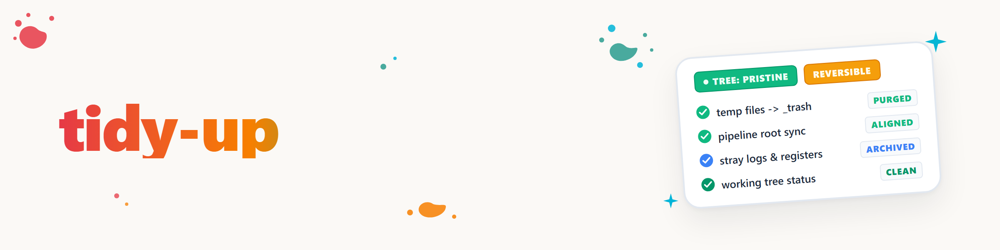

# Tidy Up — Execução de solucionador de tarefas, escritor e mantenedor para a pasta ativa do projeto

## Finalidade

No final de uma sessão de trabalho em um projeto, costuma sobrar pequenas pendências: um ponto de TODO já concluído que nunca foi marcado; um README que mostra o estado antigo em vez do estado medido; um punhado de arquivos de teste que ninguém mais precisa. `tidy-up` é uma execução **única e autolimitada** que organiza exatamente isso para **uma** pasta de projeto — aquela em que a sessão já estava trabalhando. Sem loop contínuo, sem varredura de todo o sistema.

A execução consiste em três papéis, que o próprio modelo assume em sequência:

1. **SOLUCIONADOR DE TAREFAS** — resolver ou classificar corretamente os pontos abertos, triviais/autônomos, do registro do projeto.
2. **ESCRITOR** — atualizar a documentação para o estado atual medido, no projeto E na raiz do pipeline em que o projeto está.
3. **MANTENEDOR** — higiene: recolher restos/arquivos temporários (princípio da lixeira), manter registro/catálogo e registrar os restos em aberto em vez de apenas mencioná-los no chat.

**Medido antes da criação desta skill:** Não existem nesta biblioteca (estado de 2026-08-19) skills ou papéis independentes com os nomes `tasksolver`/`writer`/`maintainer` — nem como nome de skill nem como papel documentado em outra skill (busca em texto completo por `skills/**/SKILL.md`, sem resultados além de um nome não relacionado `privat-mail-writer`). Por isso, os três papéis estão definidos diretamente abaixo como seções, e não orquestrados externamente. Caso surjam skills independentes `tasksolver`/`writer`/`maintainer` no futuro, `tidy-up` as assumirá por referência, em vez de continuar duplicando a lógica (verificação obrigatória a cada evolução desta skill).

## Escopo — o que conta como "a pasta ativa do projeto"?

- A pasta do projeto em que a sessão trabalhou neste contexto, **incluindo todas as subpastas**. Sem saltar para projetos vizinhos, sem varredura de um pipeline inteiro nem de `.TOPICS/` como um todo.
- **Uma** exceção controlada: a atualização de documentação/registro pode tocar adicionalmente o **nível raiz do pipeline** em que o projeto está (por exemplo, uma linha de status deste único projeto em uma tabela de visão geral do pipeline) — mas somente a linha/seção que diz respeito a este projeto, sem reorganizar toda a raiz do pipeline.
- Se não estiver claro o que é "a pasta ativa do projeto" (por exemplo, a sessão trabalhou em várias pastas), usar a raiz comum mais próxima do projeto (onde estão README/TODO/CLAUDE.md do projeto) — em caso de dúvida, delimitar de forma mais estreita em vez de mais ampla.

## Papel 1 — SOLUCIONADOR DE TAREFAS

Objetivo: colocar o registro do projeto (`TODO.md`/`AUFGABEN.txt`/convenção local comparável) em um estado correto e atual.

1. Localizar o registro do projeto (a convenção local tem prioridade sobre a criação de um novo arquivo — ver a regra "Tarefas remanescentes devem ser registradas, não apenas mencionadas" no regulamento global).
2. Avaliar cada ponto aberto individualmente:
   - **Já concluído** (por exemplo, pela sessão recém-encerrada) → marcar como concluído/mover para `DONE.md` ou para a convenção local de concluídos.
   - **Trivial e resolvível de forma autônoma** (nenhuma decisão, aprovação, dado, hardware ou sessão do usuário necessária; ver a tabela de delimitação em `work-autonomous`) → resolver agora e depois registrar como concluído.
   - **Não trivial ou não autônomo** → NÃO alterar, mas mantê-lo corretamente classificado (não deixá-lo sem comentário quando existir um lugar melhor para ele — por exemplo, um ponto que há muito merecia uma categoria de ticket `USER/*`).
3. Não inventar novas tarefas — `tidy-up` resolve restos existentes, não cria uma nova agenda.

## Papel 2 — ESCRITOR

Objetivo: a documentação deve mostrar o estado **medido**, não o estado lembrado ou desejado.

1. No projeto: verificar README/CHANGELOG/linhas de status em relação à situação real do código e das pastas (por exemplo, arquivos citados que ainda existem, número de versão citado correto, marcação "em andamento" que não esteja há muito tempo concluída).
2. Na raiz do pipeline: se houver um registro/uma tabela de status que liste este projeto (por exemplo, `.TOPICS/<Pipeline>/ROADMAP.md`, `STATUS.md`, uma tabela de projetos no README do pipeline), atualizar a linha/seção referente exclusivamente a este projeto.
3. **Nunca substituir conteúdo curado, apenas medir e atualizar.** Tabelas, changelogs ou seções cuidadosamente redigidas mantêm forma e tom — apenas os fatos (números, status, nomes de arquivos, versões) são corrigidos. Em caso de dúvida sobre se uma seção é curada, é preferível acrescentar uma observação a sobrescrever uma formulação existente.
4. Não reescrever do zero quando uma atualização basta.
5. **Acompanhamento de traduções** (complemento de 2026-08-19, pedido direto do usuário): se para o projeto faltar uma versão de idioma que a **Política P-006** (`.SYNC/_policies/library/P-006_sprachstufen.md`) torna obrigatória para o seu nível, ou se uma versão existente estiver visivelmente desatualizada, o passo ESCRITOR faz esse acompanhamento. Resumo da P-006: **o conjunto central (DE+EN) é obrigatório** para todo repositório publicado/objeto catalogado (repositório: `README.md` EN + `README_de.md`; skill: `SKILL.md` DE + `SKILL.en.md`); os conjuntos completos/mundiais (ES/ZH/JA/RU, ou +FR/HI/AR/BN/PT) são a meta, mas serão acompanhados **gradualmente**, e não em uma campanha única via `tidy-up`.
   **Ferramenta: a skill existente `bilingual-doc-sync` é orquestrada (chamada), sua lógica NÃO é duplicada** — ela já cobre "acompanhar a versão de idioma faltante" + verificação de paridade de seções + correção de divergências. `tidy-up` fornece apenas o gatilho (qual objeto, qual idioma obrigatório faltante segundo a P-006) para o projeto ativo; a qualidade da tradução, a paridade estrutural e a regra do idioma principal continuam sob responsabilidade de `bilingual-doc-sync`. **Limites como na P-006:** traduzir somente até o estado atual medido, não inventar conteúdo, usar diacríticos e acentuação corretos, respeitar o intervalo de espera do repositório (menos de 24 h desde o último commit) e bloqueios ativos — nesses casos, deixar o ponto sem tradução e registrá-lo como ponto aberto (Papel 3) em vez de forçá-lo.

## Papel 3 — MANTENEDOR

Objetivo: higiene, sem que nada se perca.

1. **Recolher restos/arquivos temporários** (restos de scripts, `*.tmp`, cópias duplicadas, saídas de depuração esquecidas) — princípio da lixeira: mover para uma pasta local `_archive/` (criá-la + registrá-la em `.gitignore` caso ainda não exista), **nunca excluir diretamente**. Para achados cuja origem ou finalidade não esteja clara: determinar ativamente a finalidade (ler o arquivo), não descartar sem leitura — ver a convenção "recertificar alterações de terceiros".
2. **Manutenção de registro/catálogo:** se o projeto fizer parte de um catálogo/registro maior (registro de skills, manifesto de módulos, visão geral do pipeline), verificar se a entrada deste projeto ainda está correta — não reconstruir o registro inteiro, apenas esta entrada.
3. **Registrar os restos em aberto em vez de mencioná-los no chat:** o que restar ao final desta execução (pontos não resolvíveis de forma autônoma, falhas encontradas mas não corrigidas, itens deliberadamente adiados) é registrado segundo a regra "Tarefas remanescentes devem ser registradas, não apenas mencionadas" — preferencialmente localmente, no ponto em que foi encontrado (convenção TODO.md/AUFGABEN.txt do projeto); caso contrário, centralmente (`ticket-master`/`TASKPLAN`), sempre com contexto (o que é, por que está em aberto, próximo passo).
4. **Respeitar bloqueios:** antes de qualquer alteração, verificar se há um `LOCK.txt`/`LOCK.<scope>.txt`/`LOCK.user.*` ativo na pasta do projeto. Um `LOCK.user.*` interrompe completamente o `tidy-up` para a área afetada — sem contorná-lo, sem fazer uma limpeza parcial na área bloqueada.
5. **Commit e push somente conforme a convenção de repositório de cada projeto** — quando houver áreas separadas de planejamento e de desenvolvimento, fazer as alterações no clone local autorizado do projeto, não em uma cópia de planejamento ou de projeção.
   As alterações próprias seguem a convenção global "fazer commit e push por conta própria imediatamente", quando o projeto assim o prever.

## Autolimitação

`tidy-up` é **uma execução, não um loop**. Após o Papel 3, a skill termina com um breve resumo (o que foi resolvido, atualizado, limpo e registrado como aberto) e retorna à sessão chamadora. Uma nova chamada de `/tidy-up` no mesmo projeto logo em seguida é permitida, mas não é automaticamente útil — ver o critério de vencimento abaixo.

## Relação com work-autonomous

As execuções de `tidy-up` **contam como tarefa autônoma executável no sentido do Nível 1 de `work-autonomous`** (trabalho normal e visível — sem motivo para mudar para a verificação cara de esgotamento do Nível 2, enquanto houver uma execução de `tidy-up` vencida). Na prática: se `/work-autonomous` for usado junto com `/tidy-up` dentro de um `/goal`, o objetivo só se considera concluído quando também as pendências vencidas de `tidy-up` estiverem resolvidas — desde que sejam executáveis de forma autônoma (ver a tabela de delimitação em `work-autonomous`; um ponto de `tidy-up` que exija decisão do usuário não conta como autônomo, assim como qualquer outra tarefa vinculada a `USER/*`).

**Critério de vencimento** (quando uma execução de `tidy-up` está "vencida"?):

1. A sessão já trabalhou, neste contexto, em uma pasta concreta de projeto (não apenas pesquisa/leitura sem alterações — nesse caso não há nada a limpar).
2. Desde a última execução registrada de `tidy-up` para ESTE projeto, o intervalo de espera já expirou (padrão: 1 vez por encerramento de sessão neste projeto — sem execuções repetidas **dentro** da mesma sessão sem novas alterações desde a última execução).
3. Nenhum `LOCK.user.*` ativo bloqueia a pasta do projeto (ver Papel 3, item 4).

Registro da última execução (análogo ao padrão de guarda de `work-autonomous`, mas deliberadamente mais simples — `tidy-up` não precisa de uma cadeia de quatro etapas, apenas um carimbo de data/hora por projeto):

```bash
usmc --agent <agent> note "tidy-up: project=<projekt-pfad-oder-slug> at=<ISO-Zeit> result=<done|nothing-to-do>" \
  --type context --priority 2 --tags "tidy-up-log,<projekt-slug>"
```

Antes de uma nova execução, ler a mesma tag (`usmc --agent <agent> working --limit 20` filtrado por `tidy-up-log,<projekt-slug>`), para verificar o critério 2.

Uma construção `/goal` (se existir ou for criada — o próprio `work-autonomous` não chama nenhum `/goal`, ver a seção correspondente "Intencionalmente sem `/goal` integrado") lê este critério de vencimento da mesma forma que lê o próprio sinal de interrupção de `work-autonomous`: se uma execução de `tidy-up` estiver vencida E for executável de forma autônoma, o objetivo ainda não está concluído — independentemente de a cadeia própria de quatro passos de `work-autonomous` já indicar "esgotado".

A entrada complementar, mínima e pouco invasiva, na própria skill `work-autonomous` (Nível 1, nova fonte "execuções vencidas de tidy-up do projeto ativo") faz parte desta ampliação — ver a entrada correspondente no changelog.

## Skills relacionadas

- **`work-autonomous`** — ver acima; `tidy-up` é uma das fontes que o Nível 1 de `work-autonomous` processa, não substitui a verificação de esgotamento dele.
- **`bilingual-doc-sync`** — é orquestrada pelo Papel 2 (ESCRITOR) para o acompanhamento de traduções (ver ali), não duplicada. `tidy-up` decide apenas O QUE falta segundo a P-006; `bilingual-doc-sync` decide COMO se traduz/sincroniza.
- **`bugsweep`** — busca sistemática de bugs com escalonamento por duplicação. Finalidade diferente (encontrar falhas, não manter registro/documentação/higiene) — em caso de sobreposição (um achado da varredura de bugs vai para o registro), `tidy-up` assume apenas a manutenção do registro, não a busca de bugs em si.
- **`dev-cycle`** — estrutura de 8 fases para o desenvolvimento de novos recursos. `tidy-up` não é uma estrutura de desenvolvimento, mas uma execução de encerramento/higiene após trabalho já realizado.
- **`folder-flattening`** — reestrutura hierarquias de pastas aninhadas. `tidy-up` limpa arquivos dentro da estrutura existente, sem alterar a própria estrutura.

## Exemplos

```
User: "/tidy-up"
(Session hat gerade am autorisierten lokalen Checkout von `beispiel-projekt` gearbeitet)

→ TASKSOLVER: TODO.md gelesen — 2 Punkte bereits durch die Sitzung erledigt (nach DONE.md
  verschoben), 1 trivialer Punkt ("README-Tippfehler in Zeile 12") autonom geloest, 1 Punkt
  braucht Nutzerentscheidung (unveraendert stehen gelassen).
→ WRITER: README-Versionsangabe war 1.2.0, tatsaechlich 1.3.0 (package.json) — korrigiert.
  Pipeline-Root-Statustabelle: Zeile fuer "beispiel-projekt" von "in Arbeit" auf "aktiv" gesetzt.
→ MAINTAINER: 3 Debug-Skripte im Projektroot gefunden, nach _archive/ verschoben (Zweck geprueft:
  einmalige Testskripte, nicht mehr referenziert). Skill-Registry-Eintrag geprueft: stimmt.
  1 offener Punkt (Nutzerentscheidung) in AUFGABEN.txt belassen, dort bereits korrekt einsortiert.
→ USMC-Log geschrieben: tidy-up: project=beispiel-projekt at=2026-08-19T14:30 result=done
→ Zusammenfassung an Nutzer: 3 geloest, 2 Doku-Stellen aktualisiert, 3 Dateien archiviert, 1 Punkt
  offen (Nutzerentscheidung noetig).
```

```
Kombiniert mit /goal + /work-autonomous:

/goal "Projekt X fertigstellen" mit /work-autonomous + /tidy-up als Bedingungen
→ work-autonomous Ebene 1 findet: ACTIONABLE-Ticket erledigt, dann kein weiteres Ticket mehr,
  ABER tidy-up-Faelligkeitskriterium erfuellt (Session hat an Projekt X gearbeitet, kein
  protokollierter Lauf seit Sitzungsbeginn, kein LOCK.user aktiv) → tidy-up-Durchlauf ausgefuehrt.
→ Erst NACHDEM tidy-up "done" meldet UND work-autonomous Ebene 2 "exhausted" meldet, gilt das
  Goal als abgeschlossen.
```

## Changelog

### 1.1.0 (2026-08-19)
- Complemento de um acréscimo enviado ao vivo ao ticket T-20260819-461890468 (usuário, literalmente: "bis
  zu einer uebersetzung nachzuziehen die noch nicht existiert soll auch zum skill gehoeren"):
  o Papel 2 (ESCRITOR) recebe um quinto item, acompanhamento de traduções segundo a **Política P-006**
  (níveis de idioma: conjunto central DE+EN obrigatório, completo/mundial gradualmente). A ferramenta é a
  skill já existente `bilingual-doc-sync` — orquestrada, não duplicada. Dependência no frontmatter +
  entrada "Skills relacionadas" acrescentadas.

### 1.0.0 (2026-08-19)
- Versão inicial a partir do ticket T-20260819-461890468. Três papéis (solucionador de tarefas/escritor/mantenedor)
  definidos como seções na skill, depois de uma busca em texto completo na biblioteca confirmar que não existem
  skills independentes `tasksolver`/`writer`/`maintainer` (caso contrário, teriam sido orquestradas em vez de duplicadas). Escopo limitado à
  pasta ativa do projeto + linha de status na raiz do pipeline. Integração com o goal: execuções de `tidy-up`
  contam como fonte do Nível 1 de `work-autonomous`, com um registro próprio e enxuto de vencimento USMC (sem a
  guarda de quatro etapas de `work-autonomous` — para isso `tidy-up` é estruturalmente simples demais). Entrada
  complementar, mínima e pouco invasiva em `work-autonomous` 1.3.0 acrescentada (ver o changelog ali).
