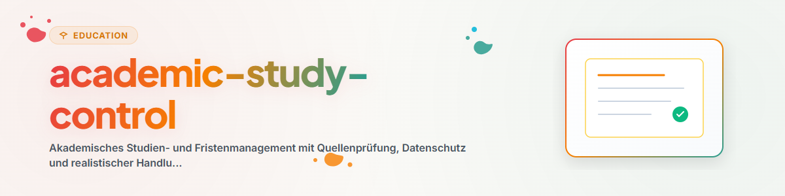

# Akademisches Studien- und Fristenmanagement (Deutsch)

Dieser Skill bietet eine systematische Unterstützung für die Studienorganisation, Fristenüberwachung und Prüfungsplanung.

## 1. Übersicht und Ziele

- **Fristen- und Prüfungssteuerung:** Erstellung verbindlicher Studien- und Prüfungspläne.
- **Quellen- und Regelkonformität:** Abgleich mit offiziellen Prüfungsordnungen und Modulhandbüchern.
- **Datenschutz & Anonymisierung:** Trennung von personenbezogenen Daten und fachlichen Inhalten.

## 2. Arbeitsablauf und Schritte

1. **Zielklärung:** Identifikation von Prüfungs- oder Abgabefristen.
2. **Bestandsaufnahme:** Abgleich mit Prüfungsordnung, LMS und bisherigen Ergebnissen.
3. **Recherche:** Einholen aktueller Fristen von offiziellen Hochschulseiten.
4. **Planerstellung:** Rückwärtsplanung von Abgabeterminen mit realistischen Pufferzeiten.
5. **Ergebnisdokumentation:** Ausgabe einer kompakten Übersichtstabelle.

## 3. Grenzen und Regeln

- **Offizielle Quellen vorrangig:** Bei Widersprüchen gilt stets die offizielle Prüfungsordnung.
- **Keine Zugangsdatenspeicherung:** Anmeldedaten für Portale werden nicht gespeichert.
- **Pufferzeiten einplanen:** Jeder Plan muss unvorhergesehene Verzögerungen berücksichtigen.
