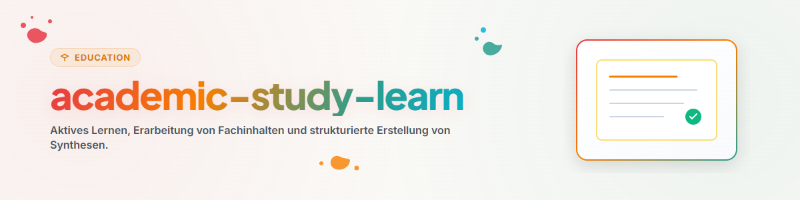

# Aprendizagem ativa e preparação do conhecimento (Alemão)

Esta skill oferece métodos para a elaboração ativa de conteúdos científicos complexos.

## 1. Visão geral e objetivos

- **Recordação e recuperação ativas:** Consolidação do conhecimento especializado na memória de longo prazo.
- **Método de Feynman:** Explicação simples de conceitos abstratos para identificar lacunas de compreensão.
- **Notas estruturadas:** Criação de resumos e cartões conceituais.

## 2. Fluxo de trabalho e etapas

1. **Análise do material de origem:** Identificação das teses centrais e dos termos principais.
2. **Reconstrução livre:** Formulação dos conteúdos a partir da memória.
3. **Comparação e análise de lacunas:** Identificação de passagens pouco claras no texto original.
4. **Síntese:** Criação de uma nota concisa ou de um mapa de conhecimento.

## 3. Limites e regras

- **Compreensão antes da memorização:** A estrutura lógica vem em primeiro lugar.
- **Base de fontes verificada:** Utilizar apenas materiais cientificamente fundamentados.
