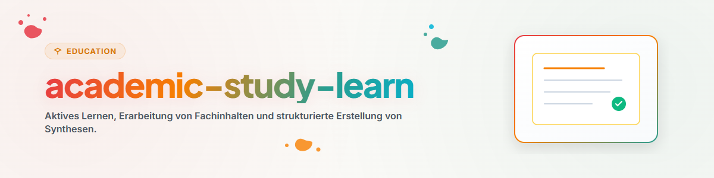

# Активное Обучение и Структурирование Знаний (Русский)

Этот навык предлагает методы активного воспоминания, техники Фейнмана и структурирования конспектов.

## 1. Общий обзор и цели

- **Активное Воспоминание и Интервальные Повторения:** Техники для долгосрочного усвоения материала.
- **Метод Фейнмана:** Объяснение сложных тем простым языком для выявления пробелов.
- **Структурированные Записи:** Метод Корнелла и концептуальные карты.

## 2. Рабочий процесс и шаги

1. **Аналитическое чтение:** Выделение ключевых тезисов из источника.
2. **Самостоятельное объяснение:** Пересказ материала своими словами без подглядывания.
3. **Устранение пробелов:** Повторный разбор неясных моментов.
4. **Создание шпаргалки:** Оформление краткого резюме темы.

## 3. Обязательные ограничения и правила

- **Приоритет понимания:** Логическое осмысление вместо заучивания.
- **Проверенные источники:** Опора на академическую литературу.
