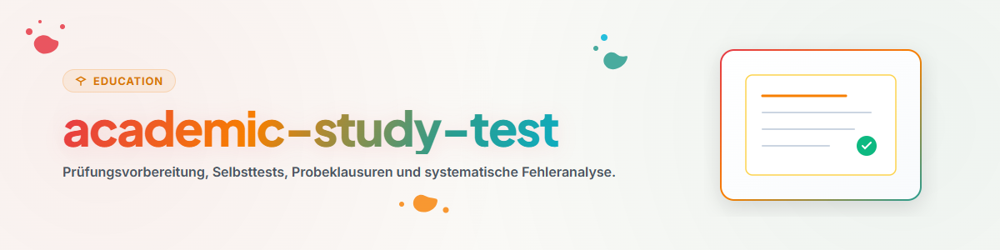

# التحضير للامتحانات والاختبارات الذاتية (الألمانية)

يتيح هذا المهارة إنشاء تمارين واقعية وإجراء فحوصات موضوعية للأداء.

## 1. نظرة عامة وأهداف

- **امتحانات محاكاة:** إعداد مهام بالصيغة المستهدفة للامتحان.
- **تحليل الأخطاء:** تصنيف منهجي لأخطاء الفهم وأخطاء عدم الانتباه.
- **إدارة الوقت:** التدريب تحت ظروف زمنية حقيقية.

## 2. سير العمل والخطوات

1. **صياغة المهام:** تصميم الأسئلة بناءً على ملف المتطلبات.
2. **محاكاة الامتحان:** الإجابة دون الاستعانة بأي مواد مرجعية.
3. **التقييم:** تصحيح موضوعي وفقًا للحل النموذجي ومخطط التقييم.
4. **المتابعة المستهدفة:** معالجة مركزة للمجالات الضعيفة.

## 3. الحدود والقواعد

- **التصحيح الصارم:** لا تُمنح نقاط للإجابات غير المكتملة أو الغامضة.
- **الخطأ فرصة للتعلم:** استخدام التشخيص لسد الفجوات المعرفية بشكل مستهدف.
