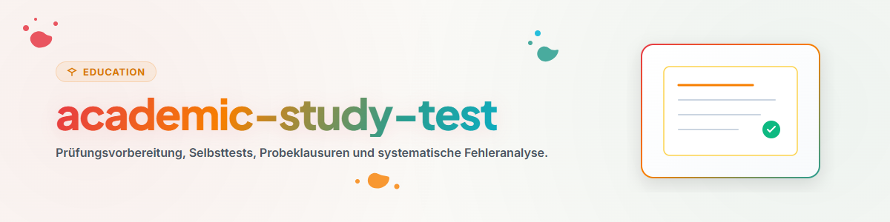

# Préparation aux Examens et Auto-Évaluation (Français)

Cette compétence permet de concevoir des examens blancs et d'analyser les erreurs pour optimiser la révision.

## 1. Aperçu Général et Objectifs

- **Examens Blancs:** Création de questions à choix multiples et de sujets de réflexion.
- **Analyse des Erreurs:** Diagnostic précis des fautes de compréhension ou de méthode.
- **Gestion du Temps:** Entraînement en conditions réelles de temps limité.

## 2. Flux de Travail et Étapes

1. **Élaboration du Sujet:** Concevoir des questions alignées sur le programme.
2. **Passage en Conditions Réelles:** Répondre sans document ni aide extérieure.
3. **Correction Rigoureuse:** Évaluer avec un barème objectif.
4. **Plan de Correction:** Réviser prioritairement les notions non maîtrisées.

## 3. Limites Absolues et Règles Inviolables

- **Évaluation Objective:** Ne pas surévaluer les réponses incomplètes.
- **Apprentissage par l'Erreur:** Exploiter chaque faute pour progresser.
