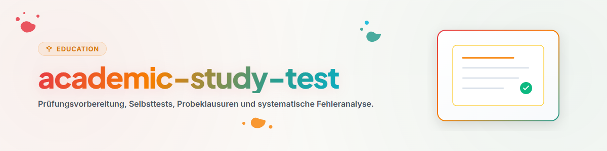

# Prüfungsvorbereitung und Selbsttests (Deutsch)

Dieser Skill ermöglicht die Erstellung realistischer Übungsaufgaben und die Durchführung objektiver Leistungskontrollen.

## 1. Übersicht und Ziele

- **Simulierte Prüfungen:** Erstellung von Aufgaben im Zielformat der Prüfung.
- **Fehleranalyse:** Systematische Kategorisierung von Verständnis- und Leichtsinnsfehlern.
- **Zeitmanagement:** Training unter realen Zeitbedingungen.

## 2. Arbeitsablauf und Schritte

1. **Aufgabenstellung:** Entwurf von Fragen basierend auf dem Anforderungsprofil.
2. **Klausursimulation:** Bearbeitung ohne Zuhilfenahme von Unterlagen.
3. **Auswertung:** Objektive Bewertung nach Musterlösung und Bewertungsschema.
4. **Gezielte Nacharbeit:** Schwerpunkmäßige Aufarbeitung mangelhafter Bereiche.

## 3. Grenzen und Regeln

- **Strenge Korrektur:** Keine Punkte für unvollständige oder vage Antworten.
- **Fehler als Lernchance:** Nutzung der Diagnose zur gezielten Schließung von Wissenslücken.
