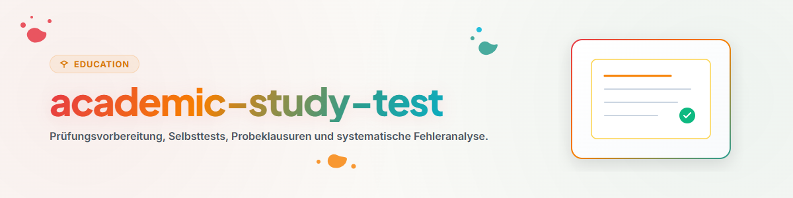

# Подготовка к Экзаменам и Пробные Тесты (Русский)

Этот навык предназначен для разработки пробных экзаменов и систематического анализа ошибок.

## 1. Общий обзор и цели

- **Пробные Экзамены:** Составление вопросов разной сложности.
- **Анализ Ошибок:** Выявление пробелов в знаниях и типичных оговорок.
- **Тайм-Менеджмент:** Тренировка выполнения заданий на время.

## 2. Рабочий процесс и шаги

1. **Составление теста:** Формирование вопросов по всему курсу.
2. **Тестирование:** Ответы без использования справочников.
3. **Проверка:** Объективная оценка по критериям.
4. **Работа над ошибками:** Повторное изучение проблемных тем.

## 3. Обязательные ограничения и правила

- **Строгость проверки:** Не завышать оценки при неполных ответах.
- **Диагностическая цель:** Использовать тесты для поиска слабых мест.
