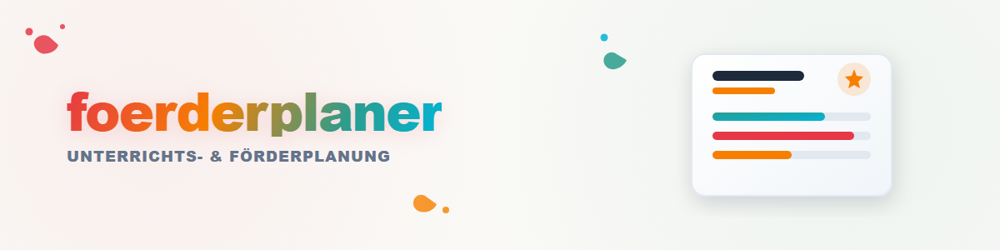

# শিক্ষণ ও সহায়তা পরিকল্পনাকারী

## উদ্দেশ্য

প্রারম্ভিক অবস্থা ও শেখার লক্ষ্য থেকে সুনির্দিষ্ট, যাচাইযোগ্য সহায়তা ও শিক্ষণ পদক্ষেপ তৈরি করা।

**ফলাফল:** লক্ষ্য, কার্যক্রম, পার্থক্যকরণ, পর্যবেক্ষণের মানদণ্ড এবং পর্যালোচনার তারিখসমূহ।

## কার্যপ্রবাহ

1. লক্ষ্য, প্রেক্ষাপট এবং প্রয়োজনীয় আউটপুট বিন্যাস স্পষ্ট করুন।
2. শুধুমাত্র বর্তমান অনুরোধে প্রদত্ত তথ্য ব্যবহার করুন।
3. ফলাফলটি কাঠামোবদ্ধ ও অনুসরণযোগ্যভাবে তৈরি করুন।
4. অনুমানগুলো চিহ্নিত করুন এবং বাহ্যিক পরিবর্তনের আগে নিশ্চিতকরণ নিন।

## উদাহরণ

**ইনপুট:** একটি বেনামী শিক্ষার্থী দলের জন্য পাঠ-বোধ বিষয়ে চার সপ্তাহের সহায়তা পরিকল্পনা করো।

**ফলাফল:** লক্ষ্য, কার্যক্রম, পার্থক্যকরণ, পর্যবেক্ষণের মানদণ্ড এবং পর্যালোচনার তারিখসমূহ।

## পাবলিক কোর ও ব্যক্তিগত সম্প্রসারণ

এই পাবলিক স্কিলে শুধুমাত্র হস্তান্তরযোগ্য পদ্ধতি অন্তর্ভুক্ত। অ্যাপ-নির্দিষ্ট অ্যাডাপ্টার, অ্যাকাউন্ট, স্থানীয় পথ, ডেটাবেস এবং ব্যক্তিগত পূর্বনির্ধারিত সেটিংস একটি ব্যক্তিগত অতিরিক্ত প্রোফাইল বা ব্যক্তিগত ফর্কে থাকবে এবং এই রিপোজিটরিতে অন্তর্ভুক্ত করা যাবে না।

ব্যক্তিগত প্রোফাইল ছাড়া এই স্কিল শুধুমাত্র বর্তমান অনুরোধে স্পষ্টভাবে প্রদত্ত তথ্যের সাথে কাজ করে।

## সীমা ও তথ্য গোপনীয়তা

- ডেটা ডিফল্টভাবে সংরক্ষণ করা হয় না।
- স্পষ্ট অনুমোদন ছাড়া কোনো উৎস, ফাইল বা ইন্টারফেস খোলা বা পরিবর্তন করা হয় না।
- এই স্কিল সহায়তা প্রতিবেদন, রিপোর্ট কার্ড বা সরকারি মূল্যায়ন তৈরি করে না। সাধারণ প্রতিবেদন তৈরির জন্য আলাদাভাবে `report-forge` ব্যবহার করা যেতে পারে; ব্যক্তিগত প্রতিবেদন টেমপ্লেট ব্যক্তিগত থাকবে।

## পরিবর্তনের লগ

### 2.0.0 (2026-07-30)

- ব্যবহারকারী-নিরপেক্ষ পাবলিক কোর; ব্যক্তিগত ইন্টিগ্রেশন ও ব্যক্তিগত প্রোফাইল সরানো হয়েছে।
