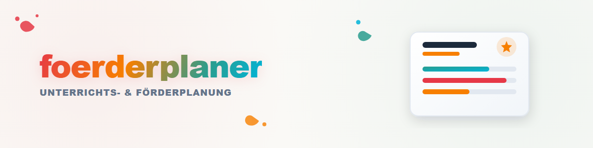

# 教学与支持规划器

## 用途

把起点和学习目标转化为具体且可复核的教学与支持步骤。

**结果:** 目标、措施、差异化、观察标准和复核日期。

## 工作流程

1. 明确目标、背景和所需输出格式。
2. 只使用当前请求中提供的信息。
3. 生成结构清晰且可追溯的结果。
4. 标记假设，并在外部变更前取得确认。

## 示例

**输入:** 为匿名学习小组规划四周的阅读理解支持。

**结果:** 目标、措施、差异化、观察标准和复核日期。

## 公共核心与私有扩展

此公共 Skill 只包含可移植的方法。特定应用适配器、账户、本地路径、数据库和个人默认设置必须保留在私有补充配置或私有 fork 中，不得提交到此仓库。

没有私有配置时，Skill 只使用当前请求中明确提供的信息。

## 限制与数据保护

- 默认不持久保存数据。
- 未经明确许可，不打开或修改任何来源、文件或接口。
- 本 Skill 不生成支持报告、证书或官方评估。通用报告可另用 `report-forge` 生成；个人报告模板保持私有。

## 变更记录

### 2.0.0 (2026-07-30)

- 改为用户中立的公共核心；移除私有集成和个人配置。
