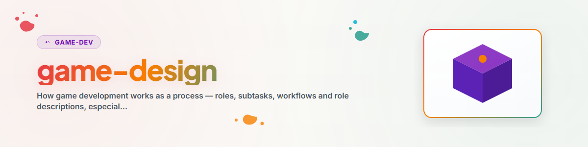

# تصميم الألعاب: الأدوار والمهام الفرعية وسير العمل

## الغرض

تطوير الألعاب عمل جماعي يتكون من تخصصات منفصلة بوضوح، حتى وإن تولّى شخص واحد أو وكيل ذكاء اصطناعي عدة منها. يوفّر هذه المهارة **نموذج التنظيم**: ما الأدوار الموجودة، وما المهام الفرعية المرتبطة بها، وبأي ترتيب تتفاعل، وكيف توثَّق اللعبة كمفهوم (GDD). أما الجانب *التقني* فيُراجَع في `/rojo` (المزامنة)، و`/rbx-studio` (المحرر/الأصول)، والمهارة الفوقية `/rbx-dev` (البنية).

استخدم هذه المهارة عند تخطيط لعبة جديدة، وعند تقسيم العمل (بما في ذلك بين عدة وكلاء ذكاء اصطناعي)، وعند كتابة مستند تصميم لعبة أو مراجعته.

## الأدوار (5 للتطوير + 2 للاختبار)

توزيع أدوار مدمج ومجرَّب. الأوصاف الكاملة مع جميع المهام الفرعية متاحة في: [`references/roles-and-workflows.md`](references/roles-and-workflows.md).

| الدور | التركيز | المهام الفرعية الأساسية |
| --- | --- | --- |
| **المخرج الإبداعي (Creative Director)** | ماذا ولماذا ولمن | GDD/KONZEPT، تصميم الميكانيكيات وموازنتها، تحديد الأولويات/السبرينتات، القصة، تدفق تجربة المستخدم UX |
| **المهندس (Engineer)** | كيف (تقنياً) | شيفرة الخادم/العميل/المشتركة، حلقة اللعب (Game-Loop)، الشبكة/Remotes، DevOps (Rojo، البناء)، إصلاح الأخطاء |
| **الفنان (Artist)** | كيف يبدو العالم | بناء العالم والمستويات، الإضاءة والأجواء، الجسيمات، جلب الأصول (بما في ذلك فحص البرمجيات الخبيثة) |
| **التلميع / الصوت (Polish / Audio)** | كيف تُحسّ اللعبة وكيف تبدو | المؤثرات الصوتية SFX والموسيقى والخلفيات الصوتية، الرسوم المتحركة، التحسين النهائي لواجهة المستخدم UI/UX، "Juice" (اهتزاز الشاشة، توقف الضربة)، التغذية الراجعة |
| **الأعمال (Business)** | الواجهة الخارجية | صفحة المتجر، الأيقونة/الصورة المصغّرة، تحقيق الدخل (Gamepass/Products/Pass)، التحليلات، المجتمع |
| **مختبِر الجودة (QA-Tester)** | هل هي صحيحة تقنياً؟ | فحص الأخطاء في الشيفرة، اختبار اللعب وفحص الـ Console، تقارير قابلة لإعادة الإنتاج، الاختبار التراجعي (Regression)، الأداء |
| **ناقد الألعاب (Game Critic)** | هل هي ممتعة؟ | الانطباع الأول والانطباع طويل المدى من منظور اللاعب، تقييم صريح (المتعة، الوضوح، العدالة)، مقترحات |

**القاعدة الأساسية:** التطوير والاختبار دوران **منفصلان**، ومن الأفضل أن يُسندا إلى أشخاص أو وكلاء مختلفين. من يكتب الشيفرة لا يمكنه اختبارها بموضوعية. ويحق لناقد الألعاب أن يكون صارماً.

## سير العمل (سلاسل التطوير)

ينتقل العمل كسلسلة من دور إلى آخر. وأهم الأنماط:

**سلسلة الميزة القياسية:**
```
Creative Director (plant Feature) → Engineer (Backend) → Artist (Frontend/Assets)
→ Polish/Audio (Sound + Feinschliff) → QA-Tester (technischer Test)
→ Spielkritiker (Spielerperspektive) → Creative Director (Feedback → nächste Iteration)
```

**سلسلة الإصلاح السريع:** مختبِر الجودة (خطأ) ← المهندس (إصلاح) ← مختبِر الجودة (تحقق).

**سلسلة الأصول:** الفنان (البحث في المتجر) ← الفنان (فحص البرمجيات الخبيثة) ← الفنان (الدمج) ← الجودة (مراجعة بصرية).

**سلسلة التلميع:** ناقد الألعاب (نقطة ضعف) ← التلميع/الصوت ← الفنان ← ناقد الألعاب (إعادة فحص).

**الإنسان في الحلقة:** [سلسلة الوكلاء] ← مختبِر بشري ← المخرج الإبداعي (ملاحظات) ← [سلسلة].

ينبغي أن تترك كل تكرار (Iteration) سجلّ تغييرات (Changelog) موجزاً. شرط التوقف: انتهاء ميزانية الوقت **أو** تحقيق هدف الجودة.

### الاختبار القائم على الشخصيات (Personas)

لا تنجح اللعبة إلا إذا تمكّن لاعبون مختلفون تماماً من التعامل معها. لذلك اختبرها (بما في ذلك عبر محاكاة الوكلاء) من عدة **شخصيات** بدلاً من الاكتفاء بوجهة نظرك الشخصية، وتنوّع الشخصيات حسب العمر والخبرة والمنصة (PC/Mobile/Tablet/Console) ومدى الانتباه واللغة وإمكانية الوصول. أمثلة: طفل casual بعمر 9 سنوات على جهاز لوحي لا يريد سوى الضغط على الأزرار؛ ولاعب Core بعمر 12 عاماً على الحاسوب يبحث عن الميتا؛ ومبتدئ فوق 60 عاماً يحتاج إلى أزرار كبيرة. ينبغي أن تُجرى اختبارات الشخصيات **بشكل أعمى** (المختبِر لا يعرف نية التصميم).

## مستند تصميم اللعبة (KONZEPT.md)

وثِّق كل لعبة في GDD موجز. القالب: [`assets/KONZEPT_template.md`](assets/KONZEPT_template.md). الحد الأدنى للبنية:

- **الرؤية**: جملة إلى جملتين: ما هي اللعبة؟
- **النوع / المرجع**: التصنيف مع عناوين مرجعية.
- **الميكانيكيات الأساسية**: **3–4 كحد أقصى** (التركيز يفرض الجودة).
- **حلقة اللعب**: الحلقة الدقيقة بدقيقة التي يمر بها اللاعب.
- **أنماط اللعب / صيغ الوقت**: عند الحاجة.
- **تحقيق الدخل**: Gamepasses، والمنتجات للمطورين، وBattle Pass، والمتجر.
- **التقنية**: المكدس (Rojo/الأطر)، والبنية التقريبية.
- **الخطوات التالية**: قائمة تحقق للتنفيذ.
- **الأخطاء المعروفة / النقاط المفتوحة**.

## تقسيم العمل بين عدة وكلاء

يمكن لعدة وكلاء ذكاء اصطناعي (أو إنسان مع ذكاء اصطناعي) أن يتقاسموا لعبة واحدة، بنمطين:

- **السرب (Schwarm)**: المهمة نفسها في مجالات مختلفة (مثلاً ثلاثة وكلاء يوازن كل منهم نظاماً واحداً).
- **الفريق (Team)**: أدوار مختلفة متناسقة مع بعضها (المهندس + الفنان + التلميع يعملون بالتوازي على ميزة واحدة، بتنسيق من المخرج الإبداعي).

من الممارسات المجرَّبة: لا تُسنِد التطوير والاختبار **أبداً** إلى الوكيل نفسه؛ وثبّت تعليمات النظام (System Prompt) لكل دور بوصفه وصفاً لذلك الدور؛ وينتهي كل تكرار في السلسلة بسجل تغييرات وتقرير اختبار؛ ويبقى الإنسان بوابة الجودة.

## سياق السوق الخاص بـ Roblox (للاسترشاد)

معرفة بالمنصة تُرسّخ العمل المفاهيمي لـ Roblox (بلا ضمان، بل قواعد عامة فقط):

- **الأنواع المربحة:** Simulator وRPG وTycoon وHorror وObby، وتتفاوت كثيراً في حجم التوسع والجهد.
- **الأنيشات قليلة الخدمة (مخاطرة أعلى، منافسة أقل):** الاستراتيجية/RTS الخفيفة، وألعاب الرياضة عالية الجودة، وCozy/Life-Sim، وألعاب الألغاز/الهروب التعاونية، وAuto-Battler.
- **قواعد تحقيق الدخل الذهبية:** (1) عمليات LiveOps إلزامية (تحديثات كل 2–4 أسابيع)، (2) ينبغي أن ي*يدعم* تحقيق الدخل اللعب ولا يعيقه، (3) تصميم التفاعل الاجتماعي (التداول، والتعاون) بنية تحتية، (4) الأولوية للهاتف المحمول (أكثر من 50% يلعبون من الهاتف)، (5) ملاءمة صناع المحتوى (YouTube/TikTok) تسويق.

> للحصول على أرقام سوقية حالية وموثوقة، ابحث عنها بدلاً من التقدير؛ النقاط أعلاه إرشادات ثابتة، وليست بيانات مباشرة.

## للاستزادة

- المهارات الشقيقة: `/rojo` و`/rbx-studio`؛ والمهارة الفوقية `/rbx-dev` (أنماط البنية، وبنية المشروع، ودروس Luau).
- خط المرجعية (إن وُجد): `<your Roblox project pipeline>` (`AGENT_ROLES.md` و`GUIDE.md` و`IDEAS.md`، وتحليلات السوق).

## سجل التغييرات

### 1.0.0 (2026-06-17)
- النسخة الأولية. إطار عام للأدوار وسير العمل، مستخلص من `.ROBLOX/AGENT_ROLES.md` و`GUIDE.md`، ومحايد للمستخدم (دون محفظة مشاريع خاصة).

## مهارات ذات صلة

- `roblox-team-lock`: مطالبات الملفات والاستوديو وMCP عندما يعمل عدة وكلاء على المشروع نفسه. اقرأ أولاً، ثم اطلب الحجز، ثم اعمل، ثم حرّر الحجز.
