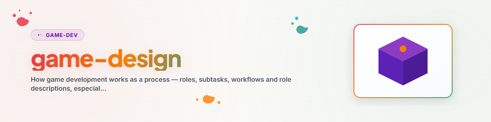

> **Français** — Version française officielle de la compétence `game-design`.

# Game Design — Rôles, sous-tâches & workflows

## Objectif

Le développement de jeux est un travail d'équipe composé de disciplines clairement séparées — même lorsqu'une seule personne
ou un agent IA en assume plusieurs. Cette compétence fournit le **modèle d'organisation** :
quels rôles existent, quelles sous-tâches leur reviennent, dans quel ordre ils interagissent
et comment formaliser un jeu sous forme de concept (GDD). Pour le *comment* technique, voir `/rojo` (synchronisation),
`/rbx-studio` (éditeur/ressources) et la méta-compétence `/rbx-dev` (architecture).

Utilisez cette compétence lors de la planification d'un nouveau jeu, lors de la répartition du travail (y compris entre
plusieurs agents IA) et lors de la rédaction ou de la relecture d'un Game Design Document.

## Les rôles (5 développement + 2 test)

Une répartition éprouvée et compacte. Descriptions complètes avec toutes les sous-tâches :
[`references/roles-and-workflows.md`](references/roles-and-workflows.md).

| Rôle | Focus | Sous-tâches principales |
| --- | --- | --- |
| **Creative Director** | QUOI & POURQUOI & pour QUI | GDD/KONZEPT, conception & équilibrage des mécaniques, priorisation/sprints, histoire, flux UX |
| **Engineer** | COMMENT (technique) | Code serveur/client/partagé, boucle de jeu, réseau/Remotes, DevOps (Rojo, build), correction de bugs |
| **Artist** | apparence du monde | Construction du monde et des niveaux, éclairage & atmosphère, particules, acquisition d'assets (avec scan malware) |
| **Polish / Audio** | sensations & sonorité | SFX/musique/ambiance, animations, finitions UI/UX, « juice » (secousses d'écran, hit-stop), retours visuels/sonores |
| **Business** | visibilité externe | Page boutique, icône/miniature, monétisation (Gamepass/Products/Pass), analytique, communauté |
| **QA-Tester** | techniquement correct ? | Recherche de bugs dans le code, playtests + vérification console, rapports reproductibles, régression, performance |
| **Critique de jeu** | est-ce amusant ? | Premières et longues impressions côté joueur, évaluation honnête (plaisir, clarté, équité), suggestions |

**Règle de base :** développement et test sont des rôles **séparés** — idéalement des personnes
ou agents distincts. Celui qui écrit le code ne le teste pas objectivement. Le critique de jeu a le droit d'être exigeant.

## Workflows (chaînes de développement)

Le travail circule sous forme de chaîne d'un rôle à l'autre. Les schémas principaux :

**Chaîne standard de fonctionnalité :**
```
Creative Director (planifie la fonctionnalité) → Engineer (backend) → Artist (frontend/assets)
→ Polish/Audio (son + finitions) → QA-Tester (test technique)
→ Critique de jeu (perspective joueur) → Creative Director (retour → itération suivante)
```

**Chaîne de correctif rapide :** QA-Tester (bug) → Engineer (correctif) → QA-Tester (vérifie).

**Chaîne d'assets :** Artist (recherche boutique) → Artist (scan malware) → Artist (intégration) → QA (visuel).

**Chaîne de finition (Polish) :** Critique de jeu (point faible) → Polish/Audio → Artist → Critique de jeu (re-vérification).

**Humain dans la boucle :** [chaîne d'agents] → testeur humain → Creative Director (retour) → [chaîne].

Chaque itération devrait laisser un bref journal des modifications. Condition d'arrêt : budget temps atteint
**ou** objectif de qualité satisfait.

### Tests basés sur des personas

Un jeu ne survit que si des joueurs très différents s'y retrouvent. Testez donc (y compris
par simulation d'agents) à partir de plusieurs **personas** plutôt que selon votre seul point de vue — en variant
âge, expérience, plateforme (PC/mobile/tablette/console), capacité d'attention, langue et
accessibilité. Exemples : un enfant de 9 ans joueur occasionnel sur tablette qui veut juste appuyer sur des boutons ; un
joueur assidu de 12 ans sur PC qui cherche la méta ; un débutant de 60 ans et plus ayant besoin de grands boutons.
Les tests par persona doivent se dérouler **à l'aveugle** (le testeur ne connaît pas l'intention de conception).

## Game Design Document (KONZEPT.md)

Consignez chaque jeu dans un GDD concis — modèle :
[`assets/KONZEPT_template.md`](assets/KONZEPT_template.md). Structure minimale :

- **Vision** — 1–2 phrases : qu'est-ce que le jeu ?
- **Genre / référence** — classification + titres de référence.
- **Mécaniques clés** — **max. 3–4** (la focalisation impose la qualité).
- **Boucle de jeu (Gameplay Loop)** — la boucle minute par minute du joueur.
- **Modes de jeu / formats temporels** — si pertinent.
- **Monétisation** — Gamepasses, Developer Products, Battle Pass, boutique.
- **Technique** — stack (Rojo/frameworks), architecture générale.
- **Prochaines étapes** — check-list d'implémentation.
- **Bugs connus / points ouverts**.

## Répartition du travail multi-agents

Plusieurs agents IA (ou humain + IA) peuvent se partager un jeu — deux modes :

- **Essaim (Swarm)** — même tâche sur des zones différentes (ex. trois agents équilibrent chacun un système).
- **Équipe (Team)** — rôles différents, coordonnés entre eux (Engineer + Artist + Polish en parallèle sur
  une fonctionnalité, coordonnés par le Creative Director).

Bonnes pratiques éprouvées : ne **jamais** confier développement et test au même agent ; figer des prompts
de rôle par rôle (prompt système = description du rôle) ; chaque itération de chaîne se termine par un journal
des modifications + rapport de test ; l'humain reste la porte de qualité finale.

## Contexte marché spécifique à Roblox (orientation)

Connaissances de plateforme qui ancrent la conception pour Roblox (aucune garantie, simples règles empiriques) :

- **Genres rentables :** Simulateur, RPG, Tycoon, Horreur, Obby — mise à l'échelle et effort très
  variables.
- **Niches sous-exploitées (risque plus élevé, moins de concurrence) :** vraie stratégie / RTS léger,
  jeux de sport de haute qualité, Cozy / simulation de vie, puzzle/escape en coop, Auto-Battler.
- **Règles d'or de la monétisation :** (1) le LiveOps est obligatoire (mises à jour toutes les 2–4 semaines),
  (2) la monétisation doit *soutenir* le gameplay sans le bloquer, (3) le design social (échanges,
  coop) est une infrastructure, (4) Mobile-First (50 %+ jouent sur smartphone), (5) la compatibilité avec
  les créateurs de contenu (YouTube/TikTok) constitue du marketing.

> Pour des chiffres de marché récents et fiables, effectuez une recherche plutôt que d'estimer — les points
> ci-dessus sont des heuristiques stables, pas des données en direct.

## Pour aller plus loin

- Compétences sœurs : `/rojo`, `/rbx-studio` ; méta-compétence `/rbx-dev` (schémas d'architecture,
  structure de projet, leçons Luau).
- Pipeline de référence (si disponible) : `<your Roblox project pipeline>` (`AGENT_ROLES.md`, `GUIDE.md`,
  `IDEAS.md`, analyses de marché).

## Journal des modifications

### 1.0.1 (2026-11-22)
- Mention linguistique corrigée.

### 1.0.0 (2026-06-17)
- Version initiale. Cadre générique de rôles et workflows, extrait de `.ROBLOX/AGENT_ROLES.md`
  et `GUIDE.md`, neutre vis-à-vis de l'utilisateur (sans portefeuille spécifique à un projet).

## Compétences associées

- `roblox-team-lock` — réservations (claims) de fichiers, Studio et MCP dès que plusieurs agents travaillent sur un même projet. Lire d'abord, puis réserver, travailler, puis libérer.
