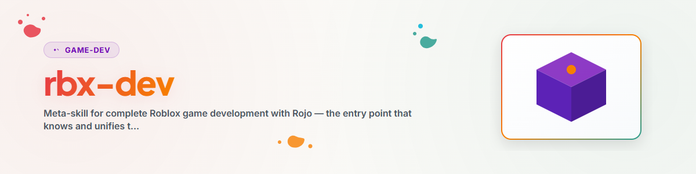

> **Français** — Version française officielle de la compétence `rbx-dev`.

> **Remarque :** Non affilié à Roblox Corporation ; « Roblox » est une marque de ses propriétaires respectifs. « rbx » est l'abréviation communautaire usuelle.

# Roblox-Dev — Méta-compétence pour le développement de jeux Roblox

## Finalité

Le point d'entrée central pour le développement de jeux Roblox avec un flux de travail versionnable basé sur Rojo. Cette compétence rassemble les connaissances transversales — structure de projet, patrons d'architecture et principaux pièges Luau — et oriente vers les trois sous-compétences spécialisées pour les questions pointues :

| Sous-compétence | Pour quoi |
| --- | --- |
| **`/rojo`** | Sync système de fichiers → Studio, `default.project.json`, rokit/Wally/Lune, squelette de projet, problèmes de sync |
| **`/rbx-studio`** | Utilisation de Studio, mode scène vs code, Studio-MCP, pipeline d'assets, **analyse anti-malware** |
| **`/game-design`** | Rôles et sous-tâches, chaînes de développement, Game Design Document (`KONZEPT.md`), multi-agents |

> Règle de routage : Pour **Sync/Build/Setup** → `/rojo`. Pour **Éditeur/Assets/Tests dans Studio**
> → `/rbx-studio`. Pour **Concept/Rôles/Processus** → `/game-design`. Pour **l'architecture du code,
> les pièges Luau ou le déroulé global** → rester ici.

## Stack en un coup d'œil

- **Langage :** Luau (`.luau`, pas `.lua`). Code en anglais, commentaires/documentation en français ou langue du projet, textes UI localisés.
- **Sync :** Rojo via rokit (versions d'outils figées). Système de fichiers = source de vérité.
- **Outils :** Rojo (sync/build), Lune (tests/scripts hors Studio), Wally (paquets), optionnellement Knit (framework Services/Controllers pour nouveaux projets), Selene (linter).
- **Pilotage :** Roblox-Studio-MCP pour inspection, tests et insertion d'assets pilotés par IA.

## Structure de projet (standard)

```
NomProjet/
├── default.project.json     # Mappage Rojo
├── rokit.toml               # versions d'outils figées
├── wally.toml               # dépendances de paquets
├── KONZEPT.md               # Game Design Document
├── src/
│   ├── shared/              # → ReplicatedStorage(.NomProjet.shared)
│   │   ├── Config.luau      # valeurs centrales, états, paramètres de gameplay
│   │   ├── GameEnums.luau   # énumérations, noms de Remotes, constantes
│   │   └── *Defs.luau       # définitions de données (objets, unités, niveaux)
│   ├── server/              # → ServerScriptService(.NomProjet)
│   │   ├── Main.server.luau # UNIQUE point d'entrée serveur (Script)
│   │   └── *Manager.luau    # ModuleScripts, chargés par Main via require()
│   ├── client/              # → StarterPlayerScripts(.NomProjet)
│   │   └── GameClient.client.luau   # point d'entrée client (LocalScript)
│   └── gui/                 # → StarterGui(.NomProjet)
│       └── *HUD.client.luau # construction GUI + boucle Heartbeat
└── assets/                  # fichiers .rbxm/.rbxl optionnels (sans scripts)
```

Un squelette est créé par `/rojo` via `scaffold_roblox_project.sh`.

## Patrons d'architecture

**Serveur — Main + modules Manager.** Un seul `Script` par projet : `Main.server.luau`. Il crée centralement le dossier `Remotes` et charge tous les modules métier via `require()` :
```lua
Main.server.luau (Script)
  ├─ require(StationManager)     -- ModuleScripts .luau
  ├─ require(PlayerSession)
  └─ crée les RemoteEvents → connecte les gestionnaires OnServerEvent
```
Tous les autres fichiers serveur sont des `.luau` (ModuleScripts).

**Client — état partagé + HUD.** Le `GameClient` écrit un état partagé et le HUD le lit dans le `Heartbeat` :
```lua
-- GameClient:
_G.ClientState = { gameState = "Lobby", health = 100 }
-- HUD:
RunService.Heartbeat:Connect(function()
    local cs = _G.ClientState; if not cs then return end
    healthBar.Size = UDim2.new(cs.health / cs.maxHealth, 0, 1, 0)
end)
```

**Remotes — centralisés dans GameEnums.** Définir les noms de Remotes une seule fois dans `GameEnums.Remotes` ; le serveur crée les événements à partir de là, le client les recherche avec ces mêmes noms. Ainsi, aucun décalage de chaîne ne survient entre serveur et client.

## Déroulé global d'un jeu

1. **Concept** (`/game-design`) : `KONZEPT.md` — genre, USP, 3 à 4 mécaniques cœur, monétisation.
2. **Setup** (`/rojo`) : générer le squelette, définir le mappage `default.project.json`.
3. **Backend** : Config → GameEnums → *Defs → Main.server → *Manager.
4. **Frontend** : GameClient → HUD.
5. **Playtest Greybox** (`/rbx-studio`) : gameplay d'abord, Parts + éventuellement matériaux IA.
6. **Mise à niveau des assets** (`/rbx-studio`) : assets Creator Store, **analyse anti-malware**, scène en `.rbxl`.
7. **Tests** (`/game-design`) : QA + critique de jeu + tests aveugles par personas, itérer.
8. **Release** (`/game-design` rôle business) : page du store, monétisation, Live-Ops.

## Pièges Luau / Roblox (liste courte)

Les écueils les plus fréquents — liste complète et commentée :
[`references/lessons-learned-luau.md`](references/lessons-learned-luau.md).

- Point-virgule après `task.wait(x)` si d'autres instructions suivent sur la même ligne.
- `Model.Position` n'existe pas → `model:GetPivot().Position`.
- `#table` sur des dictionnaires = 0 → compter manuellement.
- `mouse.Hit` peut être `nil` → vérifier avant usage.
- Appels `DataStore` **toujours** dans `pcall`.
- `tick()` obsolète → `os.clock()` ; `SetPrimaryPartCFrame` → `PivotTo`.
- Noms d'événements centralisés dans `GameEnums.Remotes` ; créer tous les Remotes dans `Main.server.luau`.
- Aucun `require` circulaire (sinon interblocage).
- `require()` uniquement sur des ModuleScripts `.luau`, jamais sur des Scripts/LocalScripts.

## Avant chaque commit (check-list)

- [ ] Points-virgules après `task.wait(...)` dans les instructions multiples
- [ ] Aucun `Model.Position`, aucun `tick()`, aucun `SetPrimaryPartCFrame`
- [ ] `DataStore` dans `pcall`, `mouse.Hit` vérifié contre `nil`
- [ ] Noms d'événements cohérents serveur ↔ client (via `GameEnums`)
- [ ] Tous les `RemoteEvent` créés dans `Main.server.luau`
- [ ] Aucun `require` circulaire
- [ ] Assets du Marketplace analysés (`/rbx-studio` → analyse anti-malware), rapports archivés

## Sources de connaissances

- **Documentation officielle Engine/Creator à jour :** Context7 MCP — `resolve-library-id` → `/websites/create_roblox_reference_engine` (API Engine) et `/roblox/creator-docs` (tutoriels/guides) ; solution de repli <https://create.roblox.com/docs>.
- **Pipeline de référence** (si présent sur ce système) : `<votre pipeline de projet Roblox>` — notamment `SKILL.md`, `GUIDE.md`, `LESSONS_LEARNED.md`, `ROJO_FAQ.md`, `ROBLOX_MCP_FAQ.md`, `AGENT_ROLES.md`, `_malware_reports/PATTERNS.md`, `_knowledge/` (cache API local).

## Journal des modifications

### 1.0.1 (2026-11-22)
- Indication de langue corrigée

### 1.0.0 (2026-06-17)
- Version initiale. Méta-compétence couvrant `/rojo`, `/rbx-studio`, `/game-design` ; structure de projet, patrons d'architecture et leçons Luau distillés depuis le pipeline `.ROBLOX`, de manière neutre vis-à-vis de l'utilisateur.
