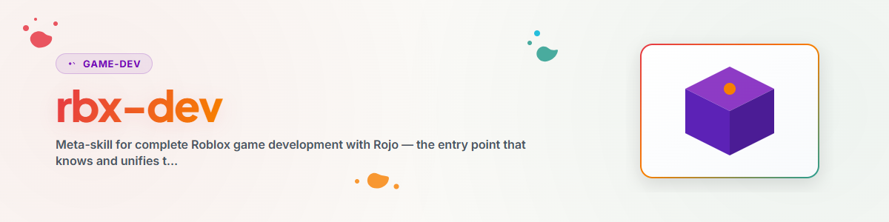

> **Nota:** Não afiliado à Roblox Corporation; "Roblox" é marca registrada de seus respectivos titulares. "rbx" é a abreviação comum da comunidade.

# Roblox-Dev — Meta-Skill para Desenvolvimento de Jogos Roblox

## Finalidade

O ponto de entrada central para o desenvolvimento de jogos Roblox com um fluxo de trabalho versionável baseado em Rojo.
Esta skill reúne o conhecimento transversal — estrutura de projeto, padrões de arquitetura e as
principais armadilhas do Luau — e encaminha para as três subskills em questões específicas:

| Subskill | Para quê |
| --- | --- |
| **`/rojo`** | Sincronização do sistema de arquivos→Studio, `default.project.json`, rokit/Wally/Lune, esqueleto do projeto, problemas de sincronização |
| **`/rbx-studio`** | Operação do Studio, modo cena vs. código, MCP do Studio, pipeline de assets, **varredura de malware** |
| **`/game-design`** | Funções e subtarefas, cadeias de desenvolvimento, Documento de Design de Jogo (KONZEPT.md), multiagente |

> Regra de roteamento: para **sincronização/build/configuração** → `/rojo`. Para **editor/assets/testes no Studio**
> → `/rbx-studio`. Para **conceito/funções/processo** → `/game-design`. Para **arquitetura de código,
> armadilhas do Luau ou o fluxo geral** → permaneça aqui.

## Stack em Resumo

- **Linguagem:** Luau (`.luau`, não `.lua`). Código em inglês, comentários/documentação em alemão, textos de UI em alemão.
- **Sincronização:** Rojo via rokit (versões de ferramentas fixadas). O sistema de arquivos é a fonte da verdade.
- **Ferramentas:** Rojo (sincronização/build), Lune (testes/scripts fora do Studio), Wally (pacotes),
  opcionalmente Knit (framework de Services/Controllers, projetos novos), Selene (linter).
- **Controle:** Roblox Studio MCP para inspeção/testes/inserção de assets assistidos por IA.

## Estrutura do Projeto (Padrão)

```
ProjektName/
├── default.project.json     # Rojo-Mapping
├── rokit.toml               # gepinnte Tool-Versionen
├── wally.toml               # Package-Dependencies
├── KONZEPT.md               # Game Design Document
├── src/
│   ├── shared/              # → ReplicatedStorage(.ProjektName.shared)
│   │   ├── Config.luau      # zentrale Werte, States, Gameplay-Parameter
│   │   ├── GameEnums.luau   # Enums, Remote-Namen, Konstanten
│   │   └── *Defs.luau       # Datendefinitionen (Items, Einheiten, Level)
│   ├── server/              # → ServerScriptService(.ProjektName)
│   │   ├── Main.server.luau # EINZIGER Server-Entry-Point (Script)
│   │   └── *Manager.luau    # ModuleScripts, von Main per require() geladen
│   ├── client/              # → StarterPlayerScripts(.ProjektName)
│   │   └── GameClient.client.luau   # Client-Entry-Point (LocalScript)
│   └── gui/                 # → StarterGui(.ProjektName)
│       └── *HUD.client.luau # GUI-Aufbau + Heartbeat-Loop
└── assets/                  # optionale .rbxm/.rbxl (scriptfrei)
```

Um esqueleto cria `/rojo` via `scaffold_roblox_project.sh`.

## Padrões de Arquitetura

**Servidor — Main + módulos de gerenciador.** Por projeto há apenas **um** script: `Main.server.luau`. Ele
cria centralmente a pasta de Remotes e carrega todos os módulos de funcionalidade via `require()`:
```lua
Main.server.luau (Script)
  ├─ require(StationManager)     -- .luau ModuleScripts
  ├─ require(PlayerSession)
  └─ erstellt RemoteEvents → verbindet OnServerEvent-Handler
```
Todos os outros arquivos do servidor são `.luau` (ModuleScripts).

**Cliente — estado compartilhado + HUD.** O GameClient escreve um estado compartilhado, e o HUD o lê no Heartbeat:
```lua
-- GameClient:
_G.ClientState = { gameState = "Lobby", health = 100 }
-- HUD:
RunService.Heartbeat:Connect(function()
    local cs = _G.ClientState; if not cs then return end
    healthBar.Size = UDim2.new(cs.health / cs.maxHealth, 0, 1, 0)
end)
```

**Remotes — centralizados em GameEnums.** Defina os nomes dos remotes uma única vez em `GameEnums.Remotes`; o servidor cria os eventos a partir disso, e o cliente os busca pelos mesmos nomes. Assim não há divergências de strings entre servidor e cliente.

## Fluxo Geral de um Jogo

1. **Conceito** (`/game-design`): KONZEPT.md — gênero, USP, 3–4 mecânicas centrais, monetização.
2. **Configuração** (`/rojo`): criar o esqueleto, definir o mapeamento `default.project.json`.
3. **Backend**: Config → GameEnums → *Defs → Main.server → *Manager.
4. **Frontend**: GameClient → HUD.
5. **Playtest em greybox** (`/rbx-studio`): primeiro a jogabilidade, com Parts e, se necessário, materiais gerados por IA.
6. **Melhoria de assets** (`/rbx-studio`): assets da Creator Store, **varredura de malware**, cena como .rbxl.
7. **Teste** (`/game-design`): QA + críticos de jogo + testes cegos com personas, iterando.
8. **Lançamento** (`/game-design`, função de negócios): página na loja, monetização, Live-Ops.

## Armadilhas do Luau/Roblox (Lista Resumida)

As armadilhas mais comuns — lista completa e comentada:
[`references/lessons-learned-luau.md`](references/lessons-learned-luau.md).

- Ponto e vírgula após `task.wait(x)`, quando mais código segue na mesma linha.
- `Model.Position` não existe → `model:GetPivot().Position`.
- `#table` em dicionários = 0 → contar manualmente.
- `mouse.Hit` pode ser nil → verificar antes do uso.
- Chamadas de DataStore **sempre** em `pcall`.
- `tick()` obsoleto → `os.clock()`; `SetPrimaryPartCFrame` → `PivotTo`.
- Nomes de eventos centralizados em `GameEnums.Remotes`; criar todos os remotes em `Main.server.luau`.
- Sem `require`s circulares (senão deadlock).
- `require()` apenas em ModuleScripts `.luau`, nunca em Scripts/LocalScripts.

## Antes de Cada Commit (Checklist)

- [ ] Ponto e vírgula após `task.wait(...)` em instruções múltiplas
- [ ] sem `Model.Position`, sem `tick()`, sem `SetPrimaryPartCFrame`
- [ ] DataStore em `pcall`, `mouse.Hit` verificado contra nil
- [ ] nomes de eventos coincidem servidor↔cliente (via GameEnums)
- [ ] todos os RemoteEvents criados em `Main.server.luau`
- [ ] sem Requires circulares
- [ ] assets do Marketplace verificados (`/rbx-studio` → varredura de malware), relatórios arquivados

## Fontes de Conhecimento

- **Documentação atual do motor/criador:** Context7 MCP — `resolve-library-id` →
  `/websites/create_roblox_reference_engine` (API do motor) e `/roblox/creator-docs`
  (tutoriais/guias); alternativa <https://create.roblox.com/docs>.
- **Pipeline de referência** (se disponível neste sistema): `<your Roblox project pipeline>` —
  incluindo `SKILL.md`, `GUIDE.md`, `LESSONS_LEARNED.md`, `ROJO_FAQ.md`, `ROBLOX_MCP_FAQ.md`,
  `AGENT_ROLES.md`, `_malware_reports/PATTERNS.md`, `_knowledge/` (cache local da API).

## Changelog

### 1.0.0 (2026-06-17)
- Versão inicial. Meta-skill sobre `/rojo`, `/rbx-studio`, `/game-design`; estrutura de projeto,
  padrões de arquitetura e lições de Luau destiladas do pipeline `.ROBLOX`, neutra quanto ao usuário.
