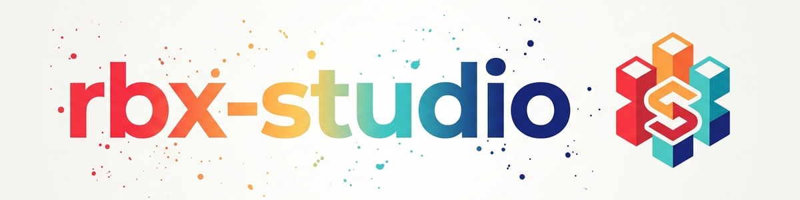

> **Deutsch** — Offizielle Deutsch-Version / Documento Oficial en Deutsch.

> **ملاحظة:** غير تابع لشركة Roblox Corporation؛ و"Roblox" علامة تجارية مملوكة لأصحابها. و"rbx" اختصار شائع في المجتمع.

# Roblox Studio — المحرر والاختبار والأصول وMCP (Deutsch)

## نظرة عامة والغرض

Roblox Studio هو المحرر الرسمي: ابنِ مشهد ثلاثي الأبعاد، واختبر اللعبة في وضع التشغيل، وأدرج أصولًا من Creator Store، وانشر المكان. في سير عمل Rojo، يتولى Studio **المشهد** (Workspace والتضاريس والنماذج الموضوعة) و**الاختبار**، أما **الكود** فيأتي عبر Rojo من نظام الملفات (انظر المهارة `/rojo`).

تغطي هذه المهارة: أساسيات Studio، والفصل الواضح بين عمل المشهد وعمل الكود، والتحكم بالذكاء الاصطناعي عبر Roblox-Studio-MCP، وسير عمل الأصول بما في ذلك **فحص البرمجيات الخبيثة الإلزامي** لكل أصل من السوق.

## الأساسيات

- **Explorer** — شجرة بجميع الكائنات (Workspace وServerScriptService وReplicatedStorage …). مع تفعيل Rojo تُملأ المناطق المربوطة مباشرةً من نظام الملفات.
- **Play-Test** — زر Play الأخضر (أو F5) يبدأ جلسة خادم وعميل محلية. بعد كل تشغيل، **افحص وحدة الإخراج بحثًا عن الأخطاء** — وهي أهم عادة في التصحيح.
- **حفظ المكان** — File ← Save As ← `.rbxl` (ثنائي) أو `.rbxlx` (XML، قابل للمقارنة). يحتوي المكان المحفوظ على **المشهد**. الكود يعيش في نظام الملفات، لا في المكان.

## سير العمل الحرج: وضع المشهد مقابل وضع الكود

عند Connect، يستبدل Rojo جميع مناطق السكربتات المربوطة بمحتوى نظام الملفات. أما `Workspace` (المشهد ثلاثي الأبعاد) فلا يُربط ويبقى سليمًا. ومن هنا القاعدة الأهم في العمل اليومي — لا تخلط الوضعين أبدًا:

**الوضع A — تحرير المشهد (Rojo مُطفأ):**
1. أوقف خادم Rojo (`taskkill //F //IM rojo.exe` أو Ctrl+C).
2. افتح المكان في Studio، وضع الأصول، وابنِ العالم، ورتّبه.
3. File ← Save ← يحتوي `.rbxl` الآن على المشهد الجديد.

**الوضع B — اختبار الكود (Rojo مُشغَّل):**
1. افتح المكان نفسه في Studio.
2. شغّل `rojo serve` ← في إضافة Rojo داخل Studio ← Connect.
3. اضغط Play واختبر. يزامن Rojo السكربتات؛ ويأتي Workspace من `.rbxl`.
4. أثناء تشغيل Rojo، **لا تحفظ** (وإلا تجمّدت حالة Rojo داخل `.rbxl`).

بهذه الطريقة يمكن أن يعمل عمل المشهد (Studio) وعمل الكود (المحرر + Rojo) بالتوازي دون تعارض — يبني الفنانون المشاهد، ويكتب المطورون الكود.

## Roblox-Studio-MCP — الذكاء الاصطناعي يتحكم في Studio

يتيح Roblox-Studio-MCP لـ Claude/Gemini/Codex التحكم مباشرةً في نسخة **تعمل** من Studio: تنفيذ الكود، والفحص، وPlay/Stop، وقراءة وحدة الإخراج، وإدراج الأصول. وهو **لا يحل محل** Rojo بل يكمّله: Rojo لتغييرات الكود الدائمة، وMCP للفحص والاختبارات وإدراج الأصول وتوليد المواد.

```
Editor + Rojo  ──(persistenter Code-Sync)──►  Studio (laufend)  ◄──(Inspektion/Test/Insert)──  MCP ◄── KI
```


### أدوات MCP المتاحة (نموذجية)

| الأداة | الغرض |
| --- | --- |
| `list_roblox_studios` / `set_active_studio` | سرد الكائنات المفتوحة / تحديد النشط منها |
| `search_game_tree` / `inspect_instance` | البحث في الهيكل / قراءة الخصائص |
| `execute_luau` | تنفيذ كود Luau مباشرةً في Studio |
| `script_read` / `script_grep` / `script_search` | تحليل السكربتات |
| `multi_edit` | تغيير عدة كائنات/سكربتات دفعة واحدة |
| `start_stop_play` | التحكم في Play/Stop |
| `get_console_output` | قراءة سجل الإخراج |
| `screen_capture` | لقطة شاشة للمشهد |
| `insert_from_creator_store` | إدراج أصل من Creator Store |
| `generate_material` | توليد مادة/نسيج بالذكاء الاصطناعي (MaterialVariant) |
| `character_navigation` / `user_keyboard_input` / `user_mouse_input` | محاكاة الإدخال |

### الإعداد (محايد للمستخدم)

يعمل MCP كخادم يأتي مع Studio، وغالبًا ما يُربط عبر غلاف خفيف لتصفية JSON يزيل اللافتات غير JSON التي لا تستطيع بعض العملاء تحليلها:

- ملف دفعة MCP (Windows): `%LOCALAPPDATA%\Roblox\mcp.bat`
- غلاف اختياري: `<your roblox-mcp wrapper>`
  (إن وُجد في هذا النظام؛ يشترك فيه Claude/Codex/Gemini)
- إعدادات العملاء: `~/.claude/mcp.json` · `~/.codex/config.toml` · `~/.gemini/antigravity/mcp_config.json`

مثال على إدخال (`~/.claude/mcp.json`):
```json
{
  "mcpServers": {
    "Roblox_Studio": {
      "command": "node",
      "args": ["<your roblox-mcp wrapper>",
               "cmd.exe", "/c", "%LOCALAPPDATA%\\Roblox\\mcp.bat"]
    }
  }
}
```


### مشكلات MCP الشائعة

| العَرَض | المعنى / الحل |
| --- | --- |
| `studios: []` أو `Not connected to WS host` | ليس "معطلًا" فورًا: أرسل `initialize` ← انتظر 2–3 ثوانٍ ← `list_roblox_studios`؛ وإلا فأعد تشغيل Studio |
| `Error: connection closed: initialized request` | Studio غير مفتوح أصلًا — شغّل Studio، وحمّل المكان، وحاول مجددًا |
| السكربتات المكتوبة عبر MCP تختفي بعد Play/Stop | تعديلات الكود عبر MCP ليست دائمة — للتغييرات الدائمة في الكود استخدم **Rojo** |
| قيمة عبر `require()` في الآلة الافتراضية (VM) للإضافة خاطئة | للآلة الافتراضية (VM) للإضافة ذاكرة require خاصة بها — للتحقق اقرأ `.Source` مباشرةً أو افحص سجل الخادم بعد Play |

## خط أنابيب الأصول (Creator Store ← اللعبة)

النموذج الرمادي (Greybox) أولًا (طريقة اللعب)، والأصول لاحقًا (قبل الإصدار). التسلسل المجرّب:

```
STORE DURCHSUCHEN   → z. B. "medieval" → mehrere Kandidaten laden
AUSSORTIEREN        → stilfremde/hässliche raus, 5–8 passende behalten
BEREINIGEN          → ALLE Scripts entfernen (Malware!), nur Geometrie/Meshes behalten
KIT / SET BAUEN     → aus Basis-Assets Varianten ableiten (gleiche Materials/Proportionen)
SZENE BAUEN (Studio)→ Assets zur Kulisse zusammensetzen (Dorf, Arena, Park)
ALS .RBXL SPEICHERN → die Kulisse ist die "Bühne"
ROJO BELEBT ES      → Scripts/Gameplay/HUD kommen per Rojo dazu; Workspace bleibt unangetastet
```


**تقنية المتغيرات ("kit معياري"):** خذ أصلًا أساسيًا جيدًا واشتق منه مجموعة كاملة (منزل ← برج، وحظيرة، ومعمل حدادة، وخربة). تتشارك جميعها المواد والألوان والنسب ← مظهر متسق بجهد أدنى، كما تفعل الاستوديوهات المحترفة.

**مصادر الأصول (حسب الأولوية):** Creator Store (مجاني، واسع جدًا، **فحص البرمجيات الخبيثة إلزامي**) ← مواد الذكاء الاصطناعي (`generate_material`) ← شبكاتك الخاصة (Blender ← .fbx) ← حزم أصول مشتراة.

## إلزامي: فحص البرمجيات الخبيثة لأصول السوق

قد تحتوي أصول Creator Store على سكربتات خبيثة مموهة (أبواب خلفية، وكود عن بُعد، وخطافات شبكات الروبوتات). افحص **كل** أصل مستورد قبل الاستخدام، وأزل جميع السكربتات — واحتفظ بالهندسة والشبكات فقط.

- مرجع الأنماط: [`references/malware-patterns.md`](references/malware-patterns.md) — أنماط التمويه الثمانية المعروفة (حمولة سمات معكوسة، وسكربت نظام مزيف، و`require()` البعيد، و`loadstring`، و`string.char`، و`getfenv/setfenv`، وقيم Values مخفية، والتنفيذ المؤجل).
- الماسح: [`scripts/scan_asset_malware.luau`](scripts/scan_asset_malware.luau) — شغّله في Studio عبر `execute_luau` (أو Command Bar)؛ يفحص الكائن مقابل جميع الأنماط ويُبلغ عن النتائج.

**إشارات الخطر فورًا:** سكربت كبير داخل نموذج زخرفي بحت · سلاسل معكوسة في السمات · `require(<number>)` · `loadstring` · `HttpService` في أصل لا يحتاج إلى شبكات. عند الشك: احذف السكربت. وثّق النتائج (مثل `_malware_reports/YYYY-MM-DD_*.md` في خط الأنابيب المرجعي).

## مزالق Luau/Studio المهمة (مقتطف)

أكثرها شيوعًا في Studio — القائمة الكاملة تحفظها المهارة `/rbx-dev`:

- `Model.Position` غير موجود ← `model:GetPivot().Position`.
- `tick()` مهمل ← `os.clock()` / `workspace:GetServerTimeNow()`.
- `SetPrimaryPartCFrame()` مهمل ← `model:PivotTo(cf)`.
- استدعاءات DataStore **دائمًا** داخل `pcall`.
- Baseplate وأرضية إجرائية على الارتفاع نفسه ← تداخل Z (وميض): أزل Baseplate أو ارفع الأرضية بمقدار +0.1 stud.
- راقب ميزانية الأجزاء (~50–80 جزءًا لكل غرفة مولّدة إجرائيًا).

## قراءات إضافية

- مهارات شقيقة: `/rojo` (المزامنة، وإعداد المشروع)، و`/game-design` (الأدوار وسير العمل وGDD)، والمهارة الفوقية `/rbx-dev` (أنماط المعمارية + جميع دروس Luau).
- وثائق المحرك/المنشئ: Context7 MCP (`/websites/create_roblox_reference_engine`، `/roblox/creator-docs`) أو <https://create.roblox.com/docs>.
- خط الأنابيب المرجعي (إن وُجد): `<your Roblox project pipeline>` (`ROBLOX_MCP_FAQ.md`، و`ASSET_PIPELINE.md`، و`_malware_reports/PATTERNS.md`).

## سجل التغييرات

### 1.0.0 (2026-06-17)
- الإصدار الأولي. مستخلص من خط أنابيب `.ROBLOX` (ROBLOX_MCP_FAQ وASSET_PIPELINE وPATTERNS وLESSONS_LEARNED)، مكتوب بشكل محايد للمستخدم.
