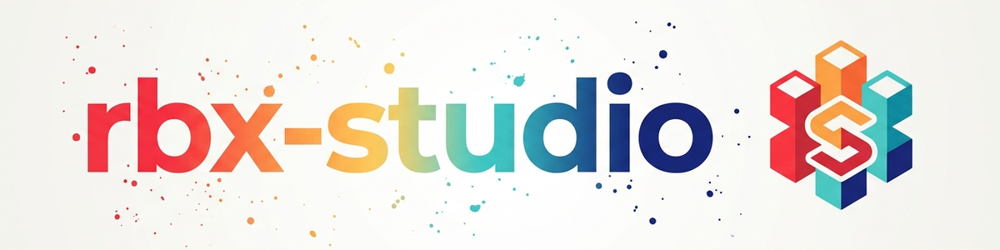

> **Français** — Version française officielle de la compétence `rbx-studio`.

> **Remarque :** Non affilié à Roblox Corporation ; « Roblox » est une marque déposée de ses propriétaires respectifs. « rbx » est l'abréviation courante de la communauté.

# Roblox Studio — Éditeur, Test, Assets, MCP

## Vue d'ensemble et Objectif

Roblox Studio est l'éditeur officiel : construire la scène 3D, tester le jeu en mode lecture,
insérer des ressources depuis le Creator Store et publier le lieu (Place). Dans un workflow Rojo,
Studio gère la **scène** (`Workspace`, `Terrain`, modèles placés) et les **tests** —
le **code** arrive via Rojo depuis le système de fichiers (voir la compétence `/rojo`).

Cette compétence couvre : les bases de Studio, la séparation nette entre travail sur la scène et travail sur le code,
le pilotage par IA via `Roblox-Studio-MCP` et le pipeline d'assets incluant le
**scan anti-malware obligatoire** pour chaque ressource issue de la boutique.

## Bases

- **Explorer** — arborescence de toutes les instances (`Workspace`, `ServerScriptService`, `ReplicatedStorage`, …).
  Lorsque Rojo est actif, les zones mappées sont alimentées en direct depuis le système de fichiers.
- **Play-Test** — le bouton vert Play (ou `F5`) lance une session locale serveur + client.
  Après chaque démarrage, **vérifiez la console Output pour repérer les erreurs** — le réflexe de débogage le plus important.
- **Sauvegarder le lieu** — `File → Save As → .rbxl` (binaire) ou `.rbxlx` (XML, comparable par diff).
  Le lieu enregistré contient la **scène**. Le code vit dans le système de fichiers, pas dans le lieu.

## Le workflow critique : mode scène vs mode code

Lors de la connexion (`Connect`), Rojo écrase toutes les zones de scripts mappées avec le contenu du système de fichiers.
Le `Workspace` (scène 3D) n'est **pas** mappé et reste intact. De là découle la règle la plus
importante du travail quotidien — ne jamais mélanger les deux modes :

**Mode A — éditer la scène (Rojo DÉSACTIVÉ) :**
1. Arrêter le serveur Rojo (`taskkill //F //IM rojo.exe` ou `Ctrl+C`).
2. Ouvrir le lieu dans Studio, placer les assets, bâtir le monde, agencer.
3. `File → Save` → le fichier `.rbxl` contient désormais la nouvelle scène.

**Mode B — tester le code (Rojo ACTIVÉ) :**
1. Ouvrir le même lieu dans Studio.
2. Lancer `rojo serve` → dans le plugin Rojo de Studio → `Connect`.
3. Appuyer sur Play et tester. Rojo synchronise les scripts ; le `Workspace` provient du `.rbxl`.
4. Tant que Rojo tourne, **ne pas** sauvegarder (sinon l'état Rojo se fige dans le `.rbxl`).

Ainsi, le travail sur la scène (Studio) et le travail sur le code (éditeur + Rojo) peuvent avancer en parallèle
et sans conflit — les artistes bâtissent les scènes, les développeurs écrivent le code.

## Roblox-Studio-MCP — L'IA pilote Studio

Le `Roblox-Studio-MCP` permet à Claude/Gemini/Codex de piloter directement une instance Studio
**en cours d'exécution** : exécuter du code, inspecter, lancer/arrêter Play, lire la console, insérer des assets. Il ne **remplace pas**
Rojo — il le complète : Rojo pour les modifications de code persistantes, MCP pour l'inspection,
les tests, l'insertion d'assets et la génération de matériaux.

```
Éditeur + Rojo  ──(synchro code persistante)──►  Studio (actif)  ◄──(inspection/test/insertion)──  MCP ◄── IA
```

### Outils MCP disponibles (typiques)

| Outil | Rôle |
| --- | --- |
| `list_roblox_studios` / `set_active_studio` | lister les instances ouvertes / sélectionner l'instance active |
| `search_game_tree` / `inspect_instance` | rechercher dans la hiérarchie / lire les propriétés |
| `execute_luau` | exécuter du code Luau directement dans Studio |
| `script_read` / `script_grep` / `script_search` | analyser les scripts |
| `multi_edit` | modifier plusieurs instances/scripts en lot |
| `start_stop_play` | piloter Play/Stop |
| `get_console_output` | lire le journal Output |
| `screen_capture` | capture d'écran de la scène |
| `insert_from_creator_store` | insérer une ressource depuis le Creator Store |
| `generate_material` | générer un matériau/texture IA (`MaterialVariant`) |
| `character_navigation` / `user_keyboard_input` / `user_mouse_input` | simuler des entrées |

### Configuration (neutre vis-à-vis de l'utilisateur)

Le MCP fonctionne comme un serveur fourni avec Studio, souvent relié via un léger wrapper filtre JSON
(qui élimine les bannières non-JSON que certains clients ne savent pas analyser autrement) :

- Batch MCP (Windows) : `%LOCALAPPDATA%\Roblox\mcp.bat`
- Wrapper optionnel : `<your roblox-mcp wrapper>`
  (s'il est présent sur ce système ; partagé par Claude/Codex/Gemini)
- Configurations clients : `~/.claude/mcp.json` · `~/.codex/config.toml` · `~/.gemini/antigravity/mcp_config.json`

Exemple d'entrée (`~/.claude/mcp.json`) :
```json
{
  "mcpServers": {
    "Roblox_Studio": {
      "command": "node",
      "args": ["<your roblox-mcp wrapper>",
               "cmd.exe", "/c", "%LOCALAPPDATA%\\Roblox\\mcp.bat"]
    }
  }
}
```

### Problèmes MCP fréquents

| Symptôme | Signification / correctif |
| --- | --- |
| `studios: []` ou `Not connected to WS host` | pas immédiatement « cassé » : envoyer `initialize` → attendre 2–3 s → `list_roblox_studios` ; sinon redémarrer Studio |
| `Error: connection closed: initialized request` | Studio n'est pas ouvert du tout — lancer Studio, charger le lieu, réessayer |
| scripts écrits via MCP disparus après Play/Stop | les modifications MCP du code ne sont pas persistantes — pour des changements durables, utiliser **Rojo** |
| valeur via `require()` fausse dans la VM du plugin | la VM du plugin possède son propre cache `require` — pour vérifier, lire `.Source` directement ou vérifier le journal serveur après Play |

## Pipeline d'assets (Creator Store → jeu)

Greybox d'abord (gameplay), assets ensuite (avant publication). La séquence éprouvée :

```
PARCOURIR LE STORE  → ex. "medieval" → charger plusieurs candidats
TRIER               → éliminer les incohérents/laids, conserver 5–8 adaptés
NETTOYER            → supprimer TOUS les scripts (malware !), ne garder que géométrie/meshes
CONSTRUIRE UN KIT   → dériver des variantes depuis les assets de base (mêmes matériaux/proportions)
BÂTIR LA SCÈNE      → assembler les assets en décor dans Studio (village, arène, parc)
SAUVER EN .RBXL     → le décor constitue la « scène »
ROJO DONNE VIE      → scripts/gameplay/HUD arrivent via Rojo ; le Workspace reste intact
```

**Technique des variantes (« kit modulaire ») :** prenez un bon asset de base et dérivez-en tout un
ensemble (maison → tour, grange, forge, ruine). Tous partagent matériaux, couleurs et
proportions → un rendu cohérent avec un effort minimal, comme le font les studios professionnels.

**Sources d'assets (priorité) :** Creator Store (gratuit, immense, **vérification anti-malware obligatoire**) →
matériaux IA (`generate_material`) → vos propres meshes (Blender → `.fbx`) → packs d'assets achetés.

## OBLIGATOIRE : scan anti-malware pour les assets du marketplace

Les assets du Creator Store peuvent contenir des scripts malveillants obfusqués (portes dérobées, code distant,
crochets de botnet). Scannez **chaque** asset importé avant usage et supprimez tous les scripts —
ne conservez que la géométrie et les meshes.

- Référence des motifs : [`references/malware-patterns.md`](references/malware-patterns.md) — les 8
  motifs d'obfuscation connus (charge utile inversée en attribut, faux script système,
  `require()` distant, `loadstring`, `string.char`, `getfenv/setfenv`, Values cachées, exécution différée).
- Scanner : [`scripts/scan_asset_malware.luau`](scripts/scan_asset_malware.luau) — à exécuter dans Studio via
  `execute_luau` (ou la barre de commandes) ; il contrôle une instance face à tous les motifs et signale les détections.

**Signaux d'alarme immédiats :** un gros script dans un pur modèle de décoration · chaînes inversées dans des
attributs · `require(<nombre>)` · `loadstring` · `HttpService` dans un asset qui n'a besoin d'aucun
réseau. En cas de doute : supprimer le script. Documenter les découvertes (ex. `_malware_reports/YYYY-MM-DD_*.md`
dans le pipeline de référence).

## Pièges Luau/Studio importants (extrait)

Les pièges les plus courants dans Studio — la liste complète est maintenue par la compétence `/rbx-dev` :

- `Model.Position` n'existe pas → `model:GetPivot().Position`.
- `tick()` est obsolète → `os.clock()` / `workspace:GetServerTimeNow()`.
- `SetPrimaryPartCFrame()` obsolète → `model:PivotTo(cf)`.
- Appels `DataStore` **toujours** dans `pcall`.
- Baseplate + sol procédural à la même hauteur → Z-fighting (scintillement) : supprimer la baseplate
  ou surélever le sol de `+0.1` studs.
- Garder un œil sur le budget de pièces (~50–80 parts par salle générée de manière procédurale).

## Pour aller plus loin

- Compétences sœurs : `/rojo` (synchronisation, configuration projet), `/game-design` (rôles, workflows, GDD),
  méta-compétence `/rbx-dev` (schémas d'architecture + toutes les leçons Luau).
- Documentation moteur/créateur : Context7 MCP (`/websites/create_roblox_reference_engine`,
  `/roblox/creator-docs`) ou <https://create.roblox.com/docs>.
- Pipeline de référence (si présent) : `<your Roblox project pipeline>`
  (`ROBLOX_MCP_FAQ.md`, `ASSET_PIPELINE.md`, `_malware_reports/PATTERNS.md`).

## Journal des modifications

### 1.0.1 (2026-11-22)
- Mention linguistique corrigée.

### 1.0.0 (2026-06-17)
- Version initiale. Extraite du pipeline `.ROBLOX` (`ROBLOX_MCP_FAQ`, `ASSET_PIPELINE`,
  `PATTERNS`, `LESSONS_LEARNED`), rédigée de manière neutre vis-à-vis de l'utilisateur.
