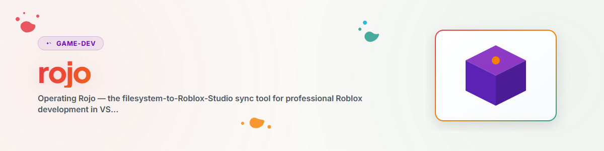

> **Français** — Version française officielle de la compétence `rojo`.

# Rojo — Synchronisation Système de fichiers → Roblox Studio

## Objectif

Rojo relie un projet classique sur système de fichiers (fichiers `.luau` dans `src/`, versionnés avec Git)
à Roblox Studio. Vous écrivez votre code dans l'éditeur de votre choix (VS Code, Claude Code), et Rojo
le synchronise en direct dans une instance Studio active. Ainsi, le code Roblox devient versionnable,
comparable par diff et éditable avec de vrais outils — au lieu de vivre dans l'éditeur de scripts intégré à Studio.

Utilisez cette compétence pour tout ce qui touche à l'installation de Rojo, au mappage `default.project.json`, à la
chaîne d'outils (rokit/Wally/Lune) et aux problèmes de synchronisation courants.

## Modèle mental

```
VS Code / Claude Code          rojo serve            Roblox Studio
   src/server/*.luau   ──────►  (localhost:34872) ──►  ServerScriptService.*
   src/client/*.luau            Synchro en direct      StarterPlayerScripts.*
   src/shared/*.luau                                    ReplicatedStorage.*
   src/gui/*.luau                                       StarterGui.*
```

**Règle fondamentale :** le système de fichiers est la source de vérité. À chaque connexion, Rojo écrase
les zones Studio mappées avec le contenu du système de fichiers. Ne modifiez donc **jamais** le code
dans Studio (il serait perdu à la synchronisation suivante), mais uniquement dans l'éditeur. Le `Workspace`
(scène 3D, terrain) n'est **pas** mappé par Rojo et reste préservé — voir la compétence
`/rbx-studio` pour le workflow scène vs code.

## Extensions de fichiers → Type Roblox (convention Rojo)

Rojo déduit le type d'instance à partir de l'extension. C'est la source d'erreur la plus fréquente :

| Fichier            | Type Roblox   | Appelable par `require()` | Rôle                          |
| ------------------ | ------------- | ------------------------- | ----------------------------- |
| `Foo.luau`         | ModuleScript  | **oui**                   | Module logique, définitions   |
| `Foo.server.luau`  | Script        | non                       | Point d'entrée serveur        |
| `Foo.client.luau`  | LocalScript   | non                       | Point d'entrée client         |
| `init.luau`        | devient le nœud dossier lui-même | oui           | transforme le dossier en ModuleScript |

> Règle pratique : **seuls les points d'entrée** sont `.server.luau`/`.client.luau`. Tout ce qui est chargé via
> `require()` **doit** être un `ModuleScript` `.luau`. Appeler `require()` sur un
> `Script`/`LocalScript` provoque `"Attempted to call require with invalid argument(s)"`.

## Commandes CLI

```bash
rojo serve default.project.json     # Démarrer le serveur de synchro en direct (port par défaut 34872)
rojo serve                          # utilise default.project.json automatiquement
rojo build default.project.json -o game.rbxlx   # build unique → fichier Place (XML)
rojo build default.project.json -o game.rbxl    # build → fichier Place (binaire)
rojo plugin install                 # installer le plugin Rojo pour Studio (une fois)
rojo --version                      # vérifier la version installée
```

Après `rojo serve` : dans Studio, ouvrir le plugin Rojo → **Connect** (`localhost:34872`).
`rojo build` n'a pas besoin d'un Studio ouvert — idéal pour la CI, les tests de fumée et les releases.

## `default.project.json` — le mappage

Ce fichier associe des chemins du système de fichiers à la hiérarchie DataModel de Roblox. Clés :

- `name` — nom du projet (affichage)
- `$className` — classe Roblox du nœud (`DataModel`, `ServerScriptService`, `Folder`, …)
- `$path` — chemin du système de fichiers synchronisé sous ce nœud (relatif à la racine du projet)

Un modèle standard prêt à l'emploi se trouve sous [`assets/default.project.json`](assets/default.project.json).

### Plat vs imbriqué — la décision la plus importante

Votre code doit correspondre au mappage. Deux variantes :

**Plat** — le contenu de `src/server` arrive directement dans `ServerScriptService` :
```json
"ServerScriptService": { "$className": "ServerScriptService", "$path": "src/server" }
```
→ Le code référence par ex. `ReplicatedStorage.Config`, `ReplicatedStorage.GameEnums`.

**Imbriqué** — le contenu arrive dans `ServerScriptService.NomProjet` :
```json
"ServerScriptService": {
  "$className": "ServerScriptService",
  "ProjektName": { "$path": "src/server" }
}
```
→ Le code référence `ReplicatedStorage.ProjektName.shared.Config`, etc.

Les deux sont valides. Choisissez **une seule** variante pour tout le projet et maintenez chaque chemin
`require`/`WaitForChild` cohérent avec ce choix. Symptôme en cas de décalage : `WaitForChild(...)`
reste bloqué indéfiniment (*Infinite yield*), car le nœud attendu se trouve ailleurs.

## Chaîne d'outils via rokit

[rokit](https://github.com/rojo-rbx/rokit) est le gestionnaire de chaîne d'outils. Un fichier `rokit.toml` dans le
projet (ou dossier parent) fige les versions exactes des outils → builds reproductibles sur toutes les
machines. S'il manque, vous obtenez `Failed to find tool 'rojo' in any project manifest file`.

`rokit.toml` standard (voir [`assets/rokit.toml`](assets/rokit.toml)) :
```toml
[tools]
rojo = "rojo-rbx/rojo@7.4.4"
lune = "lune-org/lune@0.10.4"
wally = "UpliftGames/wally@0.3.2"
```

> Note de version : `7.4.4` est la version figée de façon homogène dans le pipeline de référence.
> Les projets plus récents peuvent passer à `7.6.x` — vérifiez d'abord avec `rojo build` sur le projet,
> car le format de projet peut changer entre versions majeures.

Après clonage/installation : `rokit install` récupère tous les outils figés.

- **Lune** — exécuteur Luau hors Studio (tests unitaires, scripts de build, traitement d'assets).
- **Wally** — gestionnaire de paquets : `wally install` → `Packages/` → dans Studio sous
  `ReplicatedStorage.Packages`. Les dépendances figurent dans `wally.toml` (voir
  [`assets/wally.toml`](assets/wally.toml)), par ex. le framework `sleitnick/knit@1.7.0`.

## Créer un nouveau projet

Le script [`scripts/scaffold_roblox_project.sh`](scripts/scaffold_roblox_project.sh) crée un
squelette Rojo complet (`project.json`, `rokit.toml`, `wally.toml`, `src/{shared,server,client,gui}/`
avec fichiers de départ, ébauche `KONZEPT`) :

```bash
bash scripts/scaffold_roblox_project.sh MonJeu          # mappage plat (par défaut)
bash scripts/scaffold_roblox_project.sh MonJeu --nested # mappage imbriqué
```

Ensuite : `cd MonJeu && rokit install && rojo serve`.

## Dépannage

| Symptôme | Cause | Solution |
| --- | --- | --- |
| `Failed to find tool 'rojo'` | pas de `rokit.toml` | créer `rokit.toml` avec l'épinglage Rojo dans le projet/dossier parent, `rokit install` |
| `require` lève « invalid argument(s) » | `require()` sur un `Script`/`LocalScript` | seuls les `ModuleScript` `.luau` sont require-ables ; vérifier l'extension |
| Port 34872 occupé (`os error 10048`) | ancien processus Rojo actif | `tasklist \| grep -i rojo` → `taskkill //PID <PID> //F`, puis relancer `rojo serve` |
| Scripts mal placés dans Studio | mappage plat au lieu d'imbriqué (ou inversement) | adapter `default.project.json` aux chemins du code (voir ci-dessus) |
| `WaitForChild` bloqué sans fin | nœud attendu inexistant / erreur serveur avant création | **vérifier d'abord les erreurs dans la console serveur** ; contrôler mappage + ordre de création |
| Synchro stoppée après renommage | Rojo ne détecte pas immédiatement le renommage | arrêter le serveur (`Ctrl+C`) + redémarrer, dans Studio `Disconnect → Reconnect` |
| Modification Studio perdue au reconnexion | édition dans Studio au lieu du système de fichiers | ne modifier le code **que** dans l'éditeur ; Rojo écrase les zones mappées |

### Limites connues de Rojo

1. **Pas de synchronisation Terrain/Workspace** — bâtir la scène 3D et le terrain dans Studio ou les générer par code.
2. **Pas de fusion `.rbxl`** — les fichiers Place sont binaires, non fusionnables sous Git. Ne jamais s'en servir comme source primaire.
3. **Pas de synchro en direct en mode Play** — les changements faits pendant Play sont annulés à l'arrêt.
4. **Traduction de chemins Git Bash** — `/c/...` peut être traduit en `C:/...` et casser les chemins Rojo ; en cas de doute, utiliser des chemins relatifs ou des chemins Windows natifs.

## Linting (Selene)

Les projets Roblox Luau sont habituellement vérifiés avec **Selene** (`selene.toml` à la racine,
`std = "roblox"`). Autoriser les globales comme `_G` via `global_usage = "allow"` si le projet les
utilise pour l'état client partagé. Exécuter Selene depuis le dossier contenant la définition d'API Roblox
(`roblox.yml`).

## Pour aller plus loin

- Compétences sœurs : `/rbx-studio` (manipulation Studio, MCP, assets), `/game-design`
  (rôles, workflows, GDD), méta-compétence `/rbx-dev` (réunit les trois + schémas d'architecture).
- Documentation moteur/Rojo à jour : Context7 MCP (`resolve-library-id` →
  `/websites/create_roblox_reference_engine`, `/roblox/creator-docs`) ou
  <https://rojo.space/docs/>.
- Si disponible sur ce système, un pipeline de référence riche en projets se trouve sous
  `<your Roblox project pipeline>` (notamment `ROJO_FAQ.md`, `SKILL.md`).

## Journal des modifications

### 1.0.1 (2026-11-22)
- Mention linguistique corrigée.

### 1.0.0 (2026-06-17)
- Version initiale. Extraite du pipeline `.ROBLOX` (`ROJO_FAQ`, `ROJO_START`, `_template`),
  rédigée de façon neutre vis-à-vis de l'utilisateur.

## Compétences associées

- `roblox-team-lock` — réservations (claims) de fichiers, Studio et MCP dès que plusieurs agents travaillent sur un même projet. Lire d'abord, puis réserver, travailler, puis libérer.
