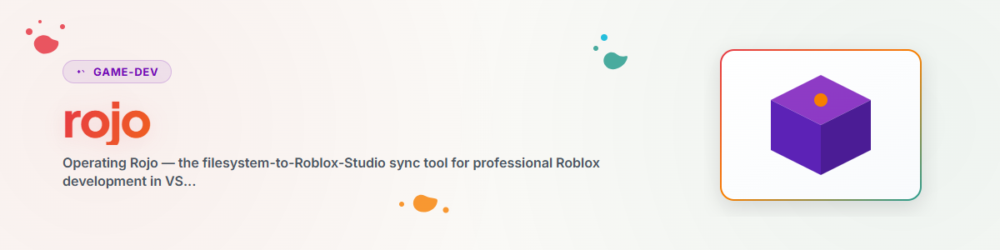

# Rojo — फ़ाइल-सिस्टम → Roblox Studio सिंक

## उद्देश्य

Rojo एक सामान्य फ़ाइल-सिस्टम प्रोजेक्ट (`.luau` फ़ाइलें `src/` में, Git से संस्करित) को Roblox Studio से जोड़ता है।
आप अपने चुने हुए एडिटर (VS Code, Claude Code) में कोड लिखते हैं, Rojo उसे चल रहे Studio इंस्टेंस में लाइव सिंक करता है। इस तरह Roblox कोड संस्करण-नियंत्रित, diff-योग्य और वास्तविक टूल्स से संपादन योग्य बन जाता है — बिल्ट-इन Studio स्क्रिप्ट एडिटर में रहने के बजाय।

Rojo सेटअप, `default.project.json` मैपिंग, टूलचेन (rokit/Wally/Lune) और सामान्य सिंक समस्याओं से जुड़ी हर चीज़ के लिए इस स्किल का उपयोग करें।

## मानसिक मॉडल

```
VS Code / Claude Code          rojo serve            Roblox Studio
   src/server/*.luau   ──────►  (localhost:34872) ──►  ServerScriptService.*
   src/client/*.luau            Live-Sync               StarterPlayerScripts.*
   src/shared/*.luau                                    ReplicatedStorage.*
   src/gui/*.luau                                       StarterGui.*
```

**मूल नियम:** फ़ाइल-सिस्टम सत्य का स्रोत है। हर connect पर Rojo मैप किए गए Studio क्षेत्रों को फ़ाइल-सिस्टम सामग्री से ओवरराइट करता है। इसलिए कोड को Studio में **कभी** संपादित न करें (अगले सिंक पर खो जाएगा), केवल एडिटर में करें। `Workspace` (3D दृश्य, Terrain) को Rojo **मैप नहीं** करता और सुरक्षित रहता है — दृश्य-बनाम-कोड वर्कफ़्लो के लिए स्किल `/rbx-studio` देखें।

## फ़ाइल एक्सटेंशन → Roblox प्रकार (Rojo परंपरा)

Rojo एक्सटेंशन से इंस्टेंस प्रकार निकालता है। यह सबसे सामान्य त्रुटि का स्रोत है:

| फ़ाइल              | Roblox प्रकार | `require()`-योग्य | भूमिका                     |
| ------------------ | ------------- | --------------- | ------------------------- |
| `Foo.luau`         | ModuleScript  | **हाँ**          | लॉजिक मॉड्यूल, परिभाषाएँ |
| `Foo.server.luau`  | Script        | नहीं            | सर्वर एंट्री-पॉइंट        |
| `Foo.client.luau`  | LocalScript   | नहीं            | क्लाइंट एंट्री-पॉइंट        |
| `init.luau`        | स्वयं फ़ोल्डर-नोड बन जाती है | हाँ | फ़ोल्डर को ModuleScript बनाती है |

> मोटा नियम: केवल **एंट्री-पॉइंट** `.server.luau`/`.client.luau` होते हैं। जो कुछ भी `require()` से लोड होता है, उसे **अवश्य** `.luau`-ModuleScript होना चाहिए। Script/LocalScript पर `require()` करने से "Attempted to call require with invalid argument(s)" त्रुटि आती है।

## CLI कमांड

```bash
rojo serve default.project.json     # Live-Sync-Server starten (Standard-Port 34872)
rojo serve                          # nutzt default.project.json automatisch
rojo build default.project.json -o game.rbxlx   # einmaliger Build → Place-Datei (XML)
rojo build default.project.json -o game.rbxl    # Build → Place-Datei (binär)
rojo plugin install                 # Rojo-Studio-Plugin installieren (einmalig)
rojo --version                      # installierte Version prüfen
```

`rojo serve` के बाद: Studio में Rojo प्लगइन खोलें → **Connect** (localhost:34872)।
`rojo build` को चल रहे Studio की आवश्यकता नहीं — CI, स्मोक-टेस्ट और रिलीज़ के लिए आदर्श।

## `default.project.json` — मैपिंग

यह फ़ाइल फ़ाइल-सिस्टम पाथ को Roblox datamodel पदानुक्रम पर मैप करती है। कुंजियाँ:

- `name` — प्रोजेक्ट नाम (प्रदर्शन)
- `$className` — नोड का Roblox क्लास (`DataModel`, `ServerScriptService`, `Folder`, …)
- `$path` — फ़ाइल-सिस्टम पाथ, जो इन नोड्स के अंतर्गत सिंक होता है (प्रोजेक्ट रूट के सापेक्ष)

एक तैयार मानक टेम्पलेट [`assets/default.project.json`](assets/default.project.json) पर उपलब्ध है।

### फ़्लैट बनाम नेस्टेड — सबसे महत्वपूर्ण निर्णय

आपका कोड मैपिंग से मेल खाना चाहिए। दो विकल्प:

**फ़्लैट** — `src/server` की सामग्री सीधे `ServerScriptService` में आती है:
```json
"ServerScriptService": { "$className": "ServerScriptService", "$path": "src/server" }
```
→ कोड `ReplicatedStorage.Config`, `ReplicatedStorage.GameEnums` जैसे संदर्भ देता है।

**नेस्टेड** — सामग्री `ServerScriptService.ProjektName` में आती है:
```json
"ServerScriptService": {
  "$className": "ServerScriptService",
  "ProjektName": { "$path": "src/server" }
}
```
→ कोड `ReplicatedStorage.ProjektName.shared.Config` आदि संदर्भ देता है।

दोनों मान्य हैं। पूरे प्रोजेक्ट में **एक** विकल्प चुनें और हर `require`/`WaitForChild` पाथ को उसके अनुरूप रखें। मिसमैच का लक्षण: `WaitForChild(...)` अनंत काल तक अटका रहता है (Infinite yield), क्योंकि अपेक्षित नोड कहीं और है।

## rokit के माध्यम से टूलचेन

[rokit](https://github.com/rojo-rbx/rokit) टूलचेन मैनेजर है। प्रोजेक्ट (या मूल फ़ोल्डर) में एक `rokit.toml` सटीक टूल संस्करण पिन करती है → सभी मशीनों पर पुनरुत्पादन-योग्य बिल्ड। इसके न होने पर `Failed to find tool 'rojo' in any project manifest file` आता है।

मानक `rokit.toml` (देखें [`assets/rokit.toml`](assets/rokit.toml)):
```toml
[tools]
rojo = "rojo-rbx/rojo@7.4.4"
lune = "lune-org/lune@0.10.4"
wally = "UpliftGames/wally@0.3.2"
```

> संस्करण नोट: 7.4.4 संदर्भ पाइपलाइन में लगातार पिन किया गया संस्करण है।
> नए प्रोजेक्ट 7.6.x पर जा सकते हैं — पहले `rojo build` से प्रोजेक्ट के विरुद्ध जाँचें,
> क्योंकि प्रोजेक्ट फ़ॉर्मेट मेजर संस्करणों के बीच बदल सकता है।

क्लोन/सेटअप के बाद: `rokit install` सभी पिन किए गए टूल लाता है।

- **Lune** — Studio के बाहर Luau रनर (यूनिट टेस्ट, बिल्ड स्क्रिप्ट, एसेट प्रोसेसिंग)।
- **Wally** — पैकेज मैनेजर: `wally install` → `Packages/` → Studio में `ReplicatedStorage.Packages` के अंतर्गत। डिपेंडेंसी `wally.toml` में रहती हैं (देखें [`assets/wally.toml`](assets/wally.toml)), जैसे फ़्रेमवर्क `sleitnick/knit@1.7.0`।

## नया प्रोजेक्ट बनाना

स्क्रिप्ट [`scripts/scaffold_roblox_project.sh`](scripts/scaffold_roblox_project.sh) एक पूर्ण Rojo स्केलेटन बनाती है (project.json, rokit.toml, wally.toml, `src/{shared,server,client,gui}/`
स्टार्टर फ़ाइलों सहित, KONZEPT स्टब):

```bash
bash scripts/scaffold_roblox_project.sh MeinSpiel        # flaches Mapping (Default)
bash scripts/scaffold_roblox_project.sh MeinSpiel --nested   # verschachteltes Mapping
```

इसके बाद: `cd MeinSpiel && rokit install && rojo serve`।

## समस्या निवारण

| लक्षण | कारण | समाधान |
| --- | --- | --- |
| `Failed to find tool 'rojo'` | कोई `rokit.toml` नहीं | प्रोजेक्ट/मूल फ़ोल्डर में Rojo पिन के साथ `rokit.toml` बनाएँ, `rokit install` |
| `require` "invalid argument(s)" फेंकता है | `require()` एक Script/LocalScript पर | केवल `.luau`-ModuleScripts require योग्य हैं; एक्सटेंशन जाँचें |
| पोर्ट 34872 पहले से उपयोग में है (`os error 10048`) | पुरानी Rojo प्रक्रिया चल रही है | `tasklist \| grep -i rojo` → `taskkill //PID <PID> //F`, फिर नए सिरे से `rojo serve` |
| Scripts Studio में गलत जगह आते हैं | फ़्लैट के बजाय नेस्टेड मैपिंग (या उल्टा) | `default.project.json` को कोड पाथों के अनुरूप करें (ऊपर देखें) |
| `WaitForChild` अनंत काल तक अटका | अपेक्षित नोड मौजूद नहीं / निर्माण से पहले सर्वर त्रुटि | **पहले सर्वर कंसोल में त्रुटि जाँचें**; मैपिंग + निर्माण क्रम जाँचें |
| फ़ाइल नाम बदलने के बाद सिंक नहीं होता | Rojo नाम बदलाव तुरंत नहीं पहचानता | सर्वर रोकें (Ctrl+C) + पुनः शुरू करें, Studio में Disconnect→Reconnect |
| Reconnect के बाद Studio का बदलाव गायब | Studio में संपादन बनाम फ़ाइल-सिस्टम संपादन | कोड **केवल** एडिटर में बदलें; Rojo मैप किए गए क्षेत्रों को ओवरराइट करता है |

### ज्ञात Rojo सीमाएँ

1. **कोई Terrain-/Workspace सिंक नहीं** — 3D दृश्य और Terrain Studio में बनाएँ या कोड से जनरेट करें।
2. **कोई `.rbxl` मर्ज नहीं** — Place फ़ाइलें बाइनरी हैं, git-मर्ज योग्य नहीं। इन्हें कभी प्राथमिक स्रोत न बनाएँ।
3. **Play मोड में कोई लाइव सिंक नहीं** — Play के दौरान किए गए बदलाव Stop पर त्याग दिए जाते हैं।
4. **Git Bash पाथ-ट्रांसलेशन** — `/c/...` `C:/...` में अनुवादित हो सकता है और Rojo पाथ तोड़ सकता है; संदेह होने पर सापेक्ष पाथ या मूल Windows पाथ का उपयोग करें।

## Linting (Selene)

Roblox Luau प्रोजेक्ट आमतौर पर **Selene** से lint किए जाते हैं (रूट में `selene.toml`,
`std = "roblox"`)। यदि प्रोजेक्ट साझा क्लाइंट-स्टेट के लिए `_G` जैसे globals उपयोग करता है, तो उन्हें `global_usage = "allow"` से अनुमति दें। Selene को Roblox API परिभाषा वाली डायरेक्टरी (`roblox.yml`) से चलाएँ।

## आगे पढ़ें

- सहोदर स्किल: `/rbx-studio` (Studio संचालन, MCP, एसेट), `/game-design`
  (भूमिकाएँ, वर्कफ़्लो, GDD), मेटा-स्किल `/rbx-dev` (तीनों और आर्किटेक्चर पैटर्न को एकीकृत करती है)।
- वर्तमान इंजन/Rojo दस्तावेज़: Context7 MCP (`resolve-library-id` →
  `/websites/create_roblox_reference_engine`, `/roblox/creator-docs`) या
  <https://rojo.space/docs/>।
- यदि इस सिस्टम पर उपलब्ध हो, तो एक प्रोजेक्ट-समृद्ध संदर्भ पाइपलाइन
  `<your Roblox project pipeline>` के अंतर्गत है (जिसमें `ROJO_FAQ.md`, `SKILL.md` शामिल हैं)।

## Changelog

### 1.0.0 (2026-06-17)
- प्रारंभिक संस्करण। `.ROBLOX` पाइपलाइन (ROJO_FAQ, ROJO_START, _template) से निकाला गया,
  उपयोगकर्ता-तटस्थ रूप में प्रस्तुत।

## संबंधित स्किल

- `roblox-team-lock` — जब कई एजेंट एक ही प्रोजेक्ट पर काम करें, तब फ़ाइल-, Studio- और MCP-दावे। पहले पढ़ें, फिर दावा करें, फिर काम करें, फिर छोड़ दें।
