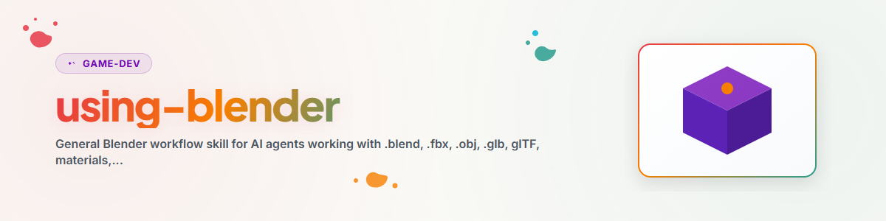

> **Deutsch** — Offizielle Deutsch-Version / Documento Oficial en Deutsch.

> **English Translation** — Official English version of `using-blender`.

# استخدام Blender (Deutsch)

## القاعدة الأساسية

اعمل مع Blender في ثلاثة أوضاع، بحسب المهمة:

1. **وضع الواجهة الرسومية (GUI):** افتح Blender بصريًا عندما يريد المستخدم معاينة الأصل أو تقييمه أو متابعة تحريره يدويًا.
2. **الوضع بدون واجهة (Headless):** استخدم `blender --background --python <script.py>` عندما يُطلب التصدير أو إعادة الاستيراد أو المعالجة الدفعية أو الفحص الحتمي.
3. **وضع MCP:** استخدمه فقط عندما يكون إضافة Blender قيد التشغيل متصلة عن قصد وتكون هناك حاجة إلى التحكم المباشر في المشهد. تحقق أولًا من الوضع الأمني والترخيص.

## سير العمل القياسي

1. وضّح الهدف: معاينة أو إنشاء أو تحويل أو تحسين أو عرض أو تحقق.
2. اقرأ الملفات الموجودة أولًا: البيان (Manifest)، وملف README، وصيغ التصدير، ونتائج الفحوص السابقة.
3. حدّد مسار Blender: `blender` في PATH أو في إعدادات المشروع أو في مسار المستخدم. لا تكتب مسارات خاصة محلية في وثائق قابلة للنشر.
4. للأتمتة، استخدم نصًا برمجيًا صغيرًا `bpy` يوضح المدخلات والمخرجات والأخطاء صراحةً.
5. بعد كل تصدير، نفّذ على الأقل فحص إعادة استيراد أو تحميل قبل اعتبار النتيجة قابلة للاستخدام.
6. وثّق المخرجات باختصار: المصدر، وصيغ التصدير، وإصدار الأداة، وحالة الفحص، والقيود المعروفة.

## قواعد التصدير والفحص

- للاستخدام العام على الويب والمعاينات، يُفضّل `.glb`.
- لمحركات الألعاب وتبادل أدوات DCC، اقترح أيضًا `.fbx` أو `.obj/.mtl` عندما يتطلب سير العمل المستهدف ذلك.
- في حالات إعادة الاستيراد الدائرية (Roundtrip)، تحقق دائمًا من: وجود الملف، وعدم كونه فارغًا، وإمكانية إعادة استيراده، ووجود أسماء الكائنات والمواد المتوقعة.
- للأصول الكبيرة، سجّل المقاييس: عدد الشبكات (Meshes)، والمواد، والصندوق المحيط (Bounding Box)، وحجم الملف، وعدد المثلثات اختياريًا.
- لفحوص العرض، استخدم دقة معاينة صغيرة قبل بدء عمليات عرض مكلفة بمحرك Cycles أو بدقة Full HD.

## قواعد الأمان

- كود `bpy` هو كود Python محلي يملك صلاحية الوصول إلى نظام الملفات. نفّذ فقط النصوص البرمجية التي كتبتها بنفسك أو دققتها.
- لا تُفعّل إضافات Blender أجنبية أو أدوات تنزيل الأصول أو خوادم القياس عن بُعد دون فحص الترخيص وحماية البيانات.
- في خوادم MCP التي تتضمن أداة `execute_python` عامة، حدّد النطاق والشبكة ومجلد العمل ومهلة الانتظار مسبقًا.
- بالنسبة إلى الأصول من الأسواق أو المصادر الخارجية، تحقق من الترخيص بشكل منفصل. إمكانية التحميل التقنية لا تحل محل حقوق الاستخدام.

## خيارات MCP

للتحكم المباشر، اطّلع على [references/blender-mcp-review.md](references/blender-mcp-review.md) عندما يُراد اختيار خادم Blender MCP أو تثبيته أو تقييمه.

## سجل التغييرات

### 1.0.0 (2026-06-20)
- مهارة Blender أولية مستقلة عن المستخدم، مع توجيه لأوضاع الواجهة الرسومية والوضع بدون واجهة وMCP.

## فحص النتيجة دون فتح الواجهة الرسومية

للأصول، يوجد بوابة جاهزة تعمل في الخلفية وتوفر **أربعة عمليات عرض ومقاييس قابلة للقياس** في تشغيل واحد (الدوران، ومحور الارتكاز، والأجزاء العائمة):

```powershell
blender.exe --background --factory-startup `
  --python "<OneDrive>\.TOPICS\.ROBLOX\_tools\verify_asset_visual.py" -- `
  --fbx "<asset.fbx>" --out "<ordner>" --json
```

لا حاجة إلى واجهة رسومية أو تركيز نافذة. التفاصيل والقيود (ومنها: خادم MCP `ellmos-blender-use` **لا** يستطيع العرض): `.ROBLOX\BLENDER_ASSET_CHANNELS.md`.
سير العمل المفصل: مهارة `build-assets-with-blender`.
