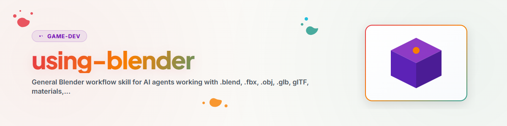

> **Français** — Version française officielle de la compétence `using-blender`.

# Utiliser Blender

## Règle fondamentale

Travaillez avec Blender selon trois modes adaptés à la tâche :

1. **Mode GUI :** Ouvrir Blender de façon visible lorsque l'utilisateur souhaite examiner, évaluer ou retoucher manuellement un asset.
2. **Mode headless :** Utiliser `blender --background --python <script.py>` lorsqu'un export, un réimport, un traitement par lots ou une vérification déterministe est demandé.
3. **Mode MCP :** À n'utiliser que si un add-on Blender actif est délibérément connecté et qu'un pilotage de scène en direct est nécessaire. Vérifier au préalable la situation de sécurité et de licence.

## Flux de travail standard

1. Clarifier l'objectif : visualiser, générer, convertir, optimiser, rendre ou vérifier.
2. Lire les fichiers existants : manifeste, README, formats d'export et résultats de contrôle existants en premier.
3. Déterminer le chemin de Blender : `blender` dans le `PATH`, configuration propre au projet ou chemin utilisateur. Ne pas inscrire de chemins privés locaux dans la documentation publiable.
4. Pour l'automatisation, utiliser un petit script `bpy` qui rend explicites les entrées, les sorties et les erreurs.
5. Après chaque export, exécuter au moins un contrôle de réimport ou de chargement avant de considérer le résultat comme exploitable.
6. Documenter brièvement les artefacts : source, formats d'export, version de l'outil, statut de contrôle et limites connues.

## Règles d'export et de vérification

- Pour un usage web / prévisualisation général, privilégier `.glb`.
- Pour les moteurs de jeu et les échanges DCC, proposer en plus `.fbx` ou `.obj/.mtl` si le flux cible l'exige.
- Pour les allers-retours (roundtrips), toujours vérifier : le fichier existe, il n'est pas vide, il peut être réimporté et les noms d'objets/matériaux attendus sont présents.
- Pour les gros assets, relever les métriques : nombre de maillages, matériaux, boîte englobante (bounding box), taille de fichier et optionnellement nombre de triangles.
- Pour les tests de rendu, utiliser une faible résolution de prévisualisation avant de lancer des rendus Cycles ou Full HD coûteux.

## Règles de sécurité

- Le code `bpy` est du code Python local disposant d'un accès au système de fichiers. N'exécuter que des scripts écrits soi-même ou audités.
- N'activer aucun add-on Blender tiers, téléchargeur d'assets ou serveur de télémétrie sans vérification de licence et de confidentialité.
- Pour les serveurs MCP dotés d'un outil arbitraire `execute_python`, limiter au préalable le périmètre, le réseau, le répertoire de travail et le délai d'expiration (timeout).
- Pour les assets issus de marketplaces ou de sources externes, vérifier la licence séparément. La capacité technique de chargement ne remplace pas les droits d'utilisation.

## Options MCP

Pour le pilotage en direct, lire [references/blender-mcp-review.md](references/blender-mcp-review.md) lorsqu'un serveur Blender-MCP doit être sélectionné, installé ou évalué.

## Journal des modifications

### 1.0.1 (2026-11-22)
- Indication de langue corrigée

### 1.0.0 (2026-06-20)
- Compétence Blender initiale agnostique avec routage GUI, headless et MCP.

## Vérifier le résultat sans ouvrir l'interface graphique

Pour les assets, il existe un contrôle en arrière-plan prêt à l'emploi qui fournit **quatre rendus et des métriques mesurables** en une seule passe (rotation, pivot, pièces flottantes) :

```powershell
blender.exe --background --factory-startup `
  --python "<OneDrive>\.TOPICS\.ROBLOX\_tools\verify_asset_visual.py" -- `
  --fbx "<asset.fbx>" --out "<dossier>" --json
```

Pas d'interface graphique, pas de focus nécessaire. Détails et limites (notamment : le serveur MCP `ellmos-blender-use` ne peut **pas** effectuer de rendu) : `.ROBLOX\BLENDER_ASSET_CHANNELS.md`.
Flux détaillé : compétence `build-assets-with-blender`.
