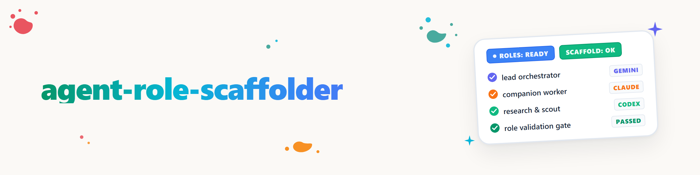

# agent-role-scaffolder

<!-- FAMILY-ROUTER:Agenten-Orchestrierung START -->
> **Familia de orquestación de agentes — guía:** elegir/escalonar modelo ->
> `model-strategy`; elegir patrón de orquestación -> `choose-your-orchestrator`;
> operaciones de enjambre (5 patrones básicos + 2 modos) -> `swarm-operations`;
> descomponer/delegar/aceptar tarea -> `orchestrator`; mensajería
> entre proveedores/presencia/bloqueos -> `agents-bridge`; **crear o
> revisar un nuevo rol -> esta skill (agent-role-scaffolder)**.
<!-- FAMILY-ROUTER:Agenten-Orchestrierung END -->

## Propósito

Este ecosistema ya cuenta con una familia madura de skills de orquestación
(`model-strategy`, `swarm-operations`, `orchestrator`, `choose-your-orchestrator`,
`agents-bridge`), pero **ninguna para la pregunta de "cómo se crea correctamente
un nuevo rol".** `agent-role-scaffolder` cubre esa laguna. No duplica las skills
mencionadas, sino que **redirige a ellas** cuando se necesitan escalonamiento,
patrones de orquestación o mensajería entre proveedores.

**Origen:** decisión del usuario M5 del ticket `T-20260825-935905816` (revisión completa
del marketplace): veredicto (b): el conocimiento propio sobre construcción de
agentes existía, pero sin formalizar. El plugin oficial de Claude Code
`agent-sdk-dev` (claude-plugins-official, Apache-2.0) sirvió como **modelo
estructural**: un archivo de comando de scaffolding más dos subagentes verificadores
temáticos con lista de comprobación y un formato de informe PASS /
PASS-WITH-WARNINGS / FAIL. Se adoptó la **forma** (catálogo de preguntas de scaffold
→ construcción → lista de verificación con informe estructurado), no el texto ni el
objeto: ese plugin construye apps Claude Agent SDK en bruto (Python/TypeScript),
mientras que esta skill construye **roles de agentes propios de ellmos**
(definiciones de subagentes y workers de compañía). El original NO está instalado;
reside en modo solo lectura en la caché local del marketplace y solo se leyó
(`.PLUGINS/CLAUDE.md` regla 5: ideas libres, formulaciones no). Entrada de registro:
`.AI/.PLUGINS/PLUGIN-REGISTER.md`, estado `zitiert`.

## Dos vías de construcción: ambas pertenecen aquí

En el ecosistema ellmos, los nuevos roles surgen por dos vías estructuralmente
distintas que no deben confundirse (análogo a la separación TS/Python del plugin
modelo, pero aquí según el límite real del sistema):

| | **Subagente nativo** | **Worker de compañía** |
|---|---|---|
| Qué surge | una definición de rol persistente (`~/.claude/agents/<name>.md`, iniciable mediante la herramienta `Agent`) | una instancia nombrada ad hoc, reutilizada mediante `SendMessage` para UNA serie de tareas |
| Vida útil | persistente, reutilizable entre sesiones | durante la duración de una serie de tickets/temas; después se descarta |
| Ejemplos existentes | `ati-agent`, `bueroassistent`, `versicherungs-agent`, `gesundheitsassistent`, `persoenlicher-assistent`, `production`, `research-agent`, `reflection-agent`, `test-agent`, `entwickler-agent` | este mismo modelo de sesión (p. ej., `skillcreator-bau`, `policyreg-decisions`, `workflowhooker-ausbau`: workers nombrados en el sistema de tickets) |
| Capa de ciclo de vida | registro de agentes propio de Claude Code | **COMA** (`.MODULES/.ORCHESTRATION/coma`), cuando se inicia entre procesos y no solo dentro de la herramienta |
| Guía de construcción aquí | `references/subagent-role-scaffold.md` | `references/companion-worker-scaffold.md` |

**Regla práctica:** si la capacidad necesita un nombre propio y reutilizable a lo
largo de muchas sesiones, con una descripción de activación fija (p. ej., "siempre
que se trate de comprobantes fiscales"), usa un subagente nativo. Si es una serie
limitada pero coherente de tareas que un coordinador delega en ese momento (cadena
de tickets, cambio de tema), usa un worker de compañía.

## Flujo

1. **Elegir la vía de construcción** (tabla anterior); ante la duda, pregunta al
   usuario en lugar de adivinar.
2. **Recorrer las preguntas de scaffold** (ver `references/*.md` correspondiente):
   igual que en el plugin modelo, de una en una y no todas a la vez: propósito/
   desencadenante, necesidad de herramientas (`Tools:`), elección de modelo
   (→ **paso 3**), necesidad de coordinación (¿agente jefe con expertos o rol
   individual?).
3. **No decidas aquí la elección de modelo: delégala a `model-strategy`.** La
   selección basada en puntuación, la delegación entre agentes, el emparejamiento
   con asesor y los disparadores de escalado ya están resueltos allí; aquí solo se
   hace la referencia. Regla práctica de los roles existentes: los subagentes **no heredan
   por defecto** el modelo principal (ver memoria de retroalimentación
   `feedback_subagenten_modellstaffelung`).
4. **Revisar el patrón de orquestación** si el nuevo rol va a colaborar con varios
   otros: `choose-your-orchestrator` elige el patrón, `swarm-operations` aporta los 5 patrones
   básicos + 2 modos, y `orchestrator` el protocolo de descomponer/delegar/aceptar.
5. **Cumplir las convenciones de equipo y mensajería** (`references/
   model-staffing-and-messaging.md`):
   `SendMessage` para la comunicación entre agentes, reclamación de tickets
   mediante el nombre de archivo en la delegación de tickets, y "referenciar en lugar
   de repetir" al asignar tareas (no reproducir en el prompt las reglas centrales,
   solo lo específico de la tarea).
6. **Verificar**: recorrer la lista de comprobación correspondiente en el archivo
   `references/*.md` elegido y elaborar el informe en el formato `PASS / PASS MIT WARNUNGEN / FAIL`
   (estructura más abajo).
7. **Catalogar si procede**: un rol persistente nuevo pertenece al registro adecuado
   (`~/.claude/agents/`, o agrupación en plugin si aplica); un worker de compañía no
   necesita entrada de registro, solo una transferencia inicial de tarea clara.

## Formato del informe de verificación (para ambas vías)

Estructura adoptada deliberadamente del plugin modelo (forma, no redacción): cuatro
secciones, concisas:

- **Estado:** PASS | PASS MIT WARNUNGEN | FAIL
- **Puntos críticos:** lo que inutiliza el rol (falta la descripción de activación,
  `Tools:` demasiado amplio o demasiado estrecho, modelo no justificado
  mediante `model-strategy`, no se verificó la delimitación frente a un rol existente)
- **Advertencias:** subóptimo pero funcional (p. ej., modelo principal heredado en
  lugar de escalonado, sin criterio de rotación para un worker de compañía de larga
  duración)
- **Comprobaciones superadas + recomendaciones:** qué cumple y cuál es el siguiente paso

## Skills relacionadas

- `model-strategy`: elección y escalonamiento de modelos (paso 3, aquí solo referenciado).
- `swarm-operations`: patrones de enjambre para la colaboración entre varios roles.
- `choose-your-orchestrator`: elige el patrón de orquestación adecuado.
- `orchestrator`: protocolo para descomponer/delegar/aceptar.
- `agents-bridge`: mensajería entre proveedores/presencia/bloqueos, si el nuevo
  rol debe comunicarse más allá de Claude Code con Codex/Gemini/Kimi.
- `skill-explorer`: comprueba si una capacidad ya existe ANTES de construir un nuevo
  rol (evitar duplicados).

## Registro de cambios

### 1.0.0 (2026-08-25)
- Primera versión. Construida según la decisión del usuario M5 (`T-20260825-935905816`)
  mediante `ellmos-skill-creator`. Formaliza el patrón de worker de compañía (fuente
  principal: `_control-center/_TICKETS/README.md`, sección "Leitprinzip (Kontext-Ökonomie)" (principio rector, economía de contexto)),
  el ciclo de vida COMA (fuente principal: `.MODULES/.ORCHESTRATION/coma/README.md`) y el patrón observado
  de "agente jefe que coordina expertos" de los roles existentes. Redirige
  deliberadamente a `model-strategy`/`swarm-operations`/`orchestrator`/
  `choose-your-orchestrator`/`agents-bridge` en lugar de duplicarlas. Modelo `agent-sdk-dev`
  (claude-plugins-official) NO instalado, solo leído y citado estructuralmente
  (`.PLUGINS/CLAUDE.md` regla 5).
