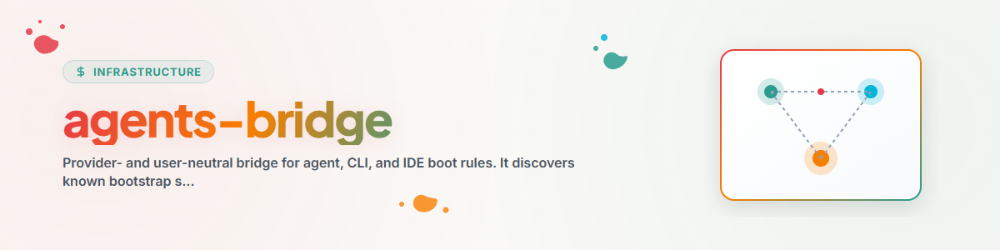

> **Deutsch** — Offizielle Deutsch-Version / Documento Oficial en Deutsch.

# AGENTS-BRIDGE — the Lifeboat, উরফে: Time Capsule (Deutsch)

> **উপনাম „Lifeboat" (জার্মান অর্থে Rettungsboot, উদ্ধারনৌকা) ও „Time Capsule":** agents-bridge
> হলো এজেন্ট-নিয়মফাইল (CLAUDE.md/
> GEMINI.md/GPT.md/AGENTS.md)-এর পুনরুদ্ধার-সেট — এই কাজটি এতদিন কোনো চেনা নাম ছাড়াই ছিল।
> „Lifeboat" নৌ-নামকরণের পরিবারে খাপ খায়, যা ব্রিজ-রূপকের চারপাশে গড়ে উঠেছে (Wheelhouse, Deep-Diver, Lower Decks);
> „Time Capsule" একই কার্যের দ্বিতীয় দিক তুলে ধরে — একটি সীলমোহরকৃত, হ্যাশ-যাচাইকৃত অবস্থা, যা পরে অক্ষতভাবে পুনরুদ্ধার করা যায়।
> নাম পরিবর্তন নয়: প্রযুক্তিগত নাম `agents-bridge`-ই থাকে, দুটি উপনামই অর্থবহ সমার্থক।

এই Skill ব্যবহার করুন একটি ছোট ফাইলভিত্তিক বহু-প্রদানকারী ব্যবস্থাকে ক্যাপচার, যাচাই, স্থানান্তর বা পুনরুদ্ধার করতে। প্রতিটি ইনস্ট্যান্সে ঠিক একটি স্পষ্টভাবে নির্বাচিত প্রধান প্রদানকারী-ফাইল থাকে। কোনো প্রদানকারী, ফাইলনাম, হোস্ট বা ক্লাউড-ডিরেক্টরি স্বয়ংক্রিয়ভাবে ক্যানোনিকাল নয়।

## কার্যপ্রবাহ ও পদ্ধতি

1. উৎস ও গন্তব্যের সব স্থানীয় নির্দেশনা, লক এবং গোপনীয়তা-নিয়ম পড়ুন। অন্যের পরিবর্তন সংরক্ষণ করুন।
2. `python scripts/bridge.py discover --root <instanz>` চালান। `discover`
   শুধু একটি অনন্য মার্কার `agents-bridge-primary: true` গ্রহণ করতে পারে।
   কোনো ক্লেইম না থাকলে বা একাধিক ক্লেইম থাকলে ওয়ার্কফ্লো একটি Decision-Briefing-সহ থেমে যায়; কোনো ফাইলনাম-ডিফল্ট নেই।
3. `references/profile-v3.schema.json` অনুযায়ী একটি প্রোফাইল তৈরি করুন। এতে নির্দিষ্ট করা হয়: প্রধান পৃষ্ঠ, প্রদানকারী-পৃষ্ঠ, সত্যের উৎস, পয়েন্টার-গ্রাফ, পুনরুদ্ধার, মেমরি-সাইলো, মেসেঞ্জার, উপস্থিতি, লক এবং গোপনীয়তা-Includes/-Excludes।
4. প্রোফাইল পরীক্ষা করুন এবং উৎস পরিবর্তন না করে ইনস্ট্যান্স ক্যাপচার করুন:

   ```text
   python scripts/bridge.py profile-validate --profile <profil.json>
   python scripts/bridge.py capture --profile <profil.json> --root <quelle> --output <neues-paket>
   ```

5. `doctor` দিয়ে প্যাকেজ যাচাই করুন এবং `plan` বা `restore` দিয়ে `--apply` ছাড়া একটি প্রিভিউ তৈরি করুন। বিদ্যমান ফাইল কখনো অন্ধভাবে ওভাররাইট করা হয় না।
6. কেবল পরীক্ষার পরেই `--apply --yes --backup-dir
   <backup> --receipt <receipt.json>` দিয়ে রিস্টোর প্রয়োগ করুন। এরপর আসে `verify` এবং Claude, Codex/GPT, Gemini বা নিরপেক্ষ প্রদানকারীর জন্য একটি প্রকৃত নেটিভ পাঠ-পরীক্ষা।
7. ত্রুটি হলে: ড্রিফট স্পষ্ট করুন, অথবা `rollback --yes` দিয়ে সঠিক রসিদ (receipt) রোলব্যাক করুন। দ্বিতীয় রিস্টোরকে অবশ্যই `idempotent` জানাতে হবে।
8. `message send|ack|status`, `memory`, `presence` এবং
   `lock claim|release|status` শুধু ছোট ফাইল-চুক্তি হিসেবে ব্যবহার করুন। মেসেঞ্জার Ticket-Master বা Scheduler-এর স্থলাভিষিক্ত নয়; মেমরি-সাইলো কখনো স্বয়ংক্রিয়ভাবে একীভূত হয় না।

## নিরাপত্তার সীমারেখা

- লোডার বা রিডাইরেক্টই অগ্রাধিকারযোগ্য। প্রজেকশন কেবল তখনই অনুমোদিত, যখন নেটিভ রেফারেন্স কাজ করে না; এতে থাকে উৎস-হ্যাশ, প্রভেন্যান্স, `generated_at` এবং একটি ড্রিফট-শনাক্তকারী। নিয়ন্ত্রিত পুনঃসৃষ্টি কেবল `capture --regenerate-projections`-সহ একটি নতুন প্যাকেজে হয়।
- সব প্রোফাইল-পাথ UTF-8 এনকোডেড, আপেক্ষিক এবং প্ল্যাটফর্ম-নিরপেক্ষ। এক্সপোর্ট ম্যানিফেস্টেড এবং Includes/Excludes-এর মধ্যে সীমাবদ্ধ।
- Secret, Credential এবং ব্যক্তিগত পূর্ণ (অ্যাবসোলিউট) পাথ fail closed প্রত্যাখ্যাত হয়, অথবা স্পষ্ট `redact` মোডে লগ-সহ প্রতিস্থাপিত হয়।
- Controlroom বিদ্যমান থাকলে সমন্বয়ের কর্তৃত্ব সেটিরই থাকে। তখন `agents-bridge` শুধু বুটস্ট্র্যাপ, পুনরুদ্ধার ও ফাইল-অ্যাডাপ্টার হিসেবে কাজ করে এবং কেন্দ্রীয় রানটাইম নকল করে না।

চুক্তি ও উদাহরণ আছে `references/contracts.de.md`,
`references/truth-topologies.md`, `references/inventory-contract.md` এবং
`references/migration-2-to-3.de.md`-এ। ইংরেজি সংস্করণ হলো `SKILL.en.md`।
