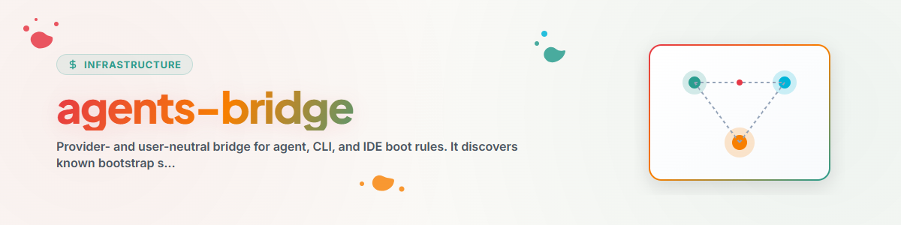

> **Français** — Version française officielle de la compétence `agents-bridge`.

# AGENTS-BRIDGE — le canot de sauvetage (« the Lifeboat »), aussi : Time Capsule

> **Surnoms « Lifeboat » (canot de sauvetage) et « Time Capsule » (capsule temporelle) :** `agents-bridge`
> EST le kit de restauration des fichiers de règles des agents (`CLAUDE.md`/
> `GEMINI.md`/`GPT.md`/`AGENTS.md`) — il assurait jusqu'ici cette fonction sans nom
> distinctif. « Lifeboat » s'inscrit dans la famille nautique autour de la métaphore
> de la passerelle (Wheelhouse, Deep-Diver, Lower Decks) ; « Time Capsule » souligne
> le second versant de la même fonction : un état scellé et vérifié par empreinte
> (hash) qui peut être restauré intact ultérieurement. Aucun renommage : le nom
> technique reste `agents-bridge`, les deux surnoms sont des synonymes parlants.

Utilisez cette compétence pour inventorier, vérifier, transférer ou restaurer un petit système multi-fournisseurs basé sur des fichiers. Chaque instance possède exactement un fichier fournisseur principal explicitement choisi. Aucun fournisseur, nom de fichier, hôte ou répertoire cloud n'est implicitement canonique.

## Flux de travail et procédure

1. Lisez toutes les instructions locales, les verrous et les règles de confidentialité pour la source et la cible. Préservez les modifications tierces.
2. Exécutez `python scripts/bridge.py discover --root <instance>`. `discover` ne peut retenir qu'un marqueur unique `agents-bridge-primary: true`. S'il n'y a aucune ou plusieurs revendications, le flux s'arrête avec un briefing de décision ; il n'existe aucun nom de fichier par défaut.
3. Créez un profil conforme à `references/profile-v3.schema.json`. Il désigne la surface principale, les surfaces fournisseurs, les sources de vérité, le graphe de pointeurs, la récupération, les silos mémoire, la messagerie, la présence, les verrous ainsi que les inclusions/exclusions de confidentialité.
4. Vérifiez le profil et capturez l'instance sans modifier la source :

   ```text
   python scripts/bridge.py profile-validate --profile <profil.json>
   python scripts/bridge.py capture --profile <profil.json> --root <source> --output <nouveau-paquet>
   ```

5. Vérifiez le paquet avec `doctor` et générez un aperçu avec `plan` ou `restore` sans `--apply`. Les fichiers existants ne sont jamais écrasés aveuglément.
6. N'appliquez la restauration qu'après vérification avec `--apply --yes --backup-dir <backup> --receipt <receipt.json>`. Suivent ensuite `verify` et un véritable test de lecture natif pour Claude, Codex/GPT, Gemini ou le fournisseur neutre.
7. En cas d'erreur : clarifier la dérive ou annuler avec le reçu exact via `rollback --yes`. Une deuxième restauration doit signaler `idempotent`.
8. Utilisez `message send|ack|status`, `memory`, `presence` et `lock claim|release|status` uniquement comme de petits contrats de fichiers. La messagerie ne remplace ni Ticket-Master ni un planificateur ; les silos mémoire ne sont jamais fusionnés automatiquement.

## Limites de sécurité

- Un chargeur (loader) ou une redirection est préférable. Une projection n'est autorisée que si les références natives ne fonctionnent pas ; elle contient les empreintes sources, la provenance, `generated_at` et une détection de dérive. La régénération contrôlée s'effectue uniquement dans un nouveau paquet avec `capture --regenerate-projections`.
- Tous les chemins du profil sont encodés en UTF-8, relatifs et indépendants de la plateforme. Les exports sont manifestés et limités aux inclusions/exclusions.
- Les secrets, identifiants et chemins absolus personnels sont rejetés en mode *fail closed* ou remplacés avec journalisation en mode explicite `redact`.
- Si un Controlroom est présent, il reste l'autorité de coordination. `agents-bridge` sert alors exclusivement de bootstrap, de récupération et d'adaptateur de fichiers sans dupliquer de runtime central.

Les contrats et exemples figurent dans `references/contracts.de.md`, `references/truth-topologies.md`, `references/inventory-contract.md` et `references/migration-2-to-3.de.md`. La version anglaise est `SKILL.en.md`.

## Journal des modifications

### 3.0.2 (2026-11-22)
- Indication de langue corrigée
