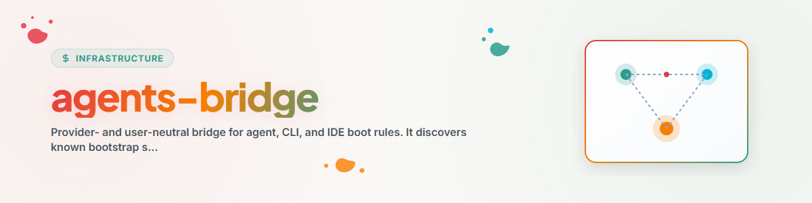

> **Français** — Documentation officielle complète traduite en français pour la compétence `agents-bridge`.


> **English** — Offizielle English-Version / Documento Oficial en English.


# AGENTS-BRIDGE (English)

Use this skill to connect an agent or IDE to explicitly selected rule files.
No provider, filename, host, or cloud directory is implicitly canonical.

## Flux de Travail et Étapes d'Exécution & Execution Steps

1. Read all local instructions that govern the source and target paths.
2. Run `python scripts/bridge.py discover` and optionally pass `--project`.
3. Ask the user to select the ordered truth sources and the target. An empty
   selection authorizes no write.
4. Prefer a redirect or ordered loader. Use a generated copy only when the
   target cannot load references, and record provenance plus drift checks.
5. Preview with:

   ```text
   python scripts/bridge.py render --truth <path> --target-kind generic
   ```

6. Create or change the target only after reviewing the preview.
7. Prove that the target agent actually read every selected source.

See `references/agent-conventions.md`,
`references/truth-topologies.md`, and
`references/inventory-contract.md`.

`agent-config-sync` manages broader configuration topologies.
`agents-bridge` is limited to boot and rule access. Runtime partner bridges and
schedulers are separate components.
