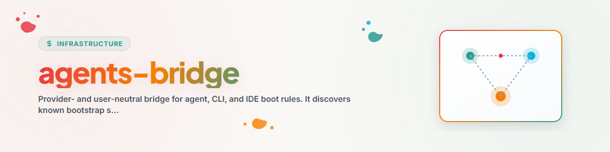

> **中文** — `agents-bridge` 官方中文版本。


# AGENTS-BRIDGE (中文)

使用此 Skill 将 Agent 或 IDE 连接到显式选择的规则文件。
任何供应商、文件名、主机或云目录都不具有隐式的权威性（canonical）。

## 工作流与步骤

1. 阅读管理源路径和目标路径的所有本地指令。
2. 运行 `python scripts/bridge.py discover`，可选传递 `--project` 参数。
3. 请用户选择有序的单一事实来源（truth sources）和目标。若选择为空，则不授权任何写入。
4. 优先使用重定向或有序加载器。仅当目标无法加载引用时才使用生成的副本，并记录出处及漂移检查（drift checks）。
5. 使用以下命令预览：

   ```text
   python scripts/bridge.py render --truth <path> --target-kind generic
   ```

6. 仅在审查预览后才创建或更改目标。
7. 证明目标 Agent 确实读取了每个选定的来源。

参见 `references/agent-conventions.md`、
`references/truth-topologies.md` 和
`references/inventory-contract.md`。

`agent-config-sync` 用于管理更广泛的配置拓扑结构。
`agents-bridge` 仅限于启动和规则访问。运行时合作伙伴桥接器与调度器属于独立组件。
