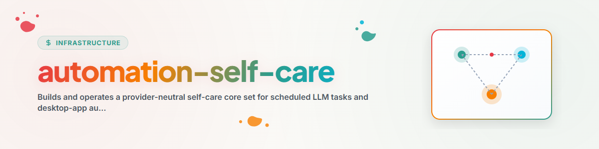

# صيانة الذات للأتمتة

يُنشئ أسطول صيانة أصليًا خاصًا بالمزوّد من حلقة قواعد واحدة محايدة تجاه المزوّدين. يحافظ على النية الأصلية لعائلة مهام ANTIGRAVITY، لكنه يشترط الأدلة والتغييرات القابلة للعكس والقراءات الراجعة الأصلية.

## الحدود غير القابلة للتفاوض

- التعامل مع الاكتشاف والتخطيط والموافقة والتعديل والقراءة الراجعة كمراحل منفصلة.
- استخدام واجهة برمجة الأتمتة المدعومة أو الأمر أو واجهة التطبيق الهدف. لا تفترض أبدًا أن تحرير ملف تخزين يغيّر حالة التطبيق الحية.
- قراءة القواعد المحلية والأقفال وسجلات الحذف/الكبت والجداول الموجودة قبل اقتراح أي مهمة.
- لا تخترع دعمًا للجدولة. إذا لم يمكن إثبات الإنشاء/التحديث/القراءة الراجعة، فأعدّ خطة تثبيت يدوية وتوقف قبل التعديل.
- تغيير ضبط واحد مستقل قابل للاختبار كحد أقصى في كل تشغيل للصيانة.
- حماية مهام الصيانة من تعطيل نفسها أو خفض وتيرتها الذاتية تحت حد الاسترداد المُهيَّأ. فقط قرار صريح من المستخدم أو بوابة أمان أو طارئ موثّق يسمح بإيقاف مضبوط.
- الإبقاء على معرّفات المهام الآلية المستقرة مستقلة عن العناوين المرئية. اعتبار بادئة التطبيق حماية إضافية للتمييز فقط، وليست هوية ولا بديلًا عن ضوابط الاسترداد والكبت والتراجع والقراءة الراجعة.
- الحفاظ على المطالبة السابقة والجدول والنموذج والأذونات وحالة التفعيل، حتى يمكن التراجع عن أي تعديل.
- عدم احتساب النجاح إلا بعد دليل على النتيجة، لا مجرد بدء الجدولة أو الخروج برمز 0.
- عدم نسخ الأسرار أو المطالبات الخاصة أو البيانات الشخصية إلى سجل مشترك.
- قبل أي تعديل، تشغيل فاحص سياسات حتمي مُسمّى في ملف تعريف المزوّد. تُحلّ مسارات المشروع وسكربتات الفحص والسياسات عبر حقول المحوّل أو عناصر نائبة محايدة؛ ولا تُدرج في المهارة العامة مسارات مضيف أو حساب أو أدلة خاصة.
- التحقق من آلية القفل المعتمدة في النظام الهدف قبل عمليات الملفات أو الجدولة أو الإيداع أو الدفع. إذا كانت سلطة القفل مجهولة أو غير قابلة للوصول أو متناقضة، يُطبَّق مبدأ الإغلاق الآمن والقراءة فقط.
- عدم تغيير النماذج بناءً على إصدارات منتجات مُرمّزة ثابتة أو افتراضات جودة غير موثّقة. تُحدَّد النماذج المسموح بها والحد الأدنى للمعايير من سطح المزوّد الحالي ومن السياسة المحلية السارية. تتطلب التخفيضات والترقيات السلطة المحددة هناك؛ وعند الغموض يبقى النموذج دون تغيير.
- عدم استنتاج ضبط المطالبات من سجلات التشغيل وحدها. يُفحص الاقتراح دلاليًا قبل التعديل مقابل السياسات السارية على المشروع المستهدف، مع الحفاظ على حدود الأمان والبحث والموافقة.
- التعامل مع أسطح الحالة المرجعية المتعددة كمعاملة واحدة: حفظ الحالات السابقة، وتحديث جميع الأهداف المعلنة، وقراءة كل هدف راجعًا، والتراجع الكامل عند النجاح الجزئي. لا تفترض أبدًا عددًا ثابتًا أو بنية مجلدات محلية محددة.
- حفظ تقارير التشغيل حصرًا في مخازن الأدلة والحالة المحلية المخصصة لذلك، وليس في ملفات قواعد الوكيل. تأتي أسماء هذه المخازن ومواقعها من ملف تعريف المزوّد.
- يمكن تكملة الصيانة الثقيلة بفحوصات مصغّرة محدودة النطاق. يجب أن تُحدَّد في ملف تعريف المزوّد حدود وقت التشغيل ونطاق الفحص والمهمة الأم ومسار التصعيد؛ ولا يجوز للفحص المصغّر تنفيذ إصلاح عميق.

## سير العمل

### 1. اكتشاف سطح الأتمتة الأصلي

جرد الفاعل الحالي والمزوّد والمعرّف غير الحساس `app_display_name` وفئة التطبيق وسطح الجدولة والعمليات المدعومة وملفات الحالة وسجل التشغيل وقياسات الاستخدام وطريقة القراءة الراجعة. وثّق القدرات عبر عقد ملف التعريف في [provider-adapter-contract.md](references/provider-adapter-contract.md).

ميّز بين جداول تطبيقات سطح المكتب الأصلية، وتشغيل CLI/بدون واجهة، وجدولة نظام التشغيل أو مشغّلات الخدمات، والخدمة العامة للجدولة، ومحرك سير العمل، والأتمتة غير المدعومة أو المعتمدة على الواجهة فقط. لا تُساوِ وجود ملف إعدادات بوجود مسار تعديل مدعوم.

### 2. جرد الأسطول

لكل مهمة، سجّل معرّفًا محليًا مستقرًا ودورًا دلاليًا والعنوان المرئي والغرض وبصمة المطالبة والجدول وحالة التفعيل والنموذج والتفكير والأذونات ومسارات الهدف وآخر حدث جدولة وآخر نتيجة ناجحة والمالك الحالي. أبقِ محتوى المطالبة محليًا.

طابق المهام الموجودة دلاليًا قبل اقتراح إنشاء مهمة جديدة. فضّل أولًا المعرّف المستقر، ثم المعرّف الأصلي للمزوّد، ثم الدور الدلالي، ثم العنوان القديم المعروف. العنوان المرئي المختلف ليس دليلًا على الحاجة إلى مهمة جديدة. النتائج الملتبسة تُوقف الخطة بدل إنشاء نسخة مكررة.

تحقق من السطح الحي المعتمد مرتين قبل أي تعديل إذا كان بإمكان التطبيق إعادة كتابة الحالة من الذاكرة.

### 3. تصميم مجموعة النواة

اقرأ [core-set.md](references/core-set.md). اختر بين:

- `compact`: خمس مهام صيانة تجمع بين التكرار وتوزيع الحمل؛ أو
- `full`: تسع مهام مركّزة وفق عائلة الصيانة الأصلية.

أنشئ خطة محايدة تجاه المزوّد:

```bash
python scripts/build_core_set.py provider-profile.json \
  --topology compact --out automation-care-plan.json
python scripts/build_core_set.py --lint-plan automation-care-plan.json
```

لا يقوم المولّد بتثبيت أي مهمة أبدًا. تحقّق من قدرة `blocked` واختر أوقاتًا محلية خالية من التعارض قبل تطبيق الخطة. تضبط ملفات تعريف المزوّدين الجديدة `app_display_name` صراحةً، ويمكن لـCI فرض ذلك عبر `--strict-profile`. تستخدم العناوين المرئية المولَّدة `<APP_DISPLAY_NAME> — <CARE_TITLE>`، بينما تبقى معرّفات المهام `automation-care.*` دون تغيير. يستخدم ملف تعريف Codex الاسم `CODEX`.

### 4. التثبيت التدريجي

ثبّت عبر محوّل المزوّد الأصلي:

1. ابدأ بالنظافة في وضع القراءة فقط.
2. أضف حماية الموارد.
3. أضف ضبط جودة المطالبات مع إمكانية التراجع.
4. أضف ضبط التكرار والحمل فقط بعد توفر أدلة تشغيل كافية.
5. أضف التنسيق بين الأنظمة في النهاية.

لأغراض ترحيل العنوان فقط، حدّث المهمة المطابقة دلاليًا في مكانها عبر السطح الأصلي المدعوم. أعد قراءة المعرّف المستقر وجميع الحقول غير المتعلقة بالعنوان؛ وأي فرق تشغيلي غير متوقع يستوجب التراجع. يجب ألا تُبلغ دورة تخطيط/تطبيق ثانية عن أي تغيير، ولا تنشئ أي مهمة إضافية.

تُنشأ المهام الجديدة أو المستوردة معطّلة، ما لم يمنح المستخدم موافقة صريحة على التثبيت النشط. للتجربة التجريبية دون إشراف، اشترط أولًا سجل حذف، ولقطة حالة سابقة، ودليل التشغيل، ومسار تراجع.

### 5. تشغيل حلقة الصيانة

تتبع كل مهمة صيانة الخطوات التالية:

```text
follow-up previous change
  -> collect current evidence
  -> classify one cause
  -> choose zero or one change
  -> mutate through native surface
  -> read back
  -> write receipt and next-check condition
```

استخدم كتالوج الفرضيات وقواعد الأدلة في [core-set.md](references/core-set.md). السبب المجهول يعني المراقبة أو تقييد الأذونات أو الإيقاف الآمن المؤقت؛ ولا تُخمَّن أبدًا إصلاحات.

### 6. التنسيق عبر الفاعلين

اعتبر الحالة المحلية للتطبيق مرجعًا نهائيًا. شارك فقط عقود المهام والتغطية والحالة والأدلة والبصمات المنقّحة. المراجعات المكررة/الاحتياطية للقراءة فقط مسموحة؛ أما التعديلات ذات الكاتب الواحد فتحتاج إلى حجز أو قفل أصلي مكافئ.

### 7. الأنظمة دون خطافات أحداث أصلية (امتداد Letter-Hooker)

تعامل مع تقييد الرموز أو الاشتراكات كحالة سعة، لا كفاعل معطّل. أعد التغطية المفوّضة بعد أن يُقدّم الفاعل الأصلي دليل نجاح.

## المخرجات الإلزامية

لكل تشغيل إعداد أو صيانة، أبلغ عن:

- سطح الأتمتة الأصلي المكتشف والقدرات غير المدعومة؛
- الطوبولوجيا المختارة والمهام المنشأة أو المقترحة أو المتخطاة؛
- التعديل الدقيق والقراءة الراجعة قبل/بعد؛
- دليل النتيجة أو نافذة المراقبة المفتوحة؛
- موقع التراجع وشرط العودة؛
- تحديث التغطية المشتركة، إن وُجد سجل تنسيق.

## مثال

المستخدم: "اضبط جداول ذاتية الصيانة في تطبيق سطح المكتب هذا."

اكتشف ما إذا كان التطبيق يستطيع سرد المهام المجدولة وإنشاؤها وتحديثها والتحقق منها. أنشئ الخطة المختصرة، واعرض القدرات غير المدعومة، ثم ثبّت فقط المهام المعتمدة عبر السطح الأصلي. لا يُعد مجلد يحتوي على مطالبة مهمة دون تسجيل حي في الجدولة إعدادًا مكتملًا.

## سجل التغييرات

### 1.3.1 (2026-09-09)

- توحيد تحسينات صيانة الذات المطلوبة صراحةً في الإصدارين 1.2 و1.3 بطريقة محايدة تجاه المزوّدين.
- إزالة مسارات المضيف والحساب والمشاريع الخاصة من الإرشادات العامة، واستبدالها بحقول المحوّل أو عناصر نائبة محايدة.
- ربط تبديل النماذج بقدرة المزوّد الحالية والسياسة المحلية والسلطة الموثّقة؛ وإزالة ترتيبات الإصدارات الثابتة وادعاءات الجودة غير الموثّقة.
- توصيف فاحص السياسات والفحص الدلالي للمطالبات وبوابة الأقفال والتحديثات المعاملاتية متعددة الأسطح ونظافة ملفات القواعد والفحوصات المصغّرة كعقود قابلة للنقل.

### 1.3.0 (2026-09-09)

- إضافة فحص السياسات الحتمي والفحص الدلالي للسياسات.
- تأمين تكافؤ الأسطح المتعددة وتنظيف الحالات المتناقضة.

### 1.2.0 (2026-09-06)

- إضافة حوكمة الأقفال ومنع التراجع في النماذج ونظافة ملفات القواعد وبنية الفحوصات المصغّرة.

### 1.1.0 (2026-08-30)

- إضافة `app_display_name` المحايد تجاه المزوّدين وصيغة العنوان المرئي `<APP_DISPLAY_NAME> — <CARE_TITLE>`، بما في ذلك `CODEX — ...` عبر ملف تعريف محوّل Codex.
- إضافة فحص الخطة ومطابقة المعرّف المستقر/الدلالة وحماية من التكرار.
- توضيح أن التسمية تُطبَّق إضافةً إلى حد الاسترداد، وأن ترحيلات العنوان وحدها يجب أن تحافظ على كل بصمة غير متعلقة بالعنوان.

### 1.0.1 (2026-07-30)

- إضافة أسماء بديلة محايدة تجاه المزوّدين لأتمتة النصوص وأتمتة تطبيقات سطح المكتب.

### 1.0.0 (2026-07-28)

- دمج عائلة صيانة ANTIGRAVITY الأصلية وحلقة القواعد F1-F6 والتعديلات اللاحقة الخاصة بالمزوّدين في مهارة نواة محايدة واحدة.
