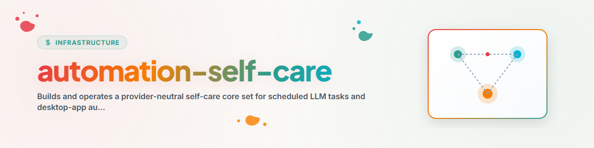

# Automation Self-Care

Erstellt eine native, anbieterspezifische Wartungs-Flotte aus einer einzigen
anbieterneutralen Regelschleife. Bewahrt die ursprüngliche Absicht der
ANTIGRAVITY-Task-Familie, verlangt dabei aber Belege, reversible Änderungen
und native Readbacks.

## Nicht verhandelbare Grenzen

- Discovery, Planung, Freigabe, Mutation und Readback als getrennte Phasen
  behandeln.
- Die unterstützte Automations-API, den Befehl oder die UI der Ziel-App
  nutzen. Niemals annehmen, dass das Bearbeiten einer Speicherdatei den
  Live-App-State ändert.
- Lokale Regeln, Locks, Lösch-/Suppression-Logs und bestehende Zeitpläne
  lesen, bevor ein Task vorgeschlagen wird.
- Keine Scheduler-Unterstützung erfinden. Kann Create/Update/Readback nicht
  belegt werden, einen manuellen Installationsplan erstellen und vor der
  Mutation anhalten.
- Höchstens eine unabhängig testbare Tuning-Änderung je Care-Lauf.
- Die Care-Tasks davor schützen, sich selbst zu deaktivieren oder ihren
  eigenen Takt unter den konfigurierten Recovery Floor zu senken. Nur eine
  ausdrückliche Nutzerentscheidung, ein Sicherheitsgate oder ein belegter
  Notfall darf eine kontrollierte Pause autorisieren.
- Stabile maschinelle Task-IDs unabhängig von sichtbaren Titeln halten. Ein
  App-Präfix als zusätzlichen Erkennbarkeits-Schutz behandeln, niemals als
  Identität oder als Ersatz für Recovery-, Suppression-, Rollback- und
  Readback-Kontrollen.
- Den vorherigen Prompt, Zeitplan, Modell, Berechtigungen und Aktiv-Status
  bewahren, damit jede Mutation zurückgerollt werden kann.
- Erfolg erst nach Ergebnis-Beleg zählen, nicht bloß nach Scheduler-Start
  oder Exit 0.
- Niemals Geheimnisse, private Prompts oder personenbezogene Daten in eine
  geteilte Registry kopieren.

## Ablauf

### 1. Die native Automationsoberfläche entdecken

Den aktuellen Akteur, Anbieter, nicht-sensitiven `app_display_name`,
App-Klasse, Scheduler-Oberfläche, unterstützte Operationen, State-Dateien,
Lauf-Historie, Nutzungstelemetrie und Readback-Methode inventarisieren.
Fähigkeiten über den Profilvertrag in
[provider-adapter-contract.md](references/provider-adapter-contract.md)
festhalten.

Native Desktop-App-Zeitpläne, CLI-/Headless-Ausführung, OS-Scheduler oder
Service-Starter, allgemeinen Scheduler-Dienst, Workflow-Engine und nicht
unterstützte oder nur-UI-Automation unterscheiden. Die Existenz einer
Konfigurationsdatei nicht mit einem unterstützten Mutationspfad
gleichsetzen.

### 2. Die Flotte inventarisieren

Für jeden Task einen stabilen lokalen Identifier, semantische Rolle,
sichtbaren Titel, Zweck, Prompt-Fingerprint, Zeitplan, Aktiv-Status, Modell,
Reasoning, Berechtigungen, Zielpfade, letztes Scheduler-Ereignis, letztes
erfolgreiches Ergebnis und aktuellen Owner erfassen. Prompt-Inhalt lokal
halten.

Bestehende Tasks semantisch abgleichen, bevor eine Neuanlage vorgeschlagen
wird. Zuerst stabile Task-ID, dann anbieter-native ID, semantische Rolle und
bekannter Legacy-Titel bevorzugen. Ein abweichender sichtbarer Titel ist
kein Beleg dafür, dass ein neuer Task nötig ist. Mehrdeutige Treffer
blockieren den Plan, statt ein Duplikat anzulegen.

Die maßgebliche Live-Oberfläche vor jeder Mutation zweimal prüfen, wenn die
App State aus dem Gedächtnis neu schreiben kann.

### 3. Das Core-Set entwerfen

[core-set.md](references/core-set.md) lesen. Wählen zwischen:

- `compact`: fünf Care-Tasks, die Frequenz mit Lastverteilung kombinieren;
  oder
- `full`: neun fokussierte Tasks entsprechend der ursprünglichen
  Wartungs-Familie.

Einen anbieterneutralen Plan erzeugen:

```bash
python scripts/build_core_set.py provider-profile.json \
  --topology compact --out automation-care-plan.json
python scripts/build_core_set.py --lint-plan automation-care-plan.json
```

Der Generator installiert niemals Tasks. Jede `blocked`-Fähigkeit prüfen und
kollisionsfreie lokale Zeiten wählen, bevor der Plan angewendet wird. Neue
Anbieter-Profile setzen `app_display_name` ausdrücklich; CI kann das mit
`--strict-profile` erzwingen. Erzeugte sichtbare Titel nutzen
`<APP_DISPLAY_NAME> — <CARE_TITLE>`, während `automation-care.*`-Task-IDs
unverändert bleiben. Ein Codex-Profil nutzt `CODEX`.

### 4. Installation stufenweise

Über den nativen Anbieter-Adapter installieren:

1. Mit Hygiene im Read-only-Modus beginnen.
2. Ressourcenschutz ergänzen.
3. Prompt-Qualitäts-Tuning mit Rollback ergänzen.
4. Frequenz- und Lasttuning erst ergänzen, wenn genug Lauf-Belege
   vorliegen.
5. Cross-System-Koordination zuletzt ergänzen.

Für eine reine Titel-Migration den semantisch gematchten Task über die
unterstützte native Oberfläche in-place aktualisieren. Die stabile ID und
alle Nicht-Titel-Felder zurücklesen; jedes unerwartete operative Delta
verlangt Rollback. Ein zweiter Plan-/Apply-Zyklus muss keine Änderung
melden und darf keinen weiteren Task anlegen.

Neue oder importierte Tasks deaktiviert anlegen, sofern der Nutzer die
aktive Installation nicht ausdrücklich freigegeben hat. Für einen
unbeaufsichtigten Pilotlauf zuerst ein Löschlog, einen
Vorher-State-Snapshot, einen Laufbeleg und einen Rollback-Pfad verlangen.

### 5. Die Care-Schleife ausführen

Jeder Care-Task folgt:

```text
follow-up previous change
  -> collect current evidence
  -> classify one cause
  -> choose zero or one change
  -> mutate through native surface
  -> read back
  -> write receipt and next-check condition
```

Den Hypothesen-Katalog und die Belegregeln in
[core-set.md](references/core-set.md) nutzen. Unbekannte Ursache bedeutet
beobachten, Berechtigungen einschränken oder sicher pausieren; niemals eine
Reparatur raten.

### 6. Über Akteure hinweg koordinieren

Lokalen App-State als maßgeblich behalten. Nur Task-Verträge, Abdeckung,
Status, Belege und bereinigte Fingerprints teilen. Redundante Read-only-
Reviews sind erlaubt; Single-Writer-Mutationen brauchen einen Claim oder
einen gleichwertigen nativen Lock.

### 7. Systeme ohne native Event-Hooks (Letter-Hooker-Erweiterung)


Token- oder Abo-Limitierung als Kapazitätszustand behandeln, nicht als
kaputten Akteur. Delegierte Abdeckung zurückgeben, nachdem der ursprüngliche
Akteur einen erfolgreichen Beleg liefert.

### 8. Antigravity / Gemini Plugin-Brücke & CareCenter-Integration

Dieser Skill bleibt vollständig **anbieterneutral** für Codex, Claude, Kimi
und generische Runner. Für **Google Antigravity / Gemini** gilt zusätzlich:

- Da Antigravity den `<skills>`-Katalog bei großem Kontextbudget alphabetisch
  abschneiden kann (`excluded due to context budget limits`), stellt dieser
  Skill für Antigravity/Gemini ein dediziertes **Antigravity-Plugin** bereit:
  `~/.gemini/config/plugins/automation-self-care/` (mit `plugin.json`,
  `rules/AGENTS.md` und gebündeltem `skills/automation-self-care/SKILL.md`).
- **Automatische Installation / Synchronisation:** Wenn ein Antigravity- oder
  Gemini-Agent diesen Skill liest oder einrichtet, prüft er, ob das Plugin unter
  `~/.gemini/config/plugins/automation-self-care/` installiert und in
  `~/.gemini/config/config.json` unter `"plugins"` registriert ist, und führt
  bei Bedarf sofort aus:
  ```bash
  python scripts/install_antigravity_plugin.py
  ```
- **Operative Werkzeuganbindung (`CareCenter-for-Antigravity`):** Für
  Antigravity-spezifische Laufzeit-, DB-, Patch- und Start-Schutz-Operationen
  (`safe-start`, `db-clean`, `ls-patch`, `switch`, `lint-sidecars`,
  `report-bug`) verweist das Plugin auf **CareCenter for Antigravity**
  (`<LOCAL_DEV_REPOS>/CareCenter-for-Antigravity`, CLI: `acc` bzw.
  `python -m carecenter_antigravity`, inkl. `acc matrix init|test`).

### 9. Minderabdeckungs-Erkennung (Under-Coverage) & Anbieter-spezifischer Lifecycle

Ein häufiger Architekturfehler in Multi-App-Flotten ist die Annahme, dass alle
Anbieter-Apps (z. B. Antigravity, Codex, Claude) immer gleichzeitig laufen. In
der Praxis fällt regelmäßig ein Anbieter wegen Token-Limits, Fokus-Pausen oder
Systemressourcen aus (**Solo-Betrieb**). Deshalb müssen die Self-Care-Tasks
(`automation-care.scheduler-tuning`, `antigravity-sheduler-state-controller`,
`antigravity-sheduled-task-sentiziser`, `antigravity-system-sync`) aktiv auf
**Minderabdeckung (Under-Coverage)** prüfen und reagieren:

1. **Drei quantitative Minderabdeckungs-Indikatoren (`coverage_audit`):**
   - **Solo-Rotationszyklus ($T_{\text{cycle,solo}}$):** Verhältnis aus realer
     Ziel-Pool-Größe $N_{\text{targets}}$ (z. B. 239 GitHub-Repos, 21
     Roblox-Spiele) zur effektiven Tagesfrequenz eines einzelnen Anbieters
     $F_{\text{solo}}$. Überschreitet $T_{\text{cycle,solo}} = N_{\text{targets}} / F_{\text{solo}}$
     den Domänen-Schwellenwert (GitHub-Repos: $>25\text{ Tage}$, Roblox-Spiele:
     $>14\text{ Tage}$), liegt eine Minderabdeckung vor.
   - **Producer-Consumer-Ungleichgewicht:** Wenn arbeitserzeugende Tasks
     (Producer, z. B. PR-Ersteller `githubbot-one-repo-cleaner` +
     `githubbot-one-repo-marketing-and-design` mit $12 + 12 = 24\text{ Läufen/Tag}$)
     häufiger laufen als abarbeitende Tasks (Consumer, z. B. PR-Merger
     `githubbot-multi-bot`), wächst der Backlog ungebremst an. Regel:
     $F_{\text{consumer,solo}} \ge F_{\text{producer,solo}}$.
   - **Verwaiste Fach-Stationen (`Station Gap`):** Fällt für eine notwendige
     Pipeline-Rolle (z. B. `ARTIST`, `SUBSYSTEM_SCOUT`, `SYSTEMS_DESIGNER`) die
     Solo-Frequenz auf $F_{\text{solo}} = 0$, während dieselbe Rolle beim
     Partner-Anbieter laut `automation-changes.log` ebenfalls pausiert oder
     archiviert ist, muss der Care-Task reagieren.
2. **Reaktion auf erkannte Minderabdeckung (Hypothese `h9`):**
   - Anhebung der Cron-Frequenz (`args[0]`) des unterabgedeckten Tasks auf einem
     freien Slot des harmonischen 8-Slot-Gitters (`:00, :07, :14, :20, :27, :35, :43, :51`), oder
   - Probe-Aktivierung eines pausierten Spezial-Tasks inkl. Aktualisierung der
     `STATUS-NOTIZ` und Eintrag in `OneDrive/.SYNC/automation-changes.log`.
3. **Anbieter-spezifische Archivierung, Pausierung & `automation-changes.log`:**
   - **Anbieter-Scope:** Eine Archivierung (`ARCHIVED`) oder Pausierung (`PAUSED`)
     bleibt immer auf den jeweiligen Anbieter selbst beschränkt (damit
     Redundanz/Failover bei anderen Anbietern erhalten bleibt).
   - **Aus der GUI archivieren (`--archive-delete <id>`):** Nicht mehr benötigte
     Automationen werden aus der Live-GUI entfernt (`config.json` + 3
     Spiegelordner) und als `.prompt.txt` (reine Textdatei mit Begründungskopf),
     `.md` und `.json` unter `OneDrive/.SYNC/_archive/deleted_automations/<provider>/`
     gespeichert (jederzeit per `--restore <id>` wiederherstellbar).
   - **Dauerhaft pausieren / reaktivieren (`STATUS-NOTIZ`):** Bei Automationen,
     die pausiert oder wieder aktiviert werden, steht der Grund direkt unterhalb
     der Kopfzeile (`[TAG] | ZWECK: ... | STATUS-NOTIZ (PAUSIERT/REAKTIVIERT <Datum> [Scope: <provider>]): <Grund> | AUFGABE: ...`),
     sodass der Namens-/Tag-Präfix am Anfang unberührt bleibt.
   - **Gemeinsames Log (`OneDrive/.SYNC/automation-changes.log`):** Alle Anbieter
     protokollieren jede Erstellung, Pausierung, Reaktivierung, Taktänderung und
     Archivierung mit Begründung in `OneDrive/.SYNC/automation-changes.log`
     (Spiegel: `automatization-changes.log`).

### 10. Nutzerneutrale Ziel-Aufgaben-Prioritäts- & Erfüllungs-Matrix v2.1 (`goal-task-priority-matrix`)

Automationen sind Abdeckungsträger für **in Aufgaben kristallisierte Nutzerziele** (`T-01`–`T-NN`). Die vollständige, nutzer- und anbieterneutrale Vorlage samt Anleitungsskill ist direkt im Skill-Paket enthalten:
- **Nutzerneutrale Referenz-Matrix & Template:** `references/goal-task-priority-matrix-template.md`
- **Nutzerneutrales JSON-Schema-Template:** `references/priority_matrix.template.json`
- **Anbieterneutraler Evaluator:** `python scripts/evaluate_task_fulfillment.py <path/to/priority_matrix.json>`
- **Eigenständiger Anleitungsskill:** `../goal-task-priority-matrix/SKILL.md`
- **Antigravity-optimierte Implementierung in CareCenter:** `acc matrix init` / `acc matrix test [--auto-heal-prompts]` (`docs/ANTIGRAVITY_GOAL_TASK_PRIORITY_MATRIX.md`)

Kernprinzipien der Matrix-Steuerung (`<SYNC_DIR>/GOAL_TASK_PRIORITY_MODEL.md`, `<SYNC_DIR>/priority_matrix.json`, `<SYNC_DIR>/priority-change-log.txt`):

1. **Zwei-Achsen-Priorisierung ($P_{\text{eff}}$):**
   - **Achse 1 — Zweck-Cluster-Priorität ($P_{\text{Cluster}}$, `C-01` bis `C-12`):** Grundgewicht (`0..100`) nach ursprünglichem Nutzeranliegen.
   - **Achse 2 — Thematische / Projekt-Priorität ($\Delta P_{\text{Project}}$):** Schwerpunkt-Boost für aktive Fokusprojekte (`<FOCUS_PROJECT_P0> = P0 (+30)`), sodass das wichtigste Projekt auch bei `<20%` Token-Quota (`LOW_CREDIT_SPARMODUS`) ungedrosselt weiterläuft.
2. **Die 6 Ökosystem-Anschlusspunkte (Prioritäts- & Kontext-Sensoren):**
   - **(1) Aktueller User-Chat & `/prios`** (`~/.local/state/agent-priorities/`)
   - **(2) `/agenda-setting` & Strategische Pläne** (`~/.config/agent-agenda/profile.json`, `<CONTROL_DIR>/_PLANS/`)
   - **(3) `decision-registry`** (`<CONTROL_DIR>/_DECISIONS/TO-DECIDE-USER.txt`, `DECIDED-AND-DONE.md`)
   - **(4) `policy-registry`** (`<SYNC_DIR>/_policies/library/P-*.md`, insbes. `P-014` risikobasierte Autoritätsanpassung & `P-019` Multi-App-Abdeckung)
   - **(5) Aktivitäts- & Backlog-Scanner (`gardener` / `scanner_tasks`)** (FTS5/Time-Decay `30m -> 24h -> 7d`)
   - **(6) Empirisches Präferenz-Gedächtnis (`build-your-users-mind` / Prompt-Listener)** (`<CONTROL_DIR>/_USER-MIND/avatar/WHAT-USER-SAID.md`, `PROFIL.md`)
3. **Autoritäts- & Einmaligkeits-Hierarchie (*„Einmal heißt nicht immer wieder“*):**
   - **Einmal-Aufforderungen im Chat** sind zu **100 % autoritativ für den aktuellen Moment**, ändern aber **niemals** dauerhaft Cron-Takte oder Cluster-Prioritäten.
   - **Regelmäßige Abläufe & Qualitäts-Gates** folgen den **kanonischen Regeln, Policies (`P-*.md`), lokalen Steuerdateien (`START.md`, `RULES.md`) und `SKILL.md`**.
   - **Explizite Richtungsänderungen / Monatsagenden** im Chat aktualisieren `priority-change-log.txt` und `priority_matrix.json`.
   - **Selbstheilende Lückenfüllung:** Neue Regeln/Upload-Gates werden in Projekt-Root-Steuerdateien (`START.md`, `GITHUB-POLICY.md`) und Skills hinterlegt; Automationen lesen diese beim Booten ein und füllen die Lücke dynamisch ohne Prompt-Hardcoding.
4. **Falscher-Indikator-Schutz & Evidenz-Pflicht:**
   - Cron-Frequenz und Cluster-Besetzungsstärke sind **keine verlässlichen Prioritäts-Marker** (oft nur durch Poolgröße wie 200+ Repos bedingt).
   - Jede Prioritätsänderung in `priority-change-log.txt` benötigt ein wörtliches Evidenz-Zitat (`[EVIDENZ:STATUS-NOTIZ]`, `[EVIDENZ:CHAT-ZITAT]`, `[EVIDENZ:DECISION]`, `[EVIDENZ:POLICY]`, `[EVIDENZ:AGENDA]`, `[EVIDENZ:INDICATOR_TEST]`).
5. **Aufgabenerfüllungs-Regelkreis (Qualität $I_{\text{Qual}}$ vs. Quantität/Masse $I_{\text{Quant}}$):**
   Jede Teilaufgabe `T-01`–`T-NN` besitzt explizite, ausführbare **Indikator-Tests**:
   - **Quantität ROT ($I_{\text{Quant}}$ = Stau/Backlog wächst oder `0%` aktive Abdeckung auf `P1`-Aufgabe bei GRÜNER Qualität):** Consumer-Frequenz erhöhen, Producer temporär drosseln oder pausierten `P1`-Spezialisten reaktivieren (Substance Gate).
   - **Qualität ROT ($I_{\text{Qual}}$ = Fehlalarme durch fremde Provider-States, `Locked: 100%`-Bug, Step-3-Abbrüche, generische `ZWECK:`-Stubs, korrupte DB-Zeilen oder Root-Pollution in PRs):** **Kein** Frequenz-Hochziehen! Schreibpfad einschränken, Ursache in Code/Prompt/DB heilen (`PR-Self-Clearing Gate`, `Headless-Stabilitäts-Gate`, `db-clean`) und erst nach grünem Readback skalieren.

## Pflicht-Ausgaben

Für jeden Setup- oder Care-Lauf berichten:

- entdeckte native Oberfläche und nicht unterstützte Fähigkeiten;
- gewählte Topologie und angelegte, vorgeschlagene oder übersprungene
  Tasks;
- exakte Mutation und Vorher-/Nachher-Readback;
- Ergebnis-Beleg oder offenes Beobachtungsfenster;
- Rollback-Ort und Rückkehrbedingung;
- geteiltes Abdeckungs-Update, falls eine Koordinations-Registry existiert.

## Beispiel

Nutzer: "Richte selbst-wartende Zeitpläne in dieser Desktop-App ein."

Entdecken, ob die App geplante Tasks auflisten, anlegen, aktualisieren und
verifizieren kann. Den kompakten Plan erzeugen, nicht unterstützte
Fähigkeiten darlegen, dann nur die freigegebenen Tasks über die native
Oberfläche installieren. Ein Ordner mit einem Task-Prompt ohne
Live-Scheduler-Registrierung ist kein abgeschlossenes Setup.

## Changelog

### 1.6.0 (2026-11-01)

- **Nutzer- & Anbieterneutrale Matrix-Vorlage (`v2.1`), Evaluator & Begleit-Skill (`goal-task-priority-matrix`):**
  Bereitstellung von `references/goal-task-priority-matrix-template.md`, `references/priority_matrix.template.json` und `scripts/evaluate_task_fulfillment.py` sowie Verknüpfung mit dem eigenständigen Anleitungsskill `goal-task-priority-matrix` in `.SKILLS` und der Antigravity-optimierten Implementierung in `CareCenter-for-Antigravity` (`acc matrix init` / `acc matrix test`). Bereinigung aller persönlichen Pfade/Projektnamen zugunsten nutzerneutraler Platzhalter (`<SYNC_DIR>`, `<LOCAL_DEV_REPOS>`, `<FOCUS_PROJECT_P0>`).

### 1.5.0 (2026-11-01)

- **Modell v2.0 — 6 Ökosystem-Anschlusspunkte, Einmaligkeits-Hierarchie & Erfüllungs-Indikatoren ($I_{\text{Qual}}$ vs. $I_{\text{Quant}}$):**
  Erweiterung von `GOAL_TASK_PRIORITY_MODEL.md` und `priority_matrix.json` auf v2.0: Anbindung an `/agenda-setting`, `/prios`, `decision-registry`, `policy-registry` (`P-014`/`P-019`), `gardener` und `build-your-users-mind` (`WHAT-LUKAS-SAID.md`). Verankerung der Einmaligkeits-Regel (*„Einmal heißt nicht immer wieder“*), des Falscher-Indikator-Schutzes, der 5 Evidenz-Klassen in `priority-change-log.txt` sowie der 56 Qualitäts-/Quantitäts-Indikatortests (`T-01`–`T-56`) mit differenziertem Self-Care-Eingriff bei ROT (Takt-Nachziehen bei Stau vs. `P-014`-Einschränkung + `text-improver` bei Qualitätsmangel).

### 1.4.0 (2026-11-01)

- **Ziel-Aufgaben-Prioritäts-Modell (2-Achsen-Priorisierung & GUI-Signal-Disambiguierung):**
  Anbindung an `OneDrive/.SYNC/GOAL_TASK_PRIORITY_MODEL.md` (56 deduplizierte Teilaufgaben `T-01`–`T-56` in 12 Clustern `C-01`–`C-12`), `OneDrive/.SYNC/priority_matrix.json` und `OneDrive/.SYNC/priority-change-log.txt` (Cluster-Priorität vs. Projekt-Boost wie `BACH = P0` sowie Diagnose-Matrix für GUI-Pausierung vs. GUI-Löschung).

### 1.3.0 (2026-11-01)

- **Minderabdeckungs-Erkennung (Under-Coverage & Solo-Resilienz, Hypothese `h9`):**
  Prüfung von Ziel-Pool-Größe vs. Solo-Tagesfrequenz ($T_{\text{cycle,solo}}$),
  Producer-vs-Consumer-Gleichgewicht und verwaisten Pipeline-Stationen ergänzt.
- **Anbieter-spezifisches Lifecycle-System:** GUI-entfernende Text-/JSON-Archivierung
  (`--archive-delete` / `--restore`), `STATUS-NOTIZ` unterhalb des `[TAG] | ZWECK:`-Kopfes
  und gemeinsames Cross-Provider-Log `OneDrive/.SYNC/automation-changes.log` verankert.

### 1.2.0 (2026-10-31)

- Anbieterneutralen Skill um die **Antigravity / Gemini Plugin-Brücke**
  (`scripts/install_antigravity_plugin.py` -> `~/.gemini/config/plugins/automation-self-care/`)
  ergänzt, damit `rules/AGENTS.md` dauerhaft im `<user_rules>`-Kontext
  geladen bleibt, während der Skill für alle anderen Provider unverändert
  anbieterneutral weiterläuft.
- Anbindung an `CareCenter-for-Antigravity` (`dev-bricks`) für Safe Start,
  SQLite-/Protobuf-Summary-Hygiene, Lifecycle-Patch und Bug-Reporting ergänzt.

### 1.1.0 (2026-08-30)

- Anbieterneutrales `app_display_name` und das sichtbare Titelformat
  `<APP_DISPLAY_NAME> — <CARE_TITLE>` ergänzt, inklusive `CODEX — ...` über
  das Codex-Adapter-Profil.
- Plan-Linting, Stabile-ID-/Semantik-Abgleich und Duplikat-Schutz ergänzt.
- Klargestellt, dass Naming zusätzlich zum Recovery Floor gilt und dass
  reine Titel-Migrationen jeden Nicht-Titel-Fingerprint bewahren müssen.

### 1.0.1 (2026-07-30)

- Anbieterneutrale Text-Automations- und Desktop-App-Automations-Aliase
  ergänzt.

### 1.0.0 (2026-07-28)

- Die ursprüngliche ANTIGRAVITY-Wartungsfamilie, die F1-F6-Regelschleife und
  spätere anbieterspezifische Anpassungen zu einem neutralen
  Core-Set-Skill konsolidiert.
