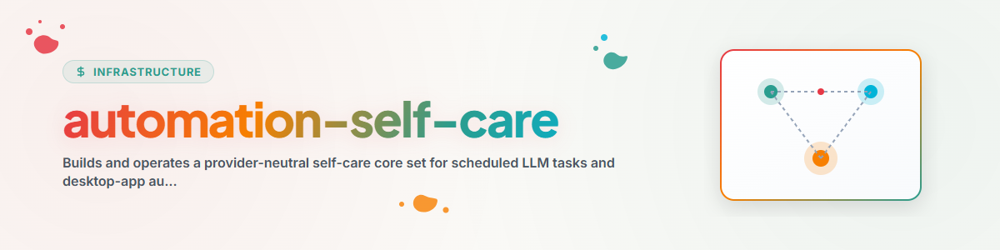

> **Français** — Version française officielle de la compétence `automation-self-care`.

# Automation Self-Care (Auto-maintenance des automatisations)

Construit une flotte de maintenance native et spécifique au fournisseur à partir d'une seule boucle de régulation indépendante du fournisseur. Préserve l'intention originelle de la famille de tâches ANTIGRAVITY tout en exigeant des preuves, des modifications réversibles et des relectures natives.

## Limites non négociables

- Traiter la découverte, la planification, l'approbation, la mutation et la relecture (readback) comme des phases distinctes.
- Utiliser l'API d'automatisation, la commande ou l'interface utilisateur officiellement prise en charge par l'application cible. Ne jamais supposer que l'édition d'un fichier de stockage modifie l'état en direct de l'application.
- Lire les règles locales, verrous, journaux de suppression/rétrogradation et planifications existantes avant de proposer une tâche.
- Ne pas inventer de prise en charge du planificateur. Si create/update/readback ne peuvent pas être prouvés, produire un plan d'installation manuel et s'arrêter avant toute mutation.
- Au maximum une modification de réglage indépendamment testable par cycle de maintenance.
- Protéger les tâches de maintenance contre l'auto-désactivation ou l'abaissement de leur propre cadence sous le plancher de récupération configuré (`Recovery Floor`). Seule une décision explicite de l'utilisateur, un garde-fou de sécurité ou une urgence prouvée peut autoriser une mise en pause contrôlée.
- Maintenir des identifiants machine stables indépendants des titres visibles. Traiter un préfixe d'application comme une protection de repérage supplémentaire, jamais comme une identité ni comme un substitut aux contrôles de récupération, de suppression, de rollback et de relecture.
- Conserver le prompt, la planification, le modèle, les permissions et l'état actif précédents afin que toute mutation puisse être annulée.
- Ne compter un succès qu'après preuve du résultat, pas simplement après un lancement du planificateur ou un code de sortie `0`.
- Ne jamais copier de secrets, prompts privés ou données personnelles dans un registre partagé.

## Déroulement

### 1. Découvrir la surface d'automatisation native

Inventorier l'acteur actuel, le fournisseur, le `app_display_name` non sensible, la classe d'application, l'interface du planificateur, les opérations prises en charge, les fichiers d'état, l'historique d'exécution, la télémétrie d'usage et la méthode de relecture. Consigner les capacités selon le contrat de profil dans [provider-adapter-contract.md](references/provider-adapter-contract.md).

Distinguer les planifications natives d'application desktop, l'exécution CLI/headless, le planificateur du système d'exploitation ou lanceur de service, le service de planification générique, le moteur de workflow et les automatisations non prises en charge ou uniquement via UI. Ne pas assimiler l'existence d'un fichier de configuration à un chemin de mutation pris en charge.

### 2. Inventorier la flotte

Pour chaque tâche, relever un identifiant local stable, le rôle sémantique, le titre visible, l'objet, l'empreinte du prompt, la planification, l'état actif, le modèle, le niveau de raisonnement, les permissions, les chemins cibles, le dernier événement du planificateur, le dernier résultat réussi et le propriétaire actuel. Conserver le contenu des prompts localement.

Apparier sémantiquement les tâches existantes avant de proposer une nouvelle création. Privilégier dans l'ordre l'identifiant stable de tâche, puis l'identifiant natif du fournisseur, le rôle sémantique et le titre historique connu. Un titre visible divergent ne prouve pas qu'une nouvelle tâche soit nécessaire. Les correspondances ambiguës bloquent le plan plutôt que de créer un doublon.

Vérifier deux fois la surface en direct faisant autorité avant toute mutation si l'application est susceptible de réécrire son état depuis la mémoire.

### 3. Concevoir le jeu de base (Core Set)

Lire [core-set.md](references/core-set.md). Choisir entre :

- `compact` : six tâches de maintenance (cinq piliers de maintenance incluant la répartition de fréquence/charge, plus la revue d'automatisations sur 3 jours `automation-care.3day-review`) ; ou
- `full` : dix tâches ciblées correspondant à la famille de maintenance ANTIGRAVITY, incluant `3day-review` (`antigravity-3day-review`, tous les 3 jours, modèle réviseur de haute qualité tel que `Gemini 4 Carbon (High)` / `gpt-6.1-sol` / `claude-opus-5.5`, afin que les problèmes et erreurs silencieuses ne soient pas omis ; strictement par hôte et application sur ses propres exécutions des 1 à 3 derniers jours, en renvoyant proprement `NO_WORK` s'il y a 0 exécution).

Générer un plan indépendant du fournisseur :

```bash
python scripts/build_core_set.py provider-profile.json \
  --topology compact --out automation-care-plan.json
python scripts/build_core_set.py --lint-plan automation-care-plan.json
```

Le générateur n'installe jamais de tâches. Vérifier chaque capacité marquée `blocked` et choisir des créneaux horaires locaux sans collision avant d'appliquer le plan. Les nouveaux profils fournisseurs définissent explicitement `app_display_name` ; la CI peut l'imposer avec `--strict-profile`. Les titres visibles générés utilisent `<APP_DISPLAY_NAME> — <CARE_TITLE>`, tandis que les identifiants de tâche `automation-care.*` restent inchangés. Un profil Codex utilise `CODEX`.

### 4. Installation progressive

Installer via l'adaptateur natif du fournisseur :

1. Commencer par l'hygiène en mode lecture seule.
2. Ajouter la protection des ressources.
3. Ajouter l'ajustement de qualité des prompts avec rollback.
4. N'ajouter l'ajustement de fréquence et de charge qu'une fois suffisamment de preuves d'exécution disponibles.
5. Ajouter la coordination inter-systèmes en dernier.

Pour une pure migration de titre, mettre à jour sur place la tâche appariée sémantiquement via l'interface native prise en charge. Relire l'identifiant stable et tous les champs hors titre ; tout écart opérationnel inattendu exige un rollback. Un second cycle plan/apply doit signaler aucune modification et ne doit créer aucune tâche supplémentaire.

Créer les tâches nouvelles ou importées à l'état désactivé, sauf si l'utilisateur a explicitement approuvé l'installation active. Pour une exécution pilote sans surveillance, exiger au préalable un journal de suppression, un instantané d'état initial, une preuve d'exécution et un chemin de rollback.

### 5. Exécuter la boucle de maintenance

Chaque tâche de maintenance suit :

```text
follow-up previous change
  -> collect current evidence
  -> classify one cause
  -> choose zero or one change
  -> mutate through native surface
  -> read back
  -> write receipt and next-check condition
```

Utiliser le catalogue d'hypothèses et les règles de preuve dans [core-set.md](references/core-set.md). Une cause inconnue implique d'observer, de restreindre les permissions ou de mettre en pause de façon sûre ; ne jamais deviner une réparation.

### 6. Coordonner entre acteurs

Conserver l'état local de l'application comme source faisant autorité. Ne partager que les contrats de tâches, la couverture, le statut, les preuves et les empreintes assainies. Les revues redondantes en lecture seule sont autorisées ; les mutations à écrivain unique requièrent une revendication (claim) ou un verrou natif équivalent.

### 7. Systèmes sans hooks d'événements natifs (extension Letter-Hooker)

Traiter les limitations de tokens ou d'abonnement comme un état de capacité, et non comme un acteur défaillant. Restituer la couverture déléguée dès que l'acteur d'origine fournit une preuve de reprise réussie.

### 8. Pont de plugin Antigravity / Gemini et intégration CareCenter

Cette compétence reste entièrement **indépendante du fournisseur** pour Codex, Claude, Kimi et les exécuteurs génériques. Pour **Google Antigravity / Gemini**, s'ajoute ceci :

- Comme Antigravity peut tronquer alphabétiquement le catalogue `<skills>` en cas de fort budget de contexte (`excluded due to context budget limits`), cette compétence fournit un **plugin Antigravity** dédié pour Antigravity/Gemini : `~/.gemini/config/plugins/automation-self-care/` (avec `plugin.json`, `rules/AGENTS.md` et le `skills/automation-self-care/SKILL.md` embarqué).
- **Installation / synchronisation automatique :** Lorsqu'un agent Antigravity ou Gemini lit ou configure cette compétence, il vérifie si le plugin est installé sous `~/.gemini/config/plugins/automation-self-care/` et enregistré dans `~/.gemini/config/config.json` sous `"plugins"`, et exécute immédiatement si nécessaire :
  ```bash
  python scripts/install_antigravity_plugin.py
  ```
- **Raccordement aux outils opérationnels (`CareCenter-for-Antigravity`) :** Pour les opérations spécifiques à Antigravity relatives à l'exécution, aux bases de données, aux correctifs et à la protection au démarrage (`safe-start`, `db-clean`, `ls-patch`, `switch`, `lint-sidecars`, `report-bug`), le plugin renvoie vers **CareCenter for Antigravity** (`<LOCAL_DEV_REPOS>/CareCenter-for-Antigravity`, CLI : `acc` ou `python -m carecenter_antigravity`, y compris `acc matrix init|test`).

### 9. Détection de sous-couverture (Under-Coverage) et cycle de vie spécifique au fournisseur

Une erreur d'architecture fréquente dans les flottes multi-applications consiste à supposer que toutes les applications fournisseurs (par ex. Antigravity, Codex, Claude) tournent toujours simultanément. En pratique, un fournisseur s'arrête régulièrement en raison de limites de tokens, de pauses de concentration ou de ressources système (**fonctionnement en solo**). Les tâches d'auto-maintenance (`automation-care.scheduler-tuning`, `antigravity-sheduler-state-controller`, `antigravity-sheduled-task-sentiziser`, `antigravity-system-sync`) doivent donc vérifier activement la **sous-couverture (Under-Coverage)** et y réagir :

1. **Trois indicateurs quantitatifs de sous-couverture (`coverage_audit`) :**
   - **Cycle de rotation solo ($T_{\text{cycle,solo}}$) :** Rapport entre la taille réelle du pool cible $N_{\text{targets}}$ (par ex. 239 dépôts GitHub, 21 jeux Roblox) et la fréquence journalière effective d'un seul fournisseur $F_{\text{solo}}$. Si $T_{\text{cycle,solo}} = N_{\text{targets}} / F_{\text{solo}}$ dépasse le seuil du domaine (dépôts GitHub : $>25\text{ jours}$, jeux Roblox : $>14\text{ jours}$), il y a sous-couverture.
   - **Déséquilibre producteur-consommateur :** Si les tâches génératrices de travail (Producteurs, par ex. créateurs de PR `githubbot-one-repo-cleaner` + `githubbot-one-repo-marketing-and-design` à $12 + 12 = 24\text{ exécutions/jour}$) tournent plus souvent que les tâches de traitement (Consommateurs, par ex. fusionneur de PR `githubbot-multi-bot`), l'arriéré grossit sans frein. Règle : $F_{\text{consumer,solo}} \ge F_{\text{producer,solo}}$.
   - **Stations spécialisées orphelines (`Station Gap`) :** Si pour un rôle de pipeline indispensable (par ex. `ARTIST`, `SUBSYSTEM_SCOUT`, `SYSTEMS_DESIGNER`) la fréquence solo tombe à $F_{\text{solo}} = 0$ alors que le même rôle chez le fournisseur partenaire est également en pause ou archivé selon `automation-changes.log`, la tâche de maintenance doit réagir.
2. **Réaction à une sous-couverture détectée (hypothèse `h9`) :**
   - Augmentation de la fréquence cron (`args[0]`) de la tâche sous-couverte sur un créneau libre de la grille harmonique à 8 créneaux (`:00, :07, :14, :20, :27, :35, :43, :51`), ou
   - Activation d'essai d'une tâche spécialisée en pause, incluant la mise à jour de `STATUS-NOTIZ` et une entrée dans `OneDrive/.SYNC/automation-changes.log`.
3. **Archivage, mise en pause et `automation-changes.log` spécifiques au fournisseur :**
   - **Périmètre fournisseur :** Un archivage (`ARCHIVED`) ou une mise en pause (`PAUSED`) reste toujours limité au fournisseur concerné (afin de préserver la redondance et le basculement chez les autres fournisseurs).
   - **Archiver depuis l'interface graphique (`--archive-delete <id>`) :** Les automatisations qui ne sont plus nécessaires sont retirées de l'interface en direct (`config.json` + 3 dossiers miroirs) et sauvegardées en `.prompt.txt` (fichier texte brut avec en-tête de justification), `.md` et `.json` sous `OneDrive/.SYNC/_archive/deleted_automations/<provider>/` (restaurables à tout moment via `--restore <id>`).
   - **Mettre en pause durablement / réactiver (`STATUS-NOTIZ`) :** Pour les automatisations mises en pause ou réactivées, le motif figure juste sous la ligne d'en-tête (`[TAG] | ZWECK: ... | STATUS-NOTIZ (PAUSIERT/REAKTIVIERT <Date> [Scope: <provider>]): <Motif> | AUFGABE: ...`), de sorte que le préfixe de nom/tag en début reste intact.
   - **Journal commun (`OneDrive/.SYNC/automation-changes.log`) :** Tous les fournisseurs consignent chaque création, mise en pause, réactivation, changement de cadence et archivage avec justification dans `OneDrive/.SYNC/automation-changes.log` (miroir : `automatization-changes.log`).

### 10. Matrice neutre de priorité et d'accomplissement objectifs-tâches v2.1 (`goal-task-priority-matrix`)

Les automatisations sont des vecteurs de couverture pour les **objectifs utilisateur cristallisés en tâches** (`T-01`–`T-NN`). Le modèle complet, neutre vis-à-vis de l'utilisateur et du fournisseur, accompagné de la compétence guide, est directement inclus dans le paquet de compétence :
- **Matrice de référence et modèle neutres :** `references/goal-task-priority-matrix-template.md`
- **Modèle de schéma JSON neutre :** `references/priority_matrix.template.json`
- **Évaluateur neutre vis-à-vis du fournisseur :** `python scripts/evaluate_task_fulfillment.py <path/to/priority_matrix.json>`
- **Compétence guide autonome :** `../goal-task-priority-matrix/SKILL.md`
- **Implémentation optimisée Antigravity dans CareCenter :** `acc matrix init` / `acc matrix test [--auto-heal-prompts]` (`docs/ANTIGRAVITY_GOAL_TASK_PRIORITY_MATRIX.md`)

Principes directeurs du pilotage par matrice (`<SYNC_DIR>/GOAL_TASK_PRIORITY_MODEL.md`, `<SYNC_DIR>/priority_matrix.json`, `<SYNC_DIR>/priority-change-log.txt`) :

1. **Priorisation à deux axes ($P_{\text{eff}}$) :**
   - **Axe 1 — Priorité de cluster d'objectifs ($P_{\text{Cluster}}$, `C-01` à `C-12`) :** Poids de base (`0..100`) selon l'intention initiale de l'utilisateur.
   - **Axe 2 — Priorité thématique / projet ($\Delta P_{\text{Project}}$) :** Coup de pouce ciblé pour les projets focaux actifs (`<FOCUS_PROJECT_P0> = P0 (+30)`), afin que le projet prioritaire continue à plein régime même avec `<20%` de quota de tokens (`LOW_CREDIT_SPARMODUS`).
2. **Les 6 points de raccordement à l'écosystème (capteurs de priorité et de contexte) :**
   - **(1) Chat utilisateur courant & `/prios`** (`~/.local/state/agent-priorities/`)
   - **(2) `/agenda-setting` & Plans stratégiques** (`~/.config/agent-agenda/profile.json`, `<CONTROL_DIR>/_PLANS/`)
   - **(3) `decision-registry`** (`<CONTROL_DIR>/_DECISIONS/TO-DECIDE-USER.txt`, `DECIDED-AND-DONE.md`)
   - **(4) `policy-registry`** (`<SYNC_DIR>/_policies/library/P-*.md`, en particulier `P-014` ajustement d'autorité basé sur le risque & `P-019` couverture multi-apps)
   - **(5) Scanner d'activité et de backlog (`gardener` / `scanner_tasks`)** (FTS5/décroissance temporelle `30m -> 24h -> 7d`)
   - **(6) Mémoire empirique des préférences (`build-your-users-mind` / Prompt-Listener)** (`<CONTROL_DIR>/_USER-MIND/avatar/WHAT-USER-SAID.md`, `PROFIL.md`)
3. **Hiérarchie d'autorité et de ponctualité (*« Une fois ne veut pas dire toujours »*) :**
   - Les **demandes ponctuelles dans le chat** font **100 % autorité pour l'instant présent**, mais ne modifient **jamais** durablement les cadences cron ou priorités de cluster.
   - Les **flux réguliers et garde-fous qualité** suivent les **règles canoniques, politiques (`P-*.md`), fichiers de pilotage locaux (`START.md`, `RULES.md`) et `SKILL.md`**.
   - Les **changements d'orientation explicites / agendas mensuels** dans le chat mettent à jour `priority-change-log.txt` et `priority_matrix.json`.
   - **Comblement auto-réparateur des lacunes :** Les nouvelles règles et garde-fous d'upload sont déposés dans les fichiers de pilotage racine des projets (`START.md`, `GITHUB-POLICY.md`) et les compétences ; les automatisations les lisent au démarrage et comblent la lacune dynamiquement sans codage en dur dans les prompts.
4. **Protection contre les faux indicateurs et obligation de preuve :**
   - La fréquence cron et l'effectif d'un cluster ne sont **pas des marqueurs fiables de priorité** (souvent liés uniquement à la taille du pool, par ex. 200+ dépôts).
   - Tout changement de priorité dans `priority-change-log.txt` requiert une citation littérale de preuve (`[EVIDENZ:STATUS-NOTIZ]`, `[EVIDENZ:CHAT-ZITAT]`, `[EVIDENZ:DECISION]`, `[EVIDENZ:POLICY]`, `[EVIDENZ:AGENDA]`, `[EVIDENZ:INDICATOR_TEST]`).
5. **Boucle de régulation de l'accomplissement des tâches (Qualité $I_{\text{Qual}}$ vs Quantité/Volume $I_{\text{Quant}}$) :**
   Chaque sous-tâche `T-01`–`T-NN` dispose de **tests indicateurs** explicites et exécutables :
   - **Quantité ROUGE ($I_{\text{Quant}}$ = engorgement/backlog croissant ou `0%` de couverture active sur une tâche `P1` avec Qualité VERTE) :** Augmenter la fréquence des consommateurs, brider temporairement les producteurs ou réactiver un spécialiste `P1` en pause (Substance Gate).
   - **Qualité ROUGE ($I_{\text{Qual}}$ = fausses alertes dues aux états d'autres fournisseurs, bug `Locked: 100%`, abandons à l'étape 3, stubs `ZWECK:` génériques, lignes DB corrompues ou pollution de la racine dans les PR) :** **Aucune** augmentation de fréquence ! Restreindre le chemin d'écriture, corriger la cause dans le code/prompt/DB (`PR-Self-Clearing Gate`, `Headless-Stabilitäts-Gate`, `db-clean`) et n'augmenter la cadence qu'après relecture verte.

## Sorties obligatoires

Pour chaque exécution d'installation ou de maintenance, rapporter :

- la surface native découverte et les capacités non prises en charge ;
- la topologie retenue et les tâches créées, proposées ou ignorées ;
- la mutation exacte et la relecture avant/après ;
- la preuve de résultat ou la fenêtre d'observation ouverte ;
- l'emplacement du rollback et la condition de retour ;
- la mise à jour partagée de couverture, si un registre de coordination existe.

## Exemple

Utilisateur : « Mets en place des planifications auto-entretenues dans cette application desktop. »

Découvrir si l'application permet de lister, créer, mettre à jour et vérifier des tâches planifiées. Générer le plan compact, exposer les capacités non prises en charge, puis n'installer que les tâches approuvées via la surface native. Un dossier contenant un prompt de tâche sans enregistrement dans le planificateur en direct n'est pas une installation terminée.

## Journal des modifications

### 1.6.1 (2026-11-22)
- Indication de langue corrigée

### 1.6.0 (2026-11-01)

- **Modèle de matrice neutre vis-à-vis de l'utilisateur et du fournisseur (`v2.1`), évaluateur et compétence compagnon (`goal-task-priority-matrix`) :** Mise à disposition de `references/goal-task-priority-matrix-template.md`, `references/priority_matrix.template.json` et `scripts/evaluate_task_fulfillment.py`, ainsi que liaison avec la compétence guide autonome `goal-task-priority-matrix` dans `.SKILLS` et l'implémentation optimisée Antigravity dans `CareCenter-for-Antigravity` (`acc matrix init` / `acc matrix test`). Nettoyage de tous les chemins personnels et noms de projets au profit de marqueurs neutres (`<SYNC_DIR>`, `<LOCAL_DEV_REPOS>`, `<FOCUS_PROJECT_P0>`).

### 1.5.0 (2026-11-01)

- **Modèle v2.0 — 6 points de raccordement à l'écosystème, hiérarchie de ponctualité et indicateurs d'accomplissement ($I_{\text{Qual}}$ vs $I_{\text{Quant}}$) :** Extension de `GOAL_TASK_PRIORITY_MODEL.md` et `priority_matrix.json` vers v2.0 : raccordement à `/agenda-setting`, `/prios`, `decision-registry`, `policy-registry` (`P-014`/`P-019`), `gardener` et `build-your-users-mind` (`WHAT-LUKAS-SAID.md`). Ancrage de la règle de ponctualité (*« Une fois ne veut pas dire toujours »*), de la protection contre les faux indicateurs, des 5 classes de preuves dans `priority-change-log.txt` ainsi que des 56 tests indicateurs qualité/quantité (`T-01`–`T-56`) avec intervention différenciée en cas de ROUGE (rattrapage de cadence en cas d'engorgement vs restriction `P-014` + `text-improver` en cas de défaut qualité).

### 1.4.0 (2026-11-01)

- **Modèle de priorité objectifs-tâches (priorisation à 2 axes et désambiguïsation des signaux GUI) :** Raccordement à `OneDrive/.SYNC/GOAL_TASK_PRIORITY_MODEL.md` (56 sous-tâches dédupliquées `T-01`–`T-56` en 12 clusters `C-01`–`C-12`), `OneDrive/.SYNC/priority_matrix.json` et `OneDrive/.SYNC/priority-change-log.txt` (priorité de cluster vs boost projet tel que `BACH = P0`, ainsi que matrice de diagnostic pour mise en pause GUI vs suppression GUI).

### 1.3.0 (2026-11-01)

- **Détection de sous-couverture (Under-Coverage et résilience solo, hypothèse `h9`) :** Ajout de la vérification taille du pool cible vs fréquence journalière solo ($T_{\text{cycle,solo}}$), équilibre producteur-consommateur et stations de pipeline orphelines.
- **Système de cycle de vie spécifique au fournisseur :** Archivage texte/JSON retirant de l'interface graphique (`--archive-delete` / `--restore`), `STATUS-NOTIZ` sous l'en-tête `[TAG] | ZWECK:` et journal inter-fournisseurs commun `OneDrive/.SYNC/automation-changes.log`.

### 1.2.0 (2026-10-31)

- Enrichissement de la compétence neutre avec le **pont de plugin Antigravity / Gemini** (`scripts/install_antigravity_plugin.py` -> `~/.gemini/config/plugins/automation-self-care/`) afin que `rules/AGENTS.md` reste chargé durablement dans le contexte `<user_rules>`, tout en maintenant la compétence inchangée et neutre pour tous les autres fournisseurs.
- Ajout du raccordement à `CareCenter-for-Antigravity` (`dev-bricks`) pour Safe Start, hygiène des résumés SQLite/Protobuf, correctif de cycle de vie et signalement de bugs.

### 1.1.0 (2026-08-30)

- Ajout de `app_display_name` neutre et du format de titre visible `<APP_DISPLAY_NAME> — <CARE_TITLE>`, y compris `CODEX — ...` via le profil d'adaptateur Codex.
- Ajout du linting de plan, de l'appariement par ID stable/sémantique et de la protection contre les doublons.
- Précision que le nommage s'applique en plus du Recovery Floor et que les migrations purement de titre doivent préserver toute empreinte hors titre.

### 1.0.1 (2026-07-30)

- Ajout des alias neutres d'automatisations textuelles et d'automatisations d'applications desktop.

### 1.0.0 (2026-07-28)

- Consolidation de la famille de maintenance ANTIGRAVITY d'origine, de la boucle F1-F6 et des adaptations ultérieures propres aux fournisseurs en une seule compétence Core-Set neutre.
