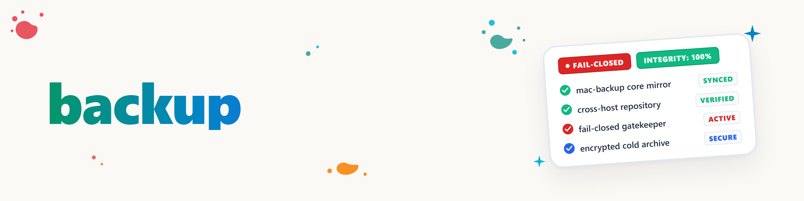

# Резервное копирование

Использовать установленный CLI `mac-backup` как единственную реализацию передачи. Не воспроизводить процесс
с помощью сырых `scp`, `rsync`, SSHFS, действий Проводника или ad-hoc удаления.

## Маршрутизация запроса

- Обычный запрос «Backup» / «резервная копия» означает `mirror`; источник остаётся нетронутым.
- `archive` означает очистку источника и является отдельным, деструктивным намерением. Никогда не выводить
  его из «backup» / «резервная копия», «copy» / «копировать» или «free some space» / «освободить место».
- `restore` записывает в новое место назначения и никогда не перезаписывает молча.
- Если проверенного JSON задания не существует, подготовить предложение задания и остановиться перед `init-target` или
  передачей.

## Выполнение

1. Прочитать задание и выполнить `mac-backup plan <job> --json`.
2. Проверить, что возвращённые класс источника, количество файлов, количество байт, ID тома назначения,
   статус шифрования и отпечаток хоста соответствуют запросу и текущему подтверждению устройства.
3. Для Mirror выполнить `mac-backup mirror <job> --json`, затем `mac-backup verify <job> --json`.
4. Для Restore использовать новое абсолютное место назначения и проверить восстановленные файлы по результату
   манифеста команды.
5. Для Archive передавать `--confirm-delete` только если пользователь явно запросил удаление источника и проверенный
   план называет именно этот источник. Блокировка политикой — правильный результат; никогда не обходить `target_encryption_required`,
   `source_class_unknown_cleanup_blocked`, `onedrive_dehydrate_not_implemented`, блокировку, расхождение идентичности или отсутствующий якорь.

`init-target` — привилегированная настройка, а не рутинное выполнение. Для него требуется независимо полученное
подтверждение операционной системы о ID тома и шифровании; значение, скопированное из предложенного
задания, не является подтверждением.

Никогда не утверждать, что зеркало является полной резервной копией, пока проверка назначения и реальный
тест восстановления оба не пройдены. Не допускать попадания секретов, реальных файлов заданий, локальных якорей и
имён файлов пользователя в тикеты, Git и OneDrive.

## Журнал изменений

### 1.0.0 (2026-08-24)
- Нейтрализованная копия мастер-версии развёртывания `~/.claude/skills/backup/`, добавленная в категоризированную
  библиотеку. Причина разрыва синхронизации: навык был развёрнут, но не имел исходной записи в `skills/<category>/`,
  поэтому `skill_sync.py status` сообщал его как `NUR-ZIEL` (только назначение), а `catalog.py`/`build_public_registry.py` (которые сканируют
  только `skills/`) его никогда не видели — поэтому он не мог достичь публичного реестра или `SKILLS-MAP.md` независимо
  от того, как редактировалась копия развёртывания.
