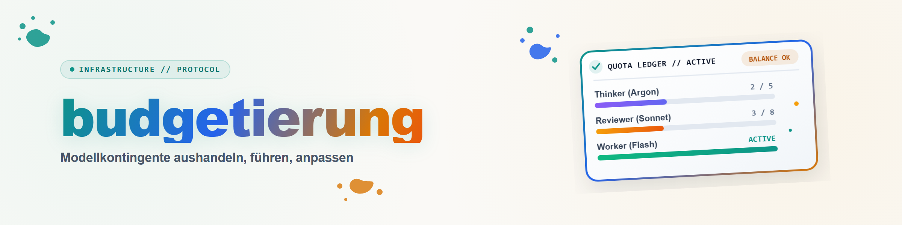

# Budgeting — negotiating, keeping, and adjusting model quotas

## Why

Long agent runs today often combine several models with very different prices and
availability: a main agent that thinks and decides, cheap long-running workers for
execution, and a few expensive specialists for reviews, audits, or breakthroughs.
Without an agreement, two mistakes happen: the expensive models get burned on
routine work, or they never get used out of misplaced caution. The ledger makes
usage **visible and negotiable**: what is allowed is fixed in advance, every use
is booked, and the user can adjust course at any time.

Models, prices, and quotas change constantly, because new models appear,
subscriptions change, and projects vary in importance. For that reason this skill
contains **no fixed numbers**, only a procedure for setting them jointly, per use
and per project.

## Phase 1 — Negotiation at the start

Before delegating work, clarify the budget with the user. Do not re-ask what they
have already specified; close only the gaps and have the result briefly confirmed
once.

1. **Survey what's available:** Which models and access paths are actually
   callable on this host? Check, don't guess: configuration files, the CLIs'
   model lists, available subagent types. Note model names exactly as they are
   invoked.
2. **Propose roles:** Every model gets a role:
   - *Thinker/decider* (main agent),
   - *Long-running worker* (execution, without a budget or with a wide one),
   - *Reviewer/auditor* (independent check, ideally a different provider than the
     author),
   - *Escalation* (highly complex sub-problems, breakthrough attempts),
   - *Advisor* (course correction for the main agent).
3. **Set quotas:** A budget and a time window per resource, e.g. "2 requests per
   hour" or "unlimited, ongoing". Clarify explicitly:
   - **Expire or accumulate?** Unused units usually expire; record this as such.
   - **Shared or separate pools?** Do two models share one unit (e.g. "Fable *or*
     Astra")?
   - **Does the advisor count?** Advisor calls are expensive and easy to forget;
     whether they have their own quota, belong to a pool, or sit outside the
     budget goes into the ledger.
   - **Effort level:** For models with reasoning levels, the level is part of the
     budget (xhigh ≠ low).
4. **Agree on the pre-procedure** (Phase 3), unless the user wants something else.
5. **Create the ledger** (Phase 2) and tell the user the path.

Short form of the follow-up question when details are missing: ask one question
with a proposal instead of an open list, e.g. "Proposal: Sonnet as the
long-running worker, Codex review 1×/hour, advisor only on request — does that
work?".

## Phase 2 — The ledger

A Markdown file in the project, e.g. `_operator/KONTINGENT.md` or wherever the
project's own conventions place it. Template:
[references/konto-vorlage.md](references/konto-vorlage.md) (German).

The ledger contains:
- **Rule block:** the negotiated quotas as a table (resource | exact
  invocation/model name | budget per window | expires yes/no).
- **Rule change log:** every adjustment by the user is added with a date, never
  overwritten. This keeps it traceable which rule a given earlier booking was
  made under.
- **Booking table:** one row per use of a budgeted resource, with number, actual
  start time, **model that actually ran**, purpose, pre-procedure steps
  completed, result path, and the earliest next window.

Important:
- **Book the model that actually ran, not the one that was meant.** CLIs fall
  back to their default model without an explicit model flag. So always set the
  model explicitly, and when in doubt, verify it from configuration or the
  response. If it turns out afterwards that a different model ran, **reclassify**
  the booking and note the error.
- **Start time from evidence** (a timestamp file, a log), not estimated.
- **Off-budget uses** (triggered by the user or explicitly exempted) are still
  logged, marked "no unit booked", so the picture stays complete.
- Unlimited long-running workers don't need an individual booking per use. One
  row stating that they're running, and on what, is enough.

## Phase 3 — Pre-procedure before every escalation

Expensive units exist for exceptions. Before booking one:

1. **Define the jigsaw piece:** What exactly is missing? What properties would
   the solution, the source, or the review result need to have? In writing, a
   few lines.
2. **Search cheaply:** web, specialist databases, the project's own material,
   using long-running workers.
3. **Idea tools:** e.g. `/idea-mining`, then `/skill-finder`, if a skill exists
   for the task.
4. **Only then book**, and note in the ledger which steps were completed. If a
   step doesn't factually fit (e.g. idea search when what's needed is a
   *review*), note why, instead of running it pro forma.

An expiring quota is **not a reason** to spend it. Conversely, false frugality is
also a mistake: if independent sign-off is needed for the next step (e.g. a claim
register with a provider switch), that is exactly the exception the budget exists
for.

## Phase 4 — Mid-run adjustments

The user can change the rules at any time: new models, more or fewer units, an
advisor that counts from now on. Then:
- add the new rule to the rule block with a date, leaving the old one in place,
- check whether earlier bookings should be classified differently under the new
  rule, and note that,
- check whether there is a matching open task for the new resource, and use it
  if so. If there is none, it may stay unused until a need arises: a quota is a
  frame, not an assignment. The user may have overestimated the need, and
  activity for its own sake also has a cost,
- confirm to the user in one sentence what now applies.

If the model itself proposes an adjustment (e.g. because a resource stays unused
long-term, or a bottleneck appears), it phrases that as a proposal with a
rationale. The decision is the user's.

## Phase 5 — Closing

At the end of a run or block, report one line on consumption to the user: which
units were used, for what, with what result, and what expired unused. The ledger
stays in the project; a follow-up session reads it first.

## Example

The user says: "Work as the operator, use Sonnet workers, Fable or Codex only
once per hour, and keep a ledger." Later: "Sol may review twice per hour, Luna
permanently, the advisor gets an extra quota."

→ Phase 1 briefly confirms the roles, Phase 2 creates the ledger with the first
rule. On the second message, Phase 4 extends the rule block and establishes that
two earlier "Codex" audits, run without an explicit model flag, actually ran on
the default model. The bookings are reclassified accordingly. There is currently
a matching open exploration task for Luna, so she is put to use; without such a
task she would stay unused.

## Related skills

- `operator` — the operator/worker role model this ledger is embedded in.
- `model-strategy` — which model fits a task; this skill governs *how much* of it.
- `idea-mining`, `skill-finder` — building blocks of the pre-procedure.
- `advisor-skill` — selective advice; its calls belong in the ledger.
- `orchestrator` — work packages, profiles (parallelism), acceptance.
- `choose-your-orchestrator` — the session contract, whose budget slots this
  ledger is entered into.

## Changelog

### 1.0.0 (2026-10-03)
- Initial version: negotiation, ledger, pre-procedure, mid-run adjustments, closing.
