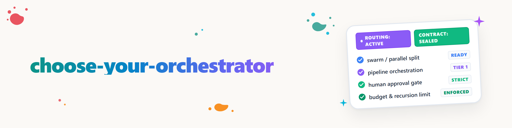

# अपना ऑर्केस्ट्रेटर चुनें

## उद्देश्य

जटिल मल्टी-एजेंट कार्य से पहले परिस्थितियाँ स्पष्ट करें, मौजूदा स्किलों का सबसे छोटा प्रभावी संयोजन सुझाएँ और एक बाध्यकारी सेशन-ऑर्केस्ट्रेशन-अनुबंध जारी करें। चयनित स्किल वर्तमान रनटाइम के स्किल-तंत्र के माध्यम से लोड करें और उनके लाइव निर्देशों का पालन करें। उनकी प्रक्रियाएँ इस स्किल में न कॉपी करें।

प्रतिनिधिमंडल (delegation) कभी भी प्राधिकार नहीं बढ़ाता। प्रकाशित करना, भेजना, हटाना, भुगतान करना या उत्पादन में परिवर्तन जैसी बाहरी या अपरिवर्तनीय कार्रवाइयाँ उपयोगकर्ता के नियंत्रण में रहती हैं, जब तक वर्तमान कार्य उन्हें स्पष्ट रूप से अधिकृत न करे।

## घटक

| घटक | अनुबंध में भूमिका | उसका काम नहीं |
|---|---|---|
| `orchestrator` | कार्य-पैकेज, स्कोप, साक्ष्य और स्वीकृति | मॉडल-चयन या स्वार्म-पैटर्न का आविष्कार |
| `swarm-operations` | स्वार्म-पैटर्न, लागत-गेट और वैकल्पिक मत्र्युश्का-स्तरीकरण | एकल कार्यों का कृत्रिम समानांतरीकरण |
| `model-strategy` | लाइव उपलब्धता के आधार पर क्षमता- और मॉडल-संबंधित रूट | निश्चित मॉडल-संस्करण या अनुमतियाँ तय करना |
| `clutch` | वैकल्पिक बाहरी रूटिंग-सुझाव | डिस्पैच या स्कोप पर एकमात्र प्राधिकार |
| `decision-avatar` | उलट सकने योग्य अनिश्चितताओं में वैकल्पिक, अधिकृत प्राथमिकता-संकेत | उपयोगकर्ता की स्वीकृतियों का स्थान लेना या प्राधिकार बढ़ाना |
| `budgetierung` | महंगे मॉडल/रिव्यूअर/एडवाइज़र के लिए समय-खिड़की के अनुसार बातचीत से तय कोटा, खाता और एस्केलेशन से पहले की प्रक्रियाएँ | मॉडल का विषयगत चयन (यह `model-strategy` करता है) या कोटा मनमाने ढंग से तय करना |

`clutch route "<kurze Aufgabenbeschreibung>" --json` का उपयोग तभी करें जब `clutch` सचमुच उपलब्ध हो। JSON-उत्तर को सुझाव मानें और उसे उपलब्ध रनटाइम-स्लॉट, बजट, परियोजना-नियमों और उपयोगकर्ता-सीमाओं से मिलाएँ। यदि `clutch` अनुपलब्ध हो या उसका आउटपुट अपठनीय हो, तो `model-strategy` और रनटाइम की लाइव क्षमताओं का उपयोग करें। अनुबंध में वर्तमान मॉडल-नाम या संस्करण हार्डकोड न करें।

## सुझाव-संवाद

### 1. कार्य का वर्गीकरण

लक्ष्य, कार्य-प्रकार, सफलता-मानदंड, नकारात्मक स्कोप, वर्तमान अनुमतियाँ, मौजूदा लॉक और स्वतंत्र कार्य-पैकेज पहचानें। पहले नीचे की तालिका से सबसे छोटा उपयुक्त रूट-सुझाव चुनें।

### 2. अनुबंध का प्रस्ताव

एक संक्षिप्त मसौदा दिखाएँ, जिसमें हों:

1. घटक और भूमिकाएँ,
2. मॉडल-/बजट-स्लॉट (बहु-घंटे चलने या कम उपलब्ध/महंगे मॉडलों के मामले में `budgetierung` के माध्यम से बातचीत करें और खाते के रूप में रखें),
3. अधिकतम समानांतरता और स्पॉन-गहराई,
4. लेखन-सीमाएँ और लॉक,
5. स्वीकृति और साक्ष्य,
6. एस्केलेशन और उपयोगकर्ता-प्रश्न,
7. प्राधिकार-सीमा।

ठोस मान सुझाएँ और एक वाक्य में सबसे महत्वपूर्ण ट्रेड-ऑफ बताएँ। केवल उन्हीं निर्णयों के बारे में पूछें जो परिणाम को सार्थक रूप से बदलते हों। खुले प्रश्नों को अधिकतम तीन स्पष्ट रूप से अलग समूहों में बाँधें; हर समूह में अनुशंसित विकल्प पहले रखें। यदि सभी आयाम पहले से स्पष्ट रूप से तय हैं, तो दोबारा न पूछें।

### 3. पुष्टि करें या घटाएँ

जब तक कोई सार्थक बजट-, लेखन- या प्राधिकार-प्रश्न खुला है, मल्टी-एजेंट डिस्पैच शुरू न करें। यदि केवल समानांतरता का लाभ अस्पष्ट है, तो एकल यात्रा तक घटाएँ। यदि कोई सार्थक उपयोगकर्ता-निर्णय शेष नहीं है, तो स्पष्ट रूप से अधिकृत कार्य सुरक्षित डिफ़ॉल्ट के साथ शुरू हो सकता है।

### 4. अनुबंध जारी करें

पुष्ट अनुबंध चैट में दें। यदि `usmc` कमांड उपलब्ध है, तो पहले उसकी सहायता जाँचें और फिर वहाँ दिए गए Note-/Write-कमांड से गोपनीयता-तटस्थ सेशन-नोट भी लिखें। कोई सब-कमांड न गढ़ें और कच्चे प्रॉम्प्ट, गुप्त कुंजियाँ या निजी सामग्री संग्रहीत न करें। USMC लेखन-मार्ग उपलब्ध न होने पर चैट-अनुबंध ही प्रामाणिक है।

## रूटिंग-तालिका

| कार्य-प्रकार | सुझाव | डिफ़ॉल्ट दायरा |
|---|---|---|
| ऑडिट / स्वीप | `orchestrator` + `swarm-operations`; भिन्न क्षमता-वर्गों में `model-strategy` | स्वतंत्र क्षेत्र, छोटा `parallel-chunks`- या `specialist`-समूह, केंद्रीय विलय |
| निर्माण-कार्यक्रम | `orchestrator` + `model-strategy`; स्वार्म केवल वास्तव में स्वतंत्र धाराओं के लिए | मुख्य योजना बनाता और स्वीकार करता है, वर्कर असंयुक्त क्षेत्रों में निर्माण करते हैं |
| एकल निर्माण | एकल यात्रा; वैकल्पिक रूप से रूट के लिए `model-strategy` या `clutch` | कोई स्वार्म या पदानुक्रम-ओवरहेड नहीं |
| टिकट-संचालन | टिकट-सिस्टम अग्रणी रहता है; `orchestrator` कार्य-अनुबंध और साक्ष्य जोड़ता है | मौजूदा राउटर-/स्कोर-व्यवस्था न बदलें, टिकट-जीवनचक्र का सम्मान करें |

## सुरक्षित डिफ़ॉल्ट

ये मान तब उपयोग करें जब उपयोगकर्ता, रनटाइम या परियोजना-नियम कुछ सख्त न बताएँ:

- अधिकतम दो सक्रिय वर्कर; पहले एक से शुरू करें और दूसरे का लाभ सिद्ध करें,
- मत्र्युश्का बंद, अधिकतम स्पॉन-गहराई `0`,
- स्पष्ट स्वीकृति के बिना वर्कर-स्वयं के सबएजेंट नहीं,
- प्रति रिपॉज़िटरी या स्पष्ट रूप से सीमित क्षेत्र में एक ही लेखक,
- हर लेखन से पहले असंयुक्त फ़ाइल-क्लेम और परियोजना-सामान्य लॉक,
- चीफ/ऑर्केस्ट्रेटर आर्टिफ़ैक्ट, डिफ़ और टेस्ट स्वयं जाँचता है,
- पूर्णता की सूचना तभी मान्य जब साक्ष्य स्वीकृत हो,
- अपरिवर्तनीय या बाहरी कार्रवाइयाँ उपयोगकर्ता-नियंत्रित रहती हैं,
- अनिश्चितता को कई अलग-अलग बाधाओं के बजाय एक समूह में रिपोर्ट किया जाता है।

मत्र्युश्का तभी सक्रिय करें जब उपयोगकर्ता उसे स्पष्ट रूप से पुष्ट करे और अनुबंध प्रति स्तर मॉडल-/क्षमता-वर्ग, सक्रिय स्लॉट-सीमा, अनुमत उप-कार्य और अधिकतम गहराई बताए। केवल मौजूद नहीं, बल्कि सक्रिय एजेंटों की गिनती करें। तब भी हर क्षेत्र में ठीक एक लेखक रहता है।

## अनुबंध-प्रारूप

```text
SESSION-ORCHESTRIERUNGSVERTRAG
Ziel und Typ: <Ergebnis; Audit/Bauprogramm/Einzelbau/Ticket-Betrieb>
Bausteine: <geladene Skills und optionale Router>
Chef: <Planung, Denkarbeit, Integration, Evidenzabnahme>
Worker-Slots: <Rolle/Fähigkeitsklasse je Slot; Budgetgrenze; Budget/Konto: <budgetierung-Konto, Pfad>>
Parallelität: <maximal aktiv>; Spawn-Tiefe: <0..N>; Matruschka: <aus/an>
Schreibgrenzen: <ein Schreiber je Bereich; Claims; Locks; negative Scopes>
Abnahme: <Artefakte, Tests, Diffs, Quellen; wer prüft>
Eskalation: <Stopps; höchstens drei gebündelte Nutzerfragen>
Autorität: <zulässige Aktionen; extern/irreversibel user-gegatet>
Persistenz: <Chat autoritativ; USMC-Notiz ja/nein und privacy-neutral>
```

## उदाहरण

```text
Auftrag: Drei unabhängige Komponenten prüfen und einen Fix integrieren.
Empfehlung: orchestrator + swarm-operations; zwei aktive Read-only-Reviewer,
danach genau ein Integrationsschreiber. Matruschka aus, Tiefe 0. Der Chef prüft
Fundstellen, Diff und Gesamttests. Push oder Veröffentlichung nur im ausdrücklich
autorisierten Scope.
Offene Frage: Ist die zweite parallele Review-Spur den zusätzlichen Verbrauch wert?
Empfehlung: ja, weil die Komponenten unabhängig sind.
```

## रुकने की शर्तें

यदि स्कोप ओवरलैप हों, लॉक अस्पष्ट हों, रनटाइम अनुशंसित स्लॉट न दे, बजट की पुष्टि न हो, या स्वीकृति स्वतंत्र रूप से सिद्ध न की जा सके, तो ऑर्केस्ट्रेशन रोकें या घटाएँ। नया उत्पाद-, गोपनीयता- या प्राधिकार-निर्णय अनुमान से तय करने के बजाय उपयोगकर्ता से पूछें।

## परिवर्तन-लॉग

### 1.1.0 (2026-10-03)
- बातचीत से तय मॉडल-कोटा/खाते के लिए `budgetierung` घटक जोड़ा गया
  (घटक-तालिका, संवाद में मॉडल-/बजट-स्लॉट, अनुबंध-प्रारूप में वर्कर-स्लॉट की पंक्ति)।

### 1.0.0 (2026-08-20)
- सुझाव-संवाद, रूटिंग-तालिका और संक्षिप्त सेशन-अनुबंध प्रस्तुत किए गए।
- समानांतरता, मत्र्युश्का, लेखन-सीमाओं, साक्ष्य और बाहरी कार्रवाइयों के लिए सुरक्षित डिफ़ॉल्ट तय किए गए।
- बिना निश्चित मॉडल-बंधन या प्राधिकार-विस्तार के `clutch` और अधिकृत प्राथमिकता-मॉडल के वैकल्पिक एकीकरण का वर्णन किया गया।
