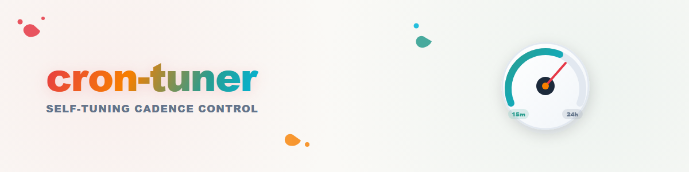

# cron-tuner — bucle de regulación de cadencia autoajustable

Un bucle de regulación **autoajustable** para trabajo recurrente impulsado por
calendario (trabajos cron, tareas programadas, temporizadores). En lugar de un
intervalo fijo, el trabajo ajusta su propia cadencia: se acelera cuando hay
trabajo y se enfría cuando hay silencio. Neutral respecto al host y a la
plataforma; el patrón funciona con cualquier planificador.

## Cuándo usarlo

- Un escaneo recurrente (vigilancia de buzón, escaneo de Sync-Yard, sondeo de
  cola) debe reaccionar rápido durante un "Match" activo y mantenerse barato
  en fases de inactividad.
- El ajuste debe ser **auditable** (un archivo de estado) en lugar de
  implícito en una conversación o en la memoria de una persona.

## Conceptos

- **Bucle de regulación**: medir → decidir → actuar → persistir. Cada ejecución
  termina escribiendo su estado; cada ejecución comienza leyéndolo.
- **Activación**: se encuentra trabajo nuevo → saltar directamente al intervalo
  más rápido.
- **Escalera de enfriamiento**: las ejecuciones vacías bajan un peldaño de la
  escalera; cada peldaño solo aplica si el intervalo cambia realmente.
- **Tope**: nunca relajarse más allá de un intervalo máximo definido.

## Esquema de referencia

| Condición | Nuevo intervalo |
|---|---|
| se encuentra trabajo nuevo | el más rápido (p. ej., 15 min) |
| 4 ejecuciones vacías consecutivas | 30 min |
| 6 ejecuciones vacías consecutivas | 1 h |
| cada ejecución vacía adicional | duplicar (2 h, 4 h, 8 h) |
| Tope | 24 h (nunca más) |

Ajuste los umbrales a la carga de trabajo; mantenga la duplicación simple y el
tope explícito.

## Archivo de estado (obligatorio)

Un pequeño archivo JSON por worker, p. ej. `cron-tuner-state.json`:

```json
{
  "empty_runs": 0,
  "interval_minutes": 15,
  "note": "cron-tuner state"
}
```

Reglas:

1. **Archivo, no memoria.** El contador debe sobrevivir a la compactación de
   contexto, a los reinicios de sesión y a los cambios de operador, y debe ser
   visible para personas y otros agentes. No siga la cadencia en el historial
   de la conversación.
2. **Reescribir solo ante un cambio.** Persista el estado en cada ejecución,
   pero reemplace el trabajo programado solo cuando el intervalo cambie
   realmente.
3. **Nuevo trabajo = nuevo calendario, mismo estado.** Un cambio de cadencia
   significa eliminar el trabajo anterior y crear uno nuevo con el nuevo
   intervalo; el contador sigue avanzando.

## Reglas operativas

- **El trabajo decide, no el ánimo.** Solo las llegadas observadas cambian la
  cadencia, nunca las expectativas ni las aproximaciones.
- **Desfases anti-manada.** Evite las marcas de hora en punto y de media hora
  para el intervalo más rápido (p. ej., minutos 7/22/37/52), para que las
  flotas no disparen al unísono.
- **Fail-safe:** si un sistema asociado enmudece, aplica la regla normal de
  vacancia/ausencia; el ajustador nunca escala hacia inundaciones de sondeo.
- **Evidencias:** cada cambio de cadencia se registra con motivo, intervalo
  anterior y nuevo.

## Extensibilidad (registro de tipos de bucle)

La habilidad es el hogar de otros tipos de bucle autoajustables a lo largo del
tiempo:

- **cooldown** (este esquema: silencio → más lento)
- **backoff** (error → más lento, éxito → más rápido)
- **burst** (pico de llegadas → modo rápido temporal con un fin explícito)
- **wake-assist** (mensaje de activación externo → ejecución inmediata fuera
  del ciclo)

Los nuevos tipos de bucle recibirán aquí un subcapítulo y su propio esquema de
archivo de estado.
