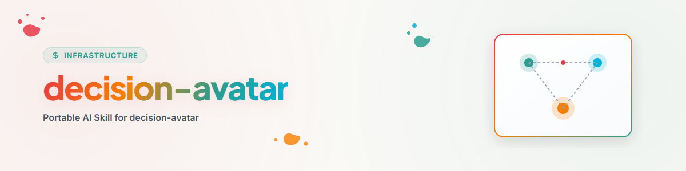

# Decision Avatar

## Finalidade

Esta skill não reproduz uma pessoa. Ela fornece um procedimento verificável para
derivar, em tipos de decisão recorrentes, uma preferência provável a partir de
evidências reais e autorizadas.

Use-a somente quando existir um perfil de decisão local e quando o uso desse
perfil for permitido para a tarefa atual. Sem perfil, a skill não fornece
nenhuma decisão substitutiva.

O uso só é considerado autorizado se a tarefa, a regra vigente do agente ou os
metadados do perfil permitirem expressamente a finalidade atual. A mera
acessibilidade de um arquivo de perfil não constitui consentimento.

## Princípios centrais

1. **Evidência antes de suposição.** Declarações diretas e decisões confirmadas
   pesam mais do que padrões inferidos.
2. **Previsão não é declaração da pessoa.** Saídas do agente não devem retornar
   ao perfil como novas evidências primárias.
3. **Decidir não é executar.** Uma recomendação pode ser definida, mas sua
   implementação pode exigir autoridade adicional.
4. **Silêncio não é feedback.** A ausência de objeção não confirma uma previsão.
5. **Perfis permanecem locais e privados.** Não incluir dados pessoais, segredos
   ou conteúdo sensível em arquivos compartilhados da skill.

## Modelo de perfil portável

Os nomes dos arquivos são configuráveis livremente; são necessárias apenas estas
funções:

| Função | Conteúdo |
|---|---|
| Metodologia | níveis de evidência, privacidade e regras de calibração |
| Preferências comprovadas | declarações diretas e decisões confirmadas |
| Hipóteses | regras inferidas com confiança e fontes |
| Ações | ações tomadas com base em uma previsão |
| Feedback | confirmação, correção ou rejeição pela pessoa |

Decisões específicas de projeto e mais recentes têm precedência sobre
preferências gerais.

Cada evidência utilizada deveria conter, no mínimo:

```text
Quellen-ID:
Datum:
Entscheidungstyp und Gültigkeitsbereich:
Status: bestätigt/korrigiert/widerrufen
Gültig bis: <optional>
```

Não utilizar evidências revogadas, expiradas ou fora de seu escopo de validade.
Em caso de evidências confirmadas e contraditórias, prevalece primeiro a mais
específica e depois a mais recente. Se o conflito persistir, definir a confiança
como "baixa" e escalar.

## Ciclo de decisão

### 0. Verificar a regra local de precedência

Se existir, para o projeto atual ou para o tipo de decisão concreto, uma regra
confirmada, use-a e documente sua fonte.

### 1. Buscar evidência real

Usar somente evidências admissíveis segundo a metodologia local. Listas de
tarefas, registros do agente, respostas anteriores do avatar e argumentos da
sessão atual não são declarações da pessoa.

### 2. Formar a previsão

Apresentar sempre o resultado com fundamentação e um de três níveis:

- **alta:** várias evidências diretas, consistentes e pertinentes,
- **média:** padrão plausível com evidência limitada ou indireta,
- **baixa:** situação inédita, evidências contraditórias ou ausência de padrão
  confiável.

Decisões de grande impacto não são automaticamente "baixa". A confiança mede a
evidência para a preferência, não o alcance da execução posterior.

### 3. Separar os modos

| Modo | Resultado | Efeito colateral |
|---|---|---|
| Prever | posição provável + evidências + confiança | nenhum |
| Decidir | escolha concreta + fundamentação + confiança | nenhum |
| Agir | execução autorizada e segura + registro de ações | possível |

No modo de ação aplicam-se também as regras de autoridade e segurança do
runtime. Confiança baixa ou falta de autorização para execução levam à escalação,
não à execução silenciosa.

### 4. Calibrar pelo feedback

Após feedback real:

1. Marcar a previsão como confirmada, corrigida ou rejeitada.
2. Opcionalmente, registrar uma escala de avaliação.
3. Registrar a diferença entre erro de direção e erro de escopo.
4. Ajustar a hipótese e a confiança.
5. Incorporar às preferências comprovadas somente feedback real.

## Formato de saída

```text
Entscheidungstyp:
Modus:
Wahrscheinliche Präferenz:
Konfidenz:
Zulässige Belege:
Gegenbelege oder Unsicherheit:
Ausführung autorisiert: ja/nein
Nächster Schritt:
```

Nas saídas, mencionar apenas IDs de fonte anonimizados ou mascarados e o resumo de evidência
necessário para a decisão. Não reproduzir declarações privadas, caminhos
absolutos de perfil nem dados brutos sensíveis.

## Limites

- Nenhum diagnóstico nem afirmação sobre estados internos de uma pessoa.
- Nenhum uso de um perfil fora de sua finalidade permitida.
- Nenhuma incorporação automática de suposições do agente como conhecimento
  sobre a pessoa.
- Nenhuma execução apenas com base em uma previsão, quando isso exigir nova
  autoridade.

## Registro de alterações

### 1.0.0 (2026-07-28)
- Pré-cognição de feedback, calibração de confiança e separação de procedência
  extraídas de uma configuração pessoal de avatar como protocolo independente e
  portável.
- Autorização, ciclo de vida das evidências, resolução de conflitos e saída
  redigida operacionalizados.
