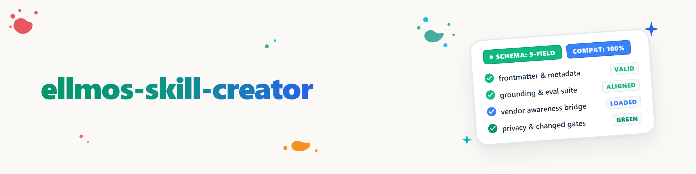

# ellmos-skill-creator

## 来源与决策(分叉 vs. 自行构建)

**决策:自行构建,不分叉。** 记录理由以免丢失:

- `skill-creator`(Anthropic,市场 `claude-plugins-official`)采用 **Apache-2.0** 许可(已于 2026-08-24 阅读并核对克隆库中的 LICENSE 文本),因此分叉在法律上完全可行,且本仓库其他地方已将其作为既定模式使用(`skills/third-party/grill-me`、`skills/third-party/grilling`)。
- 但分叉会连带引入原版的整套评估/基准机制(`agents/{analyzer,comparator,grader}.md`、`eval-viewer/`、7 个脚本、485 行的 SKILL.md)——这些能力已经存在且可直接调用(`Skill: skill-creator:skill-creator`)。依据 `.PLUGINS/CLAUDE.md` 的规则 4("在重新构建前先检查已有能力")以及模式 P10("两个开关无人比较"),这将是重复而非扩展。
- 真正的缺口纯属 ellmos 特定需求,原版从根本上并不了解:自有 frontmatter(`templates/SKILL.md`)、`docs/CONVENTIONS.md`、提供方/用户/ellmos 中立但对 ellmos 敏感的识别、`grounding-seed` 对接、供应商意识、自我更新。
- 本 Skill **不包含任何 Anthropic 文本**(全部为自有表述),因此对修改版也不触发 Apache-2.0 的署名义务。它是**组合**原版,而非复制原版:这既是法律上最干净的做法,也是维护成本最低的做法。

## 何时激活

- "创建一个 Skill 用于 X"、"构建新 Skill"、"使用 skill-creator"
- "让这个 Skill 符合 ellmos 规范"、"将 Skill 升级到自有标准"
- 只要**目标位置**是 `.AI/.SKILLS/skills/…`(或其规范的 Plan-D 克隆)中的 Skill 时——而非与本生态系统无关的通用请求(如"随便给我做一个 Claude Skill,与这里无关")。

## 流程

### 步骤 1 — 委托访谈/草稿/评估

调用官方 `Skill: skill-creator:skill-creator` 完成:意图澄清、SKILL.md 结构草稿、测试用例、评估循环、描述优化(`scripts/improve_description.py`)。**不要重新发明**——这一部分是通用的,原版已经解决得很好。

### 步骤 2 — 搭建 ellmos 自有脚手架(必需,与原版格式叠加)

在原版生成的 SKILL.md 基础上,补充 `.SKILLS/templates/SKILL.md` 中的 9 个自有字段(或根据类型使用 `AGENT.md`/`WORKFLOW.md`/`PROMPT.md`)。事先阅读 `.SKILLS/docs/CONVENTIONS.md`,了解类别文件夹、扁平规则(<5 个文件时保持扁平)、版本约定(SemVer:MAJOR/MINOR/PATCH)以及多语言集合(核心:德语+英语为必需)。**`visibility` 始终从 `private-only` 开始**——发布是之后经过检查的用户决策(`.AI/VISIBILITY-POLICY.md`),绝不是默认值。这些字段相对于 Anthropic 格式纯属**附加**(在 `name`/`description` 旁边新增 YAML 键),因此如此生成的每个 Skill 仍完全 `anthropic_compatible: true`。

### 步骤 3 — 落实原则:提供方中立、用户中立、ellmos 中立但对 ellmos 敏感

全文与代码模式:`references/ELLMOS-PRINCIPLES.md`。简而言之:生成的 Skill 必须**能够独立运行**(自带所需一切),同时**一旦可用就**利用 ellmos 组件——它在运行时自行判断,绝不硬编码。这正是 `grounding-seed` 已经提供的模式(README:"精心培育的景观,而非野花" / "独立可用,协同更高效")——**不会另行发明第二套识别机制**,本 Skill 会一贯地将所生成的 Skill 指向 `grounding_seed.detect_ecosystem()`。

### 步骤 4 — 随附 config.json + connections.json

`grounding-seed` 已可作为 Python 包导入(2026-08-24 已核验:`import grounding_seed` 能在本地克隆的 `grounding-seed` 源码树上成功解析,Plan-D 克隆)——它是**规范的对接点**,不要另行发明文件。对于每个对外部有需求(程序、服务、提供方)的已生成 Skill:

- **`config.json`** — Skill 自有设置(模板:`templates/skill-config.template.json`)。`grounding_seed.store.LocalStore(root)` 默认使用此文件名存放其角色——因此生成的 Skill 既可以将自身的 `config.json` 用作 `LocalStore` 后端,也可以在它除角色外还需要纯行为设置时(此时需要第二个 `LocalStore(root, filename="connections.json")` 实例)将其单独保存。
- **`connections.json`** — 实际**已解析**的外部对接点(找到了哪个程序/服务、何时找到、来源如何)——模板:`templates/skill-connections.template.json`,模式 `ellmos.source-resolver.user-config.v1`(与 `source-resolver` 相同,根据 grounding-seed README 的说明是刻意选择的,以便日后迁移到真正的 `source-resolver` 时不丢失信息——参见其中的 `migration.py`)。

详情、CLI 与代码示例:`references/ELLMOS-PRINCIPLES.md` 的"Docking"章节。

### 步骤 5 — 构建提供方/供应商意识

全文:`references/VENDOR-AWARENESS.md`。简而言之:生成的 Skill 会获得一个"提供方与替代方案"章节,该章节(a)列出该主题当前最先进的提供方(例如 TTS 对应 ElevenLabs),(b)至少列出一个替代提供方,(c)在它们覆盖该主题时,**明确将 ellmos 自有组件列为同等级候选**(例如 `ellmos-voice-io` 可替代或与 ElevenLabs 并列),并且在用户需求匹配时**建议**安装/迁移,而不是默认假定其已存在。判断"系统上有什么"的依据:`grounding_seed.scan.scan_resources([...])`(检查 `shutil.which`),加上 `.AI/.MCP/MCP-PROFILE-MANAGEMENT.md` 用于查找 ellmos 候选。

### 步骤 6 — 建立自我更新

全文:`references/SELF-UPDATE.md`。简而言之:每个生成的 Skill 都会获得一个"自我更新"章节,该章节(a)定期建议进行一次简短的网络调研,以保持与最先进水平同步,(b)了解相关 Skill/工作流并指出可能更适合的新替代方案,(c)维护一个小型学习 JSON(模板:`templates/skill-connections.template.json`,字段 `notizen`/`gelernt`),当存在 ellmos 记忆组件(USMC/Gardener)时可将其外包,而不是在本地不断增长——同样是识别而非硬编码(`grounding_seed.detect_ecosystem()`)。

### 步骤 6b — 建立学习契约 + 用例覆盖度(可复用模式)

全文:`references/LEARNING-CONTRACT-AND-COVERAGE.md`。简而言之:不仅本 Skill 自身,**它生成的每个 Skill** 都会获得一套小型、可复用的学习/覆盖度文件集——已对照既有标准进行核对,不构成平行标准:

- `evals/evals.json` — **复用而非复制**:这已经是 skill-creator 针对作者设计的测试用例的标准。
- `user-usecases.json` — 用户实际提出的用例,与 `evals.json` 结构相同(模板:`templates/user-usecases.template.json`)。
- `usecase-gaps.json` — 对照:哪些用户用例未经测试/未被覆盖(模板:`templates/usecase-gaps.template.json`)。
- `known-providers-and-abilities.json` — 按角色划分的已知提供方候选空间,字段借鉴 A2A/`AgentSkill`(id/name/description/tags),而非自造(模板:`templates/known-providers-and-abilities.template.json`)。
- `gap-closing-analysis.json` — 每个缺口的结构性填补路径(ellmos 模块、ellmos 套件、第三方模块、重新构建)——不与 `grading.json.eval_feedback` 重复(模板:`templates/gap-closing-analysis.template.json`)。
- `config.json` 的字段 `lernvertrag` — 行为准则(选择最佳选项,**用户至上**,绝不擅自安装,更新间隔)——有意作为 `config.json` 的扩展,而非第七个文件。

Schema:`.SKILLS/schemas/{user-usecases,usecase-gaps,known-providers,
gap-closing-analysis}-v1.schema.json`——与 `skill-v1.schema.json` 遵循相同的本系统约定。已针对本文件集检查 `grounding-seed`,并**有意未对其扩展**(理由见 `LEARNING-CONTRACT-AND-COVERAGE.md`)——只有 `connections.json` 属于它的一部分。

### 步骤 7 — 注册、测试、提交

- 按 `.SKILLS/CLAUDE.md`/`SKILLS-MAP.md` 选择类别文件夹;如有疑问,询问 `skill-finder` 或 `controlcenter_find_skill` 某个系列是否已存在。
- 提交前运行 `testing/`(privacy_gate + 元数据测试)。
- **不要手动编辑**注册表文件(`registry/components.json`、`SKILLS-MAP.md`、`llms.txt`)——它们通过脚本生成(`build_public_registry.py`、`build_skills_map.py`、`catalog.py`)。如果规范克隆中正在进行他人未提交的会话,**不要全局重新生成**(会将他人与自己的修改混入同一文件)——应单独提交新的 Skill 文件夹,并将注册表重新生成留给下一次干净的运行(`skill-register-care`)。
- `git commit -- skills/<kategorie>/<name>/`——仅限自己的新路径。

## 与 Anthropic 格式的兼容性

所有附加字段都只是 `name`/`description` 旁的纯 YAML 扩展——不属于本生态系统的标准 Claude Code 仍只读取 `name`/`description` 并忽略其余部分。`config.json`/`connections.json` 是可选的随附资源(如 `docs/CONVENTIONS.md` 所设想的),而非强制依赖——没有它们的 Skill 照常工作。

## 相关 Skills

- `skill-creator:skill-creator` — 通用访谈/评估循环(委托给它,即步骤 1)。
- `skill-finder` — 已有自有 Skill 的路由器(构建前先检查:是否已存在?)。
- `skill-explorer` — 景观审计 + 网络调研,寻找新 Skill/插件(元层面:我们的 Skill *存量*;而本 Skill 则是让每个*单独生成的* Skill 自身具备提供方意识)。
- `skill-family-care`、`skill-register-care` — 构建后的维护。
- `grounding-seed`(模块,`.AI/.MODULES/.CONTROL/grounding-seed`)——实际的对接/自我供给逻辑,此处仅引用,不重复。

## 变更日志

### 0.2.0 (2026-08-24)
- 补充内容(工单 T-20260824-218233618,范围扩展):为每个生成的 Skill 新增可复用的学习/覆盖度模式——`user-usecases.json`、`usecase-gaps.json`、`known-providers-and-abilities.json`、`gap-closing-analysis.json`(新增本系统 Schema 位于 `.SKILLS/schemas/`),以及 `config.json` 中的学习契约字段。`evals/evals.json`(skill-creator)有意复用而非复制。已检查 `grounding-seed`——无需扩展(理由见 `references/LEARNING-CONTRACT-AND-COVERAGE.md`),因此无后续工单。提供方目录的字段名借鉴 A2A 协议(`AgentSkill`),而非自造词汇。

### 0.1.0 (2026-08-24)
- 首个版本。已作出并说明自行构建而非分叉的决策(工单 T-20260824-218233618)。将通用 Skill 创建委托给 `skill-creator:skill-creator`,新增自有脚手架、ellmos 原则、`grounding-seed` 对接(config.json/connections.json)、供应商意识与自我更新。
