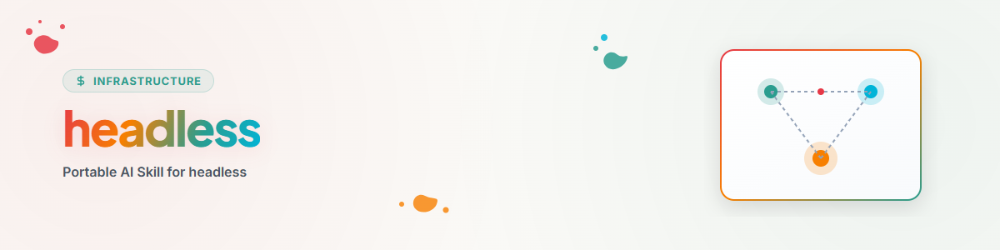

> **Français** — Version française officielle de la compétence `headless`.

# Mode Headless (Exécution autonome prolongée)

## Vue d'ensemble et Objectif

Utilisez cette compétence lorsque le donneur d'ordre demande explicitement une exécution
autonome prolongée sans sollicitations continues. Ce mode augmente
l'endurance, pas les permissions.

Un point isolé non exécutable ne doit pas bloquer inutilement le reste du travail
indépendant et sûr.

## Conditions de démarrage

À fixer avant de commencer :

- objectif concret et critère de réussite,
- périmètre positif et négatif,
- budgets de temps ou de coûts disponibles,
- effets de bord autorisés,
- règles du projet, verrous et modifications tierces,
- chemin ou mécanisme pour les points de contrôle (checkpoints),
- éventuellement un profil de décision local autorisé.

En l'absence de profil de décision, seules les règles explicites et des hypothèses
par défaut sûres sont utilisées. Le runtime ne doit imiter aucune personne.

## Niveaux de décision

| Niveau | Base | Comportement |
|---|---|---|
| élevé | règle explicite ou schéma confirmé à plusieurs reprises | décider ; exécuter uniquement si l'autorité existe |
| moyen | décision standard plausible et réversible | décider, marquer l'hypothèse, poursuivre prudemment |
| faible | inédit, contradictoire ou sans cadre fiable | ne pas deviner ; différer ou escalader |

La confiance dans la décision et l'autorité d'exécution sont deux axes distincts.

## Protocole d'exécution

1. **Charger le contexte.** Vérifier règles, état, verrous et objectif.
2. **Découper le travail.** Identifier les lots indépendants, les points de décision et
   les points de validation. Si au moins deux exécutants indépendants sont mobilisés,
   appliquer le protocole de commande et de preuve d'`orchestrator`, s'il est disponible.
3. **Exécuter le travail sûr.** Poursuivre les étapes réversibles et autorisées.
4. **Traiter les décisions.**
   - Avec profil autorisé : utiliser la procédure de `decision-avatar`.
   - Sans profil : déduire uniquement des règles explicites du projet ou de la mission.
5. **Mettre en attente les points non exécutables.** Consigner la décision ou recommandation,
   sans anticiper l'exécution.
6. **Poursuivre le travail indépendant.** Un point mis en attente ne bloque que ses
   véritables dépendances.
7. **Écrire un checkpoint.** Enregistrer objectif, étapes accomplies, preuves, hypothèses,
   points en attente et étape suivante.
8. **Contrôler la clôture.** Vérifier soi-même les résultats et regrouper les décisions
   ouvertes dans une liste compacte.

## Journal des décisions

À consigner pour toute hypothèse non triviale :

```text
ID :
Décision :
Fondement :
Confiance :
Exécuté : oui/non
Preuve :
Annulation ou correction :
```

Les décisions d'un agent ne doivent pas être traitées ultérieurement comme des déclarations
du donneur d'ordre.

## Arrêts locaux à un lot

Arrêter et mettre en attente un lot isolé s'il requiert une nouvelle autorité, une action
externe irréversible, des règles floues ou un conflit. Vérifier ensuite quels autres lots
en dépendent réellement.

## Conditions d'arrêt de l'exécution globale

L'exécution globale s'arrête uniquement lorsque :

- plus aucun travail sûr et indépendant n'est possible,
- une décision nécessaire présente une faible confiance,
- tous les lots de travail restants exigent une nouvelle autorité externe ou irréversible,
- un verrou, un conflit ou un risque de sécurité affecte tout le périmètre restant,
- le budget convenu est atteint,
- l'état actuel ne peut plus être sauvegardé de manière fiable.

## Format de clôture

```text
Accompli :
Vérifié par :
Hypothèses :
Décisions différées :
Effets de bord non exécutés :
Prochaine étape pertinente :
```

## Journal des modifications

### 1.1.2 (2026-11-22)
- Mention linguistique corrigée.

### 1.1.1 (2026-09-01)
- Frontmatter complété selon la convention interne (`T-20260830-412369231`) ; contenu inchangé.

### 1.1.0 (2026-07-28)
- Suppression des liens personnels à l'avatar, aux chemins, aux commandes et aux fournisseurs.
- Séparation entre confiance et autorité d'exécution.
- Précision de la poursuite du travail indépendant et de l'escalade groupée.
- Distinction explicite entre bloqueurs locaux à un lot et arrêt de l'exécution globale.

### 1.0.0 (2026-06-17)
- Version locale initiale.
