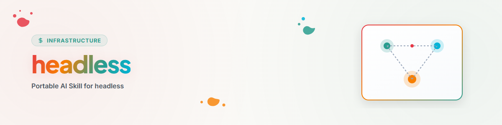

> **Deutsch** — Offizielle Deutsch-Version / Documento Oficial en Deutsch.

# Headless (Português)

## Visão geral e finalidade

Use esta skill quando a pessoa solicitante desejar expressamente uma execução
mais longa e autônoma, sem perguntas contínuas. O modo aumenta a
resistência, não a permissão.

Um único item não executável não deve interromper desnecessariamente o trabalho
restante, independente e seguro.

## Condições de início

Registrar antes do início:

- objetivo concreto e critério de sucesso,
- escopo positivo e negativo,
- orçamentos disponíveis de tempo ou custo,
- efeitos colaterais permitidos,
- regras do projeto, bloqueios e alterações de terceiros,
- caminho ou mecanismo para os checkpoints,
- opcionalmente, um perfil de decisão local permitido.

Se não houver perfil de decisão, usar apenas regras explícitas e premissas
padrão seguras. O runtime não deve imitar uma pessoa.

## Níveis de decisão

| Nível | Fundamento | Comportamento |
|---|---|---|
| alto | regra explícita ou padrão confirmado várias vezes | decidir; executar somente com autoridade existente |
| médio | decisão padrão plausível e reversível | decidir, marcar a premissa, continuar com segurança |
| baixo | inédito, contraditório ou sem enquadramento confiável | não adivinhar; adiar ou escalar |

Confiança na decisão e autoridade para execução são eixos separados.

## Protocolo de execução

1. **Carregar o contexto.** Verificar regras, estado, bloqueios e objetivo.
2. **Decompor o trabalho.** Marcar pacotes independentes, pontos de decisão e
   pontos de liberação. Se forem usados pelo menos dois workers independentes,
   aplicar o protocolo de tarefas e evidências do `orchestrator`, caso esteja
   disponível.
3. **Executar o trabalho seguro.** Continuar com as etapas reversíveis e
   autorizadas.
4. **Tratar decisões.**
   - Com perfil permitido: usar o procedimento do `decision-avatar`.
   - Sem perfil: derivar apenas de regras explícitas do projeto ou da tarefa.
5. **Estacionar os itens não executáveis.** Registrar a decisão ou
   recomendação, sem antecipar a execução.
6. **Continuar o trabalho independente.** Um item estacionado bloqueia apenas
   suas dependências reais.
7. **Gravar um checkpoint.** Salvar objetivo, etapas concluídas, evidências,
   premissas, itens estacionados e próximo passo.
8. **Verificar a conclusão.** Conferir os resultados por conta própria e reunir
   as decisões em aberto em uma lista compacta.

## Registro de decisões

Para cada premissa não trivial, registrar:

```text
ID:
Entscheidung:
Grundlage:
Konfidenz:
Ausgeführt: ja/nein
Evidenz:
Rücknahme oder Korrektur:
```

Decisões do agente não devem ser tratadas posteriormente como declarações da
pessoa solicitante.

## Paradas locais por pacote

Parar e estacionar um único pacote quando ele exigir nova autoridade, uma ação
externa irreversível, regras pouco claras ou um conflito. Em seguida, verificar
quais outros pacotes realmente dependem dele.

## Condições de parada da execução completa

A execução completa só para quando:

- não houver mais trabalho seguro e independente possível,
- uma decisão necessária tiver baixa confiança,
- todos os pacotes restantes exigirem nova autoridade externa ou irreversível,
- um bloqueio, conflito ou risco de segurança afetar todo o escopo restante,
- o orçamento acordado for atingido,
- o estado atual não puder mais ser salvo de forma confiável.

## Formato de conclusão

```text
Erreicht:
Verifiziert durch:
Annahmen:
Zurückgestellte Entscheidungen:
Nicht ausgeführte Seiteneffekte:
Nächster sinnvoller Schritt:
```

## Changelog

### 1.1.1 (2026-09-01)
- Frontmatter completado conforme a convenção da casa (T-20260830-412369231); conteúdo inalterado.

### 1.1.0 (2026-07-28)
- Removidas as vinculações pessoais de avatar, caminho, comando e provedor.
- Confiança e autoridade de execução separadas.
- Continuidade do trabalho independente e escalonamento agrupado precisados.
- Bloqueios locais por pacote separados explicitamente da parada da execução completa.

### 1.0.0 (2026-06-17)
- Versão local inicial.
