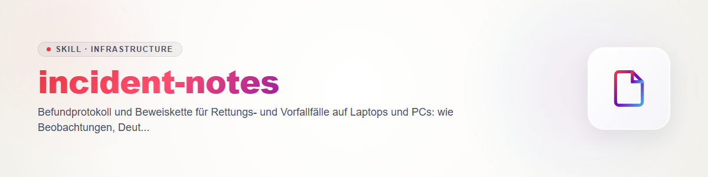

# incident-notes (English)

Without a log a rescue case cannot be reconstructed, and nobody can say later what was
changed on the device. This skill defines **what** is recorded and **how**. It is defensive
and not legal advice: if a case might be needed in court or towards an insurer, bring in
professionals before taking further steps.

## The case folder

One folder per case, named with the case ID from `rescue-intake`:

```text
case-<date>-<nr>/
  intake.md          intake (ownership, consent, mode)
  notes.md           finding log (this template, continuously)
  actions.md         action log (every change to the device)
  evidence/          collection output, image checksums, INDEX.sha256
  summary.md         summary for the owner
```

## Rules

1. **Measure time, do not estimate.** Every entry carries UTC time read from the system
   clock. If the target device's clock deviates, note the deviation once.
2. **Separate observation, interpretation, action.** What the output shows is an
   observation. What you conclude from it is an interpretation with a confidence level
   (`confirmed`, `likely`, `unclear`). What someone did to the device is an action. Mixed
   forms create false certainty.
3. **Cite the source.** Each observation names the file in the case folder it comes from
   (and the line or excerpt).
4. **Checksums.** Note the SHA-256 sum for collection output, images and backups; the sums
   are in `INDEX.sha256` or in the log. Do not modify evidence after the checksum: work on
   copies.
5. **Chain of custody.** Who had which medium or image, when? One line per handover (date
   UTC, from, to, medium, checksum verified yes/no).
6. **Every change to the device goes into the action log** before it happens (plan, state
   before, owner's confirmation, way back) and afterwards (result, state after, follow-up
   check). Nothing is "polished" afterwards: errors and setbacks stay in.
7. **Never put secrets in the log.** Passwords, keys, tokens, session cookies, card and
   account numbers are redacted (`[REDACTED]`) or not recorded at all. If a secret is
   visible in the raw material it counts as leaked and is renewed (`malware-cleanup-guide`,
   step 4).
8. **Anonymise before cloud agents.** See `rescue-intake`; the replacement table stays
   local and is not part of the log that is passed on.
9. **Negative findings count.** What was checked and showed nothing is also recorded, with
   the note that the result holds only for the scope checked.

## Template `notes.md`

```text
Case ID: ...        Handler/agent: ...        Mode: A / B
Target device clock deviates by: ... (measured UTC <time>)

| No | UTC | Type | Content | Source/evidence | Confidence |
|----|-----|------|---------|-----------------|------------|
| 1  | ... | observation    | service "X" starts from a Temp folder | evidence/services.txt l. 41 | confirmed |
| 2  | ... | interpretation | might be persistence | no. 1 | likely |
| 3  | ... | action         | service disabled, task noted | actions.md #3 | -- |

Open questions: ...
Not checked: ...
```

## Template `actions.md`

```text
#   UTC   Change (specific)   State before   Backup/image (checksum)   Confirmed by   Result   State after   Way back
```

## `summary.md` for the owner

Plain language, no jargon, in this order: what was going on (as far as known) · what was
done · what the state is now · what remains open or uncertain · what has to be done now
(passwords, updates, backups, observation) · where the documents are and when they will be
deleted. No assurance of the kind "the device is clean"; instead say what was checked and
what was not.

## Closing

Close the case only when: action log complete, checksums noted, secrets redacted, summary
handed over, retention or deletion agreed, removable medium marked as touched.
