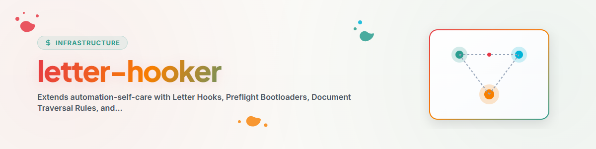

> **Français** — Version française officielle de la compétence `letter-hooker`.

# Letter-Hooker — Moteur de préchargement et gouvernance au niveau du prompt

La compétence **Letter-Hooker** étend `automation-self-care` pour les frameworks d'agents IA (tels qu'**Antigravity / Gemini CLI**) qui ne disposent pas de chargeurs natifs de hooks JSON pilotés par événements (par ex. `~/.claude/settings.json` ou `~/.codex/hooks.json`).

Au lieu de s'appuyer sur des hooks passifs à chaque frappe, `letter-hooker` exécute un **chargeur d'amorçage preflight actif au niveau du prompt et une boucle d'injection de Letter-Hooks** via des tâches planifiées et des scripts de maintenance (`scripts/agy_kontext_and_workflow_loader.py`).

---

## Capacités principales

1. **Chargeur d'amorçage preflight et règles de traversée de documents :**
   - **Recherche ascendante et descendante :** Impose des instructions strictes aux agents pour vérifier `AGENTS.md`, `CLAUDE.md`, `START.md`, `RULES.md` et `README.md` au niveau du répertoire de travail courant. En cas d'absence, remonter l'arborescence jusqu'à les trouver ; puis vérifier en descendant.
   - **Preflight Memory et Gardener :** Requête preflight obligatoire auprès de `gardener` et `memoryhooker` avant d'exécuter toute modification destructrice ou complexe.

2. **Catalogue de Letter-Hooks et liens de référence :**
   - Fichiers d'instructions modulaires `.md` sous `hooks/`.
   - Injecte des liens explicites `file://` directement dans le texte du prompt de `sidecar.json` afin que les agents lisent les protocoles exacts de sécurité et de flux de travail lors de l'invocation.

3. **Liste quotidienne de mots-clés et enrichissement auto-réparateur des prompts :**
   - Maintient un fichier quotidien `STICHWORTLISTE.json` à partir des tâches actives et en attente (standby).
   - Analyse les journaux d'exécution (`AUTOMATIONS-MEMORY.md`) à la recherche de motifs d'erreur (contexte manquant, guide de workflow absent, chemins invalides) et corrige dynamiquement les prompts des tâches.

4. **Routage des compétences et des personas :**
   - Examine les mots-clés des tâches et les associe aux `.SKILLS` adaptés (par ex. `infrastructure/condition`, `semantic-persona-routing`, `orchestrator`, `think`, `decide`).

---

## Letter Hooks principaux

- **`HOOK-DOC-TRAVERSAL-01`** : [bootloader_doc_traversal.md](hooks/bootloader_doc_traversal.md)
- **`HOOK-GARDENER-MEMORY-01`** : [preflight_gardener_query.md](hooks/preflight_gardener_query.md)
- **`HOOK-WORKFLOW-HYGIENE-01`** : [workflow_lock_and_git_hygiene.md](hooks/workflow_lock_and_git_hygiene.md)
- **`HOOK-PATH-VALIDATION-01`** : [path_validation_and_authority.md](hooks/path_validation_and_authority.md)

---

## Intégration au flux de travail

```bash
# Exécuter le moteur de maintenance Letter-Hooker
python scripts/agy_kontext_and_workflow_loader.py
```

Exécutez la commande depuis le dossier de la compétence `letter-hooker`. La liste de mots-clés est générée sous `<SYNC_DIR>/STICHWORTLISTE.json` ; `<SYNC_DIR>` est configurable dans `config.json`.

1. **Scanner les sidecars :** Lire tous les textes de prompt `sidecar.json` dans `~/.gemini/config/sidecars/`.
2. **Mettre à jour la liste de mots-clés :** Extraire les termes métier et les enregistrer dans `<SYNC_DIR>/STICHWORTLISTE.json`.
3. **Injecter les Letter Hooks :** Annexer les règles d'amorçage et les liens de référence `file://` aux prompts.
4. **Journaliser les résultats :** Consigner les mises à jour dans `ANTIGRAVITY-LOG.txt` et `ANTIGRAVITY-REGISTRY.md`.

## Journal des modifications

### 1.0.1 (2026-11-22)
- Indication de langue corrigée
