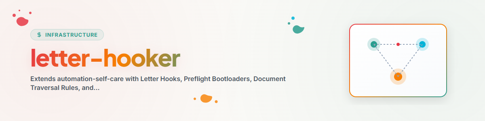

# Letter-Hooker (Motor de Preflight & Governança em Nível de Prompt)

A skill **Letter-Hooker** estende `automation-self-care` para frameworks de agentes de IA (como **Antigravity / Gemini CLI**) que não possuem carregadores nativos de hooks de ciclo de vida JSON orientados a eventos (por exemplo, `~/.claude/settings.json` ou `~/.codex/hooks.json`).

Em vez de depender de hooks passivos por pressionamento de tecla, `letter-hooker` opera um **loop ativo de injeção de Letter Hooks e bootloader de preflight em nível de prompt**, por meio de tarefas agendadas e scripts de manutenção (`agy_kontext_and_workflow_loader.py`).

---

## Capacidades Principais

1. **Bootloader de Preflight & Regras de Travessia de Documentos**:
   - **Busca ascendente e descendente**: Impõe instruções estritas para que os agentes verifiquem `AGENTS.md`, `CLAUDE.md`, `START.md`, `RULES.md` e `README.md` no nível do diretório de trabalho atual. Se estiverem ausentes, percorrer para cima até encontrá-los; em seguida, verificar para baixo.
   - **Preflight de Memory & Gardener**: Consulta de preflight obrigatória a `gardener` e `memoryhooker` antes de executar alterações destrutivas ou complexas.

2. **Catálogo de Letter Hooks & Links de Referência**:
   - Arquivos modulares de instruções `.md` em `OneDrive/.SYNC/antigravity_kontext_and_workflow_loader_package/letter_hooks/`.
   - Injeta links explícitos de `file://` diretamente no texto do prompt de `sidecar.json`, para que os agentes leiam os protocolos exatos de segurança e fluxo de trabalho ao serem invocados.

3. **Lista Diária de Palavras-chave & Enriquecimento de Prompt com Autocura**:
   - Mantém uma `STICHWORTLISTE.json` diária a partir de tarefas ativas/em espera.
   - Analisa os logs de execução (`AUTOMATIONS-MEMORY.md`) em busca de padrões de erro (contexto ausente, orientação de fluxo de trabalho ausente, caminhos inválidos) e corrige dinamicamente os prompts das tarefas.

4. **Roteamento de Skills & Personas**:
   - Verifica as palavras-chave das tarefas e as mapeia para as `.SKILLS` correspondentes (por exemplo, `infrastructure/condition`, `semantic-persona-routing`, `orchestrator`, `think`, `decide`).

---

## Letter Hooks Importantes

- **`HOOK-DOC-TRAVERSAL-01`**: [bootloader_doc_traversal.md](file:///<USER_HOME>/OneDrive/.SYNC/antigravity_kontext_and_workflow_loader_package/letter_hooks/bootloader_doc_traversal.md)
- **`HOOK-GARDENER-MEMORY-01`**: [preflight_gardener_query.md](file:///<USER_HOME>/OneDrive/.SYNC/antigravity_kontext_and_workflow_loader_package/letter_hooks/preflight_gardener_query.md)
- **`HOOK-WORKFLOW-HYGIENE-01`**: [workflow_lock_and_git_hygiene.md](file:///<USER_HOME>/OneDrive/.SYNC/antigravity_kontext_and_workflow_loader_package/letter_hooks/workflow_lock_and_git_hygiene.md)
- **`HOOK-PATH-VALIDATION-01`**: [path_validation_and_authority.md](file:///<USER_HOME>/OneDrive/.SYNC/antigravity_kontext_and_workflow_loader_package/letter_hooks/path_validation_and_authority.md)

---

## Integração de Fluxo de Trabalho

```bash
# Letter-Hooker-Wartungs-Engine ausführen
python OneDrive/.SYNC/scripts/agy_kontext_and_workflow_loader.py
```

1. **Varrer sidecars**: Ler todos os textos de prompt `sidecar.json` em `~/.gemini/config/sidecars/`.
2. **Atualizar a lista de palavras-chave**: Extrair termos técnicos e salvá-los em `.SYNC/STICHWORTLISTE.json`.
3. **Injetar Letter Hooks**: Anexar regras do bootloader e links de referência de `file://` aos prompts.
4. **Registrar resultados**: Registrar atualizações em `ANTIGRAVITY-LOG.txt` e `ANTIGRAVITY-REGISTRY.md`.
