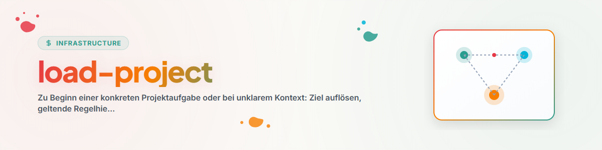

# تحميل المشروع

## الغرض

استخدم هذه المهارة عند بداية مهمة مشروع محددة، أو عندما يصبح سياق العمل غير واضح. الهدف ليس تدقيقًا كاملًا للمستودع، بل أصغر قدر من السياق الموثوق الذي يمكن بناءً عليه متابعة العمل بأمان.

## الإعدادات

لا تتطلب هذه المهارة أسماء مجلدات ثابتة. يمكن للتثبيتات المحلية أن تحدد اختياريًا القيم التالية في قواعد الوكيل العامة أو في إعداد خاص بالمشروع:

- جذور مساحات العمل المعروفة،
- أدوات الملفات المفضلة،
- أسماء ملفات تمهيد أو سجل إضافية،
- أدوات التحقق من الأقفال،
- أدوار وأولويات خاصة بالمشروع.

في حال غياب مثل هذا الإعداد، تعمل المهارة فقط بالهدف المحدد والقواعد الخاصة بالمشروع التي يمكن العثور عليها هناك.

## سير العمل

### 1. تحديد الهدف

1. اعتبار المسار الصريح أو اسم المشروع أو مساحة العمل الحالية نقطة البداية.
2. تحديد جذر المشروع أو المستودع الفعلي.
3. تضييق النتائج الغامضة بالاستناد إلى المهمة ومستندات الجذر وحدود المستودع؛ وعدم التخمين عندما تكون الأهداف مختلفة جوهريًا.

### 2. تحميل تسلسل القواعد

اقرأ من السياق العام إلى السياق المحدد:

1. قواعد الوكلاء والأمان العامة،
2. قواعد مساحة العمل أو خط المعالجة،
3. قواعد المشروع والمستودع،
4. التعليمات الخاصة بالمهمة.

تسري القواعد الأكثر تحديدًا ضمن نطاقها؛ وتبقى حدود الأمان والتفويض ذات المرتبة الأعلى سارية.

### 3. قراءة مستندات الجذر حسب الأدوار

أسماء الملفات مجرد مؤشرات وليست معيارًا ثابتًا. ابحث بشكل مستهدف عن المستندات ذات الأدوار التالية:

| الدور | المحتوى النموذجي |
|---|---|
| المدخل | الغرض والتنقل وتعليمات البداية |
| القواعد | طريقة العمل واللغة والأمان والاصطلاحات |
| البنية | المكونات وتدفق البيانات والحدود |
| الحالة | الوضع الحالي والمشكلات المفتوحة وآخر فحص |
| المهام | العمل التالي حسب الأولوية |
| السجل | المشاريع أو الفحوص أو الإصدارات المعتمدة |
| الدليل | الاختبارات وسجلات الفحص وملاحظات الإثبات |
| التسليم | العمل الجاري والتغييرات الخارجية والخطوة التالية |

حمّل فقط الأدوار ذات الصلة بالمهمة المحددة.

### 4. تتبّع المراجع الملزمة

إذا ذكرت قاعدة مقروءة ملفات أخرى صراحةً بوصفها قراءة إلزامية، فحمّلها بشكل مستهدف. أنهِ سلاسل المراجع بمجرد أنها لا توفر سياقًا ملزمًا إضافيًا للمهمة.

### 5. التحقق من الحالة والأقفال

- تحقق من الأقفال وفق السياسة المحلية: المالك والنطاق والطوابع الزمنية ومعيار الصلاحية؛ وفي غياب قاعدة محددة لاعتبار القفل منتهيًا، لا تعلن بنفسك أنه قديم أبدًا،
- حالة التحكم في الإصدارات وتغييرات الآخرين،
- العمليات الجارية أو نقاط الحفظ، عند الصلة،
- حداثة السجلات والاختبارات وبيانات الحالة.

احفظ حالة البداية للمجالات المتأثرة قبل إجراء أي تغيير بوصفها خط أساس للحالة/الفروق. إذا تعذر إسناد التغييرات الموجودة إلى مصدرها بأمان، فاعتبرها احترازًا تغييرات الآخرين وأبقِها دون مساس.

تعامل مع اللقطات بوصفها لقطات لحظية، وأعد التحقق منها قبل الإجراءات المحفوفة بالمخاطر.

### 6. إعداد تقرير الوضع

قبل التنفيذ، سجّل بإيجاز:

```text
Ziel:
Projekt-Root:
Geltende Regeln:
Evidenzquellen:
Snapshot-Zeitpunkt:
Relevanter Ist-Zustand:
Locks oder fremde Änderungen:
Erfolgskriterium:
Nächster sicherer Schritt:
```

اذكر المصادر بالقدر الضروري فقط لإمكانية التحقق. احجب الأسرار والبيانات الشخصية والمحتوى السري، ولا تنسخها إلى تقرير الوضع.

إذا كانت المهمة واضحة ومصرّحًا بها بعد ذلك، فتابع العمل مباشرةً.

## الحدود

- لا بحث واسع وغير مقيّد في الملفات بوصفه الإجراء الافتراضي.
- لا تخترع قواعد أو سجلات مفقودة.
- لا تعامل رسالة حالة قديمة على أنها دليل حالي.
- لا تكتب فوق تغييرات الآخرين.
- لا تنفذ تهيئة للمشروع إذا كان المطلوب فقط تحميل السياق لمهمة محددة.

## سجل التغييرات

### 1.1.0 (2026-07-28)
- إزالة الارتباطات الثابتة بالمستخدم ومساحة العمل والأداة والمزوّد.
- إدخال اكتشاف المستندات حسب الأدوار والإعداد المحلي الاختياري.
- تفعيل صلاحية الأقفال، وتتبع مصدر شجرة العمل المتسخة، وأدلة اللقطات، وتقارير الوضع المحجوبة.

### 1.0.0 (2026-06-17)
- النسخة المحلية الأولية.
